# eExchange (Exchange8 Trading App) - Detailed Design Document

> Wire-level design for the Exchange8 Flutter app `apps/eexchange`.
> Overview: `README.md`. Business functionality: `BUSINESS.md`.

## 1. Scope & Context

**Owns:**

- The Flutter presentation layer for the Exchange8 trader/ops surfaces:
  `main.dart` (bootstrap), `shell/app_shell.dart` (navigation +
  `BffClientScope`), `bff/bff_client.dart` (client façade, scope map,
  SSE surface, client-side caches), `pages/` (blotter, order entry,
  depth ladder, tape, ops).
- The app-local caches (`order_cache`, per-symbol books, per-symbol
  tapes) fed by SSE and read by pages.
- The app's BFF channel map (`/proxy/exchange8/v1/*` paths and
  `/subscribe/exchange8/*` topics as consumed by the pages).

**Does NOT own (delegated):**

| Concern | Owner |
|---|---|
| HTTP + SSE transport, OAuth bootstrap, token custody | `sdk/flutter/sentin8_flutter` (`Bff8ApiClient`) |
| Token issuance, session, step-up authentication | Sentin8:Auth (via BFF) |
| Token exchange/down-scoping, proxy routing, tenant resolution | Sentin8:BFF |
| Order matching, books of record, market data | Exchange8 services (gateway, me, md) |
| Halts, busts, surveillance cases | Exchange8 services (gateway/clearing, surveillance) |
| Admin surfaces (market-state wall, cascade, sessions, feeds) | Sentin8:Dash RFW pages (per-service `/v1/admin/ui/*`) |
| App-Store listing contract | `app-listing.json` → Sentin8:App |

**System context** - the app sits at the platform edge; the trust
boundary is the device edge. Everything past `Bff8ApiClient` is a
BFF-proxied call carrying the user's session (never a raw service token):

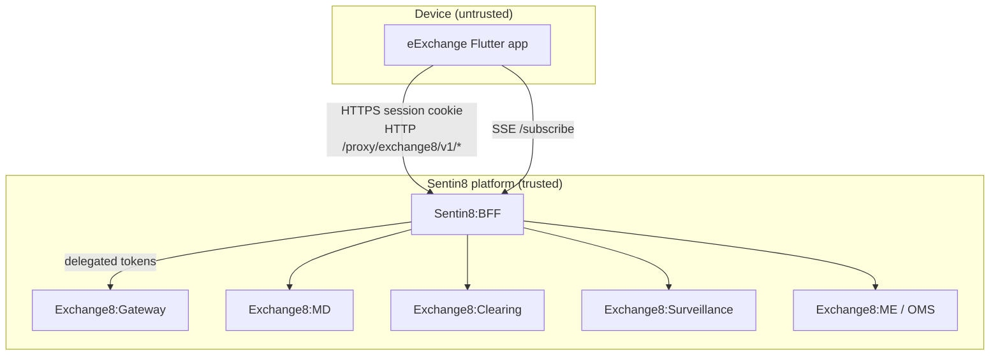

**Container view** - internal module grouping (presentation / client / transport):

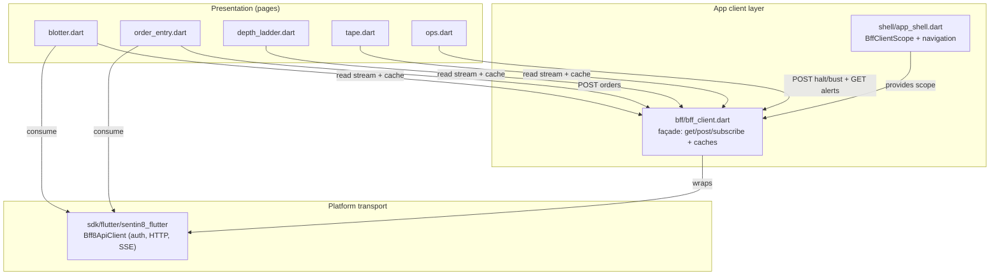

## 2. Runtime Architecture

The app runs a single widget tree. `main()` boots `EExchangeApp`
(MaterialApp, Royal Gold seed, Inter font) whose home is `AppShell`.
`AppShell` holds the navigation index and constructs the one
`Bff8ApiClient` façade, exposing it via `BffClientScope`; pages resolve it
with `BffClientScope.of(context)`. Each page is either a `StreamBuilder`
over an SSE channel (blotter, depth, tape), a form posting to the BFF
(order entry, bust), or a `FutureBuilder` over a GET (alerts list).

**Component view:**

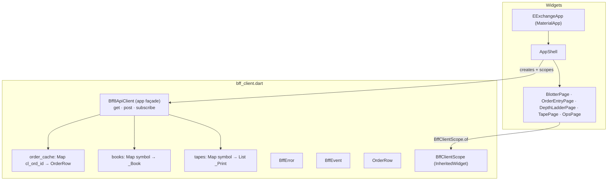

**Request lifecycle - order submission (mutation family):**

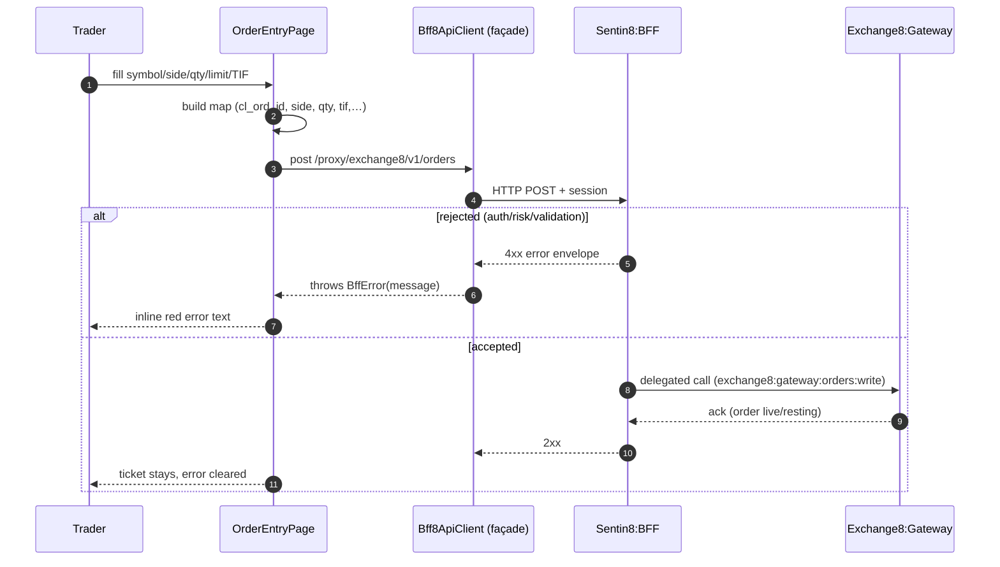

**Request lifecycle - market data consumption (subscription family):**

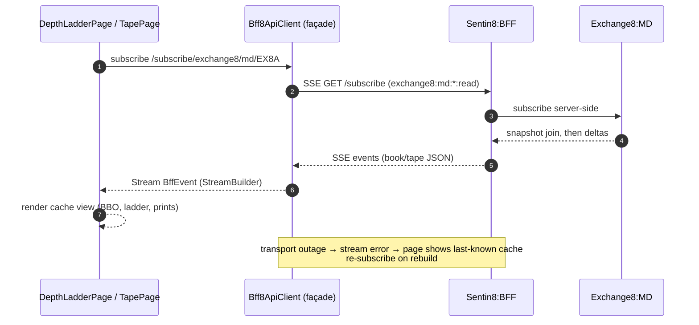

## 3. Data Model

The app owns **no server tables**. Its "data model" is client-side,
in-memory, façade-owned and rebuilt from SSE on app start:

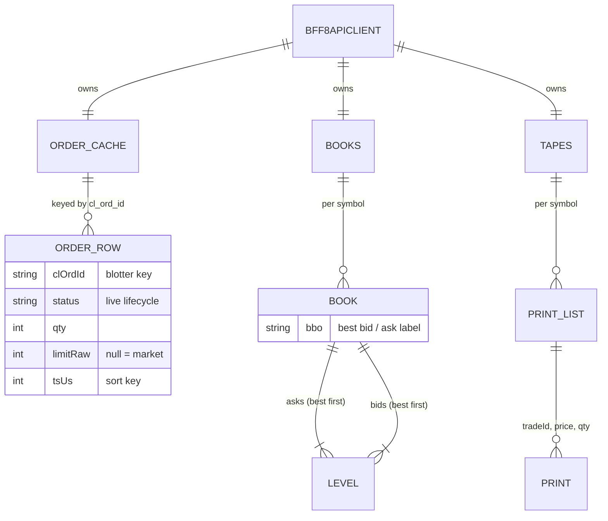

- `orderCache: Map<String, OrderRow>` - keyed by `cl_ord_id`; sorted by
  `ts_us` at render time (newest first), never stored pre-sorted.
- `_Book` per symbol - `asks`/`bids` lists of `_Level(price, qty)`, BBO
  label best-of-list (`'-'` for a side with no levels).
- `_Print` - trade id, price, qty; render-capped at the latest 50.
- Persistence: none. Server state lives in Exchange8 schemas (`gateway.*`,
  `me.*`, `md.*` - owned by the respective services, out of scope); the
  client is a pure projection that refills from SSE snapshot joins.

## 4. API Surface

The app owns no server-side API; the contract below is what it **consumes**
(wire shapes per owning service's `DESIGN.md`.

| Audience | Call (via façade) | Contract | Gate (scope) | App behavior |
|---|---|---|---|---|
| Trader | `POST /proxy/exchange8/v1/orders` | map: `cl_ord_id`, `symbol`, `side`, `qty`, `limit_raw?`, `tif` | `exchange8:gateway:orders:write` | error inline; blotter updates via SSE |
| Trader | SSE `subscribe('/subscribe/exchange8/orders')` | order lifecycle deltas | `exchange8:gateway:orders:read` | blotter rows update |
| Trader | SSE `subscribe('/subscribe/exchange8/md/{symbol}')` | snapshot join + book/tape deltas | `exchange8:md:marketdata:read`, `exchange8:md:snapshot:read` | ladder + tape render |
| Ops | `POST /proxy/exchange8/v1/admin/instruments/{symbol}/state` | `{status: H\|O}` halt/resume | admin scope (exchange8:gateway admin set) | result text per button |
| Ops | `POST /proxy/exchange8/v1/trades/bust` | `{trade_id}` | `exchange8:clearing:trades:*` (step-up enforced server-side) | result text |
| Ops | `GET /proxy/exchange8/v1/surveillance/cases` | case list (`detector`, `severity`) | surveillance read scope | alert list |

**Event flow the app participates in** (client is a pure SSE consumer -
no outbox of its own; the server outbox → Bus chain belongs to each
service's design):

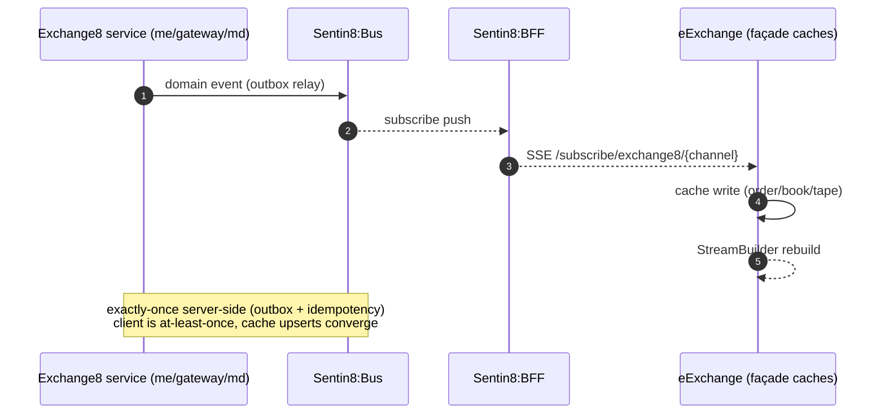

## 5. Cross-Cutting Concerns

- **Authentication/token verification** - not in-app. The platform transport
  (`sdk/flutter/sentin8_flutter` `Bff8ApiClient`) owns sign-in, session
  cookie, and refresh against Sentin8:Auth via the BFF; the app never sees
  a token. Pages assume an authenticated scope from bootstrap.
- **Tenant resolution / tenancy** - the BFF resolves org/env from the
  session and sets RLS context on the called service; the app sends no
  `env_id` and never selects tenants itself (org-env picker is a shell
  concern of the platform library).
- **Authorization** - decided server-side (Shield per service). The app's
  scope map is a UI-gating hint only; a page neither assumes nor enforces
  authorization.
- **Idempotency** - order submission is idempotent on `cl_ord_id` (gateway
  dedupe). SSE events are at-least-once; façade cache writes are key
  upserts so replays converge.
- **Failure surfacing** - every mutation path catches `BffError` and
  renders the message inline; SSE failures surface as last-known caches,
  never as crashes.
- **TLS posture** - device→BFF always HTTPS, post-quantum TLS terminated at
  Sentin8:Proxy; the app participates by never disabling certificate
  validation.

**Authorization & error path (mutation):**

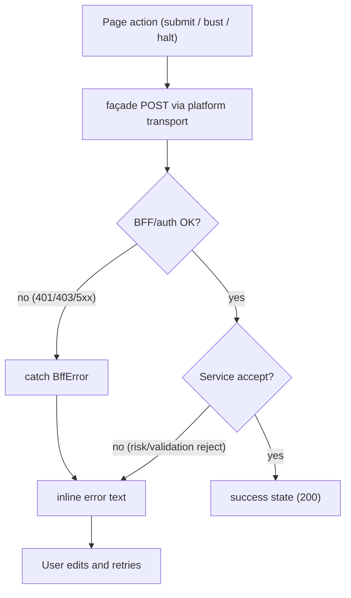

## 6. Failure Modes & Recovery

| Failure path | Behavior | Recovery |
|---|---|---|
| BFF HTTP 4xx/5xx on mutation | `BffError` thrown → page `catch` → inline message | user corrects + resubmits |
| Network drop during POST | transport throws → same client path | retry with same `cl_ord_id` is safe (idempotent) |
| SSE stream breaks (BFF restart, network) | `StreamBuilder` sees error/done; caches stay last-known | page re-mount/re-subscribe; snapshot join refills book/tape |
| Order/bust rejected (risk, validation) | error envelope message displayed | no cache mutation - rejected orders never enter the blotter |
| Token/session expiry | transport surfaces error on next call | platform shell re-authenticates (sign-in flow) |
| App relaunch | caches empty | SSE snapshot joins + GET-backed pages refill; no persistence by design |

**Transport outage / re-subscribe loop:**

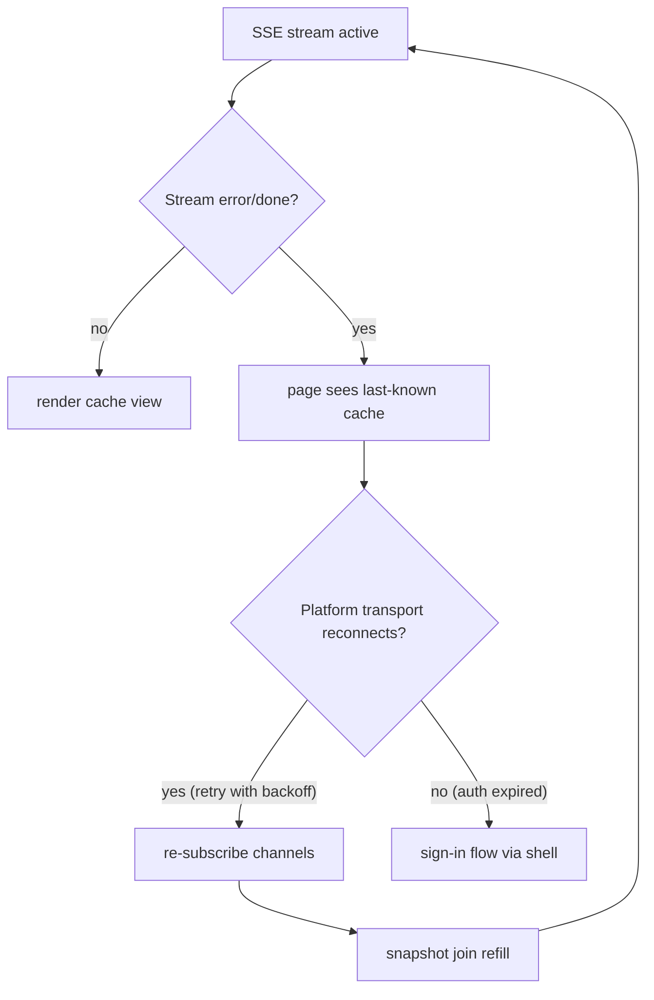

## 7. Concurrency & Performance Model

Single isolate (UI thread) - no background isolates: workloads are bounded
JSON decode + list slicing. Flutter drives rendering; the façade is a
synchronous cache with async I/O at the boundary:

- `orderCache`, `_books`, `_tapes` are plain `Map`s mutated on the UI
  isolate only (SSE events land via the platform transport on the same
  isolate) - no locks needed.
- Render caps: ladder shows top 10 levels per side; tape renders the
  latest 50 prints; blotter renders the bounded live-order map.
- SSE events rebuild pages via per-page `StreamBuilder`; one subscription
  per visible page, no shared broadcast fanout in-app.
- Backpressure: SSE is push; client writes are O(1) key upserts, tape
  windows are bounded by the render cap on read (older prints drop out).

**Task/channel topology (Flutter isolate + streams):**

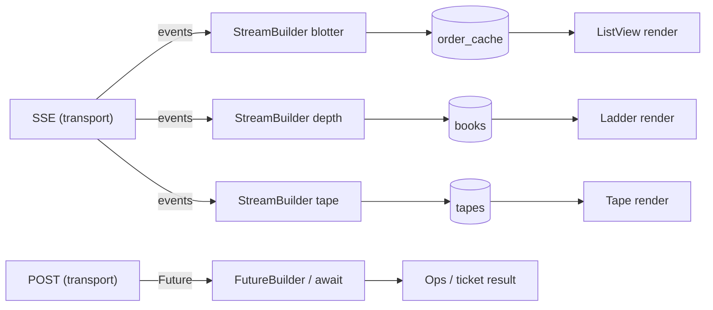

## 8. Invariants, Insecure-Defaults Rejected, Unsafe Rationale

Invariants (always true):

1. Exactly one `Bff8ApiClient` façade per widget tree, provided by
   `BffClientScope`; pages never construct clients.
2. All backend access goes through the BFF paths in §4 - no direct service
   host may ever appear in app code.
3. No OAuth token, session key, or FIX credential is stored, logged, or
   persisted in the app.
4. Façade caches are written only by SSE handlers inside the façade;
   pages read-only.
5. Blotter keys are unique `cl_ord_id`s; a repeated event for the same key
   is an overwrite (idempotent upsert), never a duplicate row.
6. Mutation failures surface as inline UI text, never as unhandled
   exceptions or navigation away from user input.
7. Market-data render slices are bounded (10 levels, 50 prints) regardless
   of cache growth.

Insecure defaults rejected:

- Direct service HTTPS from the app (bypassing BFF) - rejected: leaks
  topology and forces client-side token custody.
- Persisting the session/token in local storage - rejected; custody stays
  with the platform transport and session cookie.
- Client-side authorization as the only gate - rejected; scopes are
  re-decided server-side on every call (Shield).
- WebSocket for depth/tape - rejected: unnecessary bidirectional transport
  for one-way subscriptions.

No `unsafe` constructs exist (Dart/Flutter app; no FFI, no platform
channels in app code).

## 9. Testing Strategy

- **Widget tests** (`test/` - pending): page rendering with a faked
  `Bff8ApiClient` injected via `BffClientScope` - form submit posts the
  expected body; SSE-fed caches render as ladder/tape/blotter rows; error
  envelopes render inline rather than throwing.
- **Golden tests** (pending): design-system conformance (Royal Gold
  accent, Inter, glass panels) per `sentin8-design-system.md`.
- **Platform unit tests** - façade logic (cache upsert, BBO label, sort
  order) is pure Dart and unit-testable without widgets.
- **E2E UI suite** (`exchange8/e2e-ts`, Playwright, UI-only, BFF-proxied -
  never direct DB/backend): sign-in → order entry → blotter sees the order
  → depth/tape render from sim fills → bust (step-up) → alerts list. This
  suite owns app verification against the live BFF; widget tests do NOT
  replicate integration.
- **Deliberately NOT tested here:** server-side scope enforcement, SSE
  fanout, matching semantics - each is tested in the owning service's
  suite; e2e covers the whole path end-to-end.

**Test pyramid:**

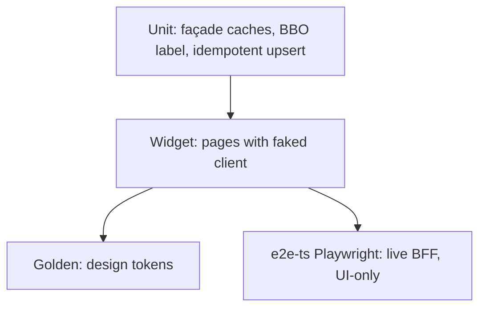

## 10. Open Questions

- Transport bootstrap (sign-in + org-env picker inside the app shell vs.
  the platform library owning the whole flow) is not settled.
- Whether the app adds the two-way trader channel (WebSocket tier) for
  order-flow streams beyond the current SSE-only surfaces.
- Peg/iceberg parameters on the ticket, and cancel/amend + history on the
  blotter, wait on the corresponding gateway REST contract for the app.
- Golden-test fixtures need asset decisions (bundled fonts vs. system
  Inter) before they can be pinned.

---

**Design attribution:** exchange8:eexchange and its underlying concepts were designed by Hamid Jahanzad <Hamid@Jahanzad.com>.

