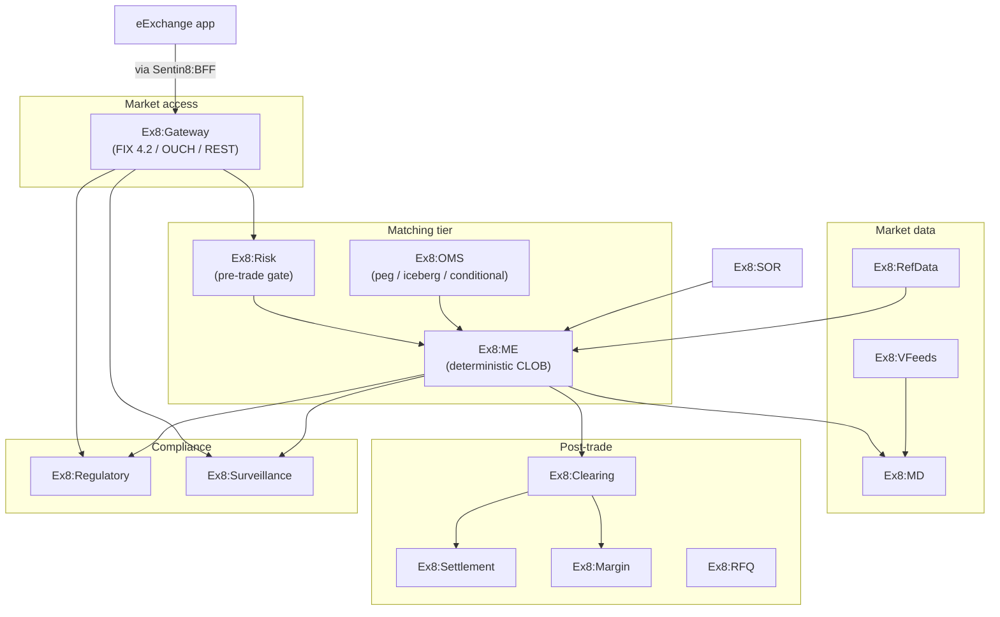

# Exchange8 — the capital-markets vertical

Exchange8 is a full exchange / MTF / ATS platform on Sentin8:
fourteen Rust services covering market access (FIX/OUCH), a
deterministic matching engine, peg and conditional order supervision,
smart order routing, clearing, margin, market data, reference data,
regulatory reporting, and surveillance — plus the eExchange trading
app.

## The products

| Tier | Products |
|---|---|
| Access | [Gateway](/docs/products/gateway) |
| Matching | [ME](/docs/products/me) · [OMS](/docs/products/oms) · [Risk](/docs/products/risk) |
| Routing | [SOR](/docs/products/sor) · [VFeeds](/docs/products/vfeeds) |
| Post-trade | [Clearing](/docs/products/clearing) · [Settlement](/docs/products/settlement) · [Margin](/docs/products/margin) |
| Quote-driven | [RFQ](/docs/products/rfq) |
| Data | [MD](/docs/products/md) · [RefData](/docs/products/refdata) |
| Compliance | [Regulatory](/docs/products/regulatory) · [Surveillance](/docs/products/surveillance) |

## Security

Exchange8 inherits the platform's five pillars and adds market
guarantees: deterministic matching, synchronous pre-trade
authorization on every order, event-sourced books, and surveillance
as a first-class tier. Read the [security page](/docs/security).