# DESIGN.md: Exchange8:Clearing - Detailed Design Document

## 1. Scope & Context

### Owned

Exchange8:Clearing owns the deterministic order/trade ledger of the exchange8
vertical: the event-sourced projection of ME/SOR/Gateway order and trade
lifecycle events, the trade query/bust API, the short-sale locate ledger
(pure core), the drop-copy fan-out engine (pure core + persisted resend
store), the regulatory-stream and bust-compensation projections (pure
cores), and the drop-buffer purge policy (pure policy, executed through the
Sentin8:Cron proxy-back). It owns schema `clearing` in database `exchange8`
and every table in it, plus the `clearing.outbox` and `clearing.audit_journal`
durability tables.

### Not owned (delegated)

- Order authorization, matching, and execution - Exchange8:ME (authoritative event
  source).
- Risk pre-trade checks, shortable flags, margin - Exchange8:Risk, Exchange8:Margin.
- Regulatory formatting/transport of reportable events - Exchange8:Regulatory
  (Clearing emits state-relevant events).
- CCP novation files, custody, collateral, give-up, block trades, EOD
  settlement exports - Exchange8:Settlement.
- Money movement - the Bank8:Ledger rail.
- Scheduling of SOD/EOD/purge jobs - Sentin8:Cron (Clearing exposes the pure
  policy; Cron proxy-backs the DELETE).
- Identity, tokens, JWKS - Sentin8:Auth (the only issuer).
- Policy decisions - the Shield engine (`sentin8-policy`) embedded via the
  shell; the `scope` JWT claim is the pre-filter, never the decision.
- Object/file storage (SOD/EOD artifacts) - Sentin8:Storage.

### System context

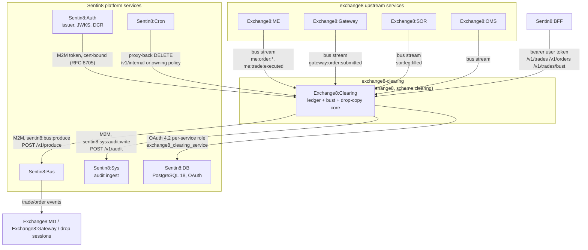

### Container view

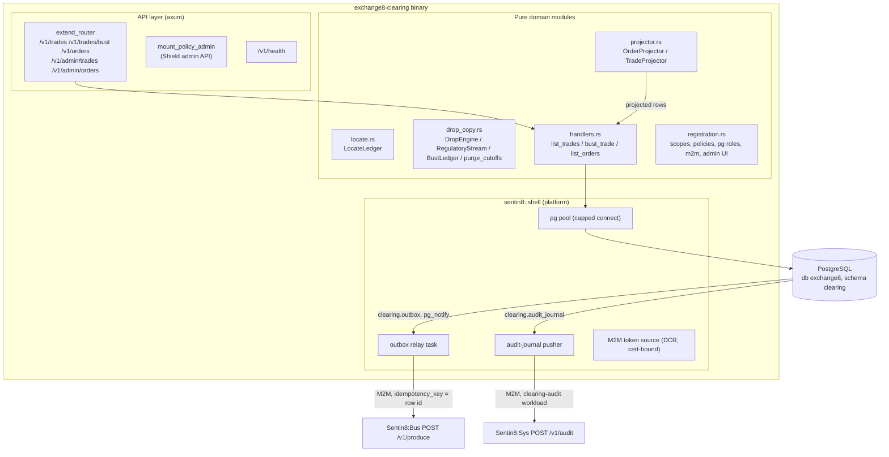

## 2. Runtime Architecture

The binary boots via `sentin8::shell::serve` with service type
`exchange8:clearing` and env prefix `EXCHANGE8_CLEARING`. The shell owns
registration output, the DB pool (`connect` capped at 3 unless
`SENTIN8_PG_POOL_MAX` overrides), `/v1/health`, the Shield admin API mount,
the mimalloc global allocator, and graceful drain on upgrade. The vertical
router adds the ledger handlers; registration declares the admin UI pages,
admin scopes, error code, policy sets, PostgreSQL role, and the M2M workload
grants.

### Component diagram

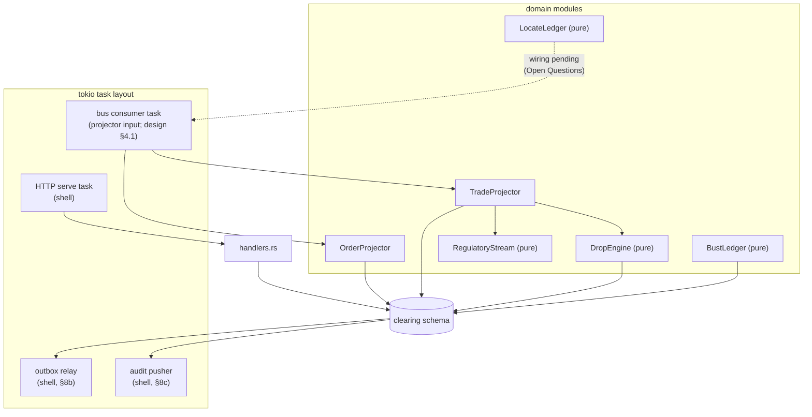

### Request family: trade capture → projection

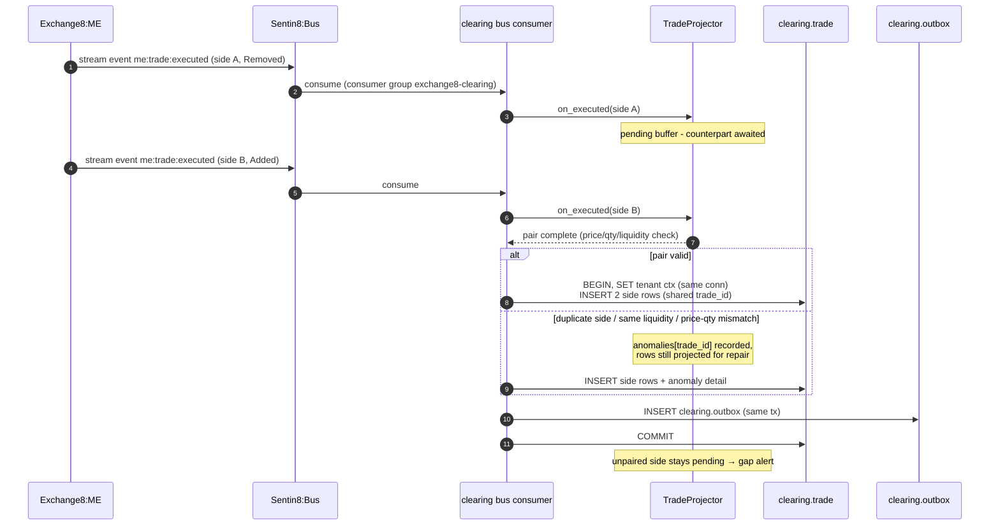

### Request family: locate request / grant (pure core; wiring in Open Questions)

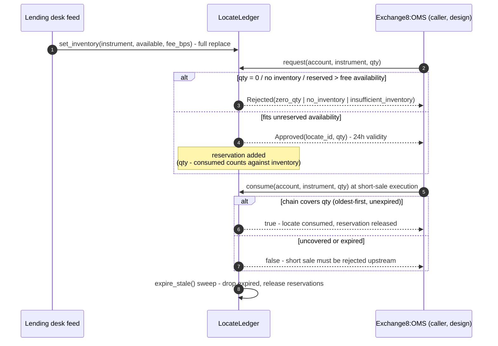

### Request family: drop-copy emission (pure engine; session transport in Open Questions)

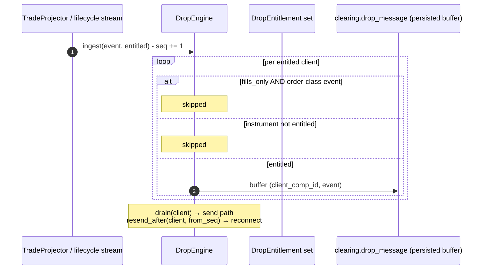

### Request family: admin trade bust (HTTP)

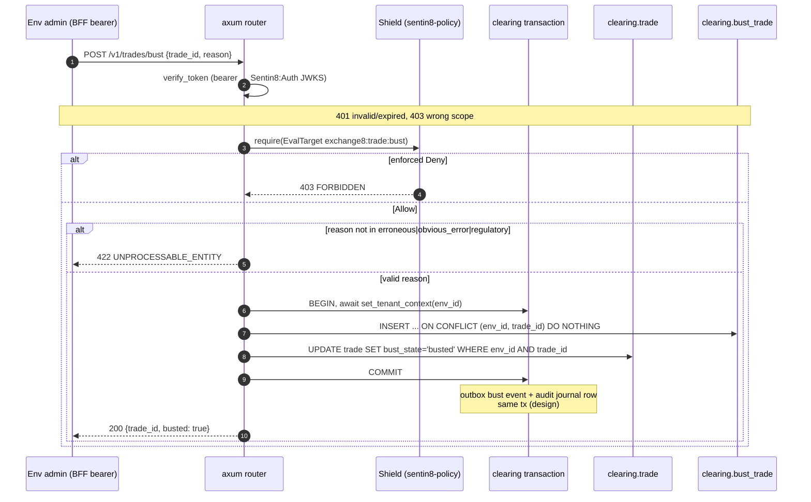

### Request family: admin RFW / query API

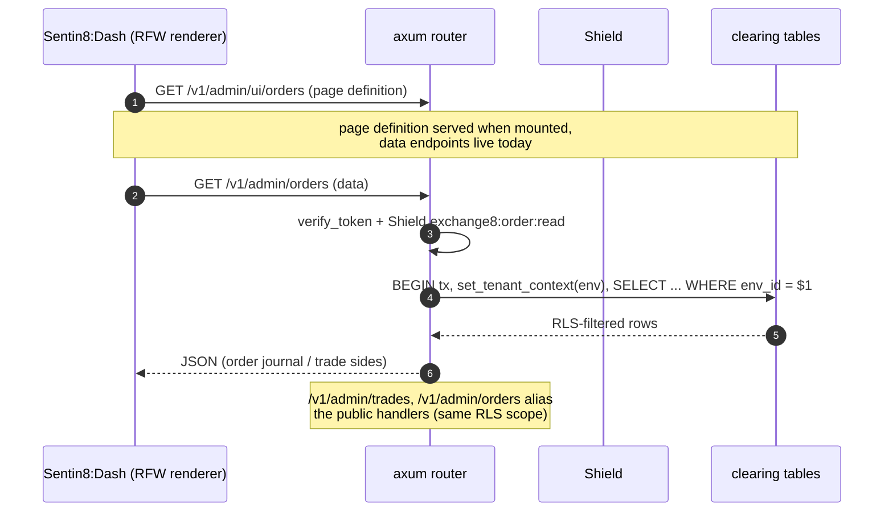

## 3. Data Model

Schema `clearing`, database `exchange8`; the service role is
`exchange8_clearing_service` (search_path = `clearing, public`, SELECT/INSERT/
UPDATE/DELETE on all tables in the schema; no BYPASSRLS). Every tenant table
carries `env_id` and is `ENABLE`+`FORCE`d under RLS with
`sentin8_context_initialized() AND env_id = sentin8_current_env_id()`
policies for select/insert/update/delete.

### Entity-relationship diagram

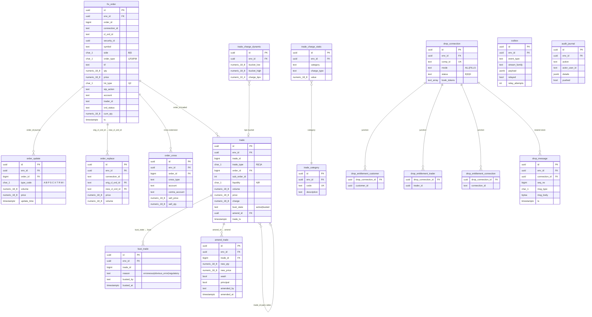

### Per-table notes

| Table | Purpose | Visibility / notes |
|---|---|---|
| `clearing.fix_order` | Order day log (FIX order journal): one row per accepted order with cl_ord_id, side/type/TIF, qty/price, ord_status, cum_qty. | RLS env-scoped; UNIQUE (env_id, order_id); indexes on (env, connection, ts) and (env, symbol). |
| `clearing.order_update` | Append-only lifecycle journal with one-letter type codes (A/B/P/S/C/X/T/R/M/I). | RLS env-scoped; index (env, order_id). |
| `clearing.order_replace` | Replace mapping: orig ↔ new cl_ord_id with price/volume. | RLS env-scoped. |
| `clearing.order_cross` | Cross-extension record. | RLS env-scoped. |
| `clearing.trade` | Executions, one row per side, shared trade_id; liquidity A (Added/maker) / R (Removed/taker); charge on the row. | RLS env-scoped; UNIQUE implicit (env, trade_id, side) via indexes; bust_state in (active, busted). |
| `clearing.bust_trade` | Bust records; UNIQUE (env_id, trade_id) - the idempotency key. | RLS env-scoped; reason CHECK (erroneous, obvious_error, regulatory). |
| `clearing.amend_trade` | Amend records (qty/price/wash/principal). | RLS env-scoped; referenced by trade.amend_id (UUID). |
| `clearing.trade_charge_static` / `_dynamic` / `trade_category` | Charge tables preserved for commission-at-trade-time. | RLS env-scoped; category code UNIQUE. |
| `clearing.drop_connection` | Drop session config: comp_id (UNIQUE), mode ALL/FILLS, status E/D/H, book_tokens text[]. | RLS env-scoped. |
| `clearing.drop_entitlement_customer` / `_trader` / `_connection` | Entitlement junctions (customer, trader, originating-connection parity). | RLS env-scoped; FK to drop_connection; PK (drop_connection_id, entity). |
| `clearing.drop_message` | Drop resend store (seq per connection, msg_type + body). | RLS env-scoped; UNIQUE (connection_id, seq_no) - the resend dedupe/idempotency key; retention-purged at 2555 days. |
| `clearing.outbox` | Local outbox (DBX): rows committed in the same transaction as domain writes; relay pushes to Bus `POST /v1/produce` with idempotency_key = row id; `pg_notify('clearing_outbox_changed')`. | RLS env-scoped; partial index on unrelayed rows. |
| `clearing.audit_journal` | Local audit journal (DBX); the shell pusher pushes to Sys `POST /v1/audit` (`sentin8:sys:audit:write`). | RLS env-scoped; partial index on unpushed rows. |

### State diagrams

Locate lifecycle (pure core):

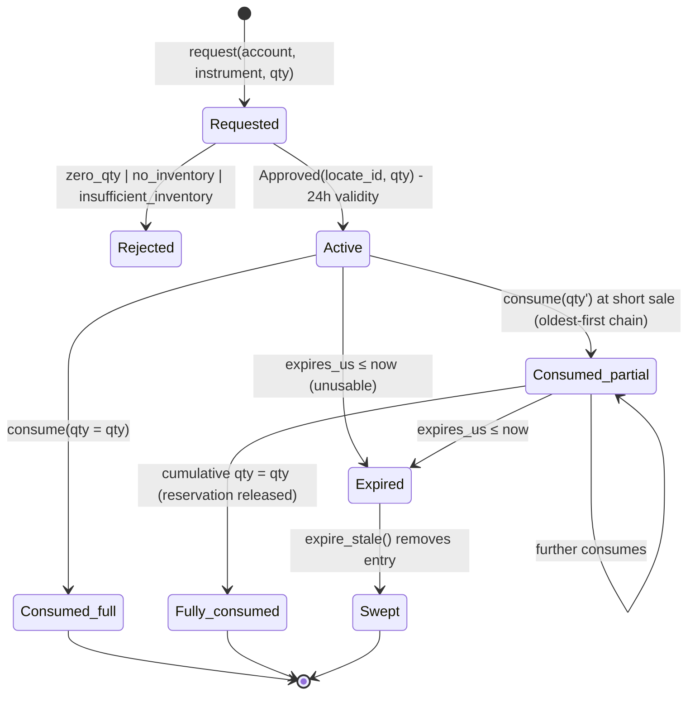

Drop connection lifecycle:

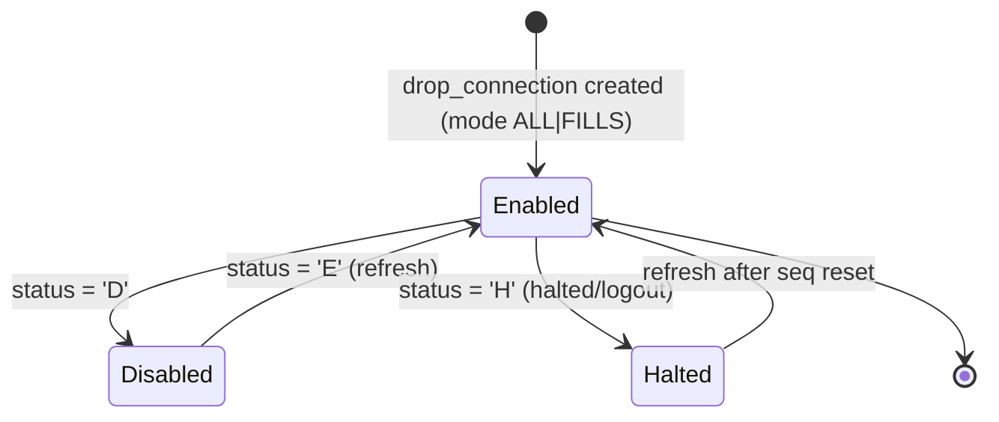

## 4. API Surface

### Public (env-scoped, bearer user or M2M token)

| Endpoint | Method | Shield scope gate | Emits |
|---|---|---|---|
| `/v1/trades?trade_id&security_id&since&limit` | GET | `exchange8:trade:read` (mirror also accepts `exchange8:trade:all`, `exchange8:trade:bust`, platform-admin scopes) | none (query) |
| `/v1/orders?trade_id&limit` | GET | `exchange8:order:read` (mirror also accepts `exchange8:order:all`, platform-admin scopes) | none (query) |
| `/v1/trades/bust` | POST | `exchange8:trade:bust` (step-up; platform-admin scopes accepted) | bust event via outbox (target family `exchange8:clearing:trade:busted`); `exchange8_trade_already_busted` 409 code declared |

Errors are the platform `(StatusCode, String)` mapping: 401 unauthenticated
(plain-text auth message), 403 Shield denial, 404 unknown path, 405 wrong
method, 422 invalid bust reason, 409 already busted (declared error code).
`GET /v1/health` is the shell health endpoint.

### Internal (consumed / produced)

- **Bus consume (consumer group `exchange8-clearing`)** - M2M scopes
  `sentin8:bus:produce`, `sentin8:bus:consume`; stream families carry
  `exchange8:me:order:{booked,killed,modified,executed,rejected,repriced}`,
  `exchange8:me:trade:executed`, `exchange8:gateway:order:submitted`,
  `exchange8:sor:leg:{filled,...}`.
- **Bus produce (outbox relay)** - `POST /v1/produce`, idempotency_key =
  `clearing.outbox.id`; event names follow
  `exchange8:{service}:{resource}:{operation}` (e.g. bust →
  `exchange8:clearing:trade:busted`; drops → `exchange8:clearing:drop:sent`).
- **Sys audit push** - `POST /v1/audit` (`sentin8:sys:audit:write`, workload
  `clearing-audit`).
- **Sys hostname resolve (TLS)** - workload `exchange8-clearing-tls`,
  `GET /v1/resolve/hostname` (`sentin8:sys:instances:read`); this service's
  TLS path is database-free.
- **Cron proxy-back** - purge of `clearing.drop_message` (2555-day
  retention); the pure `purge_cutoffs` policy is what Cron executes against.
- **Shield policy admin** - mounted by the shell (`mount_policy_admin`);
  admin scopes `exchange8:clearing:policy:read` / `exchange8:clearing:policy:write`.

### Multi-party: bust → bus fan-out (me → clearing → bus)

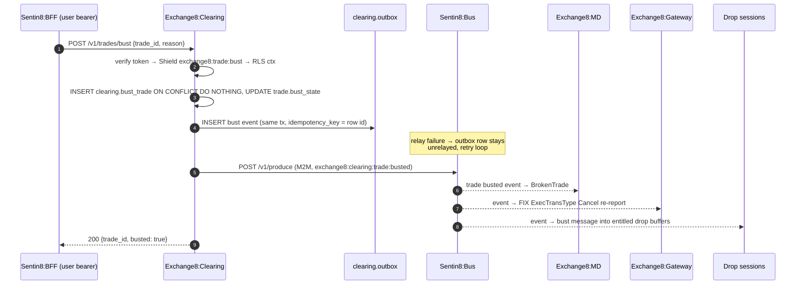

### Event-flow: outbox → Bus → trigger

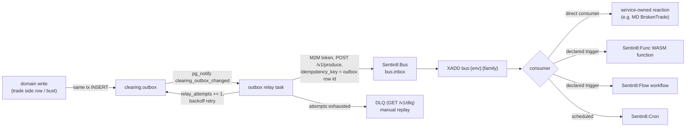

## 5. Cross-Cutting Concerns

### Authentication & authorization

The standard 8-step pipeline per request: bearer extract → verify
(issuer/signature/expiry/audience, Sentin8:Auth JWKS) → tenant resolve →
feature gate → **Shield authorize** (`sentin8-policy::EvalTarget`
`exchange8:trade:read|exchange8:trade:bust|exchange8:order:read`) → RLS
context → execute → audit. The mirror policy set covers every handler action
(test-enforced), and the enroll-time dry-run gate refuses a set that denies
its own grants. M2M tokens evaluate the same sets; the token type never
bypasses policy.

### Tenant resolution & RLS context

`set_tenant_context` is awaited inside a transaction opened on the acquired
pool connection; the handler query runs on that same transaction. The SQL
side is `sentin8_set_tenant_context(...)` (transaction-local
`set_config(..., true)`); policies use `sentin8_context_initialized() AND
env_id = sentin8_current_env_id()`. Handlers add explicit `WHERE env_id = $1`
as defense-in-depth. The `exchange8_probe` NOBYPASSRLS role proves the
enforcement in the SQL matrix tests.

### Idempotency & exactly-once

| Surface | Key | Semantics |
|---|---|---|
| Trade bust | `(env_id, trade_id)` on `clearing.bust_trade` | `ON CONFLICT DO NOTHING`; replay marks the trade rows anyway; declared 409 `exchange8_trade_already_busted` |
| Trade pairing | `trade_id` pair state | Duplicate/same-liquidity sides recorded as anomalies, not duplicates |
| Drop resend | `(connection_id, seq_no)` on `clearing.drop_message` | UNIQUE - replayed send is rejected |
| Regulatory stream | `(kind, id)` set | at-least-once in → exactly-once out |
| Outbox produce | `clearing.outbox.id` | Bus dedupe on idempotency_key |

### Rate limiting / bot protection

Inherited from the platform tier (Sentin8:Proxy / BFF) - the service exposes
no public ingress of its own and performs no per-request throttling beyond
query `LIMIT` caps (`trades` ≤ 1000 rows, `orders` ≤ 500 rows per page).

### Audit journaling

Domain mutations (bust) write `clearing.audit_journal` rows in the same
transaction where available; the shell pusher (workload `clearing-audit`,
`sentin8:sys:audit:write`) forwards to Sys `POST /v1/audit` with retry -
a Sys outage never drops audit (unpushed partial-index drain loop).

### Graceful drain (upgrade-instance)

The shell drains in-flight requests and background tasks before the
captain's upgrade-instance swap completes; the outbox relay and audit pusher
resume from their partial indexes (relayed=false / pushed=false) after
restart, so a drain mid-relay loses nothing.

### TLS posture

Post-quantum-exclusive TLS via the `sentin8-tls` library: X25519MLKEM768 key
exchange, ML-DSA-65 signatures, SLH-DSA root in the OS trust store. The
`exchange8-clearing-tls` M2M workload is database-free - hostname resolution
runs through Sys `GET /v1/resolve/hostname` (scope
`sentin8:sys:instances:read`) with a TTL cache; no platform-DB DSN is held.

## 6. Failure Modes & Recovery

| Failure | Behavior |
|---|---|
| Projector lag/stop | Watermark/DLQ alerts; replay from bus stream ranges; projections are pure functions so replays are deterministic |
| Duplicate events | Idempotent upserts: bust on (env, trade), drop on (connection, seq_no), outbox on row id; mismatches land in the projector anomaly list |
| Drop session loss | Reconnect + resend after the persisted `clearing.drop_message` seq |
| Outbox relay outage | Rows stay `relayed = false`; `relay_attempts` increments with backoff; DLQ + manual replay past the cap |
| Sys audit outage | Journal rows stay `pushed = false`; pusher retries until drained |
| Pool saturation | Shell pool cap (default 3, `SENTIN8_PG_POOL_MAX` override) fails fast; `make stop` frees connections before a rebuild |
| Process crash mid-transaction | Transaction rollback leaves no domain rows and no outbox row (atomicity); after restart the relay resumes unrelayed rows |
| ME malformed pair (dup side / same liquidity / mismatch) | Anomaly entry `(trade_id, reason)` persists; sides still project (data preserved for repair) |

### Projector crash + replay recovery

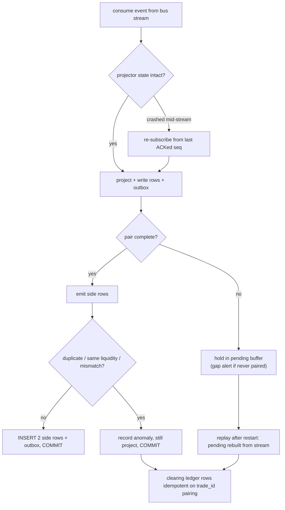

### Relay retry + DLQ recovery

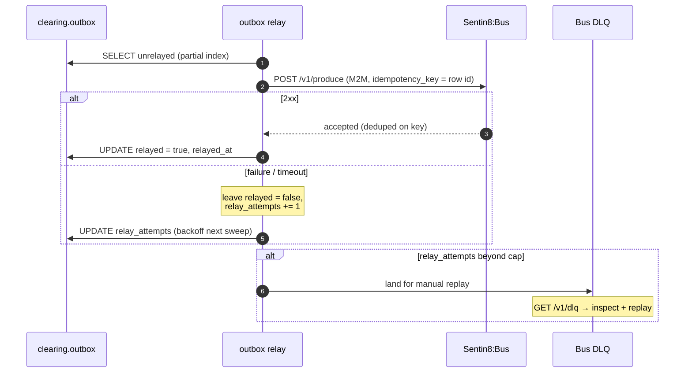

## 7. Concurrency & Performance Model

- **Task layout.** One HTTP serve task (axum + shell middleware), one outbox
  relay task (LISTEN-based drain of `clearing.outbox`), one audit pusher
  task, and one bus consumer task feeding the projectors. All workers are
  in-process tokio tasks, covered by the binary-level mimalloc allocator.
- **Locking strategy.** No cross-service locks; per-transaction consistency
  only. The projector's pairing state is single-consumer (one consumer group
  task), so the trade-projector maps need no shared mutex. The DB is the
  shared state; idempotency UNIQUE constraints are the race authorities.
- **Pool sizing.** `sentin8_config::pg_pool::connect` caps at 3 connections
  (`SENTIN8_PG_POOL_MAX` override) - protect the ~20-service cluster from
  pool exhaustion; handlers use one short transaction each.
- **Hot path.** Trade projection (2 side rows per trade) - batching and the
  outbox partial indexes make relay drain cheap; queries are index-backed on
  `(env_id, trade_ts)`, `(env_id, trade_id)`, `(env_id, order_id)`,
  `(env_id, connection_id, ts)`.
- **Backpressure.** Consumer-group flow control bounds projector lag; the
  outbox is the durability buffer when Bus is slow or down (rows accumulate,
  notify-driven drain catches up).

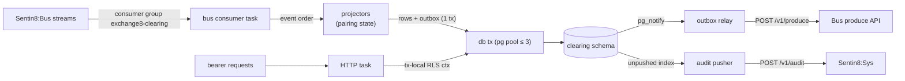

## 8. Invariants, Insecure-Defaults Rejected, Unsafe Rationale

**Always-true conditions (state, ordering, uniqueness):**

1. Every ME execution projects two side rows sharing one `trade_id`, one per
   liquidity; a side seen after pair completion or a same-liquidity pair is an
   anomaly, never silently repaired.
2. Pair completion order preserves taker-then-maker; `pending` holds
   one-side-arrived trades only.
3. A locate's approved qty ≤ free availability at issue time; outstanding
   reserved qty (qty − consumed) always counts against inventory for NEW
   requests; issued locates are never revoked by an inventory shrink.
4. locate consumption is oldest-first per (account, instrument) chain, and an
   expired locate is unusable until swept.
5. Bust is idempotent per `(env_id, trade_id)`; the trade rows are marked
   `busted` regardless of whether the bust row already existed.
6. Ledger and outbox write atomically - no committed domain row without its
   outbox row (when emitted by that write path), and vice versa.
7. RLS is FORCEd on every `clearing` table including outbox and audit
   journal; the service role has no BYPASSRLS; context and query share the
   transaction.
8. Drop resend sequence is per `(connection_id, seq_no)` and strictly
   increasing; buffer order is preserved.
9. Purge deletes only `clearing.drop_message` rows older than the retention
   cutoff (2555 days) - never another service's tables.

**Insecure defaults rejected:** plaintext provider/credentials rows (all
session credentials are Sentin8-issued, revocable); cross-schema DELETE for
purge; vertical process holding a platform-DB DSN (the TLS path is
database-free via Sys hostname resolve); BYPASSRLS on any role; a bust
without step-up scope; a projector that rewrites history instead of
appending.

**Unsafe rationale:** no `unsafe` blocks exist in this unit's source; the
crate is pure Rust over the platform shell.

## 9. Testing Strategy

### Test pyramid

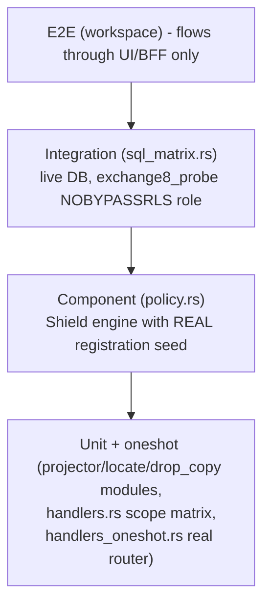

- **Unit / pure cores** (`projector.rs`, `locate.rs`, `drop_copy.rs`
  `#[cfg(test)]`): type-code round trip; journal projection (B/X, R+M pair,
  A+X reject, I reprice); trade pairing, anomalies (duplicate side,
  same-liquidity, price/qty mismatch), bust idempotence; drop fill/order
  filtering and instrument entitlement; regulatory dedupe/day-sequence; bust
  authorization/idempotence; purge cutoff arithmetic + saturation; locate
  approve/consume/expire/reservation math.
- **Oneshot HTTP** (`tests/handlers_oneshot.rs`): the real router with a
  never-connected pool - 401 before any DB touch, 405/404 route shape, plain
  text auth error envelope.
- **Component policy** (`tests/policy.rs`): the Shield engine on the REAL
  `SCOPE_MIRROR_POLICIES` seed - fail-closed no-set deny, enforced no-match
  deny, shadow never blocks, forbid-over-permit, M2M parity, platform-admin
  scopes pass, role-keyed tenant sets, cross-env isolation, mirror covers
  every handler action, enroll dry-run.
- **Integration SQL** (`tests/sql_matrix.rs`, live DB, `exchange8_probe`
  NOBYPASSRLS): every table from init.sql FORCE RLS + a select policy,
  silent zero-row without context, insert reject without context, own-env
  visibility exactly once, cross-env invisibility. Skips hermetically
  offline.
- **Deliberately not tested here:** FIX wire encoding crate-bytes (owned by
  the wire/FIX crates), platform TLS/DR patterns, gateway/me behavior, and
  the drop FIX session transport (session transport is not yet wired - see
  Open Questions).

## 10. Open Questions

- **Bus consumer + projector→DB wiring.** The pure processors exist and are
  proven, but the consumer task that feeds them from
  `exchange8:me:order:*` / `exchange8:me:trade:executed` /
  `exchange8:gateway:order:submitted` / `exchange8:sor:leg:filled` streams
  and writes the projected rows is not mounted in `main.rs`. Registration
  grants `sentin8:bus:produce`/`consume`, but `event_triggers` is empty.
- **Bust event emission point.** `bust_trade` writes `clearing.bust_trade`
  and updates `clearing.trade.bust_state` but does not write an outbox row in
  the same transaction; the intended `exchange8:clearing:trade:busted`
  fan-out (MD BrokenTrade, gateway FIX re-reports, drop messages) has no
  producing write path yet.
- **Amend endpoint.** `clearing.amend_trade` exists, but no HTTP amend
  endpoint or event (`exchange8:clearing:trade:amended`) is wired.
- **Drop session transport.** Registration declares
  `exchange8:drop:sent` naming and the admin UI data endpoint
  `/v1/admin/drops`, but no `/v1/admin/drops` handler nor outbound FIX
  4.2 session transport, session ops (refresh/seq reset/trace/logout), or
  drop send path is implemented; the pure `DropEngine` is the core only.
- **Regulatory stream ownership.** The pure `RegulatoryStream` core exists
  here, per the narrowing that moved regulatory transport to Exchange8:Regulatory;
  whether Clearing persists reportables or only emits events for Regulatory
  to persist is not visible from this source tree.
- **Routing-trades.** The design references `exchange8_routing_trade(+_amend)`
  for SOR-routed fills; no `routing_trade` table exists in init.sql - either
  the ledger is SOR-agnostic today or the table lives elsewhere; the sources
  do not show a `routing_trade` projection input.
- **Locate persistence + feed adapter.** No locate table in this schema; the
  borrowing inventory feed adapter (securities-lending desk / prime-broker
  API) and the consume-at-execution hook into OMS/ME are unwired.
- **Novation/collateral/give-up/block trades.** Real-time CCP novation
  (`exchange8:clearing:trade:novated`), collateral management
  (`exchange8:clearing:collateral:updated`), give-up/give-in, and
  block-trade/EFP capabilities from the clearing-depth design are absent
  from this source tree and are future designs for this unit or
  Exchange8:Settlement.
- **Bust scope naming.** The clearing design doc names
  `exchange8:trade:bust:execute`; the registered and enforced scope is
  `exchange8:trade:bust`, and the mirror also permits bust holders to read
  (a deliberate read-implication of the bust step-up grant).
- **SOD/EOD job wiring.** Sentin8:Cron schedules for SOD sequence seeding and
  EOD purge/trailers are declared in the design but the Cron entry points for
  this service are only the purge policy function today.

---

**Design attribution:** exchange8:clearing and its underlying concepts were designed by Hamid Jahanzad <Hamid@Jahanzad.com>.

