# DESIGN.md: Exchange8:Gateway - Detailed Design Document

## 1. Scope & Context

Exchange8:Gateway owns:

- **Client session lifecycle** - the `gateway.connection` rows (CompID,
  status, protocol, cancel-on-disconnect flag, vendor/beneficiary,
  certification state, price-protection mode, risk-bypass flag, book
  tokens) and the per-connection FIX state it implies.
- **FIX 4.2 session protocol** - logon negotiation, sequence integrity,
  gap handling, resends, heartbeat/test-request, logout; plus the OUCH
  binary codec subset and the BFF REST/WebSocket order shapes.
- **ExecutionReport conversion** - matching-engine lifecycle events → FIX
  35=8 field selection for the owning client session.
- **Order routing at the front door** - validated `ExchangeOrder`s are
  dispatched to Exchange8:ME (limit/market), the Exchange8:OMS peg supervisor
  (pegged), or Exchange8:SOR (strategy tokens + `ex_destination`); the gateway
  assigns `gw_order_id` from leased sequence blocks.
- **Session admin surface** - connection listing, sequence-state reads and
  admin sequence resets, Shield policy admin via the shared shell mount.
- **Durable session support** - `gateway.fix_session_state` (counters) and
  `gateway.fix_message` (resend store), the local `gateway.outbox` (Bus
  relay) and `gateway.audit_journal` (Sys audit pusher).

Exchange8:Gateway explicitly does NOT own:

- Matching, peg pricing, or routing strategy (Exchange8:ME / Exchange8:OMS / Exchange8:SOR).
- Pre-trade risk authorization in depth - the submission pipeline calls the
  Exchange8:Risk pre-check; the gateway performs only shape validation.
- Trade/ledger persistence (events go to the bus; Exchange8:Clearing sinks them).
- Instrument reference data (Exchange8:RefData resolves symbols).
- Identity, JWT issuance, or FIX session-key issuance (Sentin8:Auth); the
  gateway only verifies keys issued by Auth against `secret://` references.
- Market-data publication (Exchange8:MD) or vendor feeds (Exchange8:VFeeds).

System context - trust boundaries are the platform (Sentin8 services,
shared trust root, M2M clients) vs the exchange8 vertical (gateway +
domain services + the vertical database):

```mermaid
graph TD
    subgraph Market["Market participants - external"]
        FIXC["FIX 4.2 OMS / prop desk"]
        OUCHC["OUCH binary client"]
        VENDOR["Vendor virtual session - tag 115 beneficiary"]
    end

    subgraph Platform["Sentin8 platform - sys/ops env"]
        PROXY["Sentin8:Proxy - SNI to exchange8-gateway.{env}.{org}.{tld}"]
        BFF["Sentin8:BFF - /proxy/exchange8/v1/*"]
        AUTHZ["Sentin8:Auth - issuer, JWKS, session keys, DCR"]
        SHIELD["Sentin8:Policy - Shield policy sets"]
        BUSX["Sentin8:Bus - POST /v1/produce + SSE consume"]
        SYSX["Sentin8:Sys - POST /v1/audit, GET /v1/resolve/hostname"]
    end

    subgraph Vertical["exchange8 vertical"]
        GW["Exchange8:Gateway - exchange8-gateway"]
        ME2["Exchange8:ME"]
        OMS2["Exchange8:OMS"]
        SOR2["Exchange8:SOR"]
        RISK2["Exchange8:Risk - pre-trade authorize"]
        DBX[("PostgreSQL - db exchange8, schema gateway")]
    end

    FIXC -- "FIX 4.2 over TLS, session-key logon" --> PROXY
    OUCHC -- "OUCH frames over TLS" --> PROXY
    VENDOR -- "FIX with OnBehalfOfCompID 115" --> PROXY
    BFF -- "REST/WS bearer-token calls" --> PROXY
    PROXY -- "TLS terminated in-process, X-Sentin8-* injected" --> GW
    BFF -- "REST /proxy/exchange8/v1/orders" --> GW
    GW -- "bearer verify, secret://exchange8/fix/{comp} resolve" --> AUTHZ
    GW -- "Shield evaluate per request" --> SHIELD
    GW -- "RLS-scoped SQL, pool capped" --> DBX
    GW -- "M2M: exchange8:gateway, bus:produce" --> BUSX
    GW -- "M2M: gateway-audit, sys:audit:write" --> SYSX
    GW -- "ExchangeOrder dispatch" --> ME2
    GW -- "pegged route" --> OMS2
    GW -- "strategy + ex_destination route" --> SOR2
    GW -- "risk pre-check hook (pipeline step 4)" -.-> RISK2
```

Container view - the service internals grouped by layer:

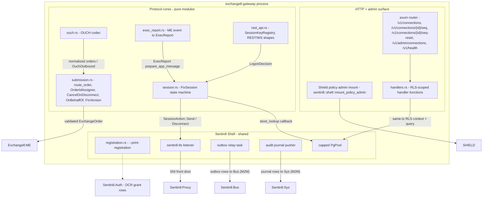

## 2. Runtime Architecture

The binary is a thin tokio shell: `main.rs` constructs
`Sentin8Shell::new("exchange8:gateway", "EXCHANGE8_GATEWAY")` with the
registration printer, simple state, and the extended router; the shell then
serves the HTTP/TLS surface, mounts the Shield admin API, and spawns the
platform workers (outbox relay - boot step 8b, audit pusher - boot step 8c)
in-process; the gateway never duplicates them. The state closure additionally
spawns the service's own runtime wiring (`runtime_wiring::spawn_tasks`): the
logon key gate arm, the FIX/OUCH TLS acceptor tasks, and the retention Cron
schedule registration. The mimalloc global allocator covers all of them since
they are binary-level tasks, not separate processes.

Components:

- **HTTP router (axum)** - the connection-management API:
  `GET /v1/connections`, `GET /v1/connections/{id}/seq`,
  `POST /v1/connections/{id}/seq-reset`, the admin/RFW surface
  (`/v1/admin/sessions` GET+POST stop, `/v1/admin/sessions/{id}/stop`,
  `/v1/admin/messages`, `GET /v1/admin/ui/{page}`), the `/ws` order-entry
  upgrade tier, the Sentin8:Cron proxy-back
  (`POST /v1/internal/schedules/run`), plus the shared
  `sentin8::shell::mount_policy_admin` Shield surface and `/v1/health`.
- **FIX acceptor task** - a dedicated `sentin8::tls::TlsListener` bound to
  `EXCHANGE8_GATEWAY_FIX_PORT` (env-injected, the captain port contract): one
  connection task per accepted TLS client; the TLS handshake runs inside the
  connection task so a stalled peer never delays the acceptor. The OUCH
  acceptor task is the same listener pattern on
  `EXCHANGE8_GATEWAY_OUCH_PORT` (SoupBinTCP-framed packets ride the same
  submission pipeline).
- **Logon key gate** - the per-process `SessionKeyRegistry` armed at boot
  from the secret reference chain (`secret://exchange8/fix/{comp}`, resolved
  via the shared `sentin8-secrets` backends): the env list rides the
  owner-side platform helper `public.sentin8_outbox_unrelayed_envs('gateway')`
  (SECURITY DEFINER, env UUIDs only) and rows read per-env inside
  transactions whose tenant context is set on the same connection. An
  unresolvable reference skips its comp; a failed bootstrap leaves the
  registry unarmed, which rejects every logon (fail-closed).
- **Session supervisor registry** - the per-process map of live connection
  ids → stop channels; the admin stop handler delivers through it. The
  `FixSession` itself is per-connection-task state (single owner - no shared
  mutable counters across sessions; §7).
- **`FixSession` protocol core** - one state machine per client
  connection; the connection task loads counters from
  `gateway.fix_session_state`, feeds decoded `FixMessage`s to `on_message`,
  executes the returned `SessionAction`s on the socket, persists stamped
  outbound frames (counter advance + store insert in ONE transaction) before
  transmit, and drives the logon-window (10 s) and heartbeat read-timeout
  (1.3× the clamped interval) timers.
- **Submission pipeline** - `route_order` shape validation + routing,
  `OrderIdAssigner` leasing blocks from the platform sequence facility, the
  `CancelOnDisconnect` registry, and `OnBehalfOf` attribution. The RISK
  PRE-CHECK (`POST /v1/authorize`, sync, fail-closed) is the documented
  cross-service seam - `route_order` performs the shape stage only; the
  endpoint is owned by Exchange8:Risk (its router does not mount it yet - §10).
- **Typed event envelopes** - `events.rs` (the refdata convention): the five
  vocabulary constants + the ME cancel-all mirror, the `EventIdentity` block,
  and the envelope builders; emissions pair with the domain persistence in
  the SAME transaction (`insert_outbox_row_with_publisher`) - the relay
  (shell boot 8b) pushes committed rows to Bus `POST /v1/produce`.
- **Execution-report conversion** - `exec_report.rs` turns ME lifecycle
  events (OrderAccepted, OrderBooked, OrderExecuted, OrderModified,
  OrderKilled, TransactionRejected, OrderRepriced) into `ExecReport` field
  sets; the connection task frames them through the session
  (`prepare_app_message`) and persists them to the resend store.
- **REST/WS shapes** - `rest_api.rs` request/response contracts for the
  BFF surface, `SessionKeyRegistry` for the logon gate; the `/ws` upgrade
  decodes the crypto submit frames into the same submission pipeline.
- **Retention executor** - `runtime_wiring::retention`: the recurring
  `fix-message-purge` Sentin8:Cron schedule registered through the DCR'd
  `gateway-cron` M2M workload (cert-bound, `sentin8:cron:write`; the mirror
  admits the scope on the dedicated
  `exchange8:gateway:fix-message:purge` action); the fire proxy-backs to
  `POST /v1/internal/schedules/run`, which executes the batched per-env
  DELETE (envs from the owner-side helper, per-env RLS context on the same
  transaction, bounded 5000-row batches) on the service's own schema; the
  fire journals an audit-execute row. Scheduling owner is Sentin8:Cron - no
  embedded scheduler loop.
- **Shell workers** - outbox relay (`gateway.outbox` → Bus
  `POST /v1/produce`, M2M token, idempotency key = row id) and the audit
  pusher (`gateway.audit_journal` → Sys `POST /v1/audit`,
  `sentin8:sys:audit:write`); both retry independently of the request path.
- **TLS posture** - TLS is terminated in-process by the `sentin8-tls`
  library (post-quantum X25519MLKEM768 key exchange, ML-DSA-65
  signatures); Sentin8:Proxy routes by SNI and injects the
  `X-Sentin8-*` context headers, which the service reads after stripping
  any client-supplied copies.
- **Registration** - `registration::print` emits service_type
  `exchange8:gateway`, subdomain `exchange8-gateway`, health path
  `/v1/health`, the `scope-mirror` Shield policy set (origin platform,
  mode enforced), PG role `exchange8_gateway_service` (db `exchange8`, no
  `cross_schema_grants`), admin scopes, error codes
  (`exchange8_logon_rejected` → 401, `exchange8_seq_too_low` → 400), the
  admin UI pages (`sessions`, `messages`) and the seven M2M grant entries
  (service, policy pair, audit, cron, tls).

Request family 1 - FIX logon:

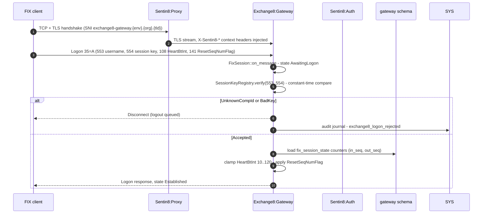

Request family 2 - new order submission (FIX path, shape stage):

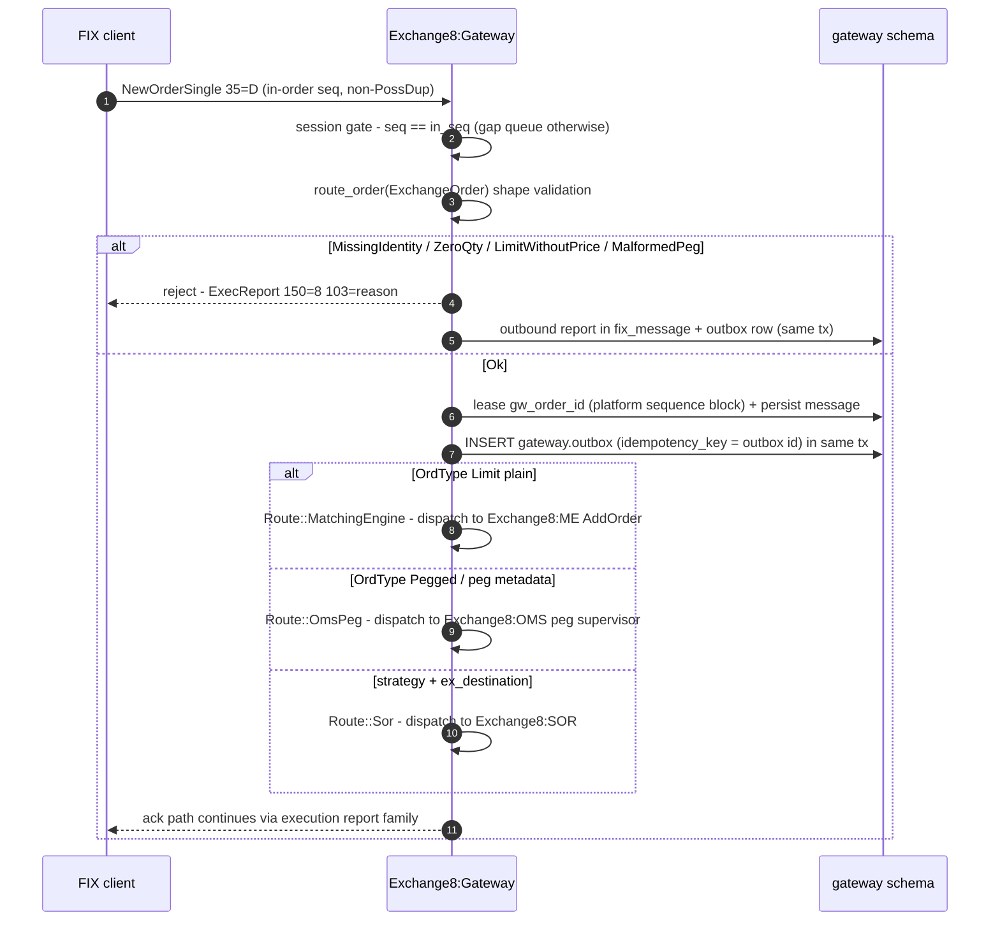

Request family 3 - execution-report path (downstream events → client):
the gateway is the recipient of ME lifecycle events; each event is
converted by `exec_report.rs` into the FIX field selection, the session
stamps the outbound sequence (`prepare_app_message`), the frame is
persisted to `gateway.fix_message` (resend window) plus the domain write
and an outbox row in the same transaction, then transmitted; resend
requests replay from the store with `PossDupFlag=43=Y`.

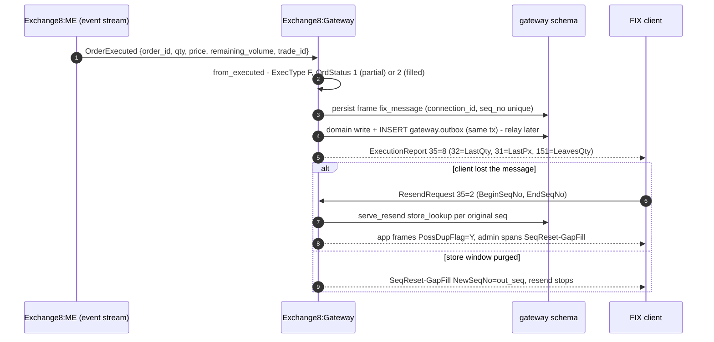

Request family 4 - REST order via Sentin8:BFF:

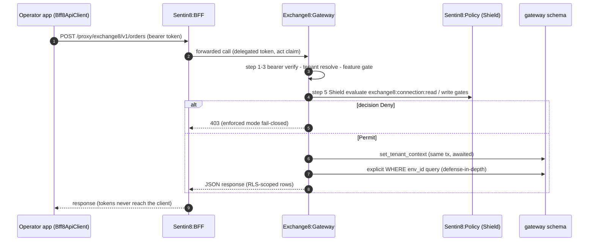

## 3. Data Model

Schema `gateway` in database `exchange8`; role `exchange8_gateway_service`
(no BYPASSRLS, no cross-schema grants) owns all reads and writes. All
tables are tenant tables with `ENABLE` + `FORCE ROW LEVEL SECURITY`
matching `env_id = sentin8_current_env_id()` after
`sentin8_set_tenant_context(...)` is awaited on the same connection.

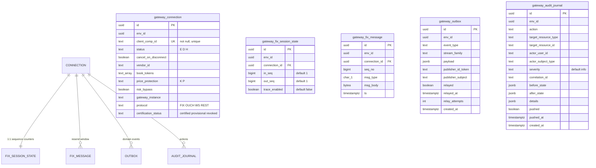

Per-table notes:

| Table | Visibility tier | Notes |
|---|---|---|
| `gateway.connection` | env-scoped RLS; select/insert/update/delete policies | `client_comp_id` globally unique; supports FIX/OUCH/WS/REST protocol values; `risk_bypass` and `cancel_on_disconnect` are connection-level flags honored by the pipeline |
| `gateway.fix_session_state` | env-scoped RLS, `UNIQUE (env_id, connection_id)` | persisted in/out counters; `trace_enabled` diagnostic toggle; admin seq-reset writes both counters via `UPDATE ... RETURNING` |
| `gateway.fix_message` | env-scoped RLS, `UNIQUE (connection_id, seq_no)` | the resend window - outbound application frames as BYTEA with 1-char msg_type; retention-purged (purge window is the resend limit) |
| `gateway.outbox` | env-scoped RLS (select/insert/update) | generated `sentin8_outbox::outbox_table_sql("gateway")`; partial index on unrelayed rows; `gateway.gateway_notify_outbox()` fires `pg_notify('gateway_outbox_changed')` after insert |
| `gateway.audit_journal` | env-scoped RLS (single combined policy) | generated `sentin8_audit::audit_journal_sql("gateway")`; partial index on unpushed rows; pushed by the shell M2M audit workload |

Secret-reference-only rule: no FIX logon key, access token, or private
key material is ever stored in any of these tables - credentials are
Sentin8-issued session keys referenced as `secret://exchange8/fix/{comp}`
and resolved out-of-band at session start; `msg_body` carries wire frames
only, never secrets.

FIX session lifecycle - the `SessionState` machine persisted per
connection:

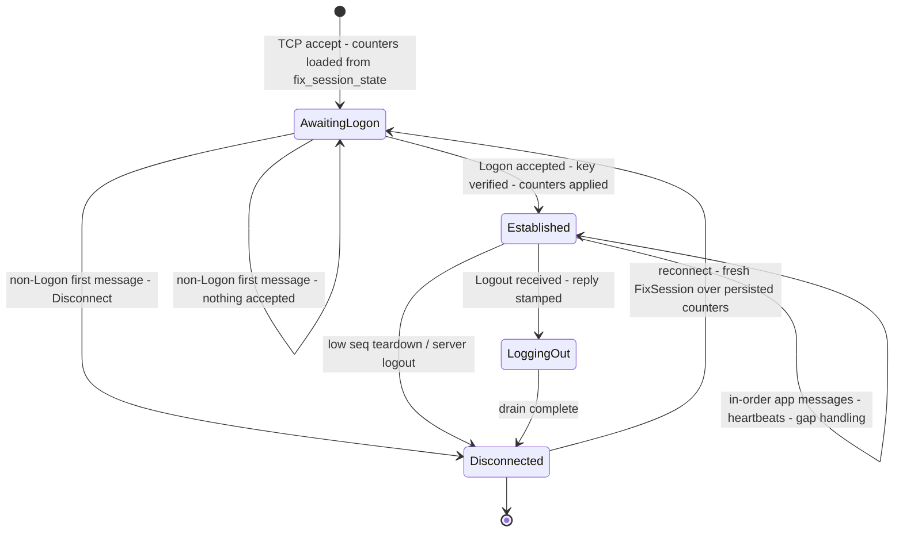

## 4. API Surface

Authorization pattern for every HTTP handler: bearer verify
(`sentin8::shell::verify_token`) → Shield evaluate
(`sentin8::shell::policy::require` against a named action) → RLS context
on the same transaction (awaited `set_tenant_context`) → explicit
`WHERE env_id` clause → commit. The declared Shield policy set
`scope-mirror` seeds the equivalent permits with origin `platform`, mode
`enforced`; tenant sets and `sentin8:sys:*` admin scopes participate in
the same decision.

### FIX session surface (order entry - protocol ports)

| Surface | Direction | Gate / credentials | Notes |
|---|---|---|---|
| FIX 4.2 logon | over TLS | `SessionKeyRegistry.verify` - UnknownCompId/BadKey → reject (`exchange8_logon_rejected`) | HeartBtInt clamped 10–120; `ResetSeqNumFlag 141=Y` restarts counters |
| FIX app messages | in-order stream | session established | NewOrderSingle / cancel / replace decoded to `ExchangeOrder`, then the submission pipeline |
| FIX admin messages | in-order stream | session established | TestRequest→Heartbeat, ResendRequest served from store, SequenceReset-GapFill accepted forward |
| OUCH enter/replace/cancel | over TLS | same session keys, `protocol='OUCH'` | codec → normalized order → same pipeline |
| Resend window | on outbound | session established | original sequence numbers preserved |

### REST / BFF surface (HTTP)

| Endpoint | Method | Shield action | Emitted events |
|---|---|---|---|
| `GET /v1/connections` | GET | `exchange8:connection:read` | connection query (audit journal) |
| `GET /v1/connections/{id}/seq` | GET | `exchange8:connection:read` | sequence-state read |
| `POST /v1/connections/{id}/seq-reset` | POST | `exchange8:connection:write` | admin reset (400 below 1; `exchange8_seq_too_low` error code vocabulary) + audit journal `Update` row |
| `GET /v1/admin/connections` | GET | `exchange8:connection:read` | RFW data alias of list_connections |
| `GET /v1/admin/sessions` · `POST /v1/admin/sessions/{id}/stop` (RFW data + stop action) | GET / POST | `exchange8:connection:read` / `write` | stop journals an audit `Update` row; the live-session registry delivers the logout |
| `GET /v1/admin/messages` | GET | `exchange8:connection:read` | the resend-window store rows (`messages` page data) |
| `GET /v1/admin/ui/{page}` | GET | the page's declared action (`sessions`/`messages` → `exchange8:connection:read`) | RFW page-definition JSON (Dash renders) |
| `POST /v1/internal/schedules/run` | POST | `exchange8:gateway:fix-message:purge` (mirror admits `sentin8:cron:write`) | retention purge (audit journal `Execute` row) |
| `POST /proxy/exchange8/v1/orders` (BFF) | POST | BFF-enforced `exchange8:gateway:orders:write` | domain validation via `RestOrderRequest::validate` |
| `GET /v1/orders/{id}` (status echo shape) | GET | BFF-enforced `exchange8:gateway:orders:read` | FIX 39 status echo |
| `POST /v1/orders/{id}/cancel` (cancel shape) | POST | BFF-enforced `exchange8:gateway:orders:write` | `RestCancelResponse` |

Admin/other surfaces: `/v1/health` (health), the shared Shield policy
admin mount (scope pair `exchange8:gateway:policy:read` /
`exchange8:gateway:policy:write` under role `exchange8:gateway:admin`),
and the registered RFW pages `sessions` / `messages`
(`/v1/admin/ui/{page}`) whose definitions the service serves as JSON
(data endpoints above; the RFW renderer is POST-only, so update-style
actions are POST routes).

Multi-party flow - client → gateway → ME → gateway → client execution
report:

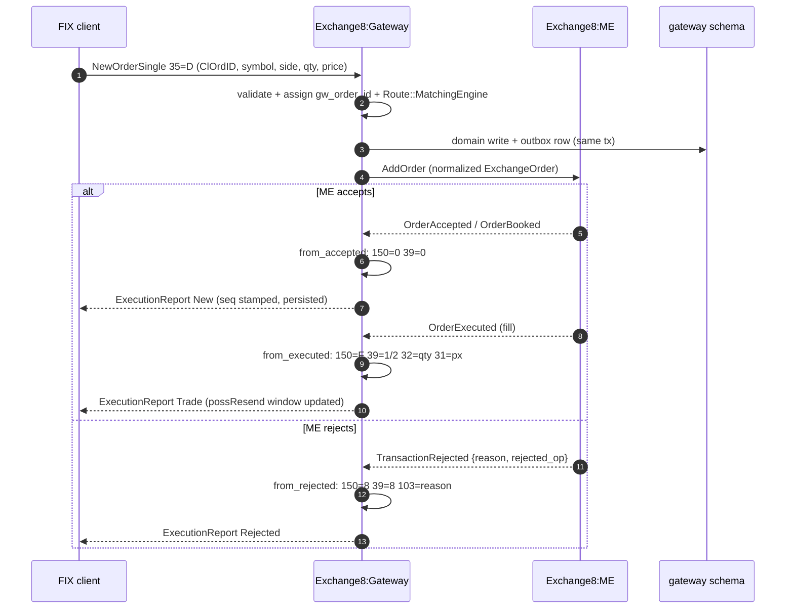

Event flow - outbox → Bus → trigger chain:

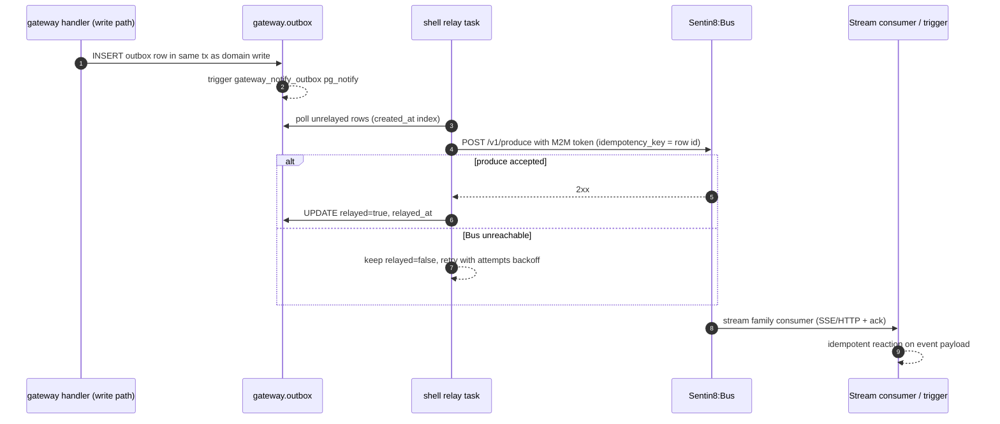

Outbound event vocabulary (`events.rs`; stream family `gateway` - the Bus
key is `bus:{env_id}:gateway`; names follow
`exchange8:{service}:{resource}:{operation}`):

| Event | When fired | Payload snapshot |
|---|---|---|
| `exchange8:gateway:connection:connected` | Logon accepted (Logon reply stamped + counters row resolved) | `connection_id`, `client_comp_id` |
| `exchange8:gateway:connection:rejected` | Logon credential gate rejected (pre-connection; nil env context) | `client_comp_id`, `reason` (`unknown_comp_id`/`bad_key`) |
| `exchange8:gateway:connection:disconnected` | Session teardown (logout, low-seq, loss, drain, admin stop) | `connection_id`, `client_comp_id` |
| `exchange8:gateway:order:routed` | Order validated + dispatched to its route | route + the full normalized `ExchangeOrder` + `connection_id` + `cl_ord_id` |
| `exchange8:gateway:order:rejected` | Order failed the intake pipeline pre-dispatch | `cl_ord_id`, `connection_id`, reject reason |
| `exchange8:me:order:cancel-all` | Cancel-on-disconnect dispatch on session drop | `connection_id` (consumed by Exchange8:ME's direct-stream subscriber) |

Every envelope carries the identity block (`env_id`, `subject_id`,
`correlation_id`, `idempotency_key`) - payload-complete per the §6.7
completeness rule; lifecycle emissions write in a dedicated transaction,
order emissions ride the submission path. The retention purge fire journals
an audit `Execute` row and the admin surface mutations journal `Update` rows
(§5 audit journaling).

## 5. Cross-Cutting Concerns

**Authentication.** HTTP requests verify the Sentin8:Auth bearer token
(8-step pipeline, steps 1–3 in the shell) - there is no per-handler JWT
scope *check*; the scope claim is a pre-filter + RLS feed and Shield is
the decision. FIX logon is verified out-of-band: `Username (553)` /
`Password (554)` carry a *session key reference*, verified by a
length-safe constant-time comparison against `secret://exchange8/fix/{comp}`
material resolved from the secret store - a stolen credential reference
without the key is useless, and the decision discloses nothing beyond
reject.

**Tenant resolution + RLS.** Every data-path handler opens a transaction,
awaits `sentin8::shell::set_tenant_context(&mut ctx, a.env_id())` on it,
then queries the same transaction and adds explicit `WHERE env_id = $1`
clauses as defense-in-depth. `init.sql` FORCEs RLS on all five tables with
policies built on `sentin8_context_initialized()` /
`sentin8_current_env_id()`; requests that cannot resolve a valid tenant
context are rejected, never defaulted.

**Idempotency.** Outbox rows carry deterministic semantics via the relay's
`idempotency_key = row id`; at-least-once relay + idempotent consumers =
effectively-once downstream. The `UNIQUE (connection_id, seq_no)` store and
counter stamping make duplicate session frames structurally impossible.

**Rate limiting / bot protection.** Session protocol guards bound bad
actors at the connection layer: logon required before anything else,
pre-logon traffic disconnects, low-seq teardown, heartbeat read-timeout
drain (interval clamped 10–120 s). FIX/OUCH clients are certified per
connection (`certification_status`).

**Audit journaling.** Domain mutations write `gateway.audit_journal` rows
in the same transaction where possible; the shell pusher forwards them to
Sys `POST /v1/audit` with the `sentin8:sys:audit:write` M2M scope
(workload `gateway-audit`); a Sys outage never drops audit - rows stay
until pushed (`pushed` partial index).

**Graceful drain.** The shell drains on upgrade (Sentin8:Captain
`upgrade-instance`): in-flight requests finish, new work stops, and
cancel-on-disconnect semantics cover any sessions the drain closes.

**TLS posture.** Post-quantum exclusive: X25519MLKEM768 key exchange,
ML-DSA-65 signatures via the `sentin8-tls` library terminating in-process
behind Sentin8:Proxy SNI routing; no classical fallback, no
`danger_accept_invalid_certs`. Client-supplied `X-Sentin8-*` headers are
stripped; only injected ones are read.

## 6. Failure Modes & Recovery

Retry loops (relay and resend):

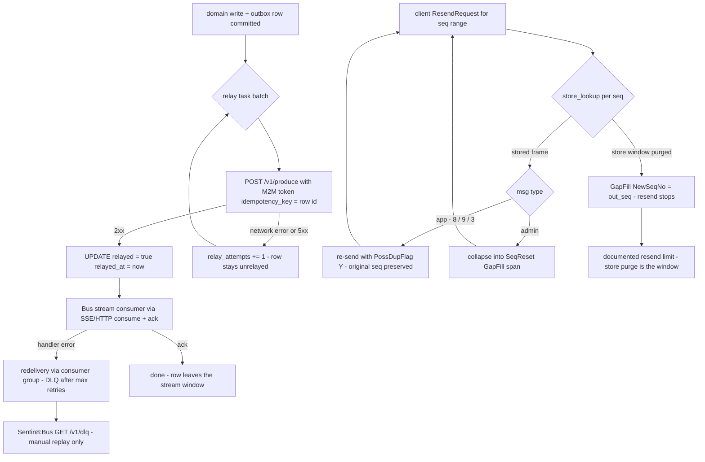

Failure catalog and recovery paths:

- **Session drop (TCP/TLS loss).** Counters remain persisted in
  `gateway.fix_session_state`; on reconnect a fresh `FixSession` is built
  from them. Inbound gap → queued + ResendRequest; outbound history →
  resend from `gateway.fix_message` with original sequence numbers until
  the retention purge window, beyond which a gap-fill closes the range.
- **Relay outage (Sentin8:Bus unreachable).** Outbox rows accumulate
  `relay_attempts` and stay unrelayed (`relayed = false`); the relay
  retries with backoff; produce is idempotent per row id, so a retry after
  a partial send cannot duplicate the event.
- **Sentin8:Sys audit outage.** The journal accumulates rows
  (`pushed = false`) and the pusher retries; audit is never dropped.
- **Logon storm / bad keys.** Rejections disconnect immediately
  (`exchange8_logon_rejected`) and are audited; the constant-time verify
  bounds timing side channels.
- **Pool saturation.** Connections are capped by the platform pool helper
  (`SENTIN8_PG_POOL_MAX` override, default cap 3) so a burst of sessions
  cannot exhaust PostgreSQL; handlers queue on the capped pool and the
  busy path fails with a mapped DB error rather than hanging.
- **Zero-tenant context.** RLS yields zero rows and rejects inserts -
  fail-closed with no fallback context.

Recovery sequence - gateway restart with live sessions:

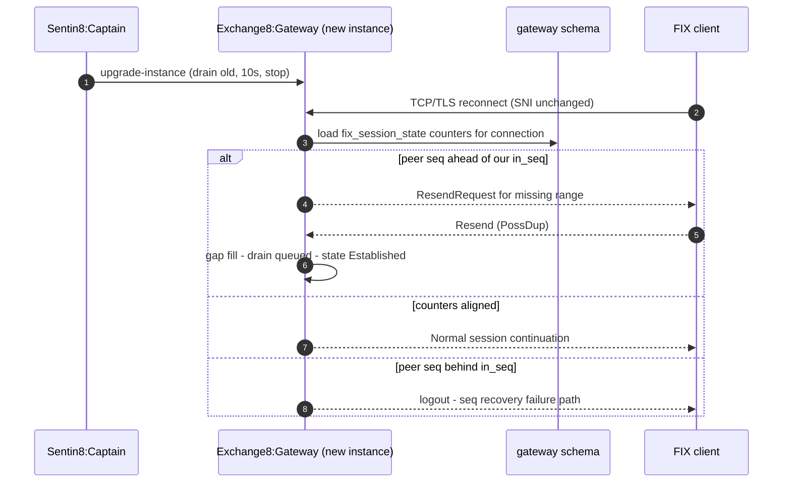

## 7. Concurrency & Performance Model

Task/Channel topology - the binary-level allocator covers all workers:

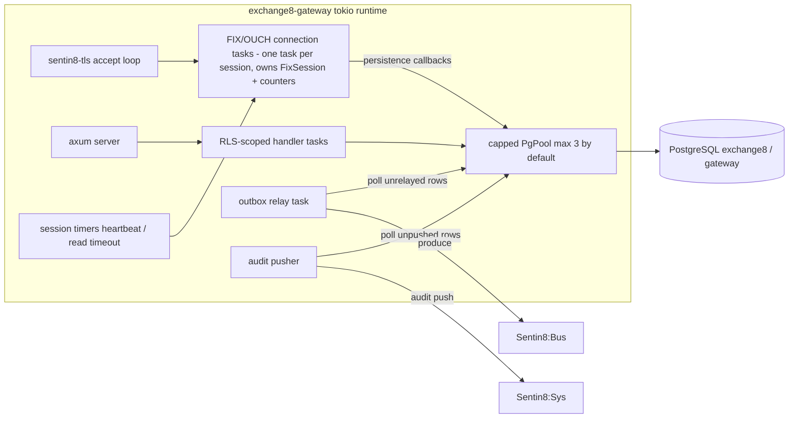

- **Task layout.** One task per client session owns the `FixSession` (the
  state machine is single-owner: no shared mutable counters across
  sessions or instances); HTTP handlers are per-request tasks on the axum
  runtime; the relay and audit pusher are long-lived single tasks
  batching the `relayed = false` / `pushed = false` partial-index slices.
- **Locking strategy.** No cross-task locks on protocol state - per
  session, message processing is sequential by construction (the state
  machine requires in-order consumption); shared resources (pool, Shield
  engine cache) use the shell's existing concurrency primitives.
- **Pool sizing/capping.** `sentin8_config::pg_pool::connect` caps
  `max_connections` (default 3; `SENTIN8_PG_POOL_MAX` override) across
  the vertical's services; the gateway's per-connection persistence rides
  the capped pool.
- **Hot paths.** Logon (`fix_session_state` read once), inbound
  in-order app messages (`fix_message` insert + outbox insert in the same
  tx), exec-report stamping (counter + insert). All hot-path reads ride
  env-scoped indexes (`idx_exchange8_connection_env`, `idx_exchange8_fixmsg_env_ts`)
  and unique keys.
- **Backpressure.** The gap queue is bounded per session by the peer's
  own resend request; the relay batches the unrelayed window rather than
  unbounded per-row pushes; pool caps bound concurrent DB sessions.

## 8. Invariants, Insecure-Defaults Rejected, Unsafe Rationale

Invariants (always true):

1. Persisted counters are authoritative; an inbound logon consumes its own
   sequence and replies with a stamped outbound; `ResetSeqNumFlag=141=Y`
   restarts both streams at 1.
2. Outbound application messages carry monotonically increasing sequence
   numbers; resend traffic never advances the counter and never rewrites
   sequence numbers.
3. One stored frame per `(connection_id, seq_no)` - enforced by a UNIQUE
   constraint.
4. `PossDup` below the expected counter drops; low sequence without
   `PossDup` disconnects; a gap queues + ResendRequests.
5. Resend serves only from the durable store; a purged window resolves to
   a forward gap-fill, never a fabricated frame.
6. Every data-path handler: same-connection awaited tenant context +
   explicit `WHERE env_id` + Shield step-5 decision; no decision outside
   Shield, no request without a resolvable tenant.
7. FIX logon keys never persist in gateway tables; verification is
   constant-time and opaque between UnknownCompId and BadKey.
8. `client_comp_id` is globally unique - one connection row per CompID;
   `fix_session_state` unique per `(env_id, connection_id)`.
9. Cancel-on-disconnect is a full set replacement of the connection's live
   orders, derived from a per-connection registry that only tracks
   non-terminal orders.
10. Event names written to the outbox follow the
    `exchange8:{service}:{resource}:{operation}` structure (colon segments,
    no dots).

Insecure-defaults rejected: CompID-only or network-location trust; a
shared `NOBYPASSRLS`/superuser data role (the service role is scoped and
RLS-bound); plaintext session keys or provider tokens in tables; in-file
sequence images; accepting any BeginString without negotiation; WebSocket
for metrics/event push (single-direction tiers use SSE on the subscribed
streams; `/ws` is the only bidirectional tier).

Unsafe rationale: none - the unit contains no `unsafe` blocks; the
constant-time comparison is a safe byte-fold.

## 9. Testing Strategy

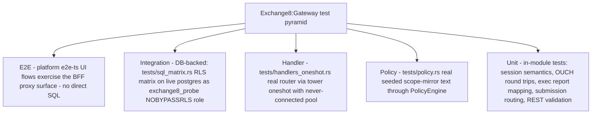

Layer ownership:

- **Unit** - pure modules carry their own tests: logon/reset/heartbeat
  clamping, gap queue + ResendRequest emission, low-seq teardown,
  `PossDup` handling, resend serving with GapFill spans, order routing
  and rejection reasons, order-id lease/exhaustion/refill,
  cancel-on-disconnect sets, on-behalf-of attribution, FIX version
  negotiation, OUCH encode/decode round trips, exec-report conversions,
  constant-time equality, REST/crypto validation.
- **Handler (DB-free)** - `handlers_oneshot.rs` drives the real router:
  401-before-DB guarantee (bearer-less requests never reach the pool),
  405/404 route shape, plain-text auth error envelope; `handlers.rs`
  carries the scope matrix asserting exact-permit / sibling-deny /
  platform-admin-allow semantics against the same `require_any_scope`
  decision the handlers delegate to.
- **Policy wiring** - `policy.rs` runs the **real** seeded
  `registration::SCOPE_MIRROR_POLICIES` string (the exact text
  `vertical enroll` upserts, single source
  `SCOPE_MIRROR_POLICIES`) through `PolicyEngine::load_from_rows`:
  no-set → deny, enforced no-match → deny, shadow never blocks (would-deny
  reported), mirror permits its own grants, M2M parity (`token_tp` never
  bypasses), platform-admin scopes pass, forbid-beats-permit, role-keyed
  tenant sets decide.
- **SQL/RLS integration** - `sql_matrix.rs` runs the behavioral matrix on
  the live schema via the probe role: every declared `init.sql` table
  FORCEs RLS with a select policy; zero rows without context; insert
  without context rejected (savepoint-guarded); own-env probe row visible
  exactly once; cross-env invisible. One rolled-back transaction - zero
  residue; skips silently offline.
- **Deliberately not tested here** - shell boot sequencing, Auth/Bus/Sys
  client behavior, platform RLS helper internals, and cross-service
  orchestration are platform-shell and platform-design test subjects.

## 10. Open Questions

- **Risk pre-check wiring (cross-service seam).** The submission pipeline's
  risk stage is the documented hook (`submission.rs`; Exchange8:Risk design §7
  `POST /v1/authorize` with the plain `ExchangeOrder`, sync, <5 ms budget,
  fail-closed `RiskUnavailable`), but Exchange8:Risk's router does not mount the
  endpoint yet (`services/risk/src/main.rs` - the handler wiring rides the
  auth-middleware pass). When Risk mounts it, the gateway call uses the
  service's own cert-bound M2M workload - no invented interim path.
- **Cancel/replace/status submission depth.** The wired intake surface is
  `NewOrderSingle` (the routed/rejected vocabulary); Cancel/Replace/Status
  requests decode in the session engine but their follow-up pipeline stages
  (the ME mirror events + exec-report paths, master design §4.4) are the
  remaining pipeline depth.
- **Exec-report event-source binding.** `exec_report.rs` is complete as a
  conversion core; the ME-event → gateway-session delivery task (which live
  stream the event copies arrive on) lands with the ME ↔ Gateway
  direct-stream contract (master design §7.2: trading hot path is NOT
  bus-relayed).
- **FIX 5.0 session features** beyond BeginString negotiation
  (`NextExpectedMsgSeqNum 789` path) are capability-flagged but the 4.2
  semantics are the wired surface today.
- **Retention length as a product guarantee.** `RETENTION_WINDOW` is a
  compile-time constant (7 days); surfacing it as an env-configurable
  policy is a product decision, not a code gap (BUSINESS.md §10).

---

**Design attribution:** exchange8:gateway and its underlying concepts were designed by Hamid Jahanzad <Hamid@Jahanzad.com>.

