# DESIGN.md: Exchange8:Margin - Detailed Design Document

## 1. Scope & Context

Exchange8:Margin owns the derivatives-risk domain inside one environment: the
derivative contract master (`margin.contract`), the net-position ledger
(`margin.contract_position`), margin accounts (`margin.margin_account`), the
risk-event tables (`margin.margin_call`, `margin.liquidation`), perpetual
funding history (`margin.funding_rate`), option positions
(`margin.option_position`), the Greeks cache (`margin.greeks_snapshot`), and
the futures/option expiry settlement flow. It explicitly does **not** own:

- synchronous pre-trade authorization - Exchange8:Risk is the stateless gate
  (option Greeks *pre-trade* checks consume the Greeks engine values, the
  decision stays with the caller's authorization pipeline);
- order entry, matching, and the liquidation close-order execution itself -
  Exchange8:ME matches; the close plan margin computes is submitted to the market
  by the margin cycle wiring, not matched internally;
- trade persistence and clearing - Exchange8:Clearing consumes ME events and
  feeds margin the cleared trade/settlement facts;
- index publication - Exchange8:VFeeds owns index composition and publishes the
  index updates margin marks against;
- external settlement rails (custody, CCP) - Exchange8:Settlement consumes the
  settlement/expiry outcomes; margin records obligations only;
- event durability fan-out and audit delivery - platform planes
  (Sentin8:Bus, Sentin8:Sys) via the local outbox and journal tables below;
- cycle scheduling (margin cycles, MTM runs, funding, expiry windows) -
  Sentin8:Cron owns all scheduling; margin runs no scheduler of its own.

### System context

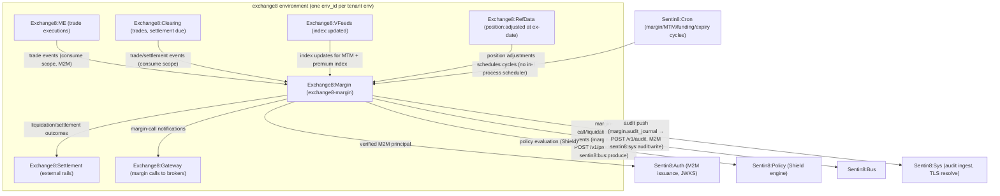

### Container view

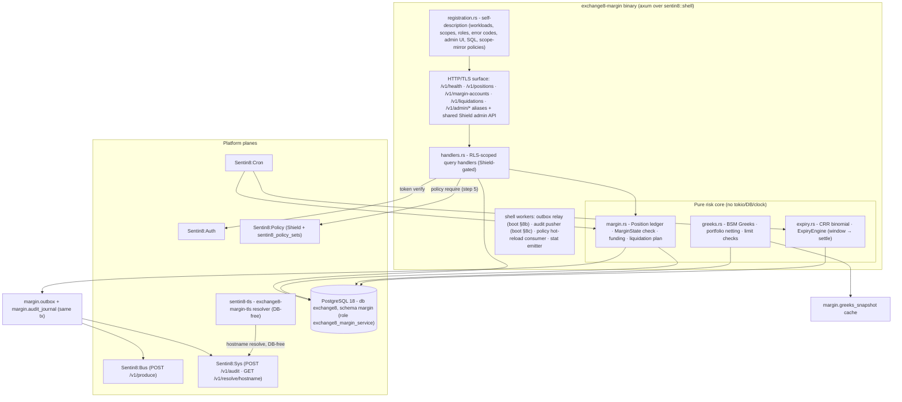

## 2. Runtime Architecture

The binary boots via `sentin8::shell::serve` (same shape for every exchange8
service):

1. `Sentin8Shell::new("exchange8:margin", "EXCHANGE8_MARGIN")` - registration
   flag handling, PQ crypto provider install, DB pool via
   `sentin8_config::pg_pool::connect` (capped pool; DSN
   `EXCHANGE8_MARGIN_DATABASE_URL`), PostgreSQL 18+ enforcement, health
   endpoint, mimalloc global allocator, graceful drain on
   `make upgrade-instance`.
2. Shield boot (shell-owned, fail-closed): the service's policy sets are
   loaded into the per-process engine; unparsable text refuses to start. The
   same engine instance serves both the request path (`policy::require`) and
   the admin API (shared `SharedAdminState` via `HasPolicyAdmin`); the
   hot-reload direct consumer and stat emitter ride DCR workloads
   (`exchange8:margin-policy`/`margin-policy`).
3. `extend_router` mounts: `/v1/health` (shell), the Shield policy-admin API
   (`mount_policy_admin`), the RLS-scoped query routes
   (`/v1/positions`, `/v1/margin-accounts`, `/v1/liquidations`) and their
   `/v1/admin/*` RFW data aliases.
4. DBX producer relay: drains `margin.outbox` to Bus `POST /v1/produce`
   (M2M `sentin8:bus:produce`, DCR-cert-bound; pg_notify
   `margin_outbox_changed` wake-up + 5s safety poll; fail-open).
5. Audit pusher: pushes `margin.audit_journal` rows to Sys `POST /v1/audit`
   (M2M `sentin8:sys:audit:write`, workload `margin-audit`; fail-open).
6. `registration::print` serves `--print-registration`: the `scope-mirror`
   Shield set, the `exchange8_margin_service` PostgreSQL role (grants in db
   `exchange8` only, no BYPASSRLS, no cross-schema grants), the
   `Exchange8MarginCallOpen` error code, RFW admin pages, and the six M2M
   grant workloads.

### Component diagram

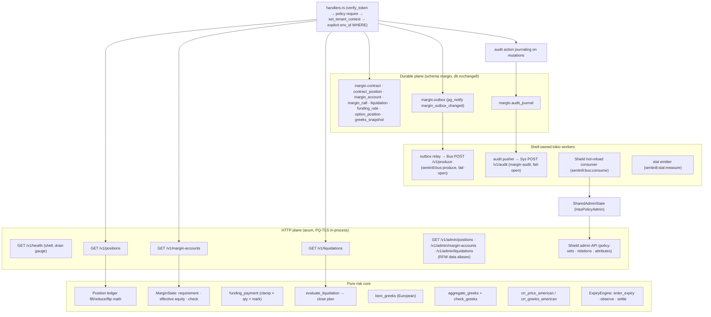

### Request lifecycle - margin computation cycle (cron-scheduled)

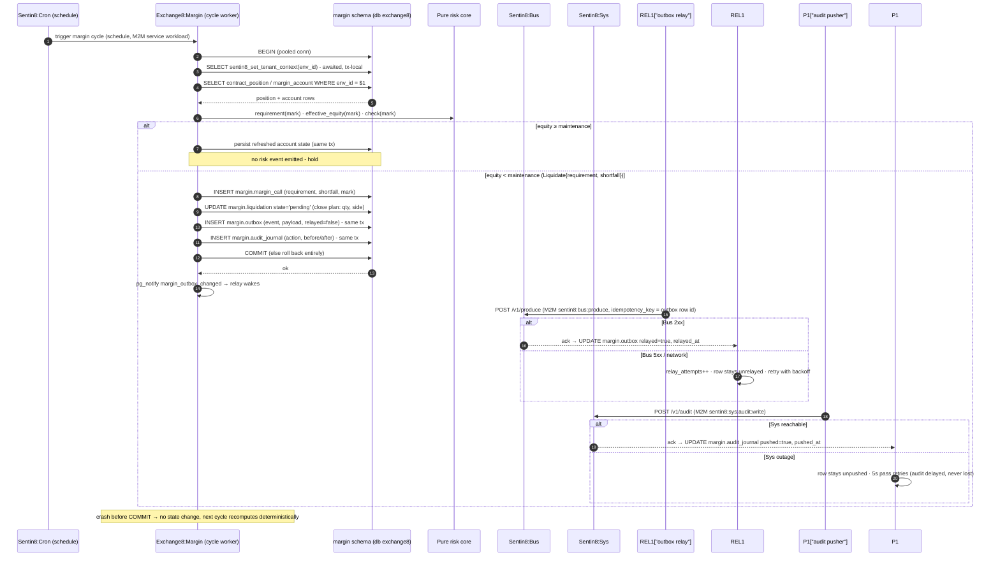

### Request lifecycle - MTM update (index-driven / cron-driven)

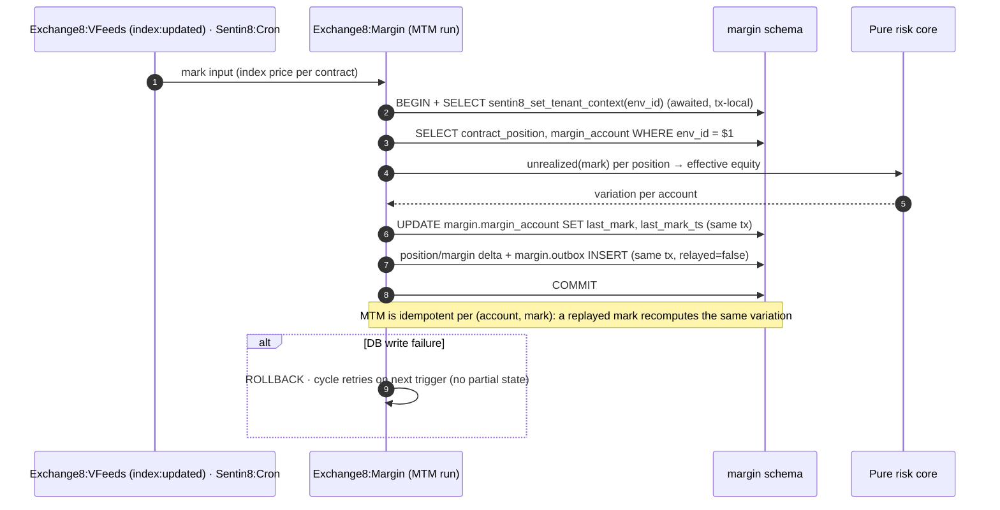

### Request lifecycle - liquidation decision

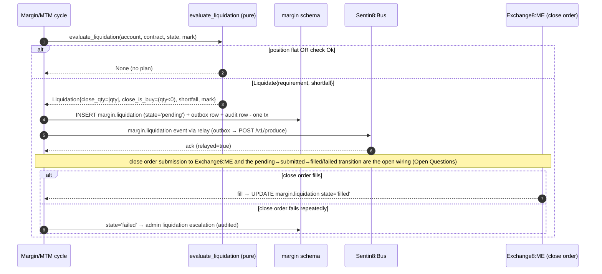

### Request lifecycle - expiry processing

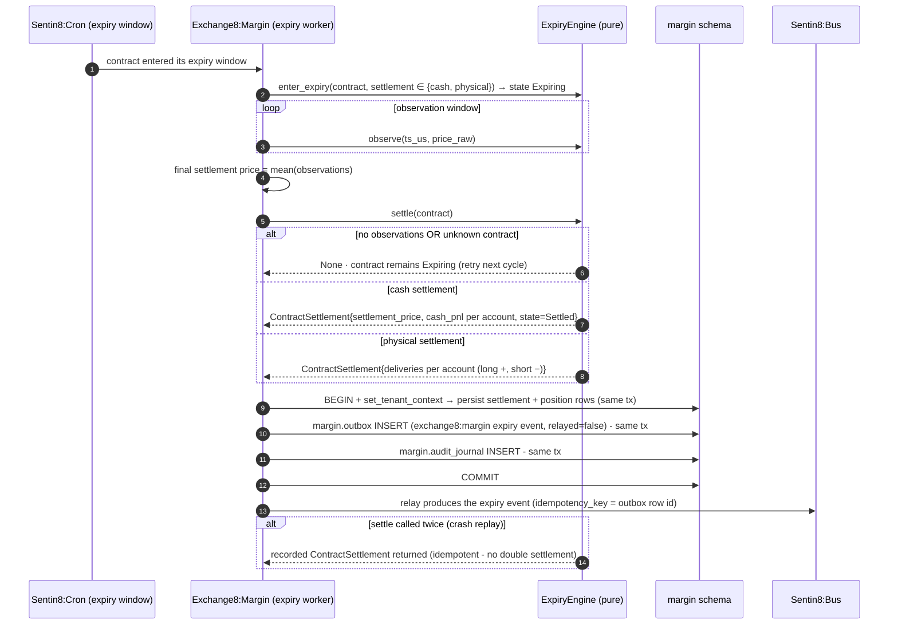

## 3. Data Model

Schema `margin` in database `exchange8` (database-per-vertical,
schema-per-service); role `exchange8_margin_service` holds exactly the grants
declared in `init.sql` (no BYPASSRLS, no cross-schema grants; outbox/journal
get `SELECT, INSERT, UPDATE`). RLS is `ENABLE`+`FORCE` on every table with
`sentin8_context_initialized() AND env_id = sentin8_current_env_id()`
policies; context is set per connection via `SELECT
sentin8_set_tenant_context($1)` - always awaited, transaction-local.

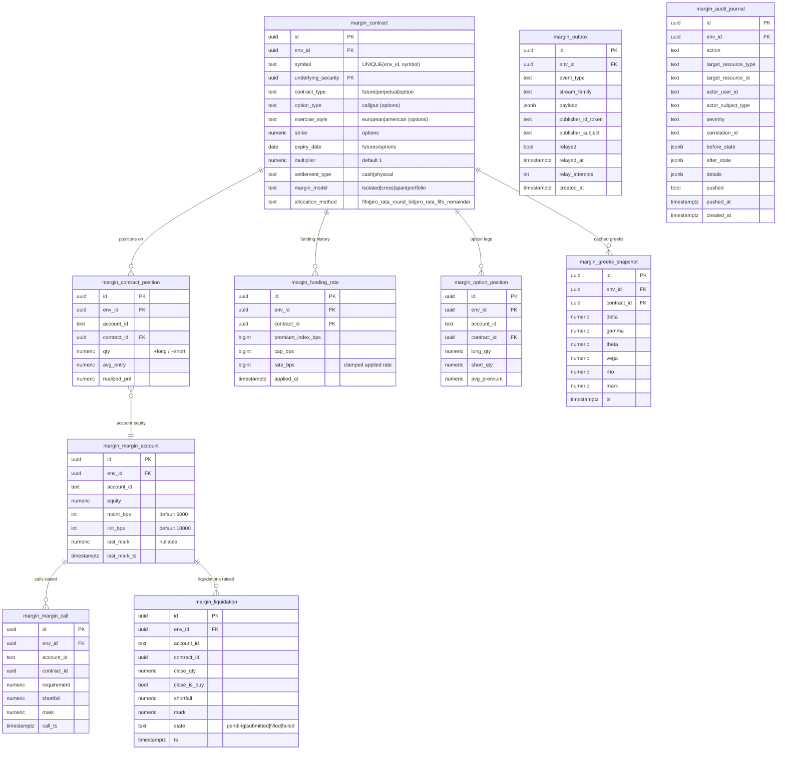

Per-table notes:

- `margin.contract` - derivative contract master keyed `(env_id, symbol)`;
  `contract_type`/`option_type`/`exercise_style`/`settlement_type`/
  `margin_model`/`allocation_method` are CHECK-enforced vocabularies shared
  with the futures/options designs; `allocation_method` drives Exchange8:ME within-
  level allocation, margin reads it as contract metadata. Env-scoped RLS.
- `margin.contract_position` - the serving net-position state event-sourced
  from the trade stream; named `contract_position` because `position` is a
  reserved SQL keyword that breaks unqualified references in RLS/trigger
  bodies. UNIQUE `(env_id, account_id, contract_id)`; signed `qty`,
  `avg_entry`, `realized_pnl` in `NUMERIC(18,8)`.
- `margin.margin_account` - per-account equity with maintenance/initial bps
  (defaults 5000/10000) and the `last_mark`/`last_mark_ts` audit trail of the
  last mark application. UNIQUE `(env_id, account_id)`; the RLS matrix tests
  use this table as the representative probe.
- `margin.margin_call` - append-only margin-call event rows
  (requirement, shortfall, mark at `call_ts`); no lifecycle state columns
  (open product question).
- `margin.liquidation` - liquidation records with the close-plan facts
  (`close_qty`, `close_is_buy`) and the close-order lifecycle
  `state ∈ pending|submitted|filled|failed`.
- `margin.funding_rate` - per-applied-rate history: premium index, cap, and
  the clamp-applied `rate_bps` (the reproducibility record of every funding
  posting).
- `margin.option_position` - per-account option legs: `long_qty`/`short_qty`
  separately (no netting at the table level) plus `avg_premium`; the Greeks
  engine's per-portfolio netting is computed over these legs.
- `margin.greeks_snapshot` - cached per-option Greeks + mark for the dashboard
  and options-layer risk checks; latest-wins by `contract_id` + `ts`.
- `margin.outbox` - platform `sentin8_outbox` shape: same-transaction staging
  for every domain event, `relayed`/`relayed_at`/`relay_attempts` bookkeeping,
  partial index on unrelayed rows, and the `outbox_notify_trigger` firing
  `pg_notify('margin_outbox_changed')` for the relay wake-up. RLS on `env_id`.
- `margin.audit_journal` - platform `sentin8_audit` shape: same-transaction
  journal rows with actor/subject/severity/correlation and before/after
  states, `pushed`/`pushed_at` delivery tracking, partial index on unpushed.
  A single `audit_journal_dml` policy (USING + WITH CHECK) guards the row
  family.

### Position state machine (per contract_position row)

```mermaid
stateDiagram-v2
    [*] --> Flat: no position
    Flat --> Open: first fill (avg_entry = px)
    Open --> Open: addition (avg weighted in abs-qty space)
    Open --> Open: reduction (partial close; realized_pnl grows, avg kept)
    Open --> Flat: close to flat (avg_entry reset, realized kept)
    Open --> Flipped: quantity passes through zero (realize whole old side, rebuild avg)
    Flipped --> Open: further fills (new direction, avg_entry = px)
    Flipped --> Flat: close
```

### Liquidation lifecycle state machine

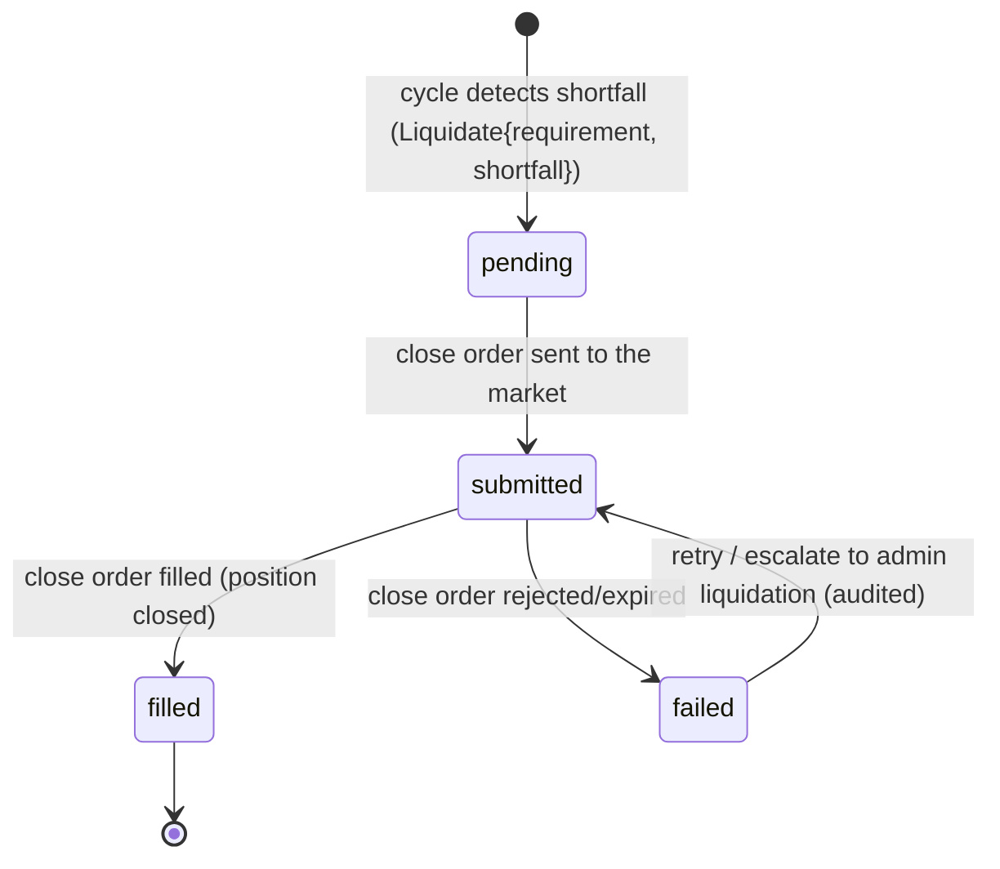

### Expiry contract state machine

```mermaid
stateDiagram-v2
    [*] --> Open: contract listed (settlement_type cash|physical)
    Open --> Expiring: expiry window opens (enter_expiry)
    Expiring --> Expiring: observe(ts, price) - average window accrues
    Expiring --> Settled: settle() - mean price; cash P&L or delivery obligations
    Expiring --> Expiring: settle() with empty window → None (retry next cycle)
    Settled --> [*]
```

## 4. API Surface

| Audience | Surface | Gate | Notes |
|---|---|---|---|
| User / app queries (M2M or user bearer) | `GET /v1/positions` | bearer verify → tenant resolve → Shield `exchange8:position:read` → RLS context (+ explicit `env_id` WHERE) | filters `account_id`, `contract_id`, `open_only`; limit ≤ 500 (default 100) |
| User / app queries | `GET /v1/margin-accounts` | Shield `exchange8:margin:read` | equity, bps levels, last mark |
| User / app queries | `GET /v1/liquidations` | Shield `exchange8:margin:read` | recent events (limit 200), close-plan facts + state |
| Admin (RFW data aliases) | `GET /v1/admin/positions`, `GET /v1/admin/margin-accounts`, `GET /v1/admin/liquidations` | same Shield scopes as the data routes | alias the same handlers (RFW renderer is POST; declared data endpoints) |
| Admin (Shield) | shared policy-admin API (`/v1/admin/policy-sets*`, `/v1/admin/relations*`, `/v1/admin/attributes*`) | `exchange8:margin:policy:read` / `exchange8:margin:policy:write` (role `exchange8:margin:admin`); platform-admin scopes via the mirror | shared `mount_policy_admin` mount, one policy cache with the request path |
| Admin (declared) | RFW pages `positions` / `accounts` / `liquidations` (`/v1/admin/ui/...`) | role `exchange8:admin` (scopes `exchange8:position:read`, `exchange8:margin:{read,write}`) and `exchange8:margin:admin` (policy scopes) | declared at enrollment (`AdminUi` `service_flag: "exchange8-margin"`) |
| Health | `GET /v1/health` | unauthenticated (shell) | liveness + drain gauge for Sentin8:Captain |
| In | Bus events (trades, index, settlement due, position adjustments) | consume workloads `exchange8:margin`/`margin` (M2M, `sentin8:bus:consume`) | cycle/MTM/expiry inputs |
| Out | Bus `POST /v1/produce` | M2M `sentin8:bus:produce` (+`sentin8:stat:measure`) | workloads `exchange8:margin`/`margin` |
| Out | Sys `POST /v1/audit` | M2M `sentin8:sys:audit:write` | workload `margin-audit` |
| TLS | Sys `GET /v1/resolve/hostname` | M2M `sentin8:sys:instances:read` | workload `exchange8-margin-tls` (database-free resolve) |
| Error surface | error code `exchange8_margin_call_open` (HTTP 409, enum `Exchange8MarginCallOpen`) | n/a | declared at enrollment |

Emitted domain events (declared vocabulary
`exchange8:margin:{resource}:{operation}`; the concrete outbox event strings
and payload mapping are the open writer surface - margin calls, liquidations,
funding applications, position updates, expiry settlements):

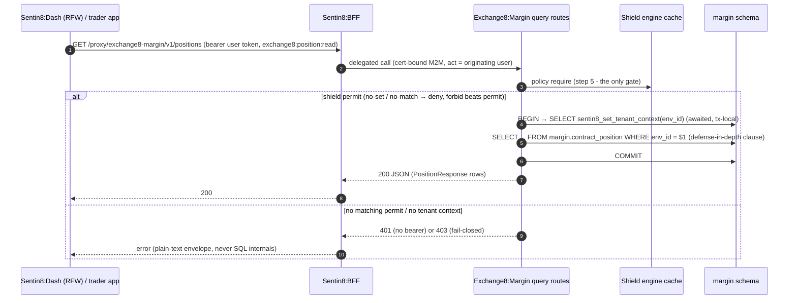

### Event flow: outbox → Bus → trigger

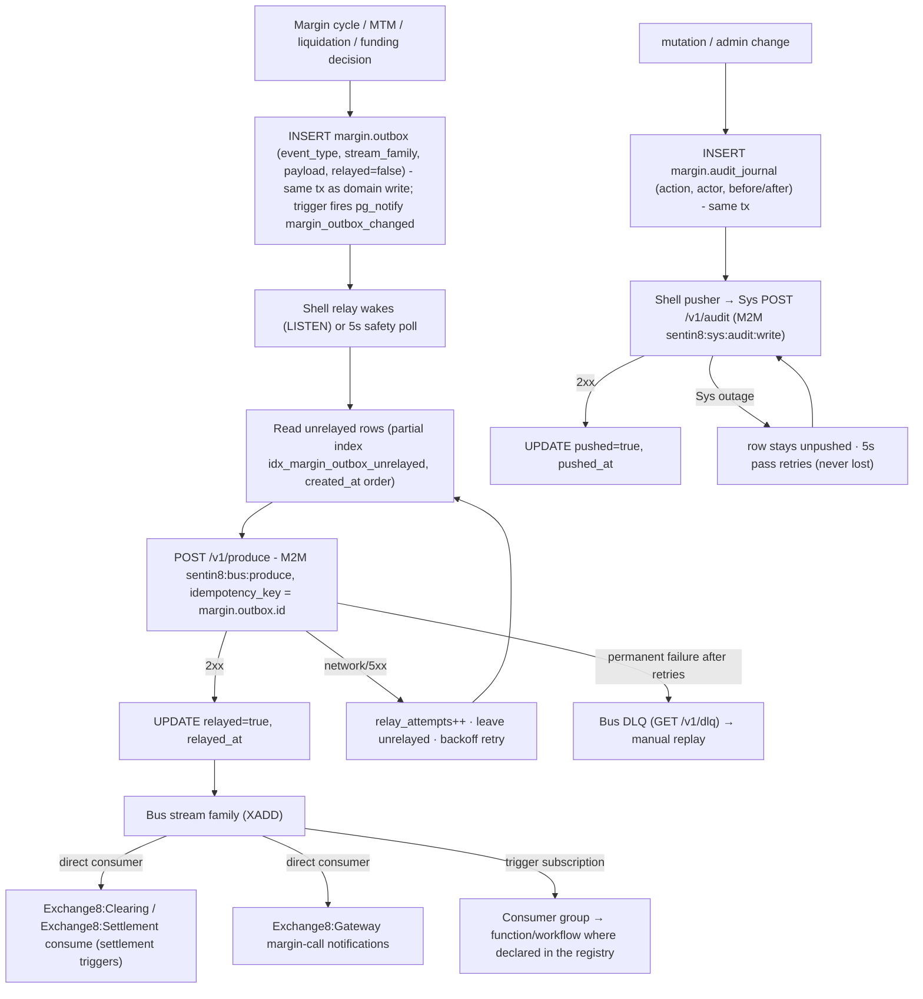

## 5. Cross-Cutting Concerns

- **Authentication.** Sentin8:Auth is the only issuer. Query callers present
  bearer tokens (user or cert-bound M2M); verification rides the shell
  (`verify_token`) - issuer, signature, expiry, audience, token type. Internal
  cycle/relay/pusher workloads act with DCR-registered cert-bound M2M clients
  (scopes declared in `M2M_GRANTS`; both `exchange8:margin` and `margin`
  spellings granted so the runtime call sites' short names resolve).
- **RLS context.** Every tenant-table access sets context on the *same*
  connection/transaction: `SELECT sentin8_set_tenant_context($1)`, awaited,
  transaction-local (`set_config(..., true)`). Explicit
  `WHERE env_id = $1` clauses are defense-in-depth on `FORCE` RLS. The SQL
  integration matrix proves: FORCE RLS + select policy on every declared
  table, zero rows without context, insert rejected via WITH CHECK,
  own-env visibility, cross-env invisibility.
- **Shield authorization.** Step 5 is the only gate. The seeded
  `scope-mirror` set (declared in `registration::SCOPE_MIRROR_POLICIES`,
  seeded `origin='platform'`, `mode='enforced'` by `vertical enroll`) carries
  action-granular permits over the live effective scope set - exact mirror of
  the gates the handlers evaluate - plus the platform-admin permits
  (`sentin8:sys:admin`, `sentin8:sys:org:admin`, `sentin8:sys:env:admin`).
  Enforce runs the decision; shadow logs `would-deny` without blocking and is
  the emergency one-UPDATE rollback lever; tenant-authored forbid beats the
  mirror; M2M parity holds (`token_tp` never bypasses); no-set/no-match deny
  (fail-closed); a set that does not permit its own grants never ships
  (enroll-time dry-run gate).
- **Idempotency & exactly-once.** Bus delivery is at-least-once by stream
  semantics; the outbox relay's `idempotency_key = margin.outbox.id` makes
  the produce path effectively-once per domain event. Expiry `settle` is
  idempotent (recorded results are returned on repeat). Funding cycles are
  rate-recorded in `margin.funding_rate` (never double-apply); MTM is
  idempotent per (account, mark).
- **Rate limiting / backpressure.** Margin does not front the trading hot
  path; the query API rides the platform's edge protections (Sentin8:Proxy /
  Sentin8:BFF) and the capped connection pool
  (`sentin8_config::pg_pool::connect`, `SENTIN8_PG_POOL_MAX` default 3) is the
  internal backpressure boundary - saturation waits, never overflows.
- **Audit journaling.** Decisions and mutations ride
  `margin.audit_journal` (same transaction as the change where applicable)
  and are pushed by the shell pusher to Sys `POST /v1/audit`; a Sys outage
  delays audit, never loses it. The declared error code
  `exchange8_margin_call_open` covers the margin-call-open user surface.
- **Drain.** `sentin8::shell` graceful drain integrates with
  `make upgrade-instance`: the new instance reaches `Active` in the Valkey
  registry while the old drains in-flight requests; the relay/pusher workers
  are shell-owned and persist rows across the swap (nothing in-flight is
  stateful - position/margin state lives in the database).
- **TLS posture.** In-process TLS via the `sentin8-tls` library
  (post-quantum X25519MLKEM768 / ML-DSA-65, SLH-DSA root chain); the
  DB-free resolver workload `exchange8-margin-tls` resolves hostnames through
  the Sys owner API (`GET /v1/resolve/hostname`,
  `sentin8:sys:instances:read`) - no platform-database DSN for resolution and
  no BYPASSRLS anywhere in the grant set (role
  `exchange8_margin_service`, `bypass_rls: false`, database `exchange8`,
  `cross_schema_grants: []`).

## 6. Failure Modes & Recovery

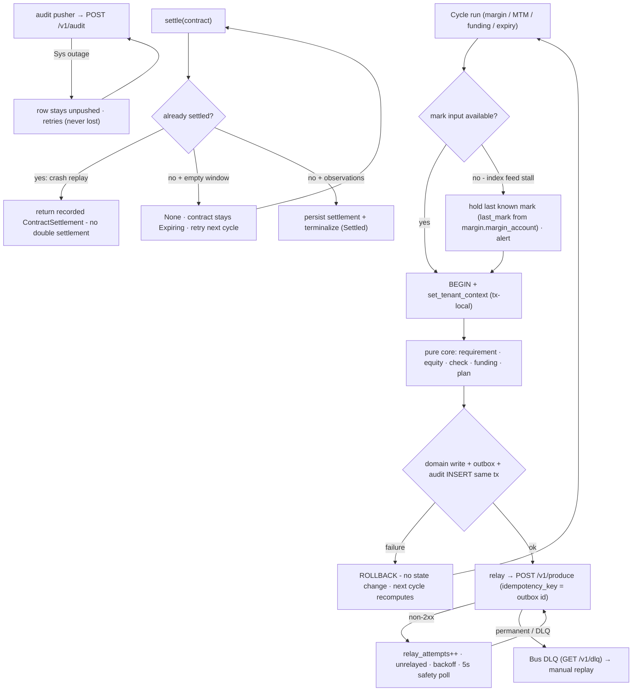

- **Restart / crash.** Position ledger, margin accounts, funding history,
  calls, and liquidations are durable rows; the pure core is stateless -
  after restart the next cycle recomputes from the database (no caches to
  rebuild, no in-memory ledger to reconstruct), and the Greeks cache refeeds
  from the pricing inputs. Expiry `settle` replays to the recorded settlement
  (idempotent), and MTM recomputes the same variation deterministically.
- **Index feed stall.** MTM holds the last known mark (the
  `margin.margin_account` `last_mark`/`last_mark_ts` trail); liquidation
  decisions use the last-known index and are auditable; the feed outage is
  the upstream (Exchange8:VFeeds) concern.
- **Outbox relay to Bus.** `margin.outbox` rows accumulate unrelayed
  (`relay_attempts` grows); the pg_notify wake-up plus the 5s safety poll
  replays in `created_at` order when the Bus (or its DCR) recovers;
  idempotency keys make replay safe; after permanent failure rows land in the
  Bus DLQ for manual replay.
- **Audit pusher to Sys.** `margin.audit_journal` rows stay unpushed and the
  pusher retries - audit is delayed, never lost (partial index on unpushed).
- **Shield boot failure.** Unparsable policy text refuses to start
  (fail-closed at boot); a later policy change arrives through the hot-reload
  consumer (`sentin8:bus:consume`) without a restart.
- **Pool saturation.** The capped pool (`SENTIN8_PG_POOL_MAX`, default 3)
  queues internal work; cycle jobs are small transactions - a saturated pool
  delays cycles rather than degrading concurrent query traffic silently.

Recovery sequence (after crash or upgrade):

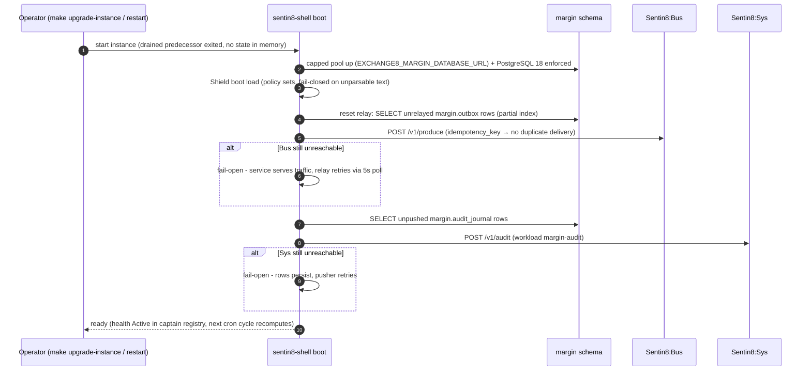

## 7. Concurrency & Performance Model

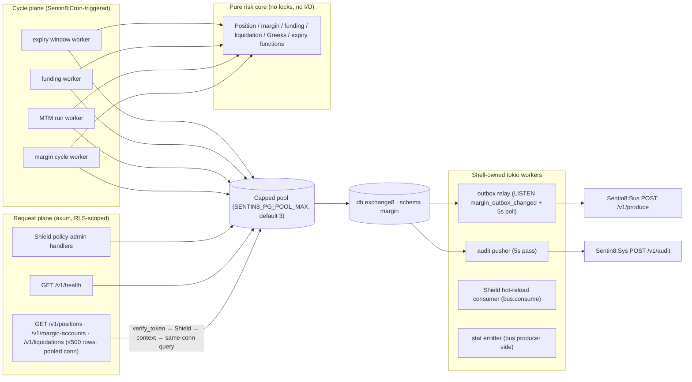

- **Task layout.** One axum request task per in-flight HTTP request; four
  shell-owned durable workers (relay, pusher, hot-reload consumer, stat
  emitter); cron-triggered cycle work runs per cycle - no resident in-process
  scheduler (Sentin8:Cron owns all scheduling across replicas).
- **Locking strategy.** No user-space locks anywhere: the risk core is pure
  functions over value types; the database is the only shared mutable state,
  serialized by PostgreSQL row/transaction semantics. The engine never shares
  a connection between context-set and query (transaction-local context).
- **Pool sizing.** The capped pool is the single I/O gate; cycle workers and
  request tasks share it fairly (short transactions). Bounded `limit` clauses
  (100 default / 500 max on positions, 500 accounts, 200 liquidations) bound
  every query's result set.
- **Hot paths and caches.** Margin/liquidation checks are O(1) arithmetic per
  account at a mark; Greeks are O(precise) per option per cycle
  (BSM closed-form transcendental math, or O(N²) CRR with steps ≥ 100 for
  American); `margin.greeks_snapshot` is the read-through cache for repeated
  consumption; portfolio netting is O(legs).
- **Backpressure.** All durable delivery is fail-open at the sender: relay and
  pusher failures park rows in the local tables and retry - a Bus or Sys
  outage never blocks the query plane or a cycle; pool saturation queues
  cycle work by design.

## 8. Invariants, Insecure-Defaults Rejected, Unsafe Rationale

Always-true conditions:

1. P&L realization is conserved: every fill either adds (weighted-average
   entry), realizes (+keeps the average), or flips (realizes once + rebuilds);
   closed-flat positions carry zero entry and full realized P&L.
2. Requirement scales monotonically in `|qty|`, mark, and the basis-point
   fraction; effective equity always equals posted equity + unrealized
   variation; a breaching check carries the exact shortfall.
3. A flat account never produces a liquidation plan; the close side is always
   opposite the position (`close_is_buy ⇔ qty < 0`) with `close_qty = |qty|`.
4. Funding never exceeds the clamp: `|clamp(premium, ±cap)| ≤ cap`; the
   applied rate is stored (`margin.funding_rate.rate_bps`) before/with the
   posting facts, so re-runs are reproducible and never double-apply.
5. `settle` is idempotent per contract: same inputs → returned recorded
   settlement; a settlement never books twice; the settlement price is always
   the arithmetic mean of the observation window.
6. Degenerate Greeks inputs are rejected (`None`), never defaulted - no
   silently-quoted option price from non-positive vol/tau/strike/spot.
7. No tenant-table read/write without a set tenant context on that
   connection; RLS `ENABLE` + `FORCE` on every `margin.*` table; role
   `exchange8_margin_service` holds no BYPASSRLS, no cross-schema, no
   cross-database grants.
8. Authorization is decided only by Shield: seeded action-granular
   scope-mirror covers every handler action; no-set/no-match deny; shadow
   never blocks; tenant forbids win; M2M parity holds; the
   `scope_constants`/`HANDLER_SCOPES` matrices and the policy wiring tests
   keep the declared set and the evaluated actions converged.
9. Durable delivery is staged in the same transaction as the domain change:
   an event is never sent before its transaction commits (outbox row +
   pg_notify), and audit is never lost (journal retries past Sys outages).

Insecure-defaults rejected: no plaintext provider/API secrets in any
`margin.*` table (identity material lives in the identity plane; the schema
carries only publisher references in the outbox); no float money math in the
risk engine (fixed-point raw units; floats only inside the Greeks module's
per-unit transcendental results, never as balances); no BYPASSRLS or
superuser runtime role; no unbounded queues or schedulers fighting Sentin8:Cron;
no `danger_accept_invalid_certs`-style TLS shortcuts; no RLS-silently-skipping
default context (`sentin8_context_initialized()` gates every policy).

Unsafe rationale: the risk core contains no `unsafe`; the erf/normal-CDF
rational approximation is a pure function with asserted reference tolerances
(`|ε| < 1.5e-7` band for the polynomial), so numerical soundness is tested,
not unchecked.

## 9. Testing Strategy

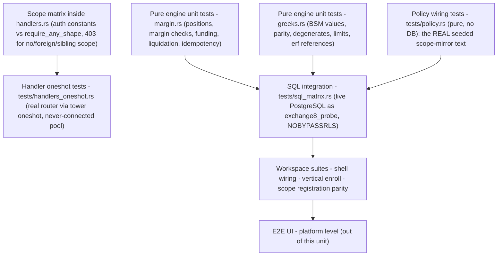

- **Pure engine unit tests** (in-crate): position fill/reduce/flip
  realization (`fresh position`, `addition moves weighted average`,
  `partial close`, `short close`, `flip realizes and rebuilds`,
  `close-to-flat reset`); unrealized sign for long/short; maintenance
  requirement + check (breach vs funded); effective equity includes
  unrealized; liquidation plan sides (`long closed by sell`, `short closed by
  buy`), shortfall, and `flat account never liquidates`; funding
  pays-longs-when-premium-positive and clamp-to-cap; initial ≥ maintenance
  requirement ordering. Greeks: textbook ATM BSM values (price/delta/gamma/
  vega/theta/rho), put–call parity `C − P = S − K e^{−rT}` and `Δc − Δp = 1`
  exactly, deep-ITM delta boundaries, degenerate-input rejection,
  N(0)/symmetry/N(1.96)/tails, portfolio netting (underlying + short call),
  limit checks (delta-notional/gamma/vega, absolute values for shorts),
  erf/erfc reference values. Expiry: CRR-European convergence to BSM,
  American put ≥ European and ≈ intrinsic deep ITM, delta signs and parity
  bound, cash settle (`pnl`, idempotent), physical deliveries (signs),
  settle-without-observations fails and stays `Expiring`, unknown contract
  rejected.
- **Policy wiring tests** (`tests/policy.rs`, DB-free): the exact seeded
  scope-mirror text drives the engine cache - no-set deny, enforced no-match
  deny, shadow never blocks (would-deny reported), mirror permits its own
  grants, M2M token-type parity, platform-admin scopes pass, forbid-beats-
  permit, role-keyed tenant sets participate, cross-env set isolation, every
  handler action covered by the declared mirror, enroll-time dry-run gate
  accepts the declared set.
- **Handler oneshot tests** (`tests/handlers_oneshot.rs`, DB-free): the real
  router through `tower::ServiceExt::oneshot` - every route rejects bearer-less
  requests 401 (or 415 where the body extractor runs first), never reaching
  the pool; wrong method 405 (not 404); unknown path 404; error envelope is
  the plain-text auth message (never SQL internals).
- **SQL integration matrix** (`tests/sql_matrix.rs`, live PostgreSQL 18 as
  the `exchange8_probe` NOBYPASSRLS role): every table declared in this
  service's `init.sql` exists with FORCE RLS + policies; zero rows without
  context; insert rejected by WITH CHECK (savepoint-isolated);
  own-env context sees exactly its probe row; cross-env zero rows - all
  inside one rolled-back transaction; hermetic offline skip.
- **Deliberately not tested here:** platform token verification internals,
  Shield engine internals beyond the wiring, RFW rendering, Bus/Sys wire
  formats, E2E UI surfaces - owned by the platform's own suites (covered in
  the platform testing strategy doc).

## 10. Open Questions

- Concrete outbound `event_type` strings and payload envelopes for
  `exchange8:margin:{resource}:{operation}` (calls, liquidations, funding
  applications, position updates, expiry settlements) - the outbox schema,
  relay, and workloads are declared; the writer mapping is the open surface.
- Inbound consumer wiring: the `sentin8:bus:consume` workloads
  (`exchange8:margin`/`margin`) are registered, but consumer groups, batched
  cycle workers, and per-event recompute semantics are open.
- Liquidation close-order submission to Exchange8:ME (framed stream path), the
  `pending → submitted → filled/failed` driver, retry/backoff, and the admin
  escalation (audited) are open.
- SPAN and portfolio margin models: the contract master declares four
  `margin_model` values; the engine implements the bps-based (isolated/cross)
  requirement - SPAN/portfolio pricing is a design decision (listed-futures
  standard) not yet implemented.
- Expiry settlement source binding: which index feed (Exchange8:VFeeds
  constituent/method/staleness configuration) drives funding premium index
  and expiry settlement averages is not yet bound to `margin.contract`.
- Funding posting rails: moving value between longs and shorts via
  Bank8:Ledger postings (fiat) and/or the custody adapter (crypto) is open -
  funding is a posting, not a trade.
- Greeks snapshot writer cadence (per index tick vs per cycle) and the
  implied-vol surface source for non-flat smile assumptions -
  `margin.greeks_snapshot` is declared but its writer is open.
- Options expiry/assignment flow: auto-exercise thresholds, assignment
  methods (pro-rata vs random), and the exercise/assignment event vocabulary
  (Exchange8:Clearing-owned) are exchange-policy decisions pending final rules.
- Durable `margin.margin_call` lifecycle (acknowledgment, expiry, escalation)
  and whether margin calls block further opening trades in the pre-trade
  pipeline (Exchange8:Risk reads) - exchange-policy decision pending.
- RFW admin page mounts for the declared
  `/v1/admin/ui/{positions,accounts,liquidations}` pages and the accounts
  data-endpoint alias (`/v1/admin/accounts` vs `/v1/admin/margin-accounts`)
  are open.
- Physical futures settlement handoff to Exchange8:Settlement (custody/CCP) for the
  delivery obligations the expiry engine records is open.
- Sizing validation of the design budget (100k positions/env; MTM < 1 ms per
  position; liquidation decision < 10 ms) against live cycle latency is
  pending once cron wiring is mounted.

---

**Design attribution:** exchange8:margin and its underlying concepts were designed by Hamid Jahanzad <Hamid@Jahanzad.com>.

