# DESIGN.md: Exchange8:MD - Detailed Design Document

## 1. Scope & Context

**Exchange8:MD owns** (resources, tables, event families):

- The per-(book, instrument) consolidated depth book as a display projection of
  matching-engine/gateway events, and the ITCH VER2 byte encoding of every
  delta (`A`/`E`/`X`/`D`/`U`/`P`/`Q`/`B`/`H`/`S`/`W`).
- The app-grade snapshot + SSE delta contract (`Snapshot`, `SseDelta`, the
  `seq` cursor and replay window) for the BFF subscription path.
- The LULD price-band engine (`Price`, `LimitState`, tiers ±5%/±10%/±20%),
  the volatility-interruption decision, and the volatility-auction arc.
- The market calendar state machine (session phases, `S` system-event codes,
  instrument-status projection) driven by Sentin8:Cron schedule-fire.
- Bust/amend fan-out from Clearing; the protection extensions surface
  (order-to-trade ratio, minimum quote life, trade-through verdicts,
  surveillance alert pipeline, index divisor rebalancing + publication gate,
  conformance scenario runners, order-state reconstruction, crypto
  corporate-action crediting, crypto feed event shapes).
- Schema `md` in the vertical database `exchange8`: `md_session`,
  `md_stream_state`, `md_message`, `security_trade_stats`, `price_band`,
  `limit_state`, `protected_quote` plus the mandated `md.outbox` and
  `md.audit_journal` staging tables.
- MemBus publication families `md.trade` (tape) and `md.book` (book deltas) -
  pub/sub class, newest-wins.

**Exchange8:MD does NOT own** (delegated to other services):

- Order state (Exchange8:ME produces the events; Exchange8:Clearing owns order/trade
  settlement state) - MD persists only feed session state, sequences, and the
  per-session replay store.
- External venue consumption - Exchange8:VFeeds upstreams venue quotes and consumes
  them; MD only re-publishes protected quotes derived from CBBO.
- Auction execution (call collection, uncross pricing) - the volatility
  auction arc lives here as the *decision*, the auction itself is Exchange8:ME
  (auctions design).
- Order routing, pre-trade risk gates, clearing/settlement - Exchange8:OMS, Exchange8:Risk,
  Exchange8:Clearing, Exchange8:Settlement.
- Index value computation - the index engine owns the portfolio math; MD
  carries only the publication gating and divisor rebalance helper.
- Surveillance case management beyond the in-pipeline alert escalation -
  the surveillance unit owns detectors-in-production and case surfaces.

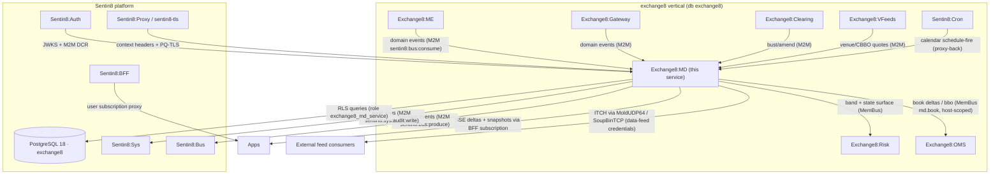

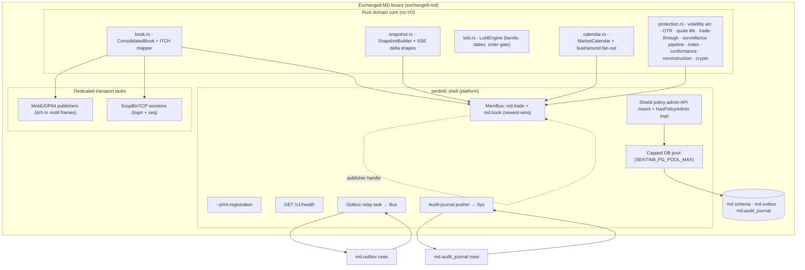

## 2. Runtime Architecture

The binary is an axum/tokio process on the shared shell. Boot order (shell):

1. `--print-registration` flag short-circuits before any I/O.
2. PQ crypto provider install → dotenv → tracing + error metrics.
3. Config from env (`EXCHANGE8_MD_*` prefix; DSN = `EXCHANGE8_MD_DATABASE_URL`).
4. Capped DB pool (default max 3) + PostgreSQL 18 enforcement (hard fail).
5. State build: `ServiceCore` + `MdState { core, membus }` - the MemBus
   `ServiceBus::connect("exchange8:md", valkey_url)` handle.
6. Shield boot (`sentin8-policy` `boot_full` on the shell's engine - load
   policy sets, unparsable text refuses to start; hot-reload consumer +
   stat emitter spawn here; the engine is consumed via
   `core.admin.policy`, never re-booted by the service).
7. Outbox relay task (drains `md.outbox` rows to Bus `POST /v1/produce`
   via pg_notify `md_outbox_changed` + 5 s safety poll) and the
   audit-journal pusher (drains `md.audit_journal` to Sys
   `POST /v1/audit`) - both fail-open.
8. Router assembly: health + the service extension router (Shield
   policy-admin API) + OpenAPI + the standard middleware stack (traffic
   counter, `X-Sentin8-*` context inject/strip, host-context resolver via
   the database-free `sentin8-tls` library, request logging, correlation
   id, CORS).
9. PQ-TLS termination (X25519MLKEM768 key exchange, ML-DSA-65 signatures),
   graceful drain via the health in-flight gauge polled by Sentin8:Captain.

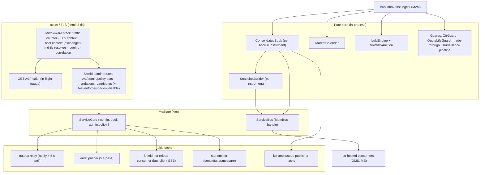

### Request lifecycle: book update ingest → L1/L2/L3 publication

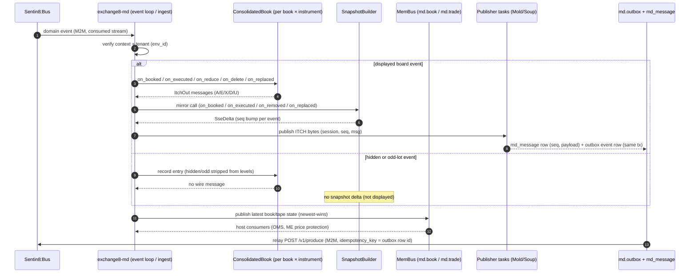

### Request lifecycle: snapshot service (snapshot + SSE resumption)

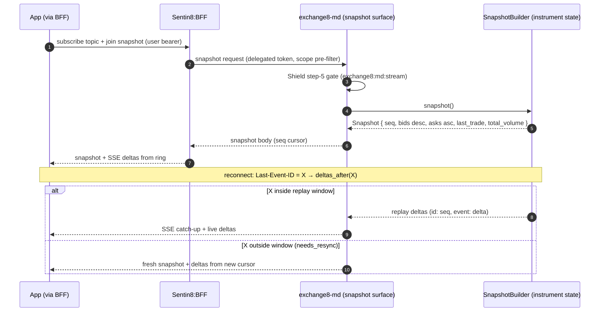

### Request lifecycle: LULD band computation + volatility decision

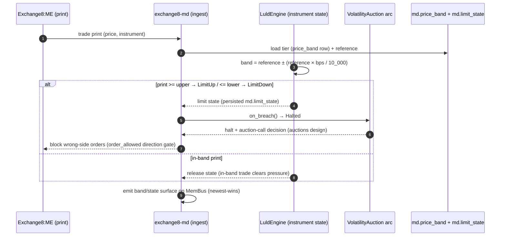

### Request lifecycle: admin RFW (policy-admin surface)

```mermaid
sequenceDiagram
    autonumber
    participant ADM as Env admin (RFW)
    participant BFF as Sentin8:BFF
    participant SV as exchange8-md (admin routes)
    participant ENG as Shield engine (core.admin.policy)
    participant DB as exchange8 db (sentin8_policy_sets)

    ADM->>BFF: GET /proxy/.../v1/admin/policy-sets (bearer)
    BFF->>SV: delegated call (scope pre-filter)
    SV->>SV: Shield gate exchange8:md:policy:read (role exchange8:md:admin)
    SV->>ENG: list/get policy sets
    ENG->>DB: SELECT (RLS on env_id)
    DB-->>ENG: rows
    ENG-->>SV: sets (cached engine view)
    SV-->>ADM: policy set list
    Note over ADM,DB: PUT /test/enforce/shadow/disable mutate tenant-authored sets;<br>forbid beats permit; shadow never blocks (would-deny logged + emitted)
    ADM->>SV: GET /v1/admin/{sessions,bands} (RFW data endpoints)
    SV-->>ADM: feed sessions / LULD bands (admin RFW page data)
```

## 3. Data Model

Schema `md` in db `exchange8`; role `exchange8_md_service` (no BYPASSRLS,
grants in the vertical database only). Every tenant table is
`ENABLE`+`FORCE ROW LEVEL SECURITY` with `env_id` policies via the platform
helpers.

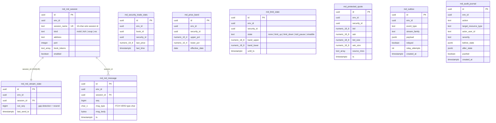

Per-table notes (ownership/visibility):

| Table | Purpose | Notes |
|---|---|---|
| `md.md_session` | MoldUDP64 / ITCH / SoupBinTCP session config per env | `kind` ∈ `mold`/`itch`/`soup`/`ws`; 10-char wire `session_name` (UNIQUE); feed consumer credentials are Sentin8 secret-refs, never inline |
| `md.md_stream_state` | per-stream outbound sequence | `UNIQUE (session_id)`; `out_seq` drives gap detection and resend |
| `md.md_message` | published market-data replay store | `UNIQUE (session_id, seq)`; retention-purged by Sentin8:Cron; source for Soup replay-from-seq |
| `md.security_trade_stats` | last-trade cache per (env, book, security) | last price + last time - the L1/stats source |
| `md.price_band` | per-instrument LULD band widths | `upper_pct`/`lower_pct` basis-point widths (e.g. 5.00 tier 1) with `effective_date` |
| `md.limit_state` | current limit state per instrument | state ∈ `none`/`limit_up`/`limit_down`/`luld_pause`/`straddle` + band bounds + `until_ts` |
| `md.protected_quote` | protected-quote cache fed by VFeeds CBBO events | best bid/ask + sizes + `source_mics[]` (protected venues) |
| `md.outbox` | local outbox (DBX producer plane) | rows written in the same tx as the domain change; relay → Bus `POST /v1/produce` (idempotency_key = row id); partial index on un-relayed |
| `md.audit_journal` | local audit journal | rows pushed to Sys `POST /v1/audit`; a Sys outage never drops audit; partial index on un-pushed |

RLS: every table has `FOR SELECT`/`FOR INSERT`/`FOR UPDATE`(/`DELETE` where
applicable) policies matching
`sentin8_context_initialized() AND env_id = sentin8_current_env_id()`.
The outbox trigger `md.md_notify_outbox()` emits `pg_notify('md_outbox_changed')`.

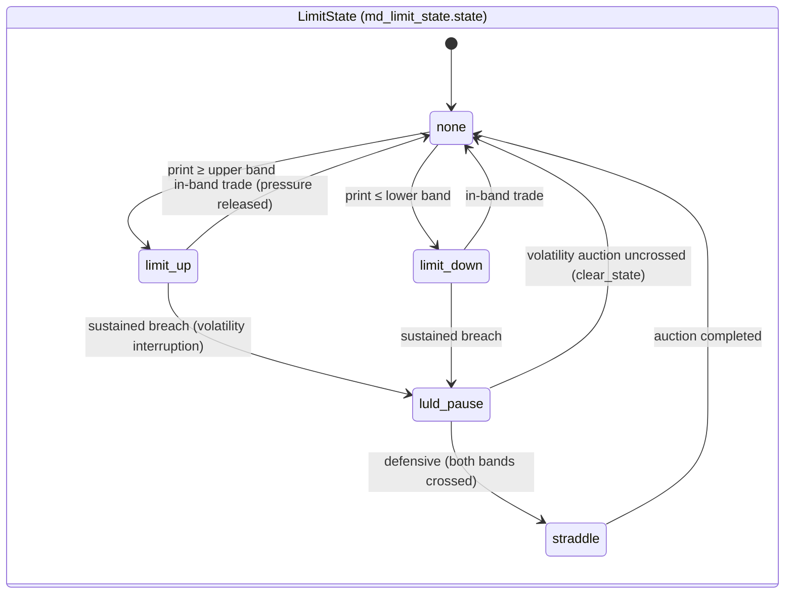

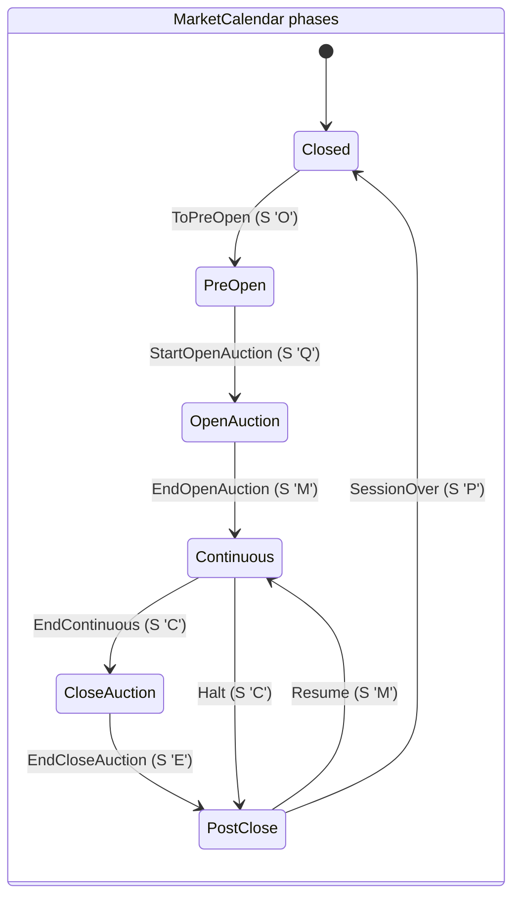

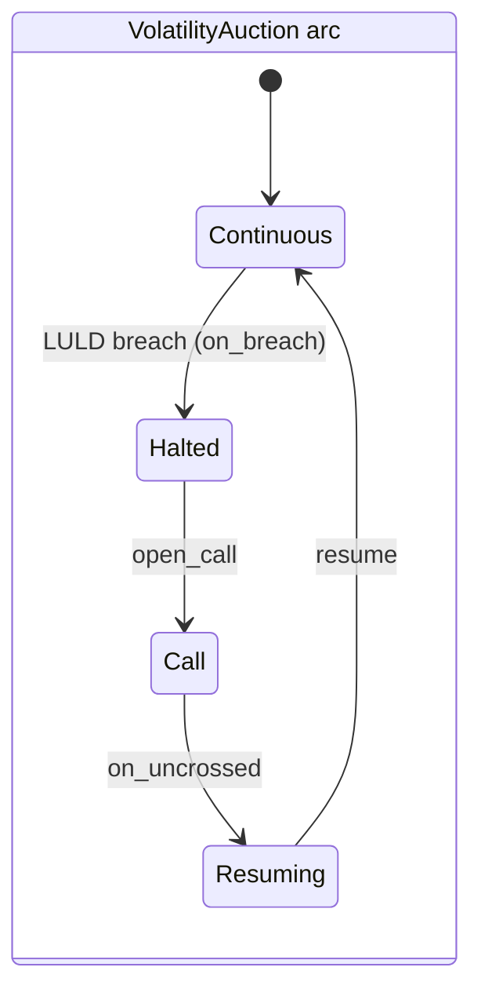

## 4. API Surface

All HTTP traffic terminates in-process via `sentin8-tls` (PQ-TLS only);
context headers `X-Sentin8-*` are injected by the platform Proxy and
stripped/injected by the shell context middleware - handlers never do their
own hostname-based tenant resolution. The 8-step pipeline: bearer verify →
tenant resolve → feature gate → Shield authorize (roles resolved live) → RLS
context (`SELECT sentin8_set_tenant_context(...)` on the same connection) →
execute → audit.

| Audience | Surface | Gate | Notes |
|---|---|---|---|
| Health / ops | `GET /v1/health` | none (liveness; in-flight gauge for drain) | captain-polled |
| Data subscribers | snapshot / SSE delta surface via Sentin8:BFF subscription (pure `SnapshotBuilder` shapes) | `exchange8:md:stream` (user or M2M; scope-mirror set) | `id: seq`, `event: delta`, Last-Event-ID resumption |
| Feed consumers | MoldUDP64 A/B + SoupBinTCP sessions carrying ITCH VER2 | data-feed credentials (Sentin8-issued, per-consumer, revocable) - multicast is network-scoped by deployment | replay-from-seq via `md_message` store |
| Admin (RFW) | `GET /v1/admin/ui/sessions`, `GET /v1/admin/ui/bands`; data endpoints `GET /v1/admin/sessions`, `GET /v1/admin/bands` | `exchange8:marketdata:read` (role `exchange8:admin`) | feed sessions + LULD bands page data |
| Tenant policy admin | `/v1/admin/policy-sets` (`GET`/`PUT`/`DELETE` `{name}`, `POST /test`, `POST /enforce`, `POST /shadow`, `POST /disable`), `/v1/admin/relations` (+ `/check`), `/v1/admin/attributes` | `exchange8:md:policy:read` / `exchange8:md:policy:write` (role `exchange8:md:admin`) | shared Shield mount; handler actions mirrored by the registered scope-mirror set |
| Registration | `--print-registration` | host (no network) | service_type `exchange8:md`; subdomain `exchange8-md` |

Error surface: `ErrorCode` `Exchange8LuldBandBreached` →
`exchange8_luld_band_breached`, HTTP 409 (a print/order rejected at the band).

Emitted domain events (durable, Bus; `vertical:service:resource:operation`):

| Event family | Trigger | Consumer |
|---|---|---|
| book / tape state deltas + MemBus `md.book`, `md.trade` (newest-wins) | every ingested board event / trade print | co-hosted consumers (OMS, ME), BFF subscription fan-out |

Design-doc-identified event shapes (`exchange8:md:*`, e.g. band-state changes,
system events) ride the same outbox → Bus produce plane; the durable topic
naming for each family is the event-flow contract below.

Inbound (consumed): Exchange8:ME order/trade/status events, Exchange8:Gateway internal
cross + instrument state, Exchange8:Clearing bust/amend, Exchange8:VFeeds CBBO quote
events, Sentin8:Cron calendar schedule-fire.

### Multi-party interaction: BFF subscription fan-out

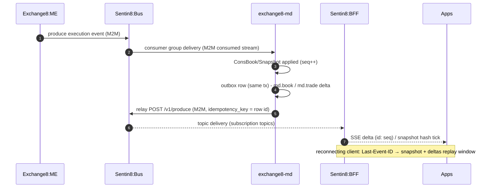

### Event flow: outbox → Bus → trigger

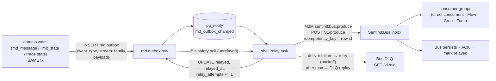

## 5. Cross-Cutting Concerns

- **Authentication** - Sentin8:Auth is the only issuer; the shell verifies
  bearer tokens (issuer/signature/expiry/audience/token type via the Auth
  client). M2M tokens are cert-bound (DCR workloads: `exchange8:md`/`md`,
  `exchange8:md-policy`/`md-policy`, `md-audit`, `exchange8-md-tls`); a stolen
  token without the key is unusable.
- **Authorization** - step 5 is Shield (`sentin8-policy`) evaluating
  roles resolved live; the JWT `scope` is a pre-filter + RLS feed. The
  registered `scope-mirror` set is the engine's default permits over the live
  scope set (action `exchange8:md:stream`), enforced mode; a tenant-authored
  forbid beats the platform permit; shadow never blocks (logged would-deny).
  Platform admins carry `sentin8:sys:admin` (and org/env-admin mirrors).
- **RLS context** - every tenant query sets
  `SELECT sentin8_set_tenant_context(env_id)` (async, `.await`ed) on the same
  pooled connection as the data query (transaction-local
  `set_config(..., true)`); explicit `WHERE env_id = $n` clauses remain
  defense-in-depth. `exchange8_md_service` carries no BYPASSRLS.
- **Idempotency / exactly-once** - outbox rows carry `idempotency_key = row
  id`; the Bus produce relay is at-least-once and consumers dedupe on the key.
  Calendar transitions are idempotent at the feed layer (invalid replays
  no-op); bust/amend fan-out is ordered and replay-safe.
- **Rate limiting / bot protection** - request-counter middleware + captain
  drain gauge at the shell; domain-side protection is the order-to-trade-ratio
  guard (per-connection watermark, grace trades) and the minimum-quote-life
  guard for cancel storms.
- **Audit journaling** - domain mutations write `md.audit_journal` rows
  (same transaction where possible); the shell pusher relays to Sys
  `POST /v1/audit` (`sentin8:sys:audit:write`, M2M `md-audit`). Sys stamps the
  verified `client_id`; a Sys outage only delays the push.
- **Graceful drain on upgrade** - the health payload exposes the traffic
  counter's `active_connections`; Sentin8:Captain's rolling
  `upgrade-instance` polls it, in-process tasks stop after the drain window;
  streams resume from the persisted `md_stream_state.out_seq`.
- **TLS posture** - post-quantum exclusively: X25519MLKEM768 key exchange,
  ML-DSA-65 signatures, root CA from the OS trust store; hostname resolution
  on cache miss rides Sys `GET /v1/resolve/hostname` via the database-free
  `exchange8-md-tls` M2M workload (`sentin8:sys:instances:read`) + TTL cache.
  No DSN rides the TLS library path.

## 6. Failure Modes & Recovery

| Failure | Durable behavior |
|---|---|
| Bus outage / DCR failure | relay task fails-open: rows persist in `md.outbox`, the 5 s safety poll retries; the service serves traffic; the Valkey registry + captain upgrade path is unaffected |
| Sys audit outage | journal pusher fails-open: `md.audit_journal` rows persist, 5 s pass retries; audit is never dropped, only delayed |
| Publisher crash | streams resume from the persisted per-session `md_stream_state.out_seq`; consumers reconnect with their own sequence (no negative-ack model) |
| Multicast loss (feed plane) | B leg + unicast retransmission endpoint; Soup consumers replay from `md_message` rows |
| ME event gap | gap detection via the per-instrument monotonic event sequence embedded by ME → alert + resync request (loss is surfaced, never silent) |
| Replay-store backpressure | retention purge (Cron) trims `md_message` oldest-first; the replay ring window in memory is bounded and trimmed oldest-first |
| Pool saturation | `sentin8_config::pg_pool::connect` caps `max_connections` (default 3, `SENTIN8_PG_POOL_MAX` override); publish-path bookkeeping stays in memory, DB round-trips are write-side only |
| LULD band misconfiguration | an unconfigured instrument is unrestricted (`band() → None`) - configuration errors are caught by the admin RFW bands page and the 409 band-breach error surface, never by silent halts |
| Process crash mid-tx | domain write + outbox/journal insert are one transaction - an unrelayed row simply retries; no half-published state |

### Relay retry after Bus outage (outbox → Bus → DLQ path)

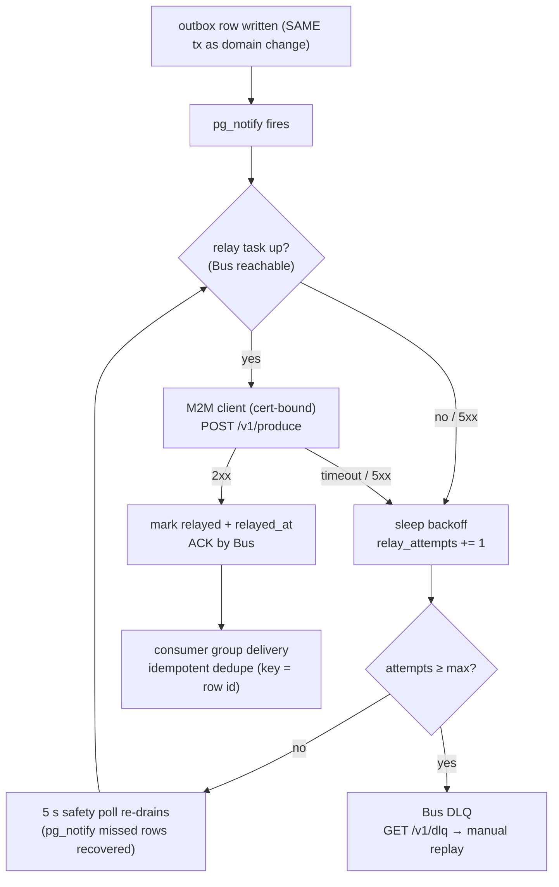

### Recovery sequence: protection-state reconstruction after crash

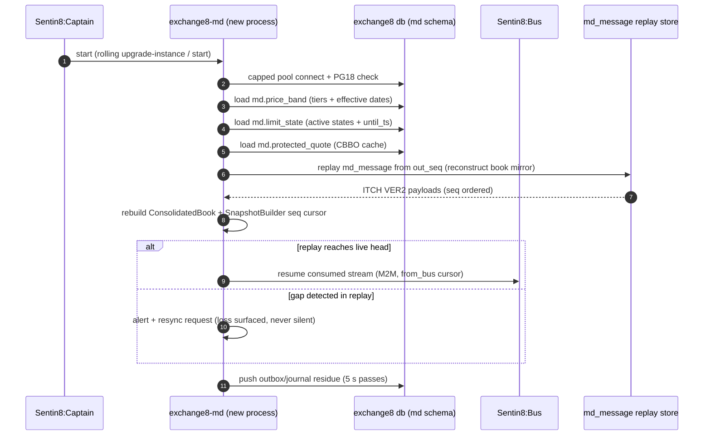

## 7. Concurrency & Performance Model

The process is a tokio multi-task runtime; the pure core is single-owner per
instrument (no shared mutable state across books), so no locks protect the
book itself - ownership is the isolation. The shell's worker set is shared;

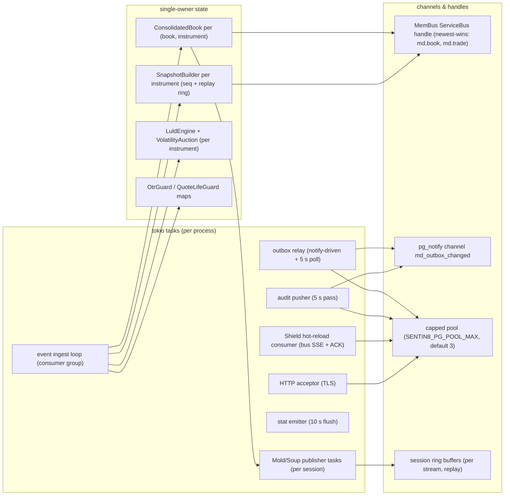

- **Task layout** - one acceptor (TLS loop blocks), one relay task, one
  audit-pusher task, one hot-reload consumer, one stat emitter, publisher
  tasks per published session, and the ingest loop(s) per consumed stream.
- **Locking strategy** - no mutexes on the publish path: each
  (book, instrument) mirror and each snapshot builder is owned by the shard
  task that processes that instrument; guards are per-connection/per-order
  maps owned by the ingest path. The only shared handles are the pool and the
  MemBus handle (cloneable, internally synchronized).
- **Pool sizing** - the shell cap (3, `SENTIN8_PG_POOL_MAX`) bounds total
  PostgreSQL connections across the fleet; MD's hot path (book mutate → wire
  emit → MemBus publish) never touches the pool.
- **Hot caches** - bands and limit states are in-memory
  `HashMap<u32, …>` in the engine, hydrated from `md.price_band` /
  `md.limit_state` at boot (and refreshed by config changes); the snapshot
  replay ring (`replay_window`, bounded `VecDeque`) is hot; `md_message`
  inserts are the durable write side, retention-purged off-line by Cron.
- **Backpressure** - publish-side: dedicated per-session transport tasks and
  bounded rings absorb bursts (design: 1 ms snapshot throttle for multicast
  bursts); ingest-side: at-least-once consumer groups with per-message ACK;
  when the ring overflows, oldest-first trim forces resync rather than
  unbounded memory.

## 8. Invariants, Insecure-Defaults Rejected, Unsafe Rationale

Always-true conditions:

1. **Hidden orders never surface in displayed depth** - every level-mutation
   path gates on `!hidden && !odd`.
2. **Level sets are exact** - every order-add/decrease/delete adjusts exactly
   one side's `BTreeMap` and removes zero-volume levels immediately.
3. **`seq` is strictly monotonic per instrument** - one bump per applied
   event; the snapshot carries the last-applied seq; `deltas_after` never
   synthesizes.
4. **The replay window is the only delta memory** - a cursor outside the
   window is a resync (`needs_resync`), never a reconstruction from raw wire.
5. **Band classification is total and inclusive** - at/beyond an edge is a
   limit state; unconfigured ⇒ unrestricted; direction gate enforces the
   state's side.
6. **Fan-out order for bust/amend is fixed** (cancel → corrective/re-broken
   marker → restore; amend additionally prints corrected terms).
7. **Calendar invalid transitions are no-ops** - the phase machine is
   idempotent to calendar replays.
8. **RLS is enforced and forced on every tenant table** - the DDL ships
   policies matching `env_id`; unconfigured contexts are silently empty, and
   inserts without context are rejected by the `WITH CHECK` policy.
9. **No plaintext secrets** - feed consumer credentials and any provider
   secrets are Sentin8 secret-refs (session rows carry references), never
   inline values in `md` tables or outbox payloads.
10. **Scope-mirror parity** - every handler action (Shield targets) is covered
    by the registered mirror set; a new handler without a mirror permit fails
    the wiring test at build time.

Insecure defaults rejected:

- No `PgPool::connect` without the platform cap (`sentin8_config::pg_pool::connect`).
- No per-service re-boot of the Shield engine (single engine at boot; services
  consume `core.admin.policy`) - a second engine would risk a cache split
  between the request path and the admin API.
- No shadow-mode-as-enforcement or dual-write fallbacks - shadow is the
  one-UPDATE rollback lever only, never the steady-state gate.
- No BYPASSRLS anywhere in the vertical (role grants are schema-scoped in the
  vertical database only).
- No plaintext API/protocol tokens or shared soup passwords - per-consumer
  revocable data-feed credentials as secret references.
- No classical TLS fallback - PQ-only terminate in-process.

Unsafe rationale: the unit contains no `unsafe` code (pure core + shell glue;
allocator safety is delegated to `mimalloc` and the platform crates).

## 9. Testing Strategy

Layers and ownership (pure core → in-binary unit tests → SQL matrix →
platform/E2E):

```mermaid
graph TD
    subgraph L1["Layer 1 - golden byte + pure invariants (in-binary #[cfg(test)])"]
        G1["book.rs: add/execute/reduce/delete/replace → ITCH bytes, lengths vs exchange8::itch constants\nhidden/odd stripping, depth aggregation, trading-action codes"]
        G2["calendar.rs: session arc emits O/Q/M/C/E/P in order; halt/resume; invalid transitions no-op"]
        G3["luld.rs: tier band widths (±5/10/20%); breach classifications; direction gating; state release; per-instrument isolation"]
        G4["snapshot.rs: seq-per-event; BBO/depth ordering; SSE + JSON shapes; replay window + resync predicates"]
        G5["protection.rs: volatility arc; OTR grace; quote life; trade-through + sweep exception; surveillance escalation; divisor continuity; conformance scenarios; reconstruction; crypto crediting + feed shapes"]
    end
    subgraph L2["Layer 2 - policy wiring (tests/policy.rs, no DB)"]
        P1["scope-mirror text vs engine: no-set deny · no-match deny · shadow never blocks\nforbid beats permit · M2M parity · sys:admin pass · cross-env isolation · enroll dry-run"]
    end
    subgraph L3["Layer 3 - SQL matrix (tests/sql_matrix.rs, live DB, probe role)"]
        S1["every init.sql table: FORCE RLS + select policy\nno context → 0 rows; insert rejected; own-env visible once; cross-env invisible\none rolled-back tx (zero residue); skip offline"]
    end
    subgraph L4["Layer 4 - platform + E2E (owned elsewhere)"]
        P4["shell boot (refuse-to-start on unparsable policy)\nrelay/pusher behavior under outage\nBFF subscription + RFW admin UI (platform E2E suites)"]
    end
    G1 --> P4["cargo test -p exchange8-md (no DB needed)"]
    G2 --> P4
    G3 --> P4
    G4["unit modules compile with golden constants"] --> P4
    G5[""] --> P4
    P4 --> S1
    P4 --> P4B["workspace SQL suites (platform)"]
    P4 --> P4C["e2e-ts UI suite (platform)"]
```

What each layer owns:

- **Layer 1 (pure core)** - byte-exact ITCH encoding, book/snapshot/LULD/
  calendar invariants, protection decisions. No tokio, no DB, fully hermetic.
- **Layer 2 (policy wiring)** - the scope-mirror contract with the real seeded
  text, fail-closed/shadow semantics, tenant isolation per env.
- **Layer 3 (SQL matrix)** - RLS truth against the live cluster as a
  `NOBYPASSRLS` probe role; self-maintaining from the DDL the binary ships.
- **Layer 4 (platform/E2E)** - boot failure modes, relay/audit retries, BFF
  subscription UX, and admin RFW rendering are cross-service suites owned by
  the platform/testing strategy docs.

Deliberately not tested here: Valkey/MemBus wire behavior, Bus DLQ semantics,
proxy context-header stripping, captain drain/upgrade - all platform-shell
surfaces with their own suites.

## 10. Open Questions

- **Snapshot/replay REST + BFF subscription wiring.** The pure snapshot
  service core (`SnapshotBuilder`, `Snapshot`, `SseDelta`) is complete, but
  the design doc's REST paths (`GET /v1/snapshot/:book/:instrument`,
  `replay?from_seq=`, per-book instrument directory, market status) and the
  BFF topic fan-out surface are mounted nowhere in this binary today: which
  surface (axum routes here vs a BFF-adjacent publisher) ships the join
  point, and the exact per-topic naming, is the primary open wiring question.
- **Published session model in-sources.** The session config
  (`md_session` rows, `kind ∈ mold/itch/soup/ws`) and sequence state
  (`md_stream_state`) are schema-level truths; the dedicated Mold/Soup
  publisher tasks, A/B legs, and retransmission endpoint are described in the
  market-data design's published session model, not yet in this unit's
  source files.
- **Retention defaults.** `md_message` is "retention-purged" by Sentin8:Cron;
  the retention window default and the alert watermark for replay rings are
  config questions not expressed here.
- **Protected-quote feed contract.** The VFeeds → MD protected-quote event
  (which CBBO event name/fields populate `md.protected_quote`) is owned by
  the VFeeds design; verified only through the table comment.
- **Index publication consumers.** `IndexPublication` (value + gate) is
  consumed by margin/funding per the index-engine design; the durable topic
  and minimum-change default are outside this unit.
- **Surveillance production detector set.** Which detectors ship enabled per
  env (the pipeline accepts closures) belongs to the surveillance unit.
- **Instrument directory / trading-action `H` fan-out endpoint.** The ITCH
  `H` (trading action) and `R`/`r` SOD directory are produced from calendar +
  book state; the SOD refresh surface (gateway events vs MD-side publish) is
  an open contract question.

---

**Design attribution:** exchange8:md and its underlying concepts were designed by Hamid Jahanzad <Hamid@Jahanzad.com>.

