# Exchange8:ME - Detailed Design Document

## 1. Scope & Context

Exchange8:ME owns the deterministic matching of order events onto per-instrument
CLOB books inside one environment: the memory-resident books, the input
journal, the trade-id lease consumption, the auction state machines, and the
outbound lifecycle/trade event stream. It explicitly does **not** own:

- client protocols (FIX / SOUP / ITCH) - Exchange8:Gateway terminates those and
  forwards;
- pre-trade risk authorization - Exchange8:Risk gates before traffic reaches ME;
- market-data book assembly / feed distribution - Exchange8:MD consumes ME events;
- trade persistence and clearing - Exchange8:Clearing consumes events; ME owns
  in-flight lifecycle only;
- market session/calendar persistence, contract master, instruments -
  Exchange8:RefData (ME pre-loads its metadata via the registry);
- event durability fan-out, audit delivery - platform planes (Sentin8:Bus,
  Sentin8:Sys) via the local outbox and journal tables below.

### System context

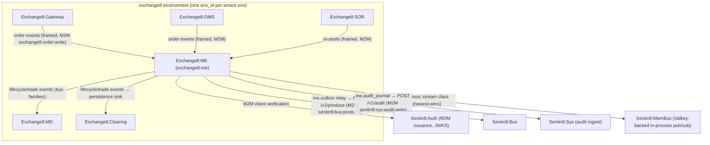

### Container view

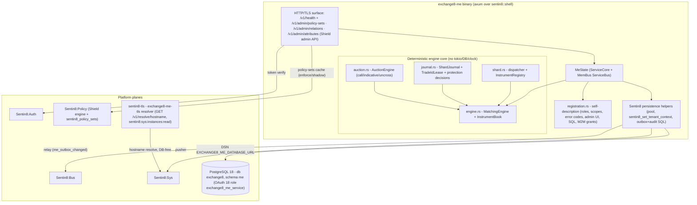

## 2. Runtime Architecture

The binary boots via `sentin8::shell::serve`:

1. `Sentin8Shell::new("exchange8:me", "EXCHANGE8_ME")` - registration, DB pool
   graceful drain on `make upgrade-instance`.
2. `with_state` builds `MeState { core, membus }` - `ServiceBus::connect`
   attaches the MemBus publish handle; an empty `valkey_url` or unreachable
   Valkey disables publishing with a WARN (fail-soft, the exchange still boots).
3. `with_router(extend_router)` mounts `/v1/health` (shell), the shared
   Shield policy-admin API (`/v1/admin/policy-sets*`, `/v1/admin/relations*`,
   `/v1/admin/attributes*`), and the declared RFW admin pages
   (`GET /v1/admin/ui/engine` + `POST /v1/admin/engine`,
   `GET /v1/admin/ui/auctions` + `POST /v1/admin/auctions`) - the RFW
   definitions are pure data (`admin_pages.rs`), the data endpoints read
   engine state through the in-process snapshot.
4. `registration::print` serves `--print-registration`: the `scope-mirror`
   Shield set (actions `exchange8:me:manage` + the engine/auction admin
   vocabulary over the live effective scope set), the `exchange8_me_service`
   PostgreSQL role (RLS-granted, no BYPASSRLS, cross-schema grant only to
   `refdata.security SELECT`), error codes, RFW admin pages, M2M grant
   workloads, and the `init` SQL for the `me` schema.
5. State-closure workers - the boot spawns the egress stack around the shard
   plane: the per-shard `ShardJournal`s push chunks to the journal writer
   task (Sentin8:Storage objects), the engine's `MeEvent` drain feeds one
   outbox-writer task (batched INSERTs on `me.outbox`), and the quote
   snapshot (`QuoteSource`, engine-local BBO) feeds price protection. The
   shell's own relay (boot 8b) and audit pusher (8c) drain the outbox and
   journal tables - ME never re-implements them.

### Component diagram

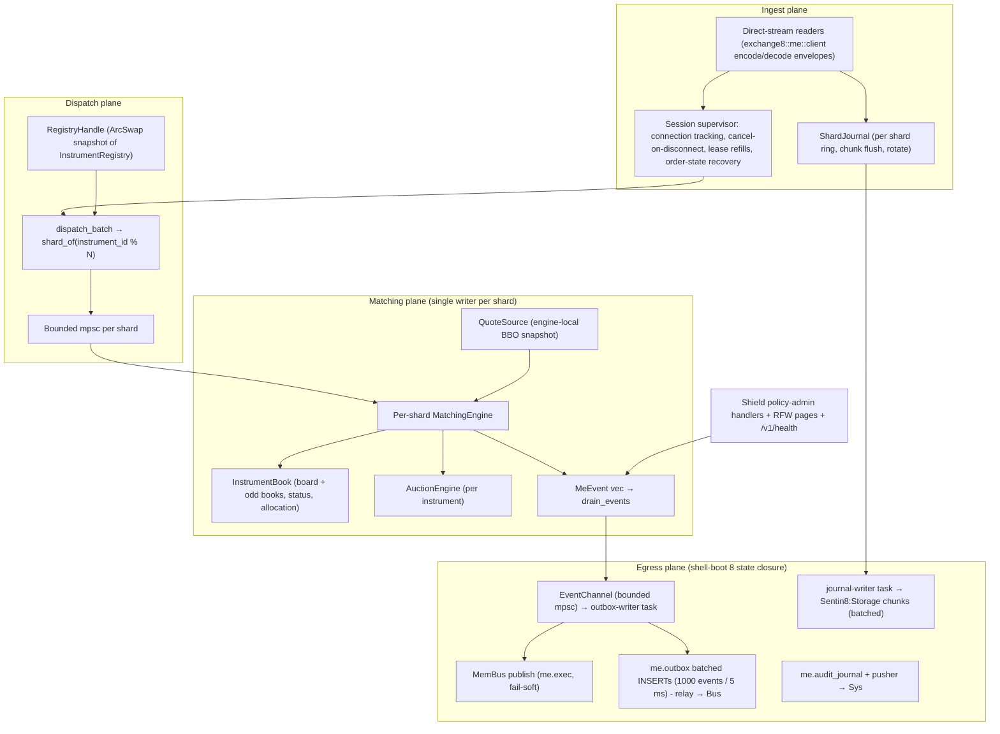

### Request lifecycle - order ingest → match → journal → outbox

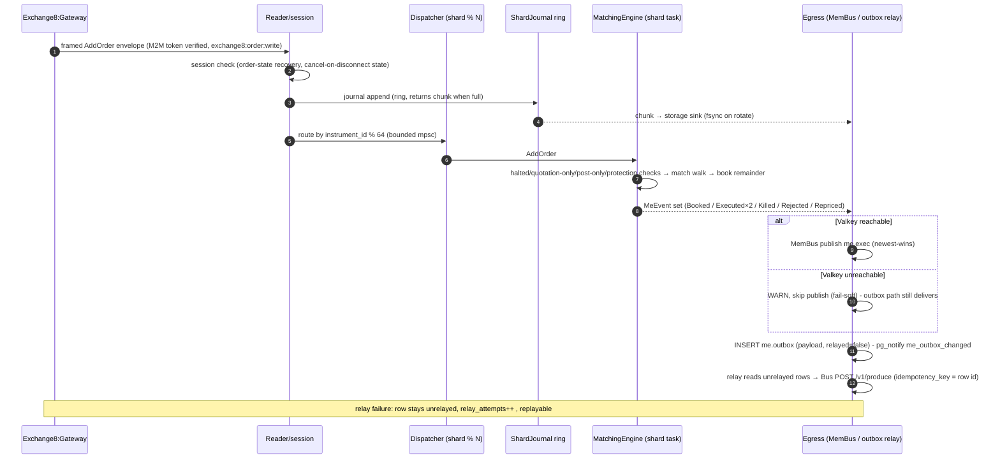

### Request lifecycle - auction call / indicative / uncross

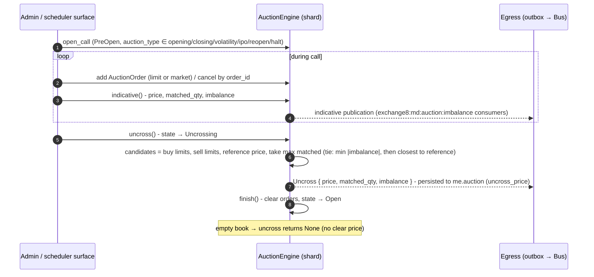

### Request lifecycle - admin / policy surface (RFW pass)

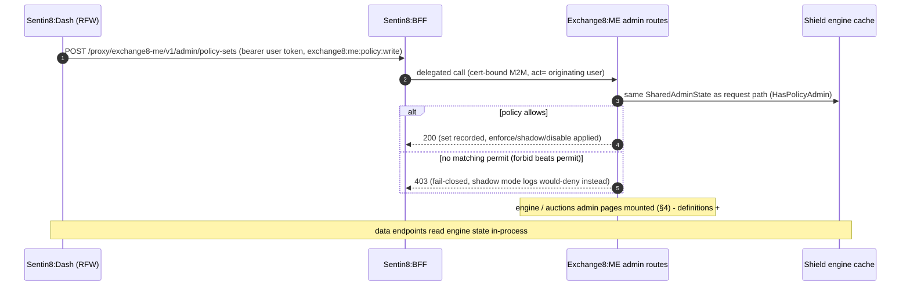

## 3. Data Model

Schema `me` in database `exchange8` (database-per-vertical,
schema-per-service); role `exchange8_me_service` holds exactly the grants in
`init.sql` (no BYPASSRLS; cross-schema read limited to `refdata.security
SELECT`). RLS is FORCEd on every table with
`sentin8_context_initialized() AND env_id = sentin8_current_env_id()`
policies; context is set per connection via
`SELECT sentin8_set_tenant_context($1)` - always `await`ed, transaction-local.

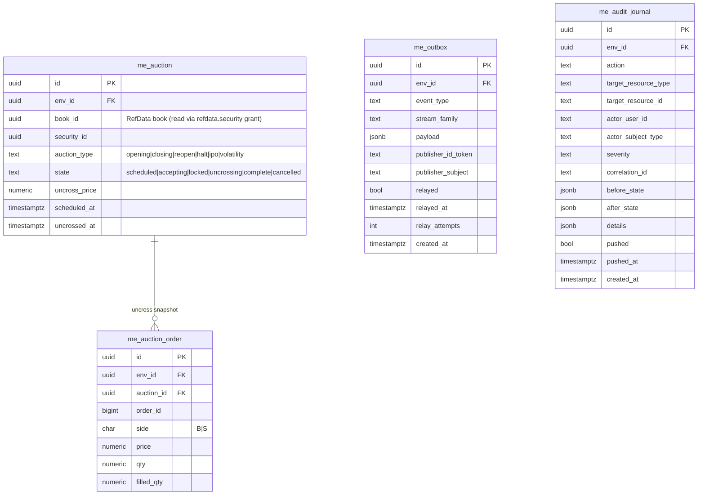

Per-table notes:

- `me.auction` - one row per (book, auction_type, scheduled session);
  `state` is the durable auction lifecycle CHECK-enforced to
  `scheduled|accepting|locked|uncrossing|complete|cancelled`; `uncross_price`
  is written at uncross; indexed on `env_id`. Visibility tier: env (RLS on
  `env_id`), no org column.
- `me.auction_order` - participating orders as of the uncross snapshot
  (`order_id`, side, price, qty, `filled_qty`); FK to `me.auction`; env-scoped
  RLS; no audit of fills beyond the journal - Clearing persists trades.
- `me.outbox` - the local outbox (platform `sentin8_outbox` shape): rows are
  inserted in the same transaction as any domain change (`event_type`,
  `stream_family`, `payload`), flagged `relayed` by the shell relay
  (`relayed_at`, `relay_attempts`), partial index on unrelayed rows, and the
  `me_outbox_changed` trigger firing `pg_notify` for the relay wake-up.
- `me.audit_journal` - the local audit journal (platform `sentin8_audit`
  shape): admin/lifecycle actions with before/after states, pushed to
  Sentin8:Sys; `pushed`/`pushed_at` track delivery; partial index on unpushed.
- The matched books, prices, quantities and orders themselves are **not**
  persisted - they live in memory per shard; the input journal (Sentin8:Storage
  objects) plus deterministic replay is the reconstruction path, and trade
  persistence belongs to Exchange8:Clearing as the event sink. Trade/order ids come
  from platform-managed sequence leases (`exchange8::wire::SequenceLease` -
  batches of 10 000, refill `UPDATE…RETURNING`); this vertical declares no
  sequence table.

### Order lifecycle (engine)

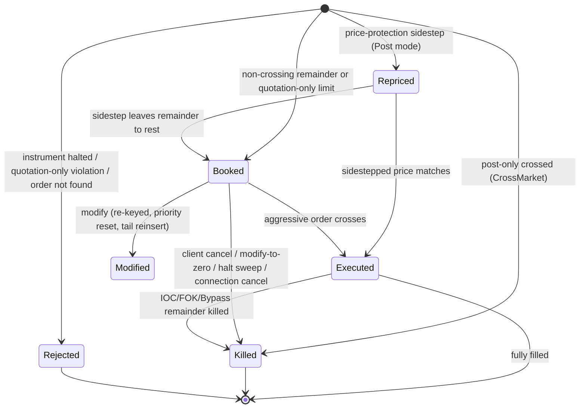

### Auction state machine

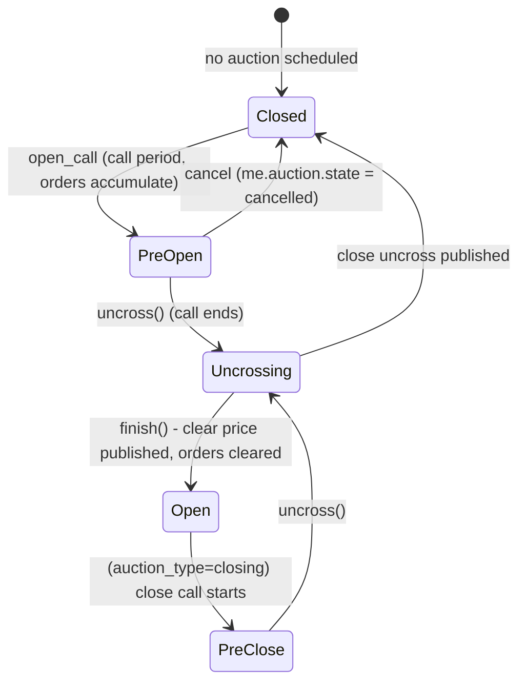

Note: the in-memory engine distinguishes `Closed → PreOpen → Uncrossing →
Open`; the durable `me.auction.state` row carries the scheduling stages
(`scheduled` → `accepting` when the call opens → `locked` at call end →
`uncrossing` while the clearing price computes → `complete` at publish -
`cancelled` when an operator withdraws the session). The shard's auction
task advances the row in the SAME transaction as the outbox event
(`exchange8:me:auction:uncrossed`) and the audit journal rows - the
durable and in-memory state machines cannot diverge at an uncross.

## 4. API Surface

Order flow uses direct framed streams (`exchange8::me::client` envelopes over
`exchange8::wire`), not HTTP payloads - ME has **no inbound HTTP data surface
of its own**; the router mounts health and the Shield admin API only.

| Audience | Surface | Gate | Notes |
|---|---|---|---|
| Upstream services (M2M) | order events (Add / Cancel / Modify / InstrumentStatus / MarketStatus / OrderState) | bearer verify → tenant resolve → Shield (`exchange8:order:write`; manage scope `exchange8:me:manage`) | framed envelopes; `env_id` claim on every message |
| Upstream services (M2M) | stream reads (me.exec) | `exchange8:order:read` | MemBus stream class consumers (MD mirror, journal batcher) |
| Admin / Shield | `GET/PUT/DELETE /v1/admin/policy-sets{,/{name},/{name}/test}`, `POST /v1/admin/policy-sets/{enforce,shadow,disable}`, `GET/PUT/DELETE /v1/admin/relations{,/check}`, `GET/PUT/DELETE /v1/admin/attributes` | `exchange8:me:policy:read` / `exchange8:me:policy:write` (also `exchange8:me:manage`, `sentin8:sys:admin`, sys org/env admins via the scope mirror) | shared Shield admin API mount |
| Admin (declared) | `GET /v1/admin/ui/engine` + `POST /v1/admin/engine`; `GET /v1/admin/ui/auctions` + `POST /v1/admin/auctions` | role `exchange8:me:admin` (admin scopes: `exchange8:order:{read,write}`, `exchange8:auction:{read,write}`, `exchange8:me:policy:{read,write}`) | RFW pages; mount in progress |
| Health | `GET /v1/health` | unauthenticated (shell) | liveness for Sentin8:Captain |
| Out | Bus `POST /v1/produce` | M2M `sentin8:bus:produce` | workloads `exchange8:me`/`me`, plus `sentin8:stat:measure` |
| Out | Sys `POST /v1/audit` | M2M `sentin8:sys:audit:write` | workload `me-audit` |
| TLS | `GET /v1/resolve/hostname` (Sys owner API) | M2M `sentin8:sys:instances:read` | workload `exchange8-me-tls` (database-free resolve) |

Emitted events - vocabulary `exchange8:{service}:{resource}:{operation}`, the
`MeEvent` → `event_type` mapping the outbox writer owns (constants in
`events.rs`, asserted by the vocabulary tests):

| `MeEvent` | event_type | stream family | MemBus family |
|---|---|---|---|
| `Booked` | `exchange8:me:order:booked` | `me.exec` | `me.exec` |
| `Killed` | `exchange8:me:order:killed` | `me.exec` | `me.exec` |
| `Modified` | `exchange8:me:order:modified` | `me.exec` | `me.exec` |
| `Repriced` | `exchange8:me:order:repriced` | `me.exec` | `me.exec` |
| `Rejected` | `exchange8:me:order:rejected` | `me.exec` | `me.exec` |
| `Executed` (both sides) | `exchange8:me:trade:executed` | `me.exec` | `me.exec` |
| auction uncross | `exchange8:me:auction:uncrossed` | `me.auction` | `me.auction` |

Payload = the `Envelope<T>` shape (`event_type`, `env_id`, per-shard `seq`,
`idempotency_key = "me-{shard}-{seq}"`, typed payload) - payload-complete
(event-first rule: Clearing/MD react from the payload alone). The MemBus
drain publishes the same envelope to the `me.exec` stream class fail-soft;
the outbox path delivers durably. Inbound events this service consumes:
contract-master / registry refresh (`sentin8:refdata:security:updated`
family), policy-set updates (`sentin8:sys` policy families via the Shield
consumer), market-wide status from the fan-out path.

### Multi-party: gateway → risk → me → bus

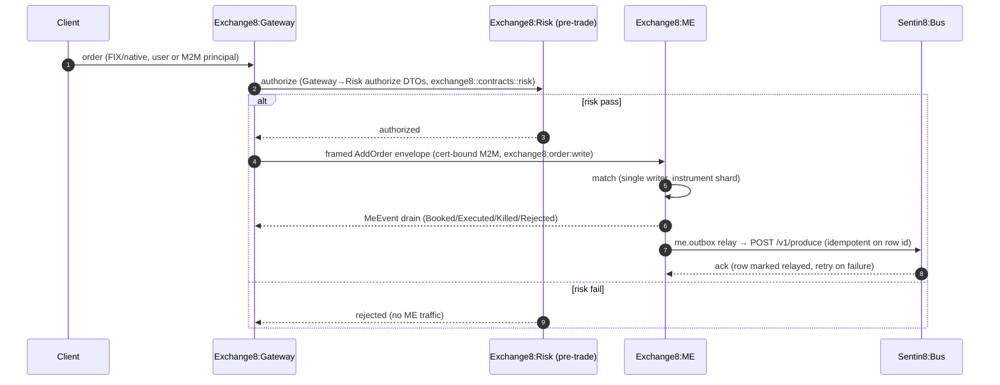

### Event flow: outbox → Bus → trigger

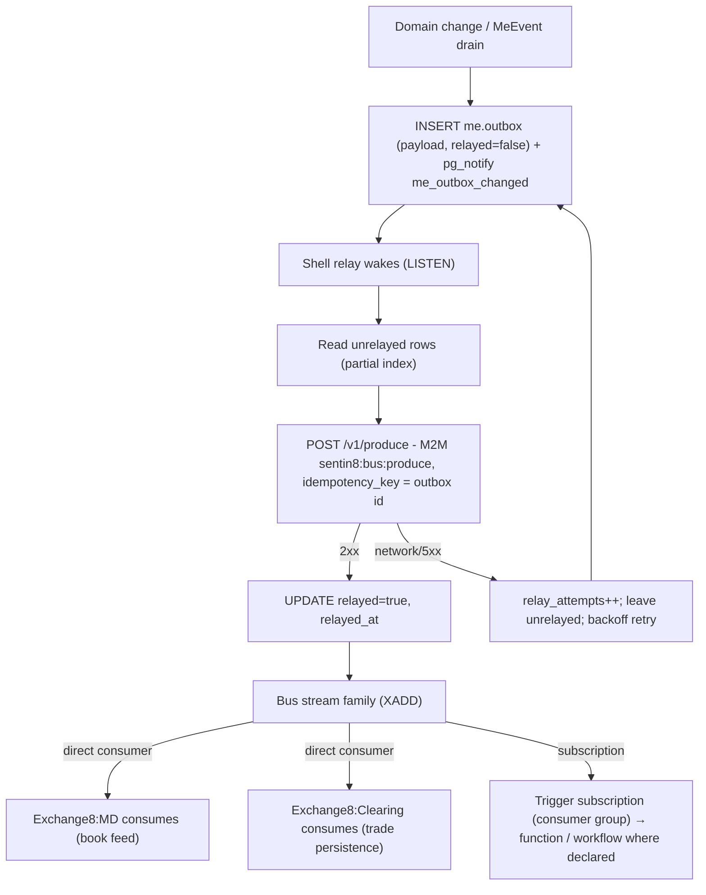

## 5. Cross-Cutting Concerns

- **Authentication.** Sentin8:Auth is the only issuer. Direct-stream callers
  present cert-bound M2M tokens (`exchange8:order:write`); the 8-step
  pipeline applies (bearer verify → tenant resolve → feature gate → Shield
  authorize → RLS context → execute → audit); requests that cannot resolve a
  tenant context are rejected, never defaulted.
- **RLS context.** Every tenant-table access sets context on the *same*
  connection: `SELECT sentin8_set_tenant_context($1)` awaited,
  transaction-local (`set_config(..., true)`); explicit `env_id` WHERE
  clauses remain defense-in-depth on top of FORCE RLS. The integration test
  matrix (below) proves silent zero-row reads without context, insert
  rejection via WITH CHECK, own-env visibility, and cross-env invisibility.
- **Shield authorization.** Step 5 is the only gate. The seeded
  `scope-mirror` policy set (declared in `registration.rs`, text asserted by
  tests) is action-granular over the LIVE effective scope set; enforce mode
  runs the decision, shadow mode logs `would-deny` without blocking;
  tenant-authored forbid beats the platform mirror; M2M parity holds
  (`token_tp` never bypasses); no-set / no-match deny (fail-closed).
- **Idempotency & exactly-once.** Bus delivery is at-least-once by stream
  semantics; the outbox relay's `idempotency_key = me.outbox.id` makes the
  produce path effectively-once per domain event. Journal replay is
  idempotent in the sense of determinism: rebuilding a shard replays the
  journaled input sequence through the stateless-initialized engine to an
  identical state (trade ids resume from the lease refill at replay start).
- **Rate limiting / backpressure.** The ME relies on upstream risk and
  connection limits (Exchange8:Gateway / Exchange8:Risk own admission); internally every
  inbound queue is a bounded mpsc - overflow is backpressure to the upstream
  stream, alerted at the queue watermark, never an unbounded buffer.
- **Audit journaling.** Admin-domain changes ride
  `me.audit_journal` (same transaction as the change where applicable) with
  actor/subject/severity/correlation; the shell pusher forwards unpushed rows
  to Sys `POST /v1/audit` (`workload me-audit`, scope
  `sentin8:sys:audit:write`); Sys outages only delay delivery, never lose
  events.
- **Drain.** `sentin8::shell` graceful drain integrates with
  `make upgrade-instance`: the new instance reaches `Active` in the registry,
  the old drains in-flight shard work and writes outstanding journal/outbox
  rows before exit - no stale Valkey captain entries, no dropped matches on
  rolling swap.
- **TLS posture.** In-process TLS via the `sentin8-tls` library
  (post-quantum X25519MLKEM768 / ML-DSA-65); the DB-free resolver workload
  `exchange8-me-tls` resolves hostnames through the Sys owner API
  (`GET /v1/resolve/hostname`, scope `sentin8:sys:instances:read`) - ME holds
  no platform-database DSN for resolution and no vertical carries
  BYPASSRLS anywhere in its grant set.

## 6. Failure Modes & Recovery

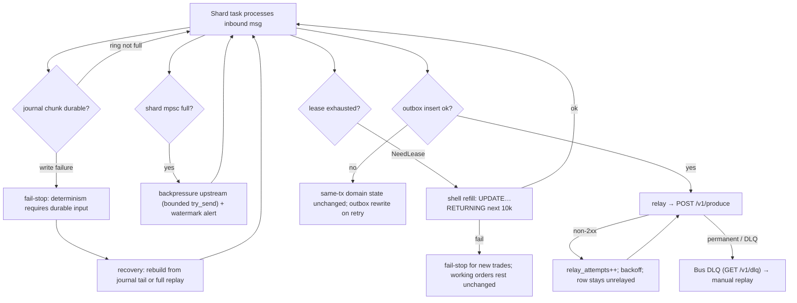

- **Process crash mid-shard.** Books are memory-resident; the journaled
  input is durable through the storage sink chunks rotated per session.
  Recovery protocol: on restart replay each shard's journal chunks through a
  fresh `MatchingEngine` (deterministic ⇒ identical books + identical next
  trade-id frontier via lease refill), then resume from the drain point.
  The Gateway-facing reconciliation ('W' all-orders state request, per-order
  erase / cancel) keeps upstream views converged.
- **Journal write failure.** Fail-stop: the journal is the source of
  recoverable truth; matching pauses rather than accepting effects that
  could not be replayed.
- **Sequence lease failure.** Fail-stop for new trade ids (no fill can be
  assigned); resting orders and cancels continue - id issuance is the only
  blocked surface.
- **Relay / Bus outage.** `me.outbox` rows accumulate unrelayed
  (`relay_attempts` grows); partial-index reads replay in `created_at`
  order when Valkey recovers; idempotency keys make replay safe; the MemBus
  realtime path degrades to WARN publish-skip without failing the exchange.
- **Sys audit outage.** `me.audit_journal` rows stay unpushed; the pusher
  retries - audit is never lost, only delayed.
- **Auction session persistence failure.** `me.auction` writes are the
  durable record of sessions; if the DB write fails the session is not
  uncrossed (the uncross transaction owns the row update), keeping the
  durable state machine consistent with the engine's.

Recovery sequence:

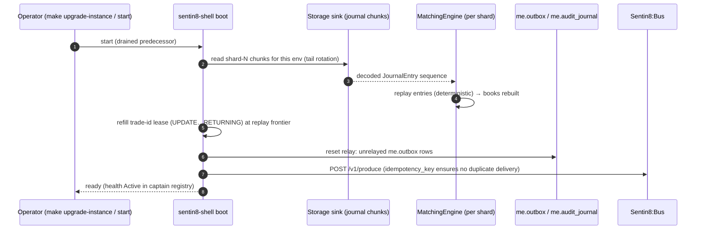

## 7. Concurrency & Performance Model

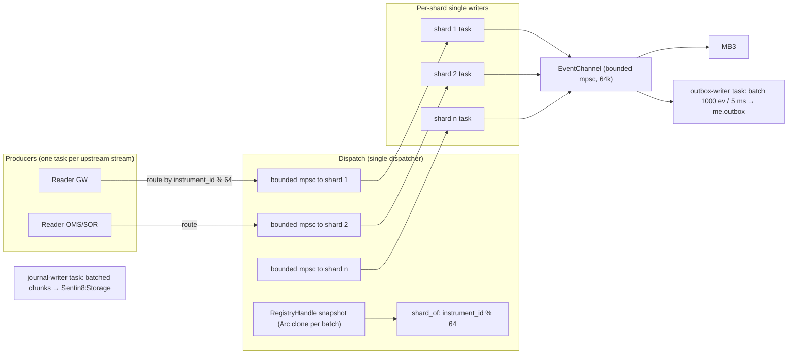

- **Task layout.** One tokio task per shard (64 default, `DEFAULT_SHARDS`), one
  reader task per upstream stream, THREE egress tasks (MemBus fail-soft
  publisher, outbox writer, journal writer) plus the shell's own relay/pusher
  (boot 8b/8c) - every channel between them is bounded; `try_send` backpressure
  is the only queueing control.
- **Outbox writer budget.** The `EventChannel` drain batches 1000 events or a
  5 ms tick, whichever first (design §4 writer budget): one INSERT batch on
  `me.outbox` per drain under one RLS-contexted transaction. A full channel
  backpressures the shard tasks (never drop, never block on I/O inline).
- **Single-writer rule.** All mutation of an instrument's books happens on its
  shard's task: no atomics, no mutex, no lock ordering to reason about;
  cross-instrument market status routes to the fan-out shard (0) by design.
- **Registry swap.** `RegistryHandle::refresh` (copy → mutate → swap) keeps
  readers on immutable snapshots - a shard's batch reads one consistent
  metadata view even mid-update; unknown instruments resolve to the
  documented default (lot 100, FIFO) for pre-registry journal replay only.
- **Hot path.** AddOrder = metadata snapshot lookup + ordered-level best-first
  walk (no rescan), O(1) order locate/cancel/reduce by id, O(log L) level
  insert, FOK availability O(L), pro-rata allocation O(n) per level;
  allocations on the fill path come from slab pools (`crates/book::pool`).
- **Backpressure & saturation.** Bounded queues everywhere: a slow MemBus or
  storage sink cannot grow a shard's memory; the exchange degrades
  publishing (WARN) before it drops events; fail-stop is reserved for
  durability loss (journal / lease), the inputs the determinism guarantee
  rests on.

## 8. Invariants, Insecure-Defaults Rejected, Unsafe Rationale

Always-true conditions:

1. One writer per instrument book (shard map is total and stable; the same
   message never mutates two shards).
2. Every accepted inbound message is journaled before its effects are
   observable outside the engine.
3. Strict FIFO prefix consumption on `fifo` instruments; pro-rata only
   where the contract master says so; qty conservation per allocation
   (Σ fills = min(incoming, level volume); fills ≤ resting).
4. Both sides of every fill share one `trade_id`; execution price equals the
   resting order's price; active side is liquidity-removed, passive added.
5. Identical accepted input sequence ⇒ identical event stream and book state
   (replayable; the journal's deterministic encoding is stable).
6. No tenant-table read/write without a set tenant context on that
   connection; RLS FORCEd everywhere; role `exchange8_me_service` holds no
   BYPASSRLS and no cross-database grants.
7. Trade ids come only from the in-process lease with monotonic refill -
   no sequence table bypass, no id reuse within an env (lease refills resume
   from the platform store's frontier).
8. The engine never rejects by policy decision not made by Shield: the
   scope mirror's `exchange8:me:manage`/action permits are the only enforced
   gate; shadow never blocks; forbid always wins.

Insecure-defaults rejected: no plaintext secrets in `me.*` tables
(verification material lives in the identity plane; the schema carries no
token columns beyond publisher references in the outbox); no
`danger_accept_invalid_certs`-style shortcuts (Sentin8:Acme root is in the
OS trust store); no BYPASSRLS or superuser runtime role; no lazy
metadata hydration (a book that froze defaults forever would be an
insecure default); no unbounded queue without backpressure.

Unsafe rationale: the engine core contains no `unsafe`; hot-path
allocation reuse is expressed with safe slab-pool APIs in `crates/book`
(pin-free, ownership-returned on consume), so determinism and memory safety
are enforced by the type system rather than by unchecked code.

## 9. Testing Strategy

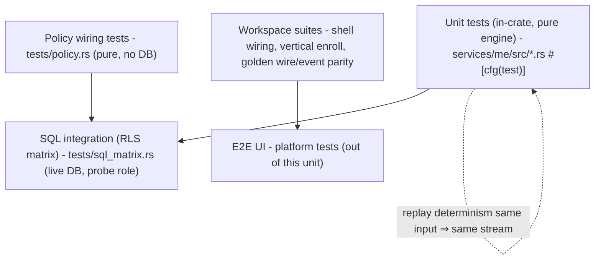

- **Pure engine unit tests** (inside `engine.rs`, `journal.rs`, `shard.rs`,
  `auction.rs`): price-time priority and strict FIFO prefix; broker
  preferencing two-pass; per-contract allocation (`fifo` untouched by
  pro-rata code; pro-rata shares, conservation, deterministic remainder);
  IOC/FOK/PostOnly/Bypass; iceberg reload with tail reinsertion and
  time-priority reset; STP KillActive/Passive/Both/Decrement and FOK
  STP-disabled; halt sweep + rejection; quotation-only gating; board/odd
  partition (mixed lots, odd never fills board); FX CLOB pipette precision
  and lot_size=1 no-split; journal round-trips, ring autoflush, rotate
  semantics, garbage-safe decode; lease hand-out/refill; shard assignment
  stability/balance, dispatch exactly-once, registry pre-load/atomic
  refresh, market-status fan-out; auction state machine, max-volume
  uncross, tie-breaks, zero-imbalance clearing, indicative math.
- **Policy wiring tests** (`tests/policy.rs`, no DB): the *actual* seeded
  scope-mirror text drives the engine cache - no-set deny, enforced
  no-match deny, shadow never blocks (would-deny reported), mirror permits
  its own grants, M2M parity, platform-admin scopes pass, forbid-beats-
  permit, role-keyed tenant sets participate.
- **SQL integration matrix** (`tests/sql_matrix.rs`, live PostgreSQL 18 as
  the `exchange8_probe` NOBYPASSRLS role): every table declared in
  `init.sql` exists with FORCE RLS + policies; zero rows without context;
  insert rejected by WITH CHECK; own-env sees exactly its probe row;
  cross-env zero rows - all inside one rolled-back transaction (zero
  residue, hermetic offline skip).
- **Deliberately not tested here:** platform token verification internals,
  RFW rendering, Bus/Sys wire formats, and Flutter surfaces - owned by the
  platform's own suites (covered in the platform testing strategy doc); the
  E2E UI pyramid lives at platform level.

## 10. Open Questions

- The concrete outbound `event_type` vocabulary shipped with the outbox
  writer (`events.rs` - the `MeEvent` mapping table in §4; the per-side
  `Executed` carries the common `trade_id`; the `Filled` roll-up stays a
  Clearing-consumed projection, not a second ME event).
- Cross-service L1 quote source (Exchange8:MD consolidated EBBO feeding
  `QuoteSource` over the bus) is a separate epic - the in-process seam is
  live: `QuoteSource` polls the shard's own journal-fed BBO snapshot and
  the MD feed swaps in behind the same trait.
- The e2e UI pyramid (eExchange shell + app instances) is a platform-level
  epic (A1) - the BFF proxy path does not yet serve an eExchange listing.

---

**Architecture & Design:** exchange8:me and its underlying concepts were designed by [Hamid Jahanzad](https://www.linkedin.com/in/hamidjahanzad/).

