# Exchange8:OMS - Detailed Design Document

## 1. Scope & Context

Exchange8:OMS owns the peg/iceberg supervision domain and the conditional-order
trigger domain inside one environment: the peg price formulas and the peg
state machine, iceberg display-slice reserve accounting, TWAP/VWAP/POV
slice scheduling, MOC/MOO auction queueing, the stop/stop-limit/trailing
trigger engine with OCO/OCA groups, complex-order atomic evaluation, the
quote cache driving re-evaluation, and the child-order id lease +
idempotency gate. It explicitly does **not** own:

- client protocols and session state (FIX / SOUP / ITCH) - Exchange8:Gateway
  terminates those and forwards peg management;
- the matching books and fills - Exchange8:ME owns both; OMS submits/replaces/
  withdraws working slices and receives lifecycle events;
- pre-trade risk authorization - Exchange8:Risk gates upstream (OMS only
  re-validates tick compliance of computed peg prices);
- market-data book assembly - Exchange8:MD / Exchange8:VFeeds publish the BBO/EBBO
  quote events OMS consumes;
- trade persistence and clearing - Exchange8:Clearing consumes the event stream;
- identity, policy, event durability, audit delivery - platform planes via
  the shell and the local outbox/journal tables below.

### System context

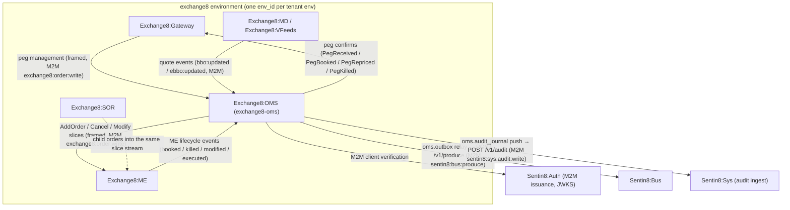

### Container view

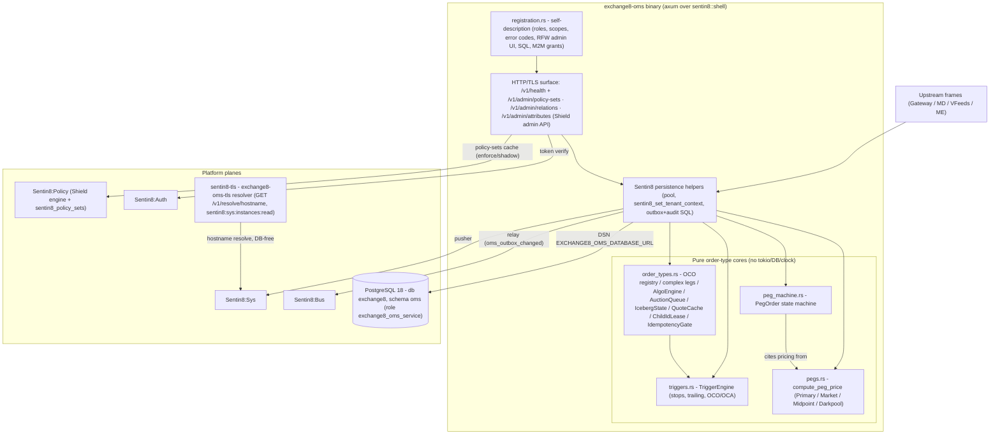

## 2. Runtime Architecture

The binary boots via `sentin8::shell::serve`:

1. `Sentin8Shell::new("exchange8:oms", "EXCHANGE8_OMS")` - registration, DB
   allocator, graceful drain on `make upgrade-instance`.
2. The `with_state` closure spawns the evaluation plane (`runtime.rs::
   spawn_tasks`): 64 instrument-shard evaluator tasks (single writer each),
   the quote consumer (Bus SSE `GET /v1/consume/sse`, group
   `exchange8-oms-quotes`, family `exchange8`), the algo scheduler pump
   (durable `oms.algo_order.state` binding), and the egress writer
   (batched `oms.outbox` INSERTs - 1000 events / 5 ms). The shell's own
   relay (boot 8b) and audit pusher (8c) drain what the plane stages;
   the stat sampler (DESIGN.md §10) emits the supervision gauges.
3. The router extension mounts the shared Shield policy-admin API
   (`mount_policy_admin`), the declared RFW pages + data endpoints
   (`GET /v1/admin/ui/{pegs,conditionals,algos}`, `POST
   /v1/admin/{pegs,conditionals,algo-orders}`, the
   `POST /v1/admin/algo-orders/{id}/{pause,resume}` mutation surface).
4. `registration::print` serves `--print-registration`: the `scope-mirror`
   Shield set (actions `exchange8:order:route` + `exchange8:algo:write`
   over the live effective scope set), the `exchange8_oms_service`
   PostgreSQL role (RLS-granted, no BYPASSRLS, no cross-schema grants),
   the `exchange8_trigger_already_fired` error code (HTTP 409), the RFW
   admin pages `Pegs` / `Conditionals` / `Algo orders`, M2M grant
   workloads, and the `init` SQL for the `oms` schema.

### Component diagram

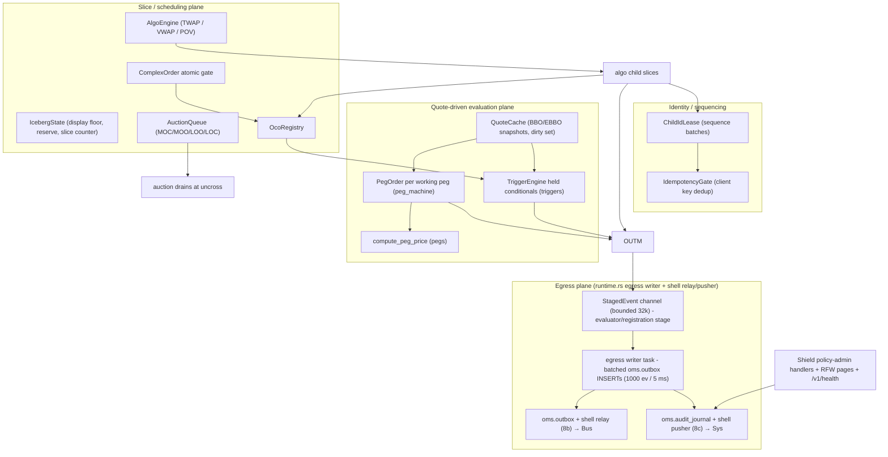

### Request lifecycle - pegged-order lifecycle

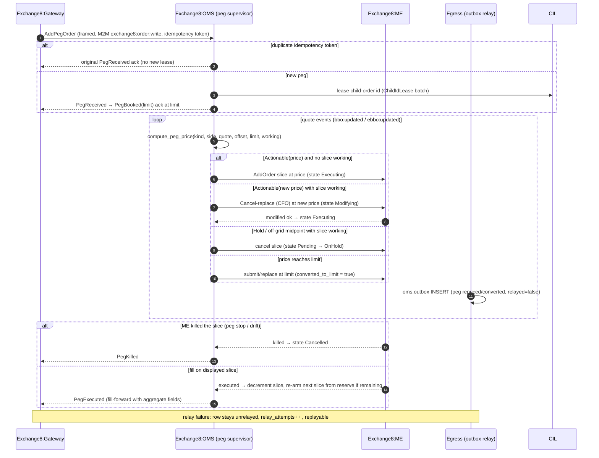

### Request lifecycle - iceberg slice issuance

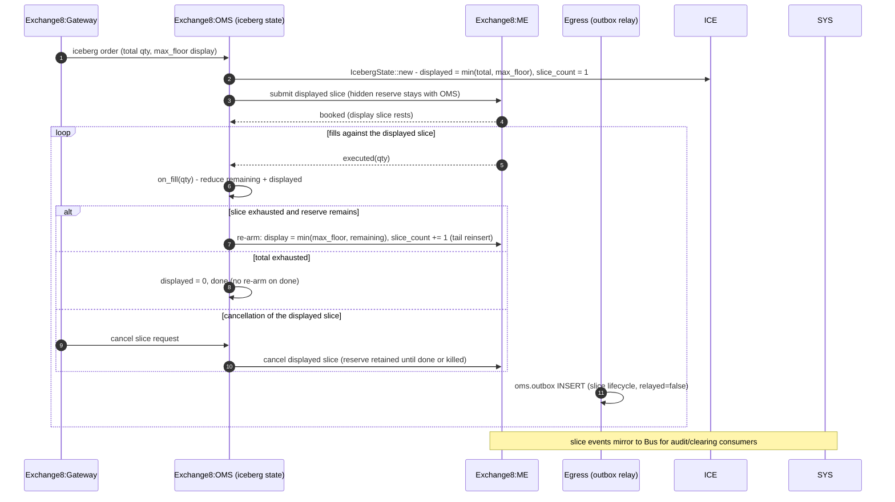

### Request lifecycle - trigger evaluation via market-data events

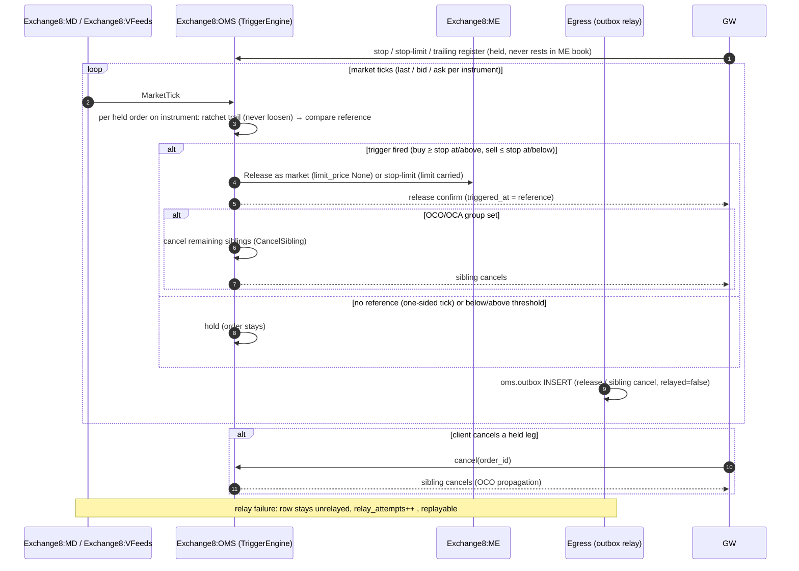

### Request lifecycle - admin / policy surface (RFW pass)

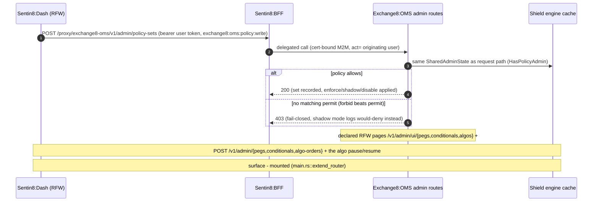

## 3. Data Model

Schema `oms` in database `exchange8` (database-per-vertical,
schema-per-service); role `exchange8_oms_service` holds exactly the grants
in `init.sql` (no BYPASSRLS, no cross-schema grants). RLS is FORCEd on
every table with `sentin8_context_initialized() AND env_id =
sentin8_current_env_id()` policies; context is set per connection via
`SELECT sentin8_set_tenant_context($1)` - always `await`ed,
transaction-local.

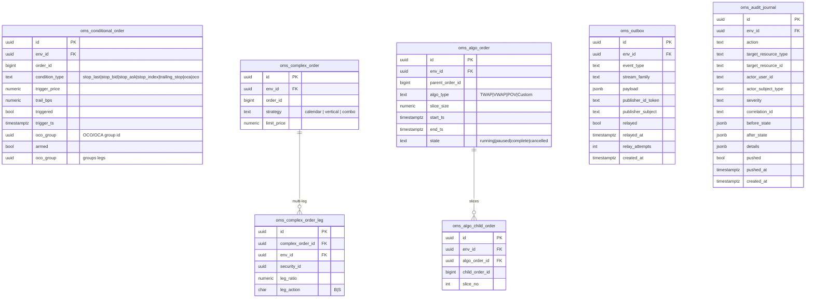

Per-table notes:

- `oms.conditional_order` - held stop/conditional/OCO skeletons
  (condition-type CHECK `stop_last|stop_bid|stop_ask|stop_index|
  trailing_stop|oca|oco`); `trigger_price`/`trail_bps` carry the trigger
  terms, `triggered`/`trigger_ts` record the release, `oco_group` links
  group legs, `armed` gates evaluation. Indexed on `env_id`. Visibility
  tier: env (RLS on `env_id`), no org column.
- `oms.complex_order` - multi-leg parent (strategy free-text e.g.
  calendar/vertical/combo; `limit_price` for the atomic gate);
  UNIQUE `(env_id, order_id)`.
- `oms.complex_order_leg` - one row per leg: `security_id`, ratio,
  `leg_action B|S`; FK to the parent.
- `oms.algo_order` - algo parent (algo-type CHECK
  `TWAP|VWAP|POV|Custom`), slice size, horizon, and the durable state
  CHECK `running|paused|complete|cancelled`; UNIQUE `(env_id,
  parent_order_id)`.
- `oms.algo_child_order` - emitted child slices per parent (`child_order_id`,
  `slice_no`); FK to the parent.
- `oms.outbox` - the local outbox (platform `sentin8_outbox` shape): rows
  inserted in the same transaction as the domain change (`event_type`,
  `stream_family`, `payload`), flagged `relayed` by the shell relay
  (`relayed_at`, `relay_attempts`), partial index on unrelayed rows, and
  the `oms_outbox_changed` trigger firing `pg_notify` for the relay
  wake-up.
- `oms.audit_journal` - the local audit journal (platform `sentin8_audit`
  shape): admin/lifecycle actions with before/after states, pushed to
  Sentin8:Sys; `pushed`/`pushed_at` track delivery; partial index on
  unpushed.
- Working pegs and trigger holds are **not** persisted - they are
  memory-resident and rebuildable (Gateway replay of the peg backlog /
  conditional registrations; the Clearing mirror provides the day-so-far
  set). Child-order ids come from platform-managed sequence leases
  (`ChildIdLease` batches); the vertical declares no sequence table.

### Peg state machine

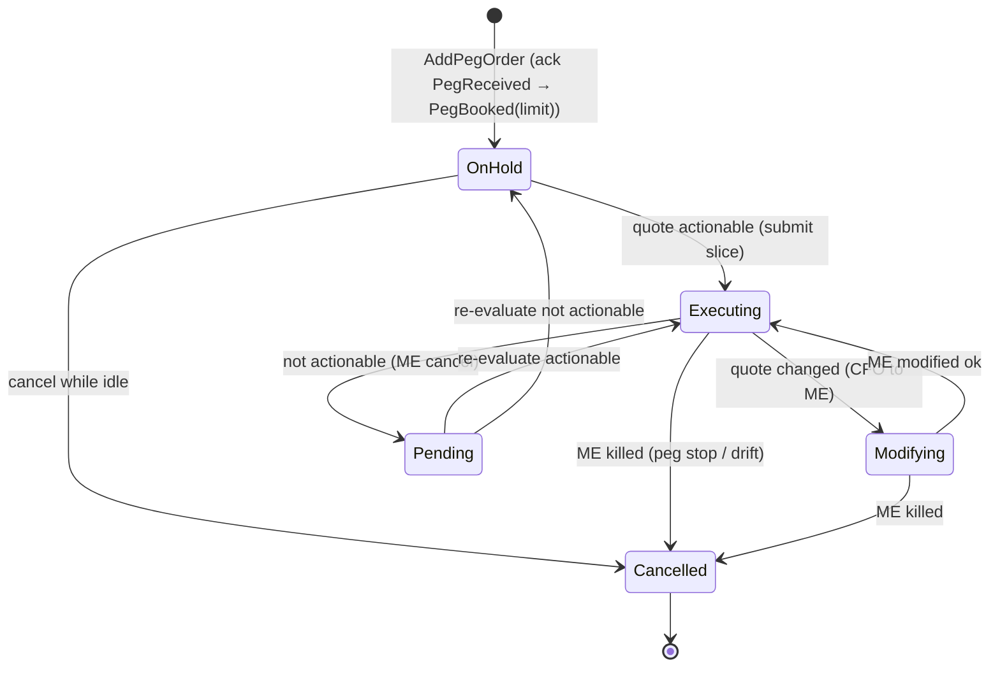

### Trigger lifecycle

```mermaid
stateDiagram-v2
    [*] --> Armed: register stop / stop-limit / trailing (armed = true)
    Armed --> Armed: tick below/above threshold (ratchet trail for trailing stops)
    Armed --> Released: reference breaches trigger (buy ≥ stop; sell ≤ stop)
    Armed --> CancelledByClient: client cancel (siblings cancel in group)
    Armed --> CancelledSibling: OCO sibling fired / cancelled first
    Released --> [*]: order lives as market/stop-limit in Exchange8:ME
    Cancelled --> [*]
    CancelledSibling --> [*]
    note right of Armed : durable skeleton (oms.conditional_order) held here, never in the ME book
```

## 4. API Surface

Upstream order flow rides direct framed streams (`exchange8::wire`), not
HTTP payloads - OMS has **no inbound HTTP data surface of its own**; the
router mounts health and the shared Shield admin API only.

| Audience | Surface | Gate | Notes |
|---|---|---|---|
| Upstream services (M2M) | peg management (AddPegOrder / CancelPegOrder / ModifyPegOrder), ME slice access, quote consumption | bearer verify → tenant resolve → Shield (`exchange8:order:route` evaluated by handlers; mirror covers `exchange8:order:{read,write}`) | framed envelopes; `env_id` claim on every message |
| Admin / Shield | `GET/PUT/DELETE /v1/admin/policy-sets{,/{name},/{name}/test}`, `POST /v1/admin/policy-sets/{enforce,shadow,disable}`, `GET/PUT/DELETE /v1/admin/relations{,/check}`, `GET/PUT/DELETE /v1/admin/attributes` | `exchange8:oms:policy:read` / `exchange8:oms:policy:write` (also `exchange8:order:{read,write}` via the scope mirror and platform-admin permits) | shared Shield admin API mount |
| Admin (declared) | `GET /v1/admin/ui/{pegs,conditionals,algos}` + `POST /v1/admin/{pegs,conditionals,algo-orders}` + `POST /v1/admin/algo-orders/{id}/{pause,resume}` | role `exchange8:oms:admin` (admin scopes: `exchange8:order:{read,write}`, `exchange8:algo:write`, `exchange8:oms:policy:{read,write}`); pages gate their own declared Shield action | RFW pages (mounted); the pause/resume writes gate `exchange8:algo:write` (mirror admits it + the platform-admin trio) |
| Errors | `exchange8_trigger_already_fired` | HTTP 409 | registered error code |
| Health | `GET /v1/health` | unauthenticated (shell) | liveness for Sentin8:Captain |
| Out | Bus `POST /v1/produce` | M2M `sentin8:bus:produce` | workloads `exchange8:oms`/`oms`, plus `sentin8:stat:measure` |
| Out (consume) | Bus `GET /v1/consume/sse` + `POST /v1/ack` | M2M `sentin8:bus:consume` | quote consumer (family `exchange8`, group `exchange8-oms-quotes`) - the SSE direct-consumer pattern (BUSCONNP-1): one long-lived stream connection, server-driven delivery, no per-second polling. |
| Out (stat) | Stat `POST /v1/m/metric` (via `collect_fire_and_forget`) | M2M `sentin8:stat:measure` | `oms.supervision` gauges - pegs working / conditionals held / algo parents running / child slices issued (the `{leaf}-policy` workload pair the policy boot initialized) |
| Out | Sys `POST /v1/audit` | M2M `sentin8:sys:audit:write` | workload `oms-audit` |
| TLS | `GET /v1/resolve/hostname` (Sys owner API) | M2M `sentin8:sys:instances:read` | workload `exchange8-oms-tls` (database-free resolve) |

Emitted events (outbox family `exchange8`, vocabulary
`exchange8:oms:{resource}:{operation}` - the constants in `events.rs`, one
outbox row in the SAME transaction as the domain change / stage write;
audited mutations journal a paired `oms.audit_journal` row):

| Event | When |
|---|---|
| `exchange8:oms:peg:received` | A peg registration is accepted (the client ack at limit) |
| `exchange8:oms:peg:booked` | A first working slice submitted (`Submit` action) |
| `exchange8:oms:peg:repriced` | A slice repriced / converted (`Replace` action; `converted` flag) |
| `exchange8:oms:peg:held` | A slice withdrawn (`Withdraw` action - non-actionable quote) |
| `exchange8:oms:peg:killed` | ME killed the slice / client cancel (mirror of the lifecycle event) |
| `exchange8:oms:peg:executed` | A fill landed on the working slice |
| `exchange8:oms:conditional:armed` | A conditional/stop registered (held, never in the ME book) |
| `exchange8:oms:conditional:released` | A trigger fired - the order released to ME (with `triggered_at`) |
| `exchange8:oms:conditional:sibling-cancelled` | An OCO/OCA sibling closed (group resolution) |
| `exchange8:oms:algo:started`/`paused`/`resumed`/`completed`/`cancelled` | The durable `oms.algo_order.state` transitions (guarded; same-tx event + audit) |
| `exchange8:oms:algo:child-issued` | A child slice recorded (`issue_algo_step`; front-row idempotency) |

Consumers: Exchange8:Clearing (audit/clearing mirror), Exchange8:Gateway (client
confirmations). Inbound events/messages this service consumes: the
consolidated BBO quote events (Exchange8:MD / Exchange8:VFeeds -
`exchange8:md:bbo:updated`, family `exchange8`, payload
`exchange8::contracts::events::BboUpdated`), ME lifecycle events (booked /
killed / modified / executed / rejected / repriced), Shield policy-set
updates, Gateway peg management requests.

**Producer seam (quote events).** The declared producer surface for
`exchange8:md:bbo:updated` is the MD/VFeeds wiring pass (their
`DESIGN.md §10` emission sites are still the open item - the vfeeds
`BboEngine` computes the CBBO change; the outbox write sites land with
their event-emission story). The OMS quote consumer is bound to the
declared family + payload shape today and idles (fail-open) until the
producers publish - consumers may run ahead of producers; pegs hold their
their last evaluation (quote-stall semantics, §6) in the interim. The
consumer rides the Bus SSE surface (`GET /v1/consume/sse`): the bus
holds the blocking read server-side on its own dedicated connection -
the OMS never issues short-interval `POST /v1/consume` blocking polls
(the BUSCONNP-1 defect class: a 1s-block poll loop that re-fires the
instant an empty batch returns saturates the bus's shared command
connection and pins the GLIDE watchdog's pending count above its
overload threshold permanently).

### Multi-party: gateway → oms → me → bus

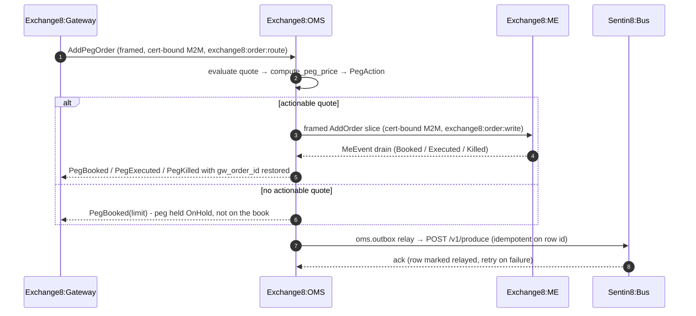

### Event flow: outbox → Bus → trigger

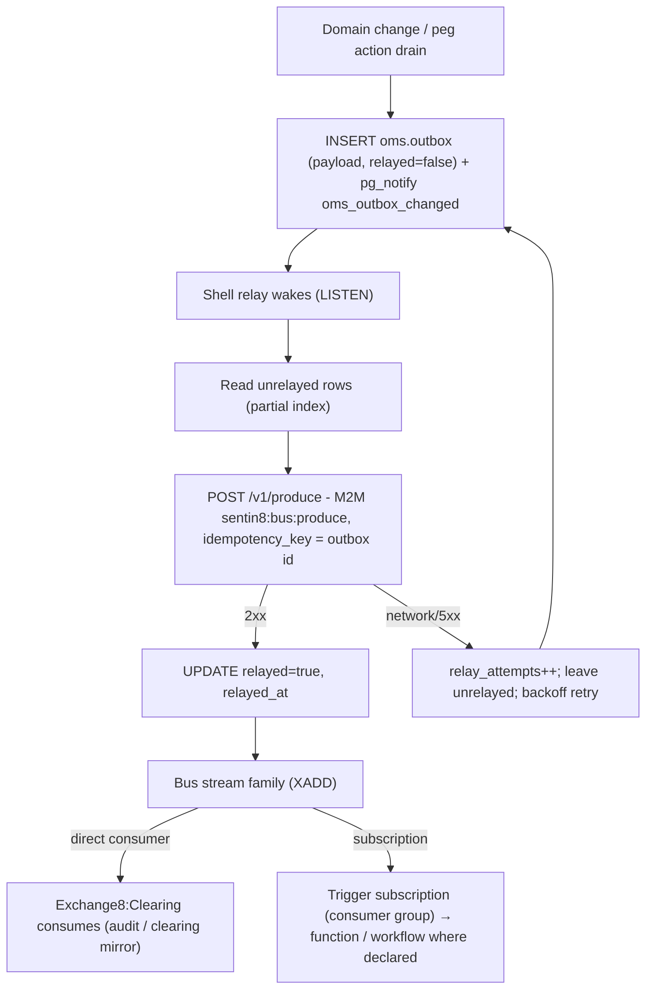

## 5. Cross-Cutting Concerns

- **Authentication.** Sentin8:Auth is the only issuer. Framed callers
  present cert-bound M2M tokens (`exchange8:order:write`);
  admin callers present delegated user tokens - the 8-step
  pipeline applies (bearer verify → tenant resolve → feature gate → Shield
  authorize → RLS context → execute → audit); requests that cannot resolve
  a tenant context are rejected, never defaulted.
- **RLS context.** Every tenant-table access sets context on the *same*
  connection: `SELECT sentin8_set_tenant_context($1)` awaited,
  transaction-local (`set_config(..., true)`); explicit `env_id` WHERE
  clauses remain defense-in-depth on top of FORCE RLS. The integration test
  matrix proves silent zero-row reads without context, insert rejection via
  WITH CHECK, own-env visibility, and cross-env invisibility.
- **Shield authorization.** Step 5 is the only gate. The seeded
  `scope-mirror` policy set (declared in `registration.rs`, text asserted
  by tests) is action-granular over the LIVE effective scope set - handler
  action `exchange8:order:route`; enforce mode runs the decision, shadow
  mode logs `would-deny` without blocking; tenant-authored forbid beats the
  platform mirror; M2M parity holds (`token_tp` never bypasses); no-set /
  no-match deny (fail-closed).
- **Idempotency & exactly-once.** Bus delivery is at-least-once by stream
  semantics; the outbox relay's `idempotency_key = oms.outbox.id` makes the
  produce path effectively-once per domain event. Gateway requests carry
  idempotency tokens - duplicate `AddPegOrder` no-ops with the original
  ack, duplicate cancels converge, and the `IdempotencyGate` returns the
  originally assigned child id on duplicate client keys.
- **Rate limiting / backpressure.** OMS relies on upstream session and
  risk limits (Exchange8:Gateway / Exchange8:Risk own admission); internally every
  inbound queue is bounded - quote storms are absorbed by the
  change-driven dirty set (unchanged quotes skip re-evaluation entirely)
  and the instrument peg cap, not by unbounded buffers.
- **Audit journaling.** Admin-domain changes ride `oms.audit_journal`
  (same transaction as the change where applicable) with actor/subject/
  severity/correlation; the shell pusher forwards unpushed rows to Sys
  `POST /v1/audit` (workload `oms-audit`, scope `sentin8:sys:audit:write`);
  Sys outages only delay delivery, never lose events.
- **Drain.** `sentin8::shell` graceful drain integrates with
  `make upgrade-instance`: the new instance reaches `Active` in the
  registry, the old drains in-flight evaluations and writes outstanding
  outbox/journal rows before exit - no stale Captain entries, no dropped
  reprice decisions on rolling swap.
- **TLS posture.** In-process TLS via the `sentin8-tls` library
  (post-quantum X25519MLKEM768 / ML-DSA-65); the DB-free resolver workload
  `exchange8-oms-tls` resolves hostnames through the Sys owner API
  (`GET /v1/resolve/hostname`, scope `sentin8:sys:instances:read`) - OMS
  holds no platform-database DSN for resolution and no vertical carries
  BYPASSRLS anywhere in its grant set.

## 6. Failure Modes & Recovery

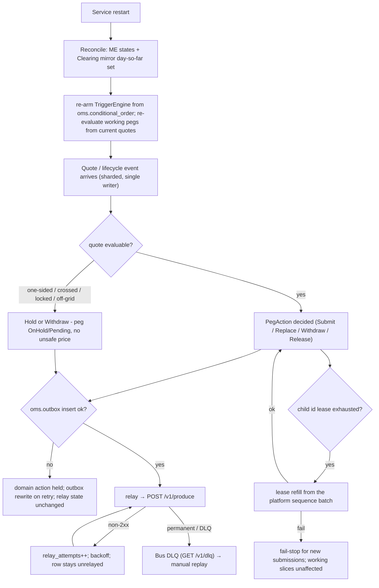

- **Process crash.** Working pegs are memory-resident and rebuildable:
  on restart, the Gateway replays the `AddPegOrder` backlog (or ME states
  reconcile), the Clearing mirror provides the day-so-far set, and pegs
  without a live ME counterpart are re-acked as killed to clients. Held
  conditional/complex/algo skeletons re-arm from the durable
  `oms.conditional_order` / `oms.complex_order` / `oms.algo_order` rows.
- **Outbox relay / Bus outage.** `oms.outbox` rows accumulate unrelayed
  (`relay_attempts` grows); partial-index reads replay in `created_at`
  order when Bus recovers; the `idempotency_key = row id` makes replay
  safe - lifecycle mirrors are delayed, never lost.
- **Sys audit outage.** `oms.audit_journal` rows stay unpushed; the pusher
  retries - audit is never lost, only delayed.
- **Quote stall.** Quotes carry timestamps; a stale quote holds last
  (pegs stop repricing, no unsafe price is ever computed from dead data)
  with alerting at the quote-age watermark.
- **Child-id lease failure.** Fail-stop for new submissions (working
  slices and triggers unaffected) - id issuance is the only blocked
  surface.
- **Dual-fire guard.** The registered
  `exchange8_trigger_already_fired` (HTTP 409) surfaces a trigger release
  request on an already-fired conditional - re-fire is idempotent at the
  engine and explicit at the API.

Recovery sequence:

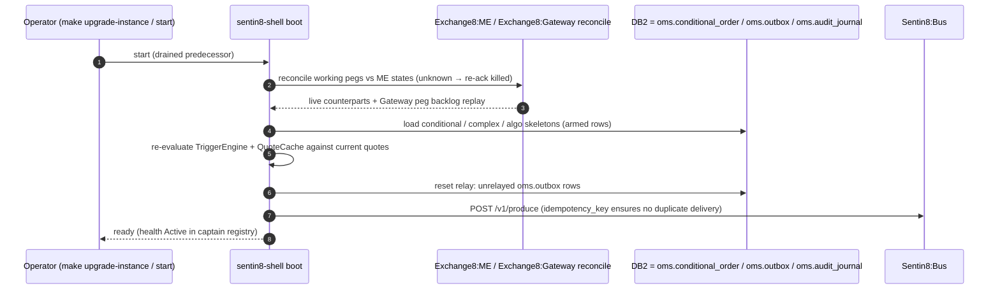

## 7. Concurrency & Performance Model

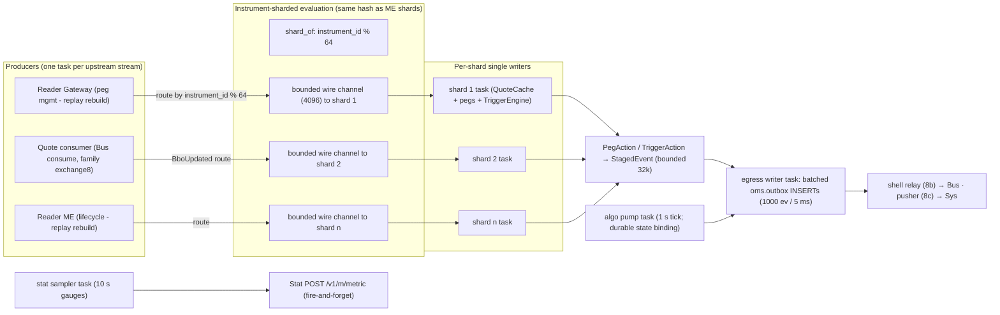

- **Task layout (implemented - `runtime.rs::spawn_tasks`).** One tokio
  task per instrument shard (64, the ME shard hash), the quote-consumer
  task (Bus SSE stream, one connection per epoch + per-message ack +
  group `exchange8-oms-quotes`), the algo pump (1 s tick, per-env owner sweep),
  the egress writer (1000 events / 5 ms batches), and the stat sampler
  (10 s gauges) - every channel between them is bounded; backpressure is
  the only queueing control, never an unbounded buffer.
- **Single-writer rule.** All mutation of a peg's state and all trigger
  evaluations for one instrument happen on its shard's task: no per-order
  mutex, no lock ordering - evaluation order is the event arrival order.
- **Hot path.** One quote event triggers re-evaluation of exactly the pegs
  on that instrument (the QuoteCache dirty set is change-filtered and
  deduped), O(pegs on instrument), bounded by the instrument peg-count cap
  with alerting; pricing is a pure integer computation - no allocation on
  the reprice path.
- **CFO round-trip.** A quote change on a working Market peg issues a
  cancel-replace and waits for the ME modified-ack before treating further
  quotes as new working prices (the Modifying state suppresses duplicate
  replaces).
- **Backpressure & saturation.** Bounded queues everywhere: a slow Bus or
  Sys only grows the unrelayed/unpushed row sets (both partial-indexed and
  replayable), never shard memory; quote storms collapse to the dirty set
  so unchanged quotes cost O(1).

## 8. Invariants, Insecure-Defaults Rejected, Unsafe Rationale

Always-true conditions:

1. A peg never prices through its client limit: a computed price beyond the
   limit converts the order to a plain limit at `limit` - it is never
   rejected with a rogue price and never repriced past conversion
   (`converted_to_limit` is terminal for repricing).
2. A working Market peg never reprices worse: the ratchet keeps the
   previous price when the recomputation is inferior (bid: lower is worse;
   ask: higher is worse) - reprice only in the improving direction.
3. Midpoint/Darkpool prices are always on the doubled-tick grid; an
   off-grid midpoint is rejected into Hold/Withdraw, never rounded.
4. Held conditional orders never rest in the ME book; release happens only
   at trigger fire, and released orders carry the trigger time reference.
5. Trailing stops only tighten: the ratcheted threshold never loosens,
   regardless of subsequent market moves.
6. OCO/OCA groups are terminal after the first fire; re-fire is a no-op, and
   a client cancel of one leg cancels the whole bracket (OCO bracket and
   OCA group share the group-withdraw semantics - unrelated orders in an
   OCA group are entered independently, but the group is still one
   lifecycle: any member's cancel withdraws every survivor).
6a. Index-linked triggers (`stop_index`) evaluate only against index
   publications (`TriggerEngine::on_index`) - instrument quotes never fire
   them (and index publications never fire quote-referenced orders); the
   trailing ratchet on an index reference follows the same never-loosen
   rule.
6b. The durable `oms.algo_order.state` binds the slice plans: paused
   parents idle, terminal parents never re-issue, and every guarded
   transition writes the transition event + audit row in the SAME
   transaction as the state UPDATE (a re-run hits the state predicate -
   the durable state is authoritative across restarts).
7. Complex orders are atomic: a single short leg means nothing executes -
   no partial leg fills.
8. Iceberg reserve is never displayed or matchable beyond `max_floor`;
   slice re-arm decrements nothing but the reserve, and the slice counter
   increments on every re-arm (sub-order identity at the ME).
9. Every domain write shares its transaction with its `oms.outbox` row;
   relayed rows are marked exactly once via the idempotent relay.
10. No tenant-table read/write without a set tenant context on that
    connection; RLS FORCEd everywhere; role `exchange8_oms_service` holds
    no BYPASSRLS and no cross-schema grants.

Insecure-defaults rejected: no plaintext secrets in `oms.*` tables
(verification material lives in the identity plane; the schema carries no
token columns beyond publisher references in the outbox); no
`danger_accept_invalid_certs`-style shortcuts (Sentin8:Acme root is in the
OS trust store); no BYPASSRLS or superuser runtime role; no rounding
midpoints to a near tick (an off-grid price must be an explicit hold, not
a silent approximation); no unbounded queue without backpressure; no
persisted working-peg table that would let pricing depend on pool health.

Unsafe rationale: the OMS cores contain no `unsafe`; pricing, transition
tables, triggers, and schedulers are pure safe Rust over `i128` raw price
units and quantity types - memory safety and determinism are enforced by
the type system, with no unchecked code on the reprice path.

## 9. Testing Strategy

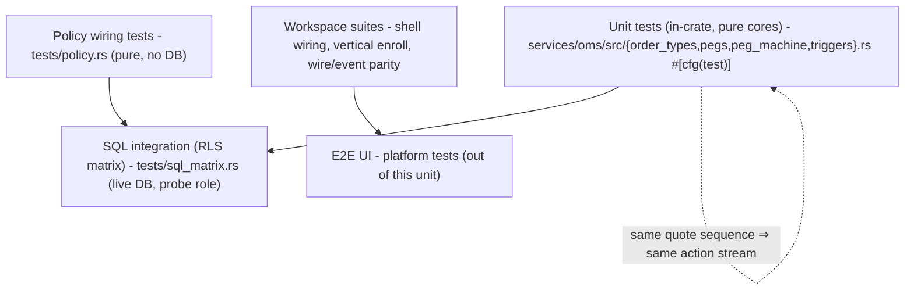

- **Pure unit tests** (inside the source modules): peg formula table
  (all 4 kinds × bid/ask × offset × limit; Market ratchet never-worse and
  allows-better; midpoint doubled-tick on-grid pass and off-grid reject;
  no-quote / crossed-quote holds; limit-conversion on bid floor and ask
  floor); peg state machine (OnHold hold on one-sided quotes; submit /
  CFO-modify path with ack; withdraw-then-rehold cycle; conversion terminal
  for repricing; ME-killed and client-cancel terminal; Market-peg ratchet
  through `PegAction`); triggers (buy/sell stops at-or-through the
  trigger, bid/ask references, missing reference holds, other-instrument
  ignores, trailing ratchet up/down and never-loosens, OCO sibling cancel
  on fire and on client cancel, independent groups survive, multiple fires
  in one tick); order types (OCO first-fire cancels sibling and re-fire is
  a no-op, external cancel breaks the bracket, unknown order no-op;
  complex atomic gate pass/fail per-leg; TWAP uniform and
  remainder-conserving, VWAP profile weighting, POV participation caps,
  auction imbalance and drain; iceberg re-arm/reserve/slice-cancel/final
  fill; quote-cache dirty-on-change only; child-id lease + idempotency
  duplicate returns the original id).
- **Policy wiring tests** (`tests/policy.rs`, no DB): the *actual* seeded
  scope-mirror text drives the engine cache - no-set deny, enforced
  no-match deny, shadow never blocks (would-deny reported), mirror permits
  its own grants (`exchange8:order:route`), M2M parity, platform-admin
  scopes pass, forbid-beats-permit, role-keyed tenant sets decide,
  cross-env set isolation, registration parity over every handler action,
  and the enroll-time dry-run gate.
- **SQL integration matrix** (`tests/sql_matrix.rs`, live PostgreSQL 18 as
  the `exchange8_probe` NOBYPASSRLS role): every table declared in
  `init.sql` exists with FORCE RLS + policies; zero rows without context;
  insert rejected by WITH CHECK (savepoint-isolated); own-env sees exactly
  its probe row; cross-env zero rows - all inside one rolled-back
  transaction (zero residue, hermetic offline skip).
- **Deliberately not tested here:** platform token verification internals,
  RFW rendering, Bus/Sys wire formats, ME matching internals, and Flutter
  surfaces - owned by the platform's own suites (covered in the platform
  testing strategy doc); the E2E UI pyramid lives at platform level.

## 10. Open Questions

- **Quote-event producer seam.** The OMS consumer is bound to the declared
  family (`exchange8`) + payload
  (`exchange8::contracts::events::BboUpdated`) of
  `exchange8:md:bbo:updated`; the MD/VFeeds outbox write sites (the
  concrete publish of the CBBO change) are their own wiring pass
  (vfeeds `DESIGN.md` §10 emission sites). Pegs idle their last evaluation
  until the first quote arrives - a restart without a quote source re-prices
  from ME/Gateway replay, not from thin air.
- **Direct-stream intake (Gateway → OMS peg management) + ME lifecycle
  readers.** The evaluation plane's shard queues are wired
  (`register_peg` / `ShardInput::ArmConditional`); the framed
  `AddPegOrder`/`CancelPegOrder` readers over `exchange8::wire` follow the
  gateway's direct-stream send-sender pass (the ME8 epic lists the same
  dependency - no peer frame senders exist yet).
- **Algo plan fill-sink.** The pump issues + binds parents durably
  (`slice_size`carried plans); the fill-side (parent exhaustion from ME
  fills) rides the ME lifecycle-reader wiring - the pump's completion path
  is live (`issue_algo_step` → `complete`), the exhaustion trigger arrives
  with the ME event intake.
- **`last`-referenced trigger ticks.** Quote events carry the bid/ask
  snapshot; the `stop_last` trigger evaluates on trade prints (the ME
  `exchange8:me:trade:executed` consumer feeds `last` - the same reader
  pass). Quote-driven ticks feed `bid`/`ask` references today.

---

**Design attribution:** exchange8:oms and its underlying concepts were designed by Hamid Jahanzad <Hamid@Jahanzad.com>.

