# DESIGN.md: Exchange8:RefData - Detailed Design Document

## 1. Scope & Context

**Owned by Exchange8:RefData** - PostgreSQL schema `refdata` inside the vertical
database `exchange8` (database-per-vertical, schema-per-service), the domain
APIs over those tables, the local `refdata.outbox` + `refdata.audit_journal`
durability pairs, and the Shield scope-mirror policy set for action
`exchange8:refdata`:

| Resource family | Tables |
|---|---|
| Customer / firm master | `refdata.customer`, `refdata.customer_location`, `refdata.customer_contact`, `refdata.customer_contact_location`, `refdata.broker_trader`, `refdata.capitalization` |
| Markets & venues | `refdata.market`, `refdata.venue`, `refdata.holiday`, `refdata.holiday_market` |
| Currencies | `refdata.currency` |
| Security master | `refdata.security`, `refdata.fixed_income`, `refdata.large_in_scale`, `refdata.security_identifier` |
| Tick rules | `refdata.tick_rule`, `refdata.tick_rule_value` |
| Order books | `refdata.book`, `refdata.book_connection`, `refdata.book_event` |
| Corporate actions | `refdata.corporate_action`, `refdata.corporate_action_entitlement`, `refdata.corporate_action_calendar` |
| Durability (DBX) | `refdata.outbox`, `refdata.audit_journal` |

**Authorization vocabulary owned** - scopes `exchange8:refdata:read`,
`exchange8:refdata:write`, `exchange8:corporate-action:read`,
`exchange8:corporate-action:write`, policy-admin scopes
`exchange8:refdata:policy:read|write`; Shield policy set `scope-mirror`
(enforced, `origin='platform'`); error code `exchange8_security_not_found`
(HTTP 404); PostgreSQL role `exchange8_refdata_service` (no BYPASSRLS, db
`exchange8` only); DSN env var `EXCHANGE8_REFDATA_DATABASE_URL`.

**Not owned (delegations)** - trade ledger and busts (Exchange8:Clearing), matching
(Exchange8:ME), settlement delivery of cash/stock entitlements (Exchange8:Settlement),
margin treatment (Exchange8:Margin), corporate-action lifecycle *transitions*
(Sentin8:Cron), position adjustment application (consumed from
`exchange8:clearing:position:adjusted`), event transport and stream storage
(Sentin8:Bus), audit ingest (Sentin8:Sys), FDX/currency cross-references for
RFQ FX pairs (read-only declared grants FROM rfq ONTO this schema, not owned).

**System context:**

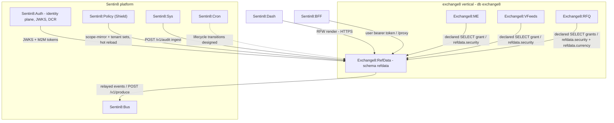

**Container view:**

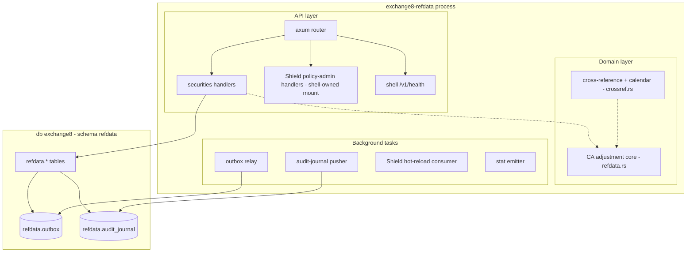

## 2. Runtime Architecture

The binary wires only the router extension (`extend_router`); everything
else - boot order, pool capping, Shield engine boot, relays, health,
middleware stack, PQ-TLS termination - comes from `sentin8::shell::serve`:

- **Registration** - `--print-registration` (flag check before any
  initialization) emits `service_type exchange8:refdata`, subdomain
  `exchange8-refdata`, health path `/v1/health`, admin scopes, error codes,
  the `AdminUi` block (`Reference Data`, pages securities / markets /
  corporate-actions), SQL migration `v1 init` (the whole `sql/init.sql`),
  `pg_roles` (`exchange8_refdata_service`, db `exchange8`,
  `cross_schema_grants: []`), the enforced `scope-mirror` PolicySetDecl,
  relations (`[]`) and the seven M2M workload grants (own client both
  spellings + `sentin8:cron:write`, the Shield pair, the transition
  `refdata-cron` workload, the audit pusher, the TLS resolver).
- **Router** - `GET/POST /v1/securities`, `GET/PUT/DELETE
  /v1/securities/{id}`, `GET/POST /v1/markets` + `PUT /v1/markets/{id}`,
  `GET/POST /v1/corporate-actions` + `GET /v1/corporate-actions/calendar` +
  `POST /v1/corporate-actions/{id}/cancel`, `GET/POST /v1/tick-rules` +
  `PUT /v1/tick-rules/{id}`, `POST /v1/holidays`,
  `POST /v1/books/connections`, the RFW page routes
  `GET /v1/admin/ui/{page}`, the admin data aliases
  (`/v1/admin/{securities,markets,corporate-actions…}` with the
  `/update`, `/delete`, `/cancel` POST aliases), the Cron proxy-back
  `POST /v1/internal/schedules/run`, the shell `/v1/health`, and the shell
  Shield policy-admin mount (`/v1/admin/policy-sets…`,
  `/v1/admin/relations…`, `/v1/admin/attributes…`).
- **Handlers** - `handlers.rs` implements the 8-step pipeline per request:
  `verify_token` → Shield `policy::require` → pool acquire → tx begin →
  awaited `set_tenant_context` → SQL with explicit `env_id` → commit - and
  then (mutations only) the durability pair on the SAME tx: the outbox
  envelope (`events::emit_outbox`) + the audit journal row
  (`events::journal_mutation`). The RFW page route (`admin_ui_page`) gates
  on the page's declared action before rendering the definition.
- **Domain modules** - `refdata.rs` (action types, stages, adjustment math,
  entitlements - pure) and `crossref.rs` (identifier resolver + CA calendar
  + record-date entitlement projection - pure); both are libraries the
  handlers and the transition worker build on, covered by in-crate tests.
- **Event envelopes** - `events.rs` (`DESIGN.md` §4): the typed envelope
  builders (`security_event`, `market_event`, `ca_event`, `simple_event`),
  the outbox writer (`emit_outbox` - same tx as the domain change), and the
  audit journal writer (`journal_mutation`) - the two durability rows
  every mutating handler writes per DESIGN.md §5.5.
- **Transition worker** - `worker.rs` (`DESIGN.md` §10 worker): the boot
  registers the recurring `refdata-ca-transitions` schedule with
  Sentin8:Cron (via the DCR'd `refdata-cron` M2M workload),
  `handlers::internal_schedules_run` is the proxy-back target, and
  `advance_due_transitions` runs the guarded stage advancement (outbox +
  journal rows per advanced action, SAME tx).
- **Background tasks (shell-spawned)** - the outbox relay (LISTEN/NOTIFY on
  `refdata_outbox_changed` + 5s safety poll, batch 100, M2M produce), the
  audit-journal pusher (5s poll, M2M `POST /v1/audit`), the Shield
  hot-reload direct consumer, and the stat emitter.

**Component view:**

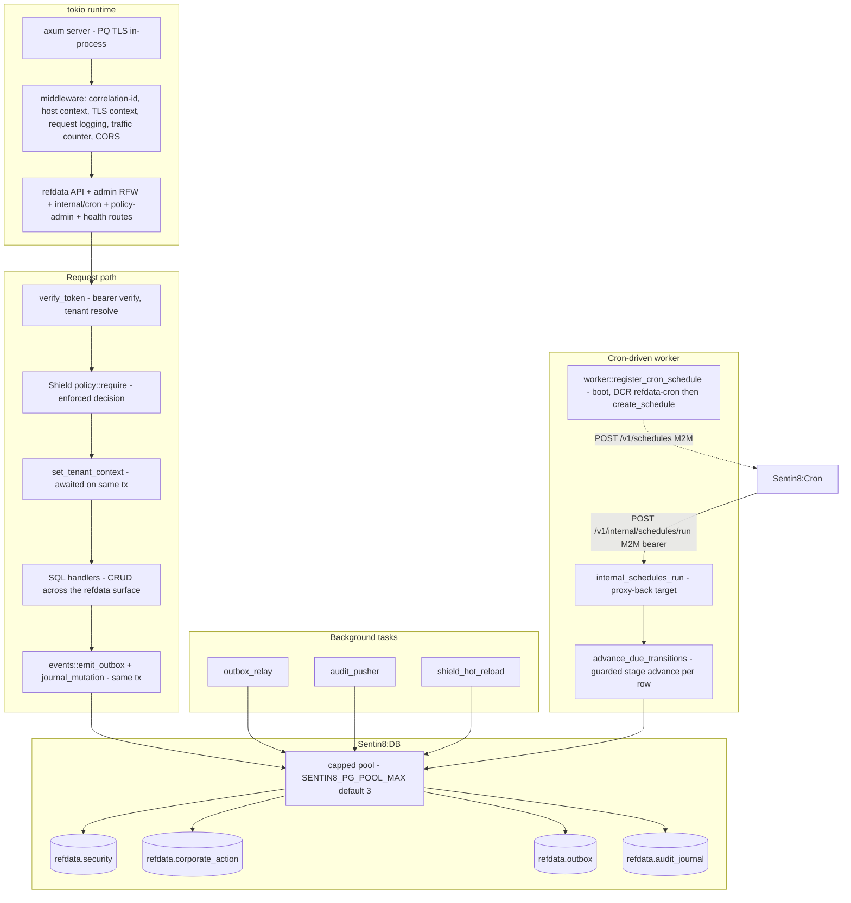

**Request family 1 - security upsert (POST /v1/securities):**

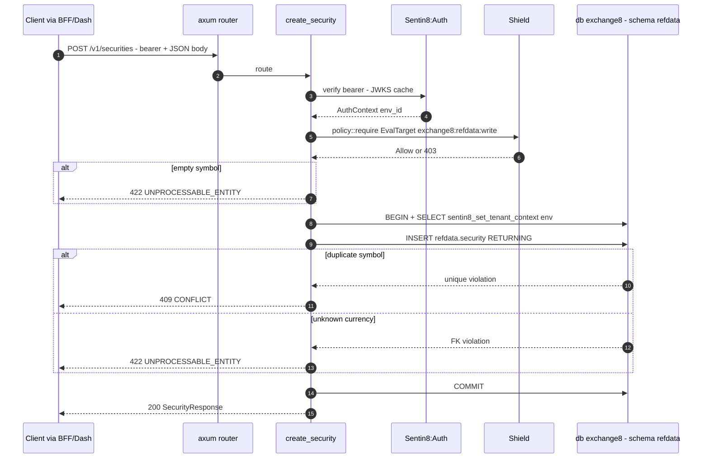

**Request family 2 - Shield policy-admin surface (shell-owned):**

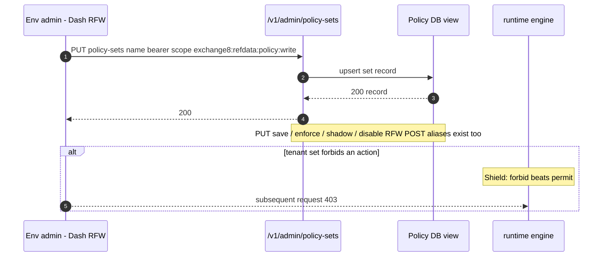

**Request family 3 - corporate-action lifecycle (cron-executed):**

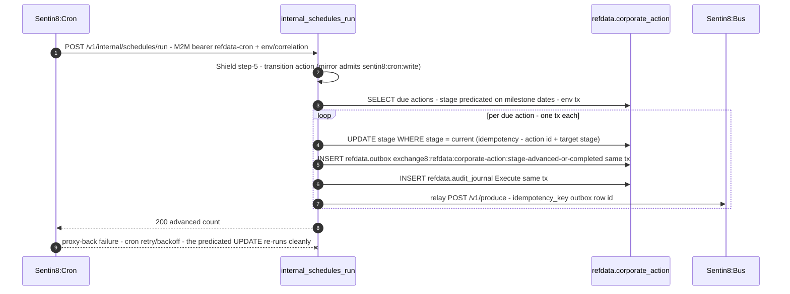

## 3. Data Model

All tables live in schema `refdata` on db `exchange8`. Every tenant table
carries `env_id UUID NOT NULL` with `ENABLE` + `FORCE ROW LEVEL SECURITY`
and the policy set `sentin8_context_initialized() AND env_id =
sentin8_current_env_id()` (select/insert/update/delete). The service role
`exchange8_refdata_service` is `bypass_rls: false`. Seed rows (currencies
CAD/USD/BTC, venues XTSX/XTSE/XCNQ/LX) are platform-scoped with the nil
UUID as `env_id` and are re-applied idempotently (`ON CONFLICT DO NOTHING`).

```mermaid
erDiagram
    CURRENCY ||--o{ SECURITY : "currency FK"
    MARKET ||--o{ SECURITY : "market_id"
    SECURITY ||--o{ FIXED_INCOME : "security_id"
    SECURITY ||--o{ SECURITY_IDENTIFIER : "security_id"
    CUSTOMER ||--o{ CUSTOMER_LOCATION : "customer_id"
    CUSTOMER ||--o{ CUSTOMER_CONTACT : "customer_id"
    CUSTOMER ||--o{ BROKER_TRADER : "customer_id"
    CUSTOMER ||--o{ CAPITALIZATION : "customer_id"
    CUSTOMER_LOCATION ||--o{ CAPITALIZATION : "location_id"
    CUSTOMER_LOCATION ||--o{ CUSTOMER_CONTACT_LOCATION : "location_id"
    CUSTOMER_CONTACT ||--o{ CUSTOMER_CONTACT_LOCATION : "contact_id"
    TICK_RULE ||--o{ TICK_RULE_VALUE : "rule_id"
    BOOK ||--o{ BOOK_CONNECTION : "book_id"
    BOOK ||--o{ BOOK_EVENT : "book_id"
    HOLIDAY ||--o{ HOLIDAY_MARKET : "holiday_id"
    MARKET ||--o{ HOLIDAY_MARKET : "market_id"
    SECURITY ||--o{ CORPORATE_ACTION : "security_id"
    CORPORATE_ACTION ||--o{ CORPORATE_ACTION_ENTITLEMENT : "action_id"
    CORPORATE_ACTION ||--o{ CORPORATE_ACTION_CALENDAR : "action_id"
    CUSTOMER {
        uuid id PK
        uuid env_id
        text company_name
        text status "E D H"
        boolean is_vendor
        text stp_code
        text stp_action "K P B D N"
        text exec_broker_id UK
        text cuid "5-char clearing id"
        text sub_participant
        bigint entitlement
        text_array book_tokens
    }
    SECURITY {
        uuid id PK
        uuid env_id
        text symbol UK "unique per env"
        text isin
        text security_type "Equity, Bond, Fund, Warrant, Future, Option, Crypto, Fx"
        text currency FK
        boolean halted
        text trading_state "O C"
        text shortable "Y E N"
        boolean permanently_delisted
        uuid market_id FK
        uuid tick_rule_id
        uuid lis_class_id
        boolean odd_lot
        text settlement_term
        text charge_tier
        integer min_size
        boolean dividend_ind
        uuid contract_id "futures/options - margin-owned"
        uuid asset_id "crypto extension"
        smallint price_scale "default 4"
        smallint qty_scale "default 0"
    }
    MARKET {
        uuid id PK
        uuid env_id
        char_1 code UK
        text name
        text mic
        text market_code "book grouping"
        text market_type "Exchange MTF Dark"
        integer lot_size
        boolean hidden_orders
        boolean ebbo_enabled
        text regulation
        text market_mode "calendar continuous"
    }
    CURRENCY {
        text code PK "3-letter ISO"
        uuid env_id
        text name
        numeric lis_exchange_rate
    }
    VENUE {
        text mic PK "unique per env"
        uuid env_id
        text name
    }
    CUSTOMER_LOCATION {
        uuid id PK
        uuid env_id
        uuid customer_id FK
        text location_type "primary shipping billing"
        text address1
        text city
        text province
        text postal_code
        text country
        text status "E D"
    }
    CUSTOMER_CONTACT {
        uuid id PK
        uuid env_id
        uuid customer_id FK
        text contact_type
        text name
        text phone
        text email
    }
    CUSTOMER_CONTACT_LOCATION {
        uuid env_id
        uuid contact_id FK
        uuid location_id FK
    }
    BROKER_TRADER {
        uuid id PK
        uuid env_id
        text user_id
        uuid customer_id FK
        text status "E D"
        text email
        text cuid_override
    }
    CAPITALIZATION {
        uuid id PK
        uuid env_id
        uuid customer_id FK
        uuid location_id FK
        text currency
        numeric amount_20_2
    }
    FIXED_INCOME {
        uuid id PK
        uuid env_id
        uuid security_id FK
        integer frequency
        numeric coupon
        numeric yield_pct
        date issue_date
        date maturity_date
        numeric par_price
        boolean eom
        text term
    }
    LARGE_IN_SCALE {
        uuid id PK
        uuid env_id
        text class_id
        bigint order_volume
    }
    TICK_RULE {
        uuid id PK
        uuid env_id
        text name
    }
    TICK_RULE_VALUE {
        uuid id PK
        uuid env_id
        uuid rule_id FK
        numeric min_price
        numeric max_price
        numeric tick_value
    }
    HOLIDAY {
        uuid id PK
        uuid env_id
        date holiday_date
        text name
    }
    HOLIDAY_MARKET {
        uuid env_id
        uuid holiday_id FK
        uuid market_id FK
    }
    BOOK {
        uuid id PK
        uuid env_id
        text code UK "4-char"
        char_1 token UK
        boolean default_flag
        text preferencing "TIME BROKER"
        boolean anonymous
    }
    BOOK_CONNECTION {
        uuid id PK
        uuid env_id
        uuid book_id FK
        text connection_id "GW-owned comp id"
        integer seq
        text status "E D"
    }
    BOOK_EVENT {
        uuid id PK
        uuid env_id
        uuid book_id FK
        char_1 event_code
        time event_time
    }
    SECURITY_IDENTIFIER {
        uuid id PK
        uuid env_id
        uuid security_id FK
        text id_type "SYMBOL ISIN CUSIP SEDOL FIGI"
        text id_value
    }
    CORPORATE_ACTION {
        uuid id PK
        uuid env_id
        uuid security_id FK
        text action_type "9 kinds"
        date announce_date
        date ex_date
        date record_date
        date pay_date
        numeric numerator
        numeric denominator
        text stage "announced ex_date record_date pay_date"
    }
    CORPORATE_ACTION_ENTITLEMENT {
        uuid id PK
        uuid env_id
        uuid action_id FK
        uuid holder_id
        numeric qty
    }
    CORPORATE_ACTION_CALENDAR {
        uuid id PK
        uuid env_id
        uuid action_id FK
        date effective_date
    }
```

Per-table notes:

- All 23 domain tables: env-scoped RLS tier (`env_id`-matching policies, all
  four DML ops), UUID PKs, no secret-bearing columns - the schema stores
  reference data and corporate-action *parameters* only; provider or session
  credentials do not exist here.
- `refdata.security` is the FK anchor for the vertical: `contract_id`
  extends to futures/options (Exchange8:Margin-owned rows) and `asset_id` to the
  crypto extension; `price_scale`/`qty_scale` are the D13 fixed-point
  contract the matching engine and market data re-key against.
- `refdata.currency.code` is a TEXT PK (3-letter ISO) referenced by
  `refdata.security.currency` - a duplicate/unknown currency surfaces as a
  422 on security create; `lis_exchange_rate` carries the LIS FX rate
  (Exchange8:RFQ declares a SELECT grant on it).
- `refdata.book_connection.connection_id` holds gateway-owned comp ids -
  membership data, not credentials.
- `refdata.corporate_action_entitlement` is the record-date snapshot
  (holder × ratio); `refdata.corporate_action_calendar` indexes upcoming
  actions per env with `effective_date`.

**Domain state machine** - `refdata.corporate_action.stage`:

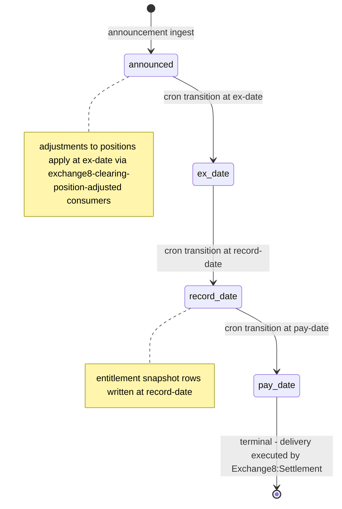

The durability tables follow the same env-scoped RLS tier:

- `refdata.outbox` - `event_type`, `stream_family`, `payload JSONB`,
  `publisher_id_token/publisher_subject`, `relayed/relayed_at/
  relay_attempts`; partial index on unrelayed rows; `AFTER INSERT` trigger
  `outbox_notify_trigger` → `pg_notify('refdata_outbox_changed')`.
- `refdata.audit_journal` - `action`, `target_resource_type/id`,
  `actor_user_id/actor_subject_type`, `severity`, `correlation_id`,
  `before_state/after_state/details JSONB`, `pushed/pushed_at`; partial
  index on unpushed rows.

## 4. API Surface

All data endpoints run the identical gate; the `/v1/admin/*` routes are RFW
data-endpoint aliases of the same handlers (the RFW renderer is POST-only -
the `/update`, `/delete`, `/cancel` admin routes are the POST aliases of the
PUT/DELETE mutations). The RFW page definitions are served at
`GET /v1/admin/ui/{page}` (the service mounts them - the shell does not
auto-serve declared pages). The Shield policy-admin surface and the shell
health endpoint are mounted by the shell.

| Endpoint | Method | Audience | Gate (Shield EvalTarget) | Events |
|---|---|---|---|---|
| `/v1/securities` | GET | public query API | `exchange8:refdata:read` (mirror also admits `exchange8:order:read`, `exchange8:refdata:write`, `exchange8:refdata:all`, platform-admin scopes) | none (read) |
| `/v1/securities/{id}` | GET | public query API | `exchange8:refdata:read` | none (read) |
| `/v1/securities` | POST | public mutation API | `exchange8:refdata:write` | `exchange8:refdata:security:created` |
| `/v1/securities/{id}` | PUT | public mutation API | `exchange8:refdata:write` | `exchange8:refdata:security:updated` |
| `/v1/securities/{id}` | DELETE | public mutation API | `exchange8:refdata:write` | `exchange8:refdata:security:deleted` |
| `/v1/markets` | GET/POST | public API | read: `exchange8:refdata:read`; write: `exchange8:refdata:write` | `exchange8:refdata:market:created` |
| `/v1/markets/{id}` | PUT | public mutation API | `exchange8:refdata:write` | `exchange8:refdata:market:updated` |
| `/v1/corporate-actions` | GET | public query API | `exchange8:corporate-action:read` | none (read) |
| `/v1/corporate-actions` | POST | public mutation API | `exchange8:corporate-action:write` | `exchange8:refdata:corporate-action:announced` |
| `/v1/corporate-actions/calendar` | GET | public query API | `exchange8:corporate-action:read` | none (read) |
| `/v1/corporate-actions/{id}/cancel` | POST | public mutation API | `exchange8:corporate-action:write` | `exchange8:refdata:corporate-action:cancelled` |
| `/v1/tick-rules` | GET/POST | public API | read: `exchange8:refdata:read`; write: `exchange8:refdata:write` | `exchange8:refdata:tick-rule:created` |
| `/v1/tick-rules/{id}` | PUT | public mutation API | `exchange8:refdata:write` | `exchange8:refdata:tick-rule:updated` |
| `/v1/holidays` | POST | public mutation API | `exchange8:refdata:write` | `exchange8:refdata:holiday:created` |
| `/v1/books/connections` | POST | public mutation API | `exchange8:refdata:write` | `exchange8:refdata:book-connection:created` |
| `/v1/admin/ui/{page}` | GET | admin / RFW | the page's action (`exchange8:refdata:read` / `exchange8:corporate-action:read`); 404 for undeclared pages | none (read) |
| `/v1/admin/securities…`, `/v1/admin/markets…`, `/v1/admin/corporate-actions…` | GET/POST/PUT/DELETE + `/update`, `/delete`, `/cancel` POST aliases | admin / RFW data | same as the matching public route | same as the matching public route |
| `/v1/internal/schedules/run` | POST | Sentin8:Cron proxy-back (M2M) | `exchange8:refdata:corporate-action:transition` (mirror admits `sentin8:cron:write`) | `…corporate-action:stage-advanced` / `…completed` |
| `/v1/health` | GET | ops (captain) | none (liveness + `active_connections` + build hash) | - |
| `/v1/admin/policy-sets…` | GET/POST/PUT/DELETE | admin / RFW (Shield) | policy scopes incl. `exchange8:refdata:policy:read|write` | - |
| `/v1/admin/relations…`, `/v1/admin/attributes…` | GET/POST/PUT/DELETE | admin / RFW (Shield) | policy scopes | - |
| `/openapi.json` | GET | tooling | none | - |

Read filters: `symbol`, `security_type`, `market_id`, `limit` (default 100,
capped at 500), ordered by symbol. Write validation: non-empty symbol (422),
duplicate symbol → 409 (`…contains("symbol")` constraint mapping), unknown
currency FK → 422; defaults `price_scale=4`, `qty_scale=0`, `min_size=1`.
Market create validates the single-char code + the `market_type`/
`market_mode` vocabulary (422); a referenced security delete → 409 (delist
via `permanently_delisted`).

**Every mutating handler** writes, in ONE transaction: the domain row change
→ the `refdata.outbox` row (`events::emit_outbox` - payload-complete
envelope carrying `env_id`, `subject_id`, `correlation_id`,
`idempotency_key`, and the full row snapshot) → the `refdata.audit_journal`
row (`events::journal_mutation` - create/update/delete/execute with the
before/after snapshots). Reads are NOT journalized (audit-journal pattern:
state changes only).

**Event flow (outbox → Bus → trigger) - the durability contract:**

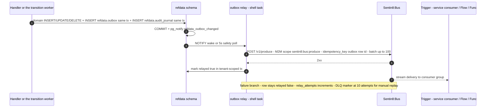

**Outbound event vocabulary (stream family `exchange8`; event format
`vertical:service:resource:operation` - all-colon, no dots):**
`exchange8:refdata:security:created|updated|deleted`,
`exchange8:refdata:market:created|updated`,
`exchange8:refdata:corporate-action:announced|stage-advanced|completed|
cancelled`, `exchange8:refdata:tick-rule:created|updated`,
`exchange8:refdata:book-connection:created`,
`exchange8:refdata:holiday:created`. `refdata-audit` pushes to
`POST /v1/audit` (journal pusher). No event name with dots exists anywhere
in the surface.

## 5. Cross-Cutting Concerns

### 5.1 Authentication & token verification

Step 1–2 of the pipeline: `verify_token` → `sentin8_auth_client::
verify_bearer_token` against Sentin8:Auth (issuer config, JWKS cached behind
the shared client). M2M and user tokens verify identically; `token_tp` never
bypasses Shield (guarded by the policy wiring tests). The PQ crypto provider
is installed by the shell before any HTTPS call.

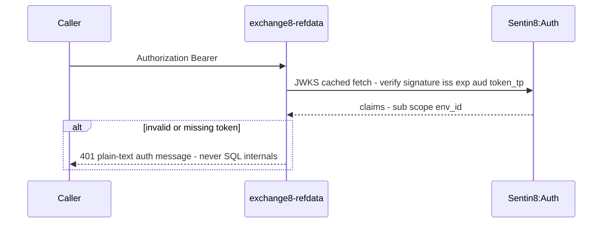

### 5.2 Tenant resolution & RLS context

`env_id` comes from the verified claims (step 2), never from headers or
client input. The awaited `set_tenant_context` helper runs
`SELECT sentin8_set_tenant_context($1)` (schema-unqualified, resolved via
the role's `search_path = refdata, public`) on the same connection and
transaction as the query - `set_config(..., true)` makes it
transaction-local, so a context set on pool connection A cannot leak to
query B.

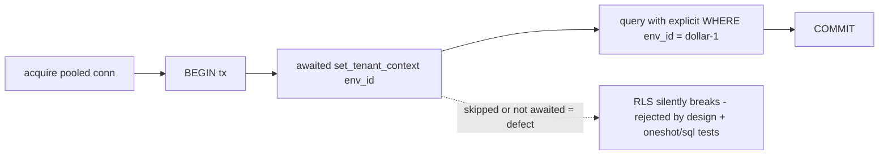

### 5.3 Shield authorization (step 5)

`sentin8::shell::policy::require` runs the full live evaluation (effective
scopes + roles + relation slice + principal attributes) against the
enforced `scope-mirror` set; a deny converts to HTTP 403. Shadow sets never
block (would-deny reported only); fail-closed when no set is loaded at that
env. The hot-reload consumer picks up admin edits within the same process
(the shell refuses a second engine per service).

### 5.4 Idempotency & exactly-once semantics

Produce idempotency = outbox row id (one Bus-side dedupe per event). The
relay's per-row retry budget (`RELAY_MAX_ATTEMPTS = 10`) keeps a permanently
rejected row as a DLQ marker (`relayed=false`, attempts counted) for manual
replay - at-least-once delivery, effectively-once consumption via consumer
groups plus dedupe keys.

### 5.5 Audit journaling

Every state-changing operation is designed to journal into
`refdata.audit_journal` on the same transaction as the domain change; the
shell's pusher drains batches of up to 200 unpushed rows to Sentin8:Sys
`POST /v1/audit` with the `exchange8:refdata`-derived `refdata-audit` M2M
workload (`sentin8:sys:audit:write`), marking rows pushed on 2xx. A Sys
outage only delays the push; rows are never dropped. Every mutating handler
journals its change via `events::journal_mutation` in the domain
transaction (create/update/delete on the CRUD path, `Execute` on the
transition worker); reads are not journalized.

### 5.6 Rate limiting / bot protection

Ingress-level: Sentin8:Proxy is the single TLS/SNI ingress and applies its
traffic controls ahead of the service; the service itself carries no
per-endpoint limiter and relies on the platform middleware stack
(correlation id, request logging, traffic counter) rather than duplicating
it.

### 5.7 Drain on upgrade

The shell health payload includes `active_connections` (shared in-flight
gauge) plus version/build hash; Sentin8:Captain polls health to drain
in-flight requests during `upgrade-instance` rolling swaps. No service
handler needs drain-specific code.

### 5.8 TLS posture

Post-quantum exclusive: in-process termination via `sentin8_tls`
(X25519MLKEM768 + ML-DSA-65 posture), the Graviola-based PQ provider is
installed before any HTTPS egress; the database-free TLS library resolves
hostnames via Sentin8:Sys `GET /v1/resolve/hostname` with the
`exchange8-refdata-tls` M2M workload scope `sentin8:sys:instances:read` -
no platform-DB access rides the TLS path. No `danger_accept_invalid_certs`
anywhere.

## 6. Failure Modes & Recovery

**Outbox relay after a Bus outage** - fail-open: the relay task may fail to
build (Bus or DCR unavailable at boot) without blocking service startup;
rows stay `relayed = false` and the 5s safety poll catches up once Bus
returns. Only a permanent 4xx rejection (contract violation) exhausts the
10-attempt budget and parks the row as a DLQ marker.

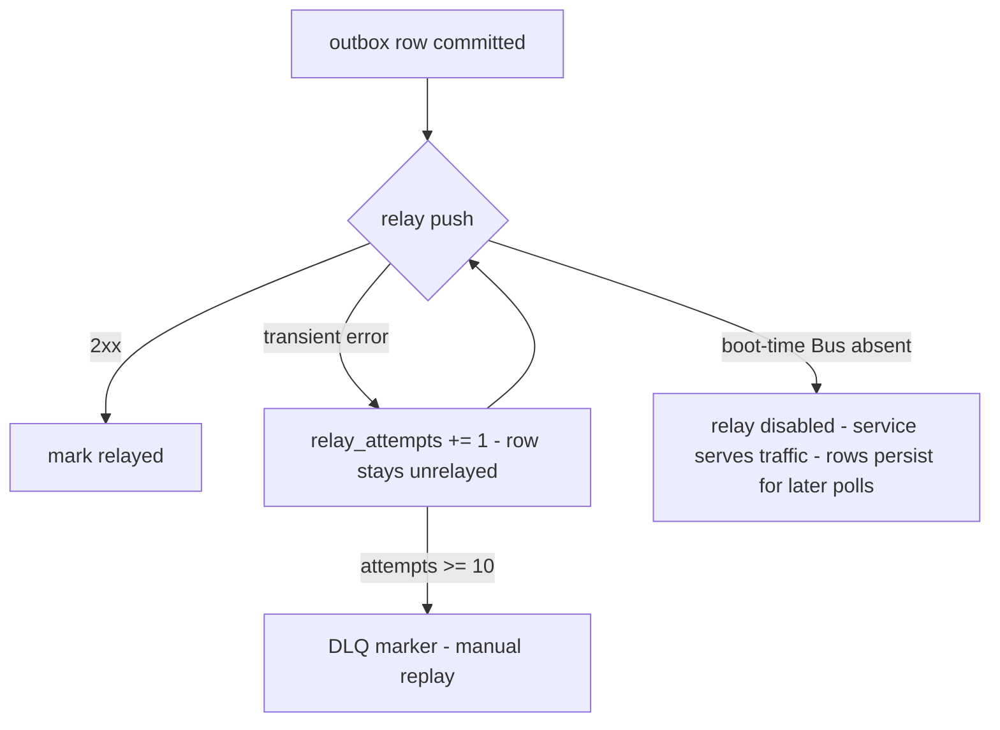

**Audit-journal push after a Sys outage** - same fail-open shape: rows
queue, the pusher retries each 5s pass with a 2s backoff on errors, lazy-DCR
retries the `{leaf}-audit` workload registration until Auth admits it, and
marks `pushed` only after a 2xx. Batch size 200 per pass.

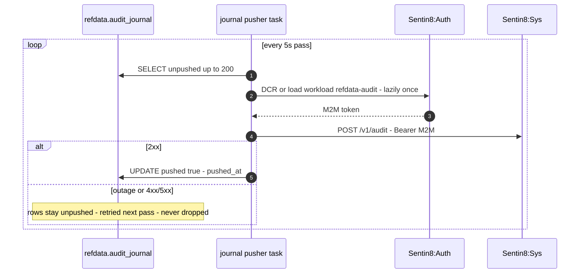

**Pool saturation** - the pool is capped (`SENTIN8_PG_POOL_MAX`, default 3);
`state.pool.acquire()` awaits backpressure rather than escalating
connections; RLS context and queries run inside one short transaction each.
`make stop` on the vertical frees DB connections when the platform is
saturated during rebuilds.

**Corporate-action cron failure** - transitions are cron-executed by design:
a missed ex-date leaves rows at their current stage (`halted`/calendar flags
keep trading honest), the recovery path re-runs the transition for the due
stage, and a retroactive adjustment is audited. An entitlement snapshot
incompleteness reconciles against the position ledger on the owning
services.

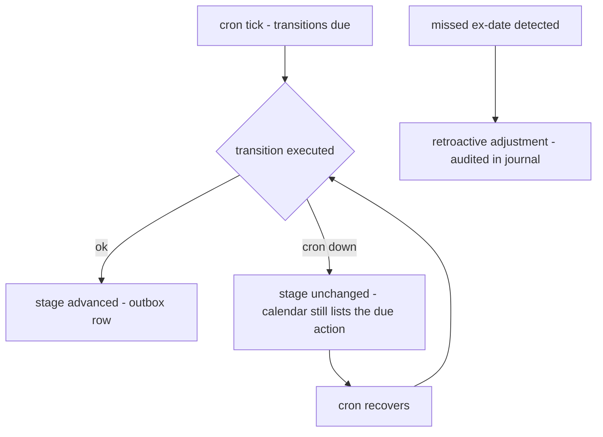

**Boot-time failure** - refuse-to-start on: PostgreSQL < 18, wrong
vertical database (DSN database name must equal the vertical leaf), an
unparsable Shield set (fail-closed at boot), a missing port. `--print-
registration` works with no DB at all.

## 7. Concurrency & Performance Model

Task topology (tokio single runtime):

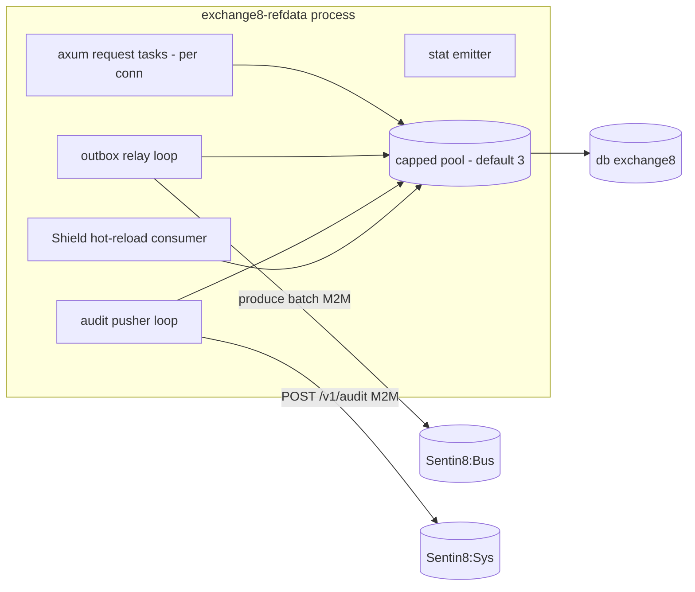

- **Pool capping**: `sentin8_config::pg_pool::connect` (max 3 default,
  `SENTIN8_PG_POOL_MAX` override) - protect the ~20-service cluster from
  pool exhaustion.
- **Hot path**: `GET /v1/securities` - one indexed query
  (`idx_exchange8_security_env` on `env_id`) per request, `ORDER BY symbol LIMIT
  500 max`; no response cache today (low read amplification per env).
- **Backpressure**: pool acquire awaits; relay/pusher loops drain bounded
  batches (100 outbox / 200 journal rows) per wake.
- **Locking**: no explicit locks; short single-statement transactions; RLS
  context is transaction-local so no global mutex exists on the request
  path.
- **mimalloc** global allocator covers request tasks and all background
  workers.

## 8. Invariants, Insecure-Defaults Rejected, Unsafe Rationale

- Every `refdata` tenant table: `ENABLE` + `FORCE ROW LEVEL SECURITY`, the
  standard four-policy set, `env_id` present and checked in policy.
- Context set and data query share one connection and one transaction;
  `set_tenant_context` is always awaited; explicit `WHERE env_id = $1`
  rides every handler query as defense-in-depth.
- The Shield step-5 decision is the only gate after verify; the JWT `scope`
  claim never decides; no per-handler scope checks fork the decision.
- The registered `scope-mirror` set covers every handler `EvalTarget` and
  passes the enroll-time dry-run (`dry_run_mirror`) - an enforced set that
  denies its own grants never ships.
- No role on `exchange8` carries BYPASSRLS; the probe role used by the SQL
  matrix is a NOBYPASSRLS test fixture, not a service role.
- No plaintext secrets in any table; the DSN travels via the vertical's own
  registry (`extra_env`), never via platform config.
- No cross-schema grants FROM this role (`cross_schema_grants: []`); no
  platform-table grants; the service holds grants only in db `exchange8` on
  schema `refdata`.
- Forbidden by design: classical-TLS fallback, `danger_accept_invalid_certs`
  as a client default, `sqlx::PgPool::connect` outside the capped helper, a
  second Shield engine per process, direct writes to other services'
  schemas/platform tables, a realm field, broad `{service}:admin` scopes.
- No `unsafe` blocks in the unit; the two process-wide side effects
  (allocator, crypto provider) are shell-owned.

## 9. Testing Strategy

```mermaid
graph TD
    TP["Test pyramid - exchange8-refdata"]
    L1["Unit - in-crate - refdata.rs CA math - crossref.rs resolver + calendar - scope matrix - RFW shape"]
    L2["Handler oneshot - tower::oneshot against the real router - DB-free - 401/405/404 + error envelope"]
    L3["Policy wiring - PURE tests on the REAL seeded scope-mirror text - deny defaults - shadow - forbid - M2M parity - admin - enroll dry-run"]
    L4["SQL matrix - live PostgreSQL as exchange8_probe NOBYPASSRLS - FORCE RLS + policy coverage for every declared table - no-context insert rejected - own-env visible - cross-env invisible"]
    L5["E2E - UI only via browser + BFF proxy - platform-level suite"]

    TP1["NOT tested here: transport-level FIX/ITCH protocol code - covered by the vertical crates"]
    TP2["NOT tested here: cross-service event delivery end-to-end - platform-wide suite"]
    TP3["Event-name + worker unit tests cover the vocabulary and stage predicate; the live cron tick is exercised in the platform suite"]

    TP["Test pyramid - exchange8-refdata"]
```

- **Unit (in-crate)**: corporate-action adjustment math and lifecycle
  (`refdata.rs` tests: split/reverse-split/cash/stock/spinoff/rights
  arithmetic, entitlement snapshots, stage progression), cross-reference
  agreement + conflict flagging + reverse view + calendar windows
  (`crossref.rs` tests), RFW page shape (hex icons, POST-friendly action
  resources, page coverage), handler scope matrix
  (deny empty/foreign/sibling, allow exact/unioned/platform-admin,
  prefix-permissive grants vs exact denials, naming convention, guard–scope
  parity).
- **Handler oneshot** (`tests/handlers_oneshot.rs`): drives the real router
  through `tower::oneshot` with a never-connected pool - route mounting,
  401-before-DB (415 on JSON-extractors counts), 405-vs-404 route shape,
  plain-text error envelope. DB-free by construction (gates run before the
  first pool access).
- **Policy wiring** (`tests/policy.rs`): evaluation against the exact
  `SCOPE_MIRROR_POLICIES` string the registration declares - no-set deny,
  enforced no-match deny, shadow never blocks, mirror covers own grants,
  M2M parity, platform-admin scopes, forbid-beats-permit, role-keyed tenant
  sets, cross-env set isolation, mirror-covers-handler-actions parity, and
  the enroll dry-run gate.
- **SQL matrix** (`tests/sql_matrix.rs`): against live PostgreSQL 18 as the
  `exchange8_probe` NOBYPASSRLS role - derives the table list from this
  service's own `sql/init.sql` (self-maintaining), asserts FORCE RLS +
  ≥1 policy on every declared table, then the behavioral matrix: no context
  → 0 rows, insert without context → rejected (savepoint-recoverable),
  own-env context → exactly the probe row, cross-env context → 0 rows; one
  rolled-back transaction, skips silently offline so plain `cargo test`
  stays hermetic.
- **E2E (platform)**: UI-only flows through the browser and the BFF proxy -
  reference data reachable through the TLS/ingress pipeline; no direct SQL
  or backend calls from tests.
- **Deliberately not tested here**: protocol codecs (wire/fix/itch crates),
  cross-service event delivery end-to-end (platform suite), and the live
  Sentin8:Cron tick (the worker's stage predicate + naming/idempotency
  contracts are unit-tested; the end-to-end tick is a platform-suite case).

## 10. Open Questions

- **Reference-data caching for hot paths**: consumers currently read
  through RLS on every use; a MemBus state refresh (`sentin8-membus`
  newest-wins) for the security master would remove per-request DB reads -
  unimplemented; no cache-invalidation channel exists yet.
- **Crypto corporate actions** (forks, airdrops, staking rewards) exist in
  the design but neither as `ActionType` variants nor tables - deferred
  into the schema's `security_type='Crypto'` + `asset_id` extension only.
- **Event-driven position adjustments + entitlements**: the transition
  worker emits the lifecycle events (announced/stage-advanced/completed),
  but the ex-date position-adjustment projector (Exchange8:Clearing consuming
  `exchange8:clearing:position:adjusted`), the record-date entitlement
  snapshot writer, and the pay-date delivery handoff to Exchange8:Settlement
  remain the CONSUMING services' wiring - this service owns the calendar
  and the events, not the consumers.
- **Customer/location/contact/trader/capitalization APIs**: the tables are
  complete and RLS'd, but no HTTP handlers exist for that master yet -
  every other refdata table has its mutation surface.
- **Record-date entitlement snapshot**: no projector persists positions ×
  ratio into `refdata.corporate_action_entitlement` at the record-date
  transition yet (the pure projection lives in `crossref.rs::
  snapshot_entitlements`; wiring it to the worker's record-date advance is
  a follow-up once the position-snapshot source is contract-set).

---

**Design attribution:** exchange8:refdata and its underlying concepts were designed by Hamid Jahanzad <Hamid@Jahanzad.com>.

