# Exchange8:Regulatory - Detailed Design Document

## 1. Scope & Context

**Owns**

- Reporter configuration (`regulatory.regulatory_session`) - per-environment
  links to each reporting regime: jurisdiction, format
  (`fix`/`api`/`file`/`sftp`), transport, address/port, credentials as
  secret reference, enabled flag; unique `(env_id, jurisdiction)`.
- Report history and acknowledgment state (`regulatory.regulatory_report`)
  - one row per formatted report with the dense per-(env, jurisdiction)
  sequence, the report class, the payload and the
  `sent/acked/rejected/retrying/failed` lifecycle.
- The reporter core: `Jurisdiction` (6 regimes), `ReportClass` (5 classes),
  the normalized `ReportableEvent`, the `Reporter` trait with one
  implementation per regime, and `ReportRouter` fan-out with per-jurisdiction
  sequence isolation and a transport-down retry queue.
- The outbox producer for regulatory events (`regulatory.outbox`, notify
  channel `regulatory_outbox_changed`) and the audit journal
  (`regulatory.audit_journal`) for the same writes.

**Does NOT own (delegates)**

- The order/trade/quote stream itself - Exchange8:ME, Exchange8:OMS, Exchange8:Clearing,
  Exchange8:MD produce the events; this service consumes them.
- Fix-session and API transport implementations - regime transports are
  configuration rows; the transport adapters are a connectivity concern
  (Exchange8:VFeeds owns external feed sessions analogously).
- Surveillance detection and market-abuse analysis - Exchange8:Surveillance (MAR
  reporting decisions originate there).
- Derivative instrument/contract masters - Exchange8:RefData.
- Fiat money movement - Bank8:Ledger.
- Identity, M2M registration, Cron schedules - Sentin8:Auth / Sentin8:Cron.

### System context

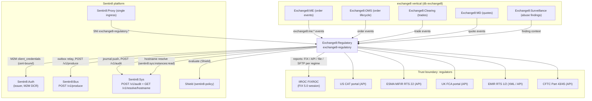

### Container view

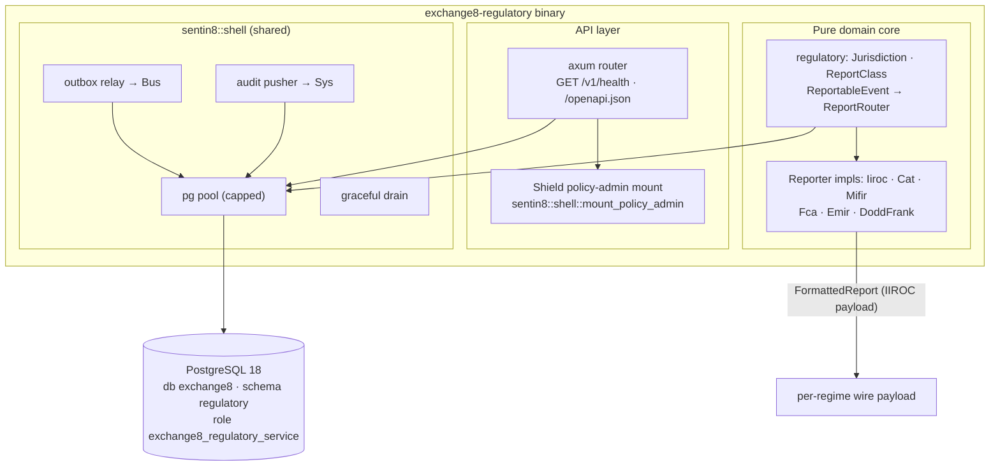

## 2. Runtime Architecture

The binary (`src/main.rs`) is a Sentin8 Shell assembly:
`Sentin8Shell::new("exchange8:regulatory", "EXCHANGE8_REGULATORY")` with
registration printing, `with_simple_state()`, and
`with_router(extend_router)` that mounts the Shield policy-admin API. The
DB pool, drain, outbox relay and audit pusher are shell-provided. Report
fan-out runs on a Bus consumer task; the HTTP router carries health and
admin endpoints only.

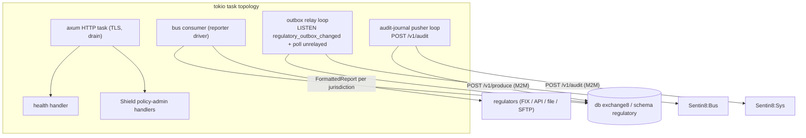

### Request family: transaction reporting generation

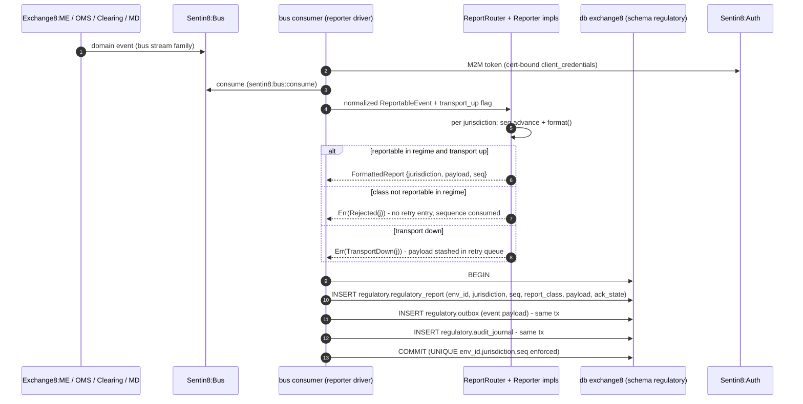

### Request family: submission to a regime

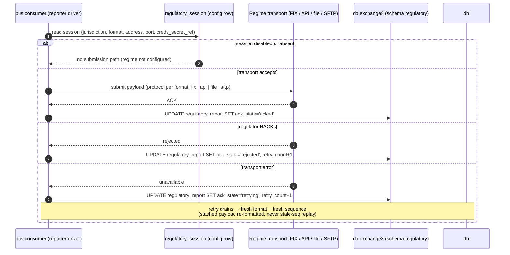

### Request family: acknowledgment ingestion

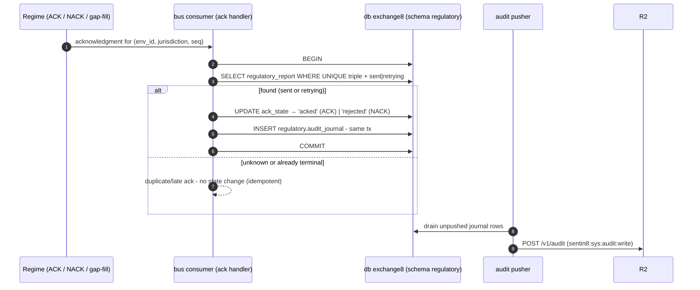

### Request family: retry / reconciliation

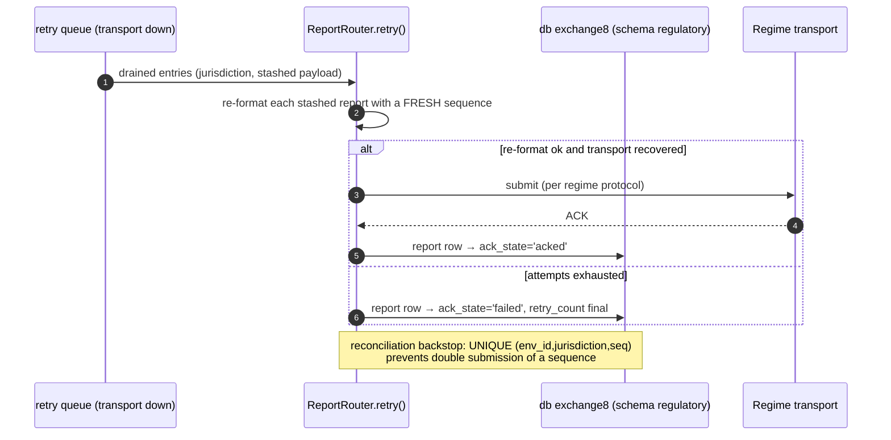

### Request family: admin RFW

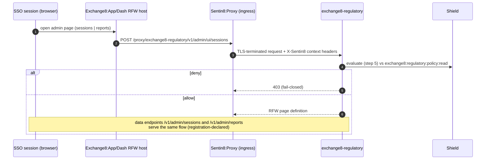

## 3. Data Model

Schema-per-service: database `exchange8`, schema `regulatory`, role
`exchange8_regulatory_service`, DSN env `EXCHANGE8_REGULATORY_DATABASE_URL`.
RLS (`ENABLE` + `FORCE`) on every table; policies require
`sentin8_context_initialized()` and `env_id = sentin8_current_env_id()`
(set via `SELECT sentin8_set_tenant_context(...)` on the same connection,
transaction-local, awaited).

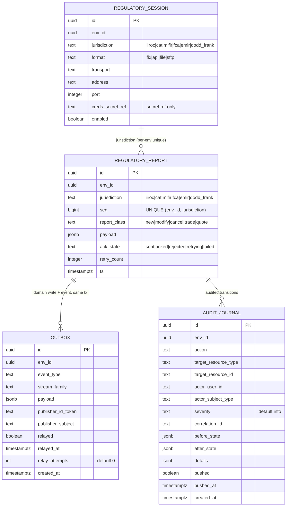

Per-table notes:

| Table | Visibility | Notes |
|---|---|---|
| `regulatory.regulatory_session` | env-scoped, RLS FORCE | one link per (env, jurisdiction) - `UNIQUE (env_id, jurisdiction)`; `jurisdiction` CHECK matches the six regime keys; `format` CHECK `fix/api/file/sftp`; credentials only as `creds_secret_ref` |
| `regulatory.regulatory_report` | env-scoped, RLS FORCE | report history + ack lifecycle; `UNIQUE (env_id, jurisdiction, seq)` is the idempotency backstop; `report_class` CHECK mirrors the five `ReportClass` variants; index `idx_exchange8_regreport_env_state (env_id, ack_state)` for the reconciliation sweep |
| `regulatory.outbox` | env-scoped, RLS FORCE | DBX §6.7 producer table; column `id` doubles as `idempotency_key` at Bus `POST /v1/produce`; partial index `idx_regulatory_outbox_unrelayed (created_at) WHERE relayed = false`; trigger `outbox_notify_trigger` → `pg_notify('regulatory_outbox_changed')` |
| `regulatory.audit_journal` | env-scoped, RLS FORCE | DBX §6.8 journal; single combined policy `audit_journal_dml` (USING + WITH CHECK); partial index `idx_regulatory_audit_journal_unpushed (created_at) WHERE pushed = false` |

### Lifecycle: report submission

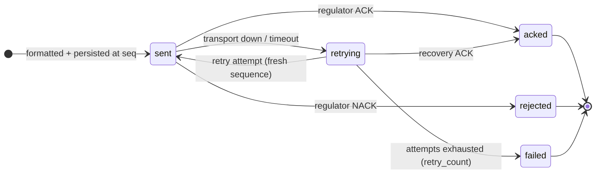

## 4. API Surface

Grouped by audience; the authorization gate for all surfaces is the 8-step
platform pipeline - bearer verify → tenant resolve → feature gate →
**Shield (sentin8-policy, scope-mirror policy set `scope-mirror`,
`origin='platform'`, `mode='enforced'`)** → RLS context → execute → audit.
The HTTP router mounts
health, `/openapi.json` and the Shield policy-admin API (the shared
`Sentin8:Policy` admin mount over `AppState: HasPolicyAdmin`); the handler
action evaluated in step 5 is `exchange8:regulatory:report` (the single
`HANDLER_ACTIONS` entry asserted by the policy wiring tests).

| Audience | Surface | Gate | Emits |
|---|---|---|---|
| System (M2M) | Report generation from bus streams (`exchange8:regulatory:report` action) | scope-mirror permit / `sentin8:sys:admin`, `sentin8:sys:org:admin`, `sentin8:sys:env:admin` | outbox event (domain payload, `regulatory_outbox_changed`) |
| System (M2M) | Regime submission and ACK/NACK ingestion (`exchange8:regulatory:report`) | scope-mirror permit | outbox event + audit journal row, same tx |
| Admin (RFW) | `/v1/admin/ui/sessions` + `/v1/admin/sessions` (page "Reporters", icon `0xe8cc`) | `exchange8:regulatory:read` / role `exchange8:admin` | - |
| Admin (RFW) | `/v1/admin/ui/reports` + `/v1/admin/reports` (page "Report History", icon `0xe873`) | `exchange8:regulatory:read` / role `exchange8:admin` | - |
| Admin | Shield policy-admin API (`exchange8:regulatory:policy:read` / `:write`) | role `exchange8:regulatory:admin` | `sentin8:sys:policy` family |
| Ops | `GET /v1/health`, `/openapi.json` | unauthenticated health; openapi none | - |

Declared error code: `exchange8_report_rejected` (502). Declared admin
service flag: `exchange8-regulatory`; app label "Regulatory" (icon `0xe8eb`).

**Multi-party reporting chain (outbox → Bus → trigger):**

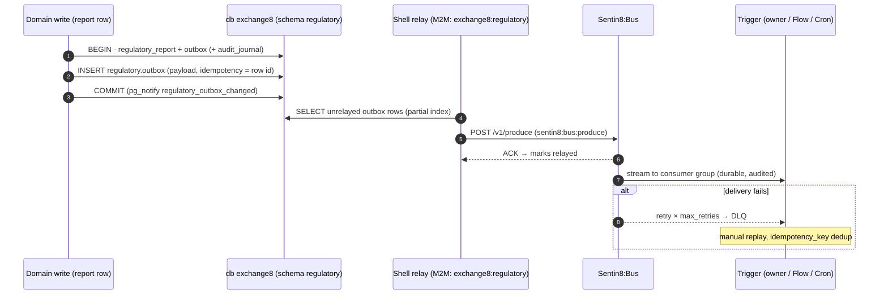

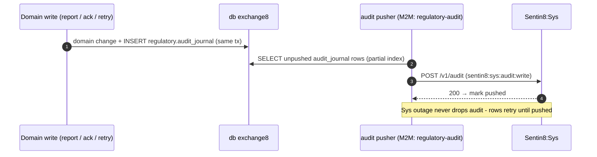

**Event flow (outbox → Bus → trigger):**

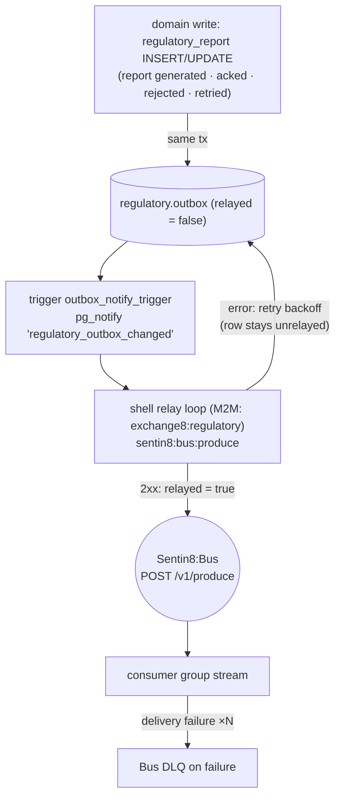

## 5. Cross-Cutting Concerns

- **Authentication** - Sentin8:Auth is the only issuer. Admin/user access
  uses user tokens; system reporting uses cert-bound M2M
  `client_credentials` tokens (DCR-registered per workload:
  `exchange8:regulatory` + `regulatory` (service client, both spellings
  granted - read/write, bus produce/consume, stat measure);
  `exchange8:regulatory-policy` + `regulatory-policy` (Shield hot-reload
  consumer + stat emitter pair); `regulatory-audit` (audit-journal pusher,
  `sentin8:sys:audit:write`); `exchange8-regulatory-tls` (database-free
  HostContextResolver, `sentin8:sys:instances:read`). DCR is fail-closed:
  only workloads present in the enrolled registry can register.
- **Authorization** - Shield (sentin8-policy) with the declared scope-mirror
  set (`policy_set_name 'scope-mirror'`, `origin='platform'`,
  `mode='enforced'`, `default_enabled=true`): action-granular permits for
  `exchange8:regulatory:report` over the live effective scope set, mirrored
  from the gates handlers evaluate; platform-admin scopes
  (`sentin8:sys:admin`, `sentin8:sys:org:admin`, `sentin8:sys:env:admin`)
  pass; no-set → deny (fail-closed); shadow is the emergency one-UPDATE
  rollback lever only; `token_tp: 'm2m'` never bypasses policy; tenant
  authors may add role-keyed sets (`principal.roles.contains(...)`), and
  forbid beats permit. The enroll-time dry-run gate rejects a set that
  denies its own grants.
- **Tenant resolution + RLS** - every table `ENABLE` + `FORCE ROW LEVEL
  SECURITY`; policies `sentin8_context_initialized() AND env_id =
  sentin8_current_env_id()`; context set with
  `SELECT sentin8_set_tenant_context(...)` (`set_config(..., true)`,
  transaction-local) on the **same connection** as the data statements -
  the async helper must be awaited. Explicit `env_id = $N` predicates stay
  the primary defense; RLS is the backstop. Role
  `exchange8_regulatory_service` carries no `BYPASSRLS`, holds
  `search_path = regulatory, public`, grants only in database `exchange8`,
  zero cross-schema grants.
- **Idempotency** - report dedup: `UNIQUE (env_id, jurisdiction, seq)`;
  relay: `idempotency_key` = outbox row id at Bus `POST /v1/produce`;
  acknowledgment replay: a late/duplicate ACK on a terminal-state row is a
  no-op; outbox retries reuse the row id.
- **Rate limiting / bot protection** - ingress tier is the platform edge
  (Sentin8:Proxy); service-local rate policies ride the Shield policy
  surface (per-tenant sets), not bespoke code.
- **Audit journaling** - every state transition (report generated, acked,
  rejected, retried) writes `regulatory.audit_journal` in the same
  transaction where possible; the pusher drains to `POST /v1/audit`
  (`sentin8:sys:audit:write`, workload `regulatory-audit`); Sys outage
  retries without loss.
- **Drain** - `sentin8::shell` graceful drain on upgrade: HTTP stops
  accepting, in-flight requests finish, the relay/journal pusher checkpoint
  unrelayed/unpushed rows, and Sentin8:Captain `upgrade-instance` swaps the
  binary (rolling, zero-downtime).
- **TLS** - terminated in-process by `sentin8-tls` behind Sentin8:Proxy
  (single ingress, SNI `exchange8-regulatory.{env}.{org}.{tld}`); the
  `exchange8-regulatory-tls` workload resolves host context DB-free via
  Sys `GET /v1/resolve/hostname` (`sentin8:sys:instances:read`) + TTL
  cache. Post-quantum only.
  relay and journal pusher alike.

## 6. Failure Modes & Recovery

### Submission retry after NACK / transport failure

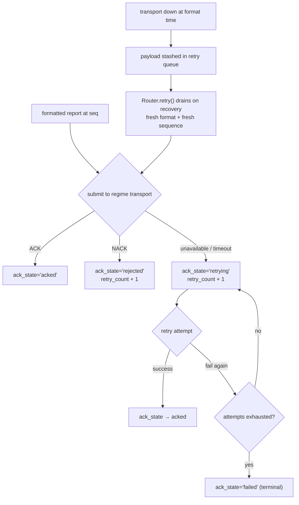

### Relay / journal retry and DLQ

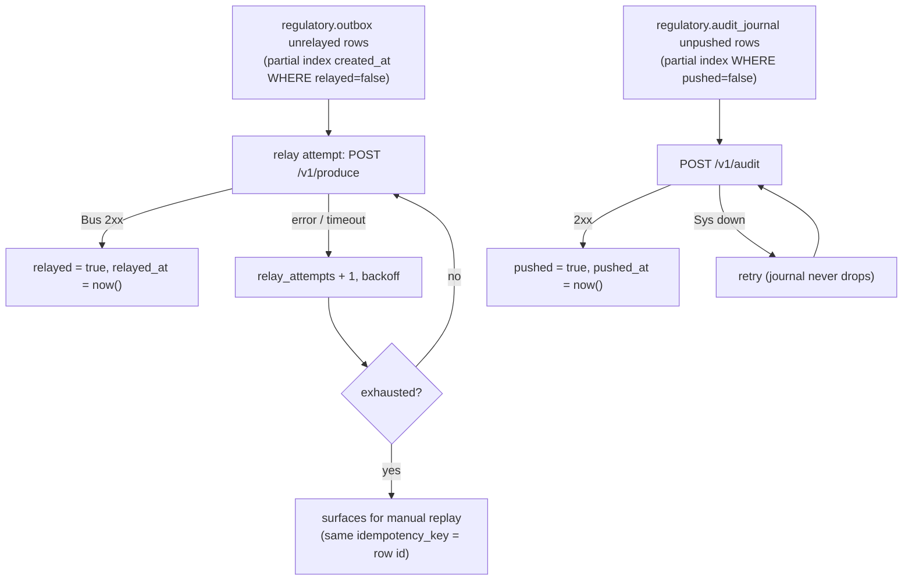

Recovery sequence (crash between write and relay):

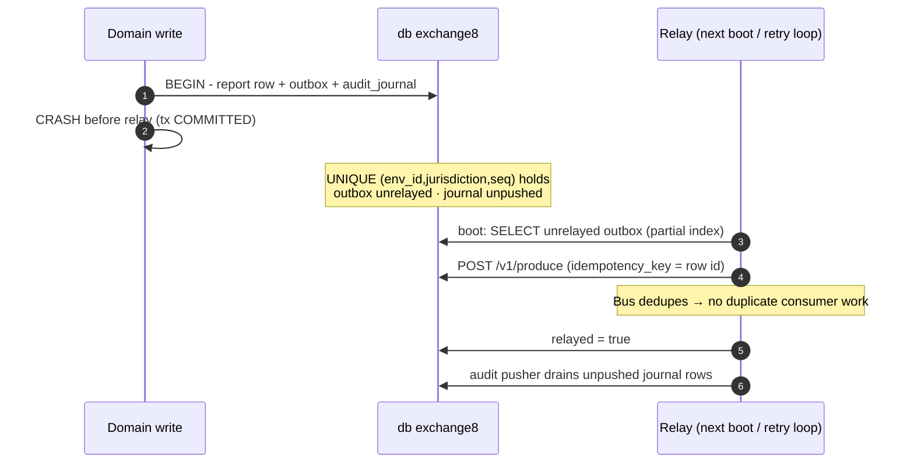

| Failure | Behavior |
|---|---|
| Regime transport down (format time) | payload queued in the router retry queue; report row lands `retrying`; drained on recovery with fresh sequence |
| Regulator NACK | `ack_state='rejected'`, sequence consumed (gap is legal), no retry entry |
| Transport error after submit | `ack_state='retrying'`, `retry_count` advanced; retry drains until `acked` or terminal `failed` |
| Relay outage | outbox rows retry with backoff; `idempotency_key` = row id makes replay safe |
| Bus DLQ | consumer delivery failures land in DLQ; manual replay re-produces with the same `idempotency_key` |
| Sys outage | audit journal rows retry (`pushed = false` partial index), never dropped |
| Regime mis-config (unknown jurisdiction key) | INSERT rejected by the CHECK constraint - no silent regime |
| Duplicate ACK | terminal-state no-op - acknowledgment ingestion is idempotent |

## 7. Concurrency & Performance Model

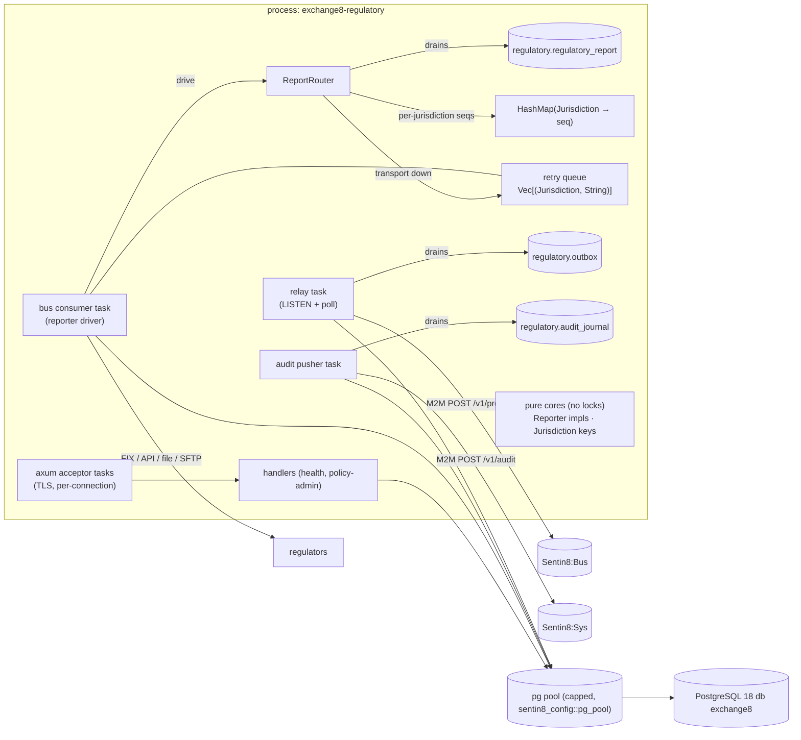

- **Task layout** - one HTTP acceptor; one bus consumer driving the
  `ReportRouter`; one relay task (LISTEN `regulatory_outbox_changed` +
  periodic unrelayed poll); one audit pusher. The router holds the mutable
  fan-out state (sequences + retry queue) behind the single consumer, so
  no cross-task shared mutable state exists on the hot path.
- **Pool sizing** - the shared `sentin8_config::pg_pool::connect` caps
  connections (default 3, overridable via `SENTIN8_PG_POOL_MAX`) so ~20
  services cannot exhaust PostgreSQL; the relay, journal pusher and
  consumer share the pool; tenant context is set transaction-locally per
  statement set.
- **Hot paths** - per-jurisdiction format + report row insert (single
  UNIQUE-guarded row + outbox row); sequence bookkeeping is a HashMap
  increment; payloads are plain strings. Cache: nothing hot-cached beyond
  the Shield policy sets (hot-reload consumer keeps them fresh) and the
  embedded HostContextResolver TTL cache.
- **Backpressure** - the `relayed = false` and `pushed = false` partial
  indexes bound the relay/pusher scans; relay backoff keeps a Bus outage
  from spinning; the drain path checkpoints before shutdown.

## 8. Invariants, Insecure-Defaults Rejected, Unsafe Rationale

Invariants (always true):

1. Report sequences are isolated per jurisdiction and monotone per (env,
   jurisdiction); a sequence is never reused and never issued for a
   different jurisdiction.
2. A format rejection consumes a sequence (gap) but never a retry entry; a
   transport-down report consumes both; the stashed payload re-formats with
   a FRESH sequence on retry.
3. A report write and its `regulatory.outbox` row (and wherever possible
   `regulatory.audit_journal`) commit in the same transaction.
4. Uniqueness of a submitted report is enforced by
   `UNIQUE (env_id, jurisdiction, seq)` - a relay replay can never create a
   second submission of the same sequence.
5. Acknowledgment ingestion only transitions from `sent`/`retrying`;
   `acked`, `rejected`, and `failed` are terminal.
6. Tenant context and data statements run on the same connection;
   `sentin8_set_tenant_context` is awaited (transaction-local
   `set_config(..., true)`).
7. Every tenant table carries `ENABLE` + `FORCE ROW LEVEL SECURITY` with
   the standard context policies; the service role has no `BYPASSRLS`, no
   cross-schema grants, and exists only in database `exchange8`.
8. Credentials to regimes exist only as `creds_secret_ref` values - never
   plaintext in `regulatory_session` rows.
9. Jurisdiction keys (`iiroc|cat|mifir|fca|emir|dodd_frank`) and report
   classes (`new|modify|cancel|trade|quote`) match the SQL CHECKs exactly -
   wire keys and schema constraints are a single vocabulary.
10. The seeded Shield scope-mirror text covers every step-5 handler action
    (`exchange8:regulatory:report`) and passes the enroll dry-run gate; a
    set that denies its own grants never ships.

Insecure defaults rejected:

- **`danger_accept_invalid_certs` / hand-rolled CA loading** - TLS is
  in-process via `sentin8-tls` (post-quantum, root CA in the OS trust
  store); regulator endpoints use the configured transport with
  secret-referenced credentials.
- **Direct cross-schema/table joins into other services** - cross-service
  data flows are membus → bus → owner API in the access order rule (this
  service declares zero cross-schema grants today).
- **Static superuser service DSN** - role `exchange8_regulatory_service` is
  unprivileged, non-bypass, database-`exchange8`-only.
- **Plaintext regime credentials** - token/credential columns carry
  references only (Secrets), never values.

## 9. Testing Strategy

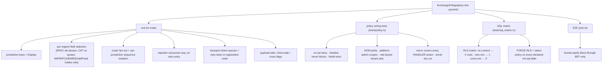

- **Unit layer** - the pure reporting core owns all domain behavior:
  fixed jurisdiction keys, per-regime class rejection rules, fan-out to
  every registered reporter, per-jurisdiction sequence isolation
  (sequences advance across transport-down reports and never roll back),
  retry-queue semantics (stale payload re-formatted, drain in registration
  order, accumulation across down batches), and payload field rendering.
- **Policy layer** - proves the real seeded scope-mirror text
  (`registration::SCOPE_MIRROR_POLICIES`, the exact string `vertical
  enroll` upserts) evaluates fail-closed: no-set deny, enforced no-match
  deny, shadow never blocks, M2M parity, platform-admin scopes pass, forbid
  beats permit, role-keyed tenant sets decide, and the enroll dry-run
  gate accepts the declared set.
- **SQL matrix** - live PostgreSQL 18 as the non-bypass `exchange8_probe`
  role (`sql/probe.sql`): policy coverage for every table this service's
  `init.sql` declares, plus the behavioral matrix (no tenant context → 0
  rows silent; insert without context rejected by WITH CHECK; own-env
  context → exactly one probe row; cross-env → 0 rows), all inside one
  rolled-back transaction, skipped silently while offline so
  `cargo test` stays hermetic.
- **Deliberately not tested here** - platform TLS/RLS plumbing itself,
  Sentin8:Bus delivery guarantees, Shield engine internals: covered by
  the platform's own test strategy docs.
- **E2E** - the vertical's `e2e-ts` suite drives the real UI through the
  BFF only (no direct SQL or backend calls).

## 10. Open Questions

- The HTTP surface carries health, `/openapi.json` and the Shield
  policy-admin API; the RFW admin pages declared in registration
  (`sessions`, `reports`) do not yet have mounted data/UI handlers in this
  binary.
- Regime transports are configuration surfaces (`regulatory_session`
  rows: `format fix/api/file/sftp`, `address`, `port`,
  `creds_secret_ref`) without in-tree transport adapters (FIX session
  management, API clients, SFTP drops) in this unit yet.
- Report persistence, outbox event emission and acknowledgment ingestion
  are designed (state machine, UNIQUE seq contract, outbox pattern) but
  not wired: `event_triggers` in registration is empty and no writer
  surfaces exist in the router extension today.
- Per-env reporter registration (which reporters populate the
  `ReportRouter` for an environment) is a boot-wiring decision pending the
  connectivity integration.
- MiCA and MAR regimes (vertical design §2) have no `Jurisdiction` variant
  or SQL CHECK entry - extending the enum, the CHECKs and the reporter set
  is a target-state change when those regimes are added.
- Statement purge / archival policy for `regulatory_report` history and
  the reconciliation view used by admin RFW pages are deferred design
  items.

---

**Design attribution:** exchange8:regulatory and its underlying concepts were designed by Hamid Jahanzad <Hamid@Jahanzad.com>.

