# Exchange8:RFQ - Detailed Design Document

## 1. Scope & Context

**Owns**

- The RFQ engine - the full RFQ lifecycle
  `Open → Quoting → Quoted → Traded | Expired | Rejected`: request routing,
  quote collection with windows and lateness, hit binding, last-look
  parking/accept/reject with per-(LP, reason) counters, and the sweep.
- The streaming-quote side channel - per-(LP, pair) live two-way books,
  newest-binds hit semantics, withdrawal.
- The anonymized RFQ tape (`RfqTape`) and the last-look analytics
  scorecard (`LastLookAnalytics`).
- FX pair/tenor master extension (`rfq.fx_pair`, `rfq.fx_tenor`) - the pair
  metadata (pip size, big figure, settlement convention, NDF flag,
  `quote_type`, cut-off) that rides on top of `refdata.security`.
- Per-currency exposure records (`rfq.currency_exposure`).
- The outbox producer (`rfq.outbox`, notify channel `rfq_outbox_changed`)
  and the audit journal (`rfq.audit_journal`) for the same writes.

**Does NOT own (delegates)**

- The CLOB order book for FX pairs traded as limit orders - Exchange8:ME
  (pairs with `quote_type ∈ {clob, clob+rfq}` are served there).
- Client/LP FIX 4.4 and WebSocket session transports and FIX codec -
  Exchange8:Gateway (sessions are connections; the engine consumes their events).
- The currency-exposure **limit policy decisions** - Exchange8:Risk (this service
  records net position per currency/value date; limit evaluation is Risk's).
- Position ledger, novation and settlement of FX trades -
  Exchange8:Clearing / Exchange8:Settlement / Bank8:Ledger.
- Instrument security master, currency catalog - Exchange8:RefData
  (`refdata.security`, `refdata.currency`; read via declared grants).
- Public market-data fan-out - Exchange8:MD / Exchange8:VFeeds (the tape is published
  by RFQ; consumer-facing feeds are theirs).
- Identity, M2M registration, Cron schedules - Sentin8:Auth / Sentin8:Cron.

### System context

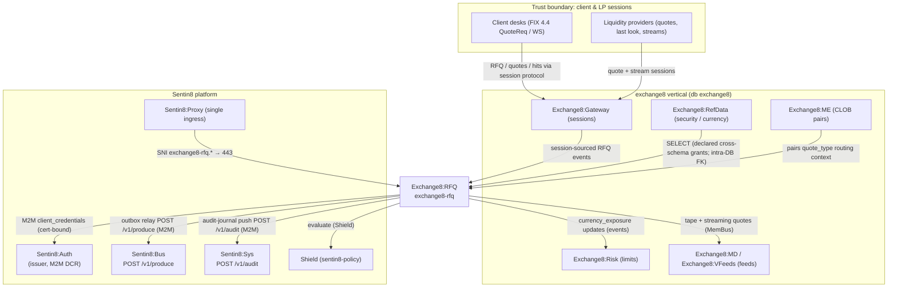

### Container view

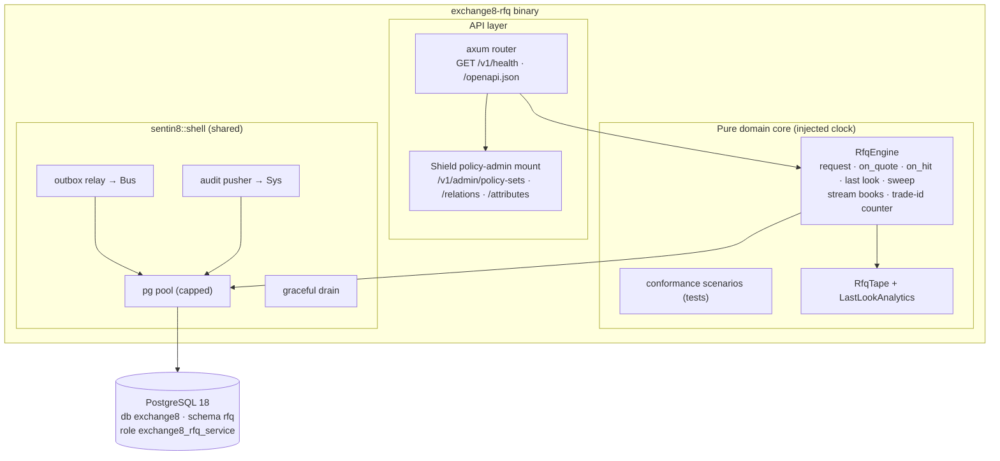

## 2. Runtime Architecture

The binary (`src/main.rs`) is a Sentin8 Shell assembly:
`Sentin8Shell::new("exchange8:rfq", "EXCHANGE8_RFQ")` with registration
printing (`registration::print`), state wiring that connects the MemBus
(`sentin8::membus::ServiceBus::connect("exchange8:rfq", valkey_url)`), and
`with_router(extend_router)` that mounts the Shield policy-admin API over
the shared `HasPolicyAdmin` accessor so the admin surface and the request
covering every in-process task. Boot, DB pool, drain, outbox relay and audit
pusher are shell-provided.

The engine is the deterministic core: pure functions against an injected
`now_us`; the shell owns FIX/WS session I/O (with the session plumbing, bus
consumers and the sweep timer landing with the runtime wiring pass) and
turns engine events into MemBus publishes and DB writes.

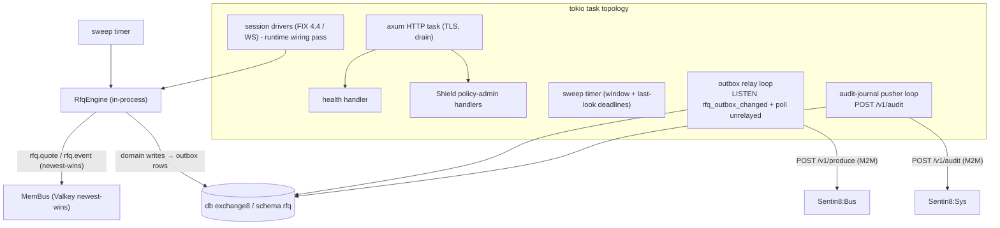

### Request family: RFQ create / broadcast

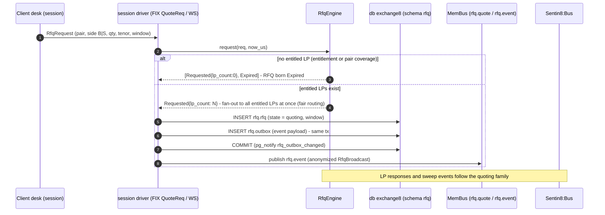

### Request family: quote collect / compare

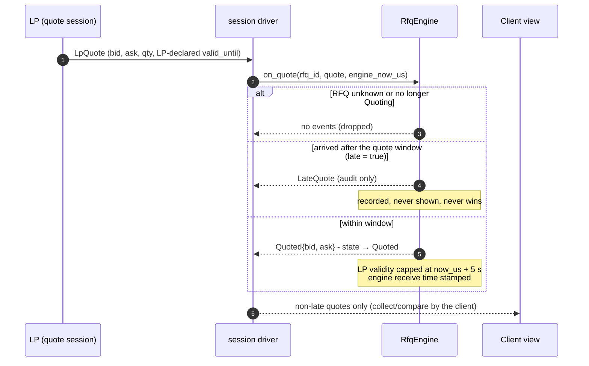

### Request family: RFQ → order (trade) conversion

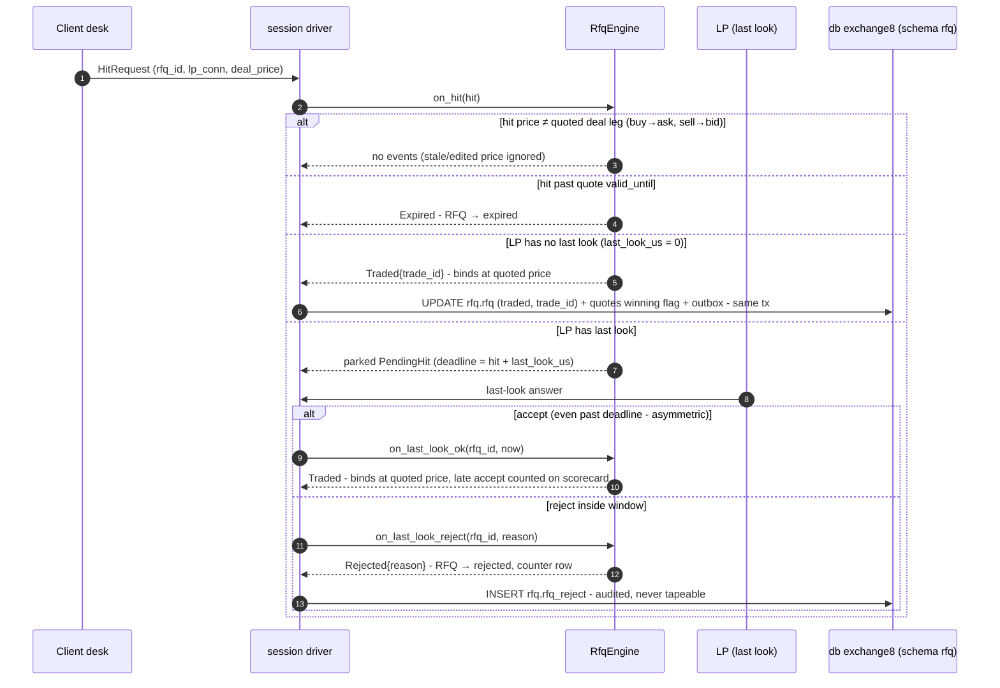

### Request family: admin RFW / policy

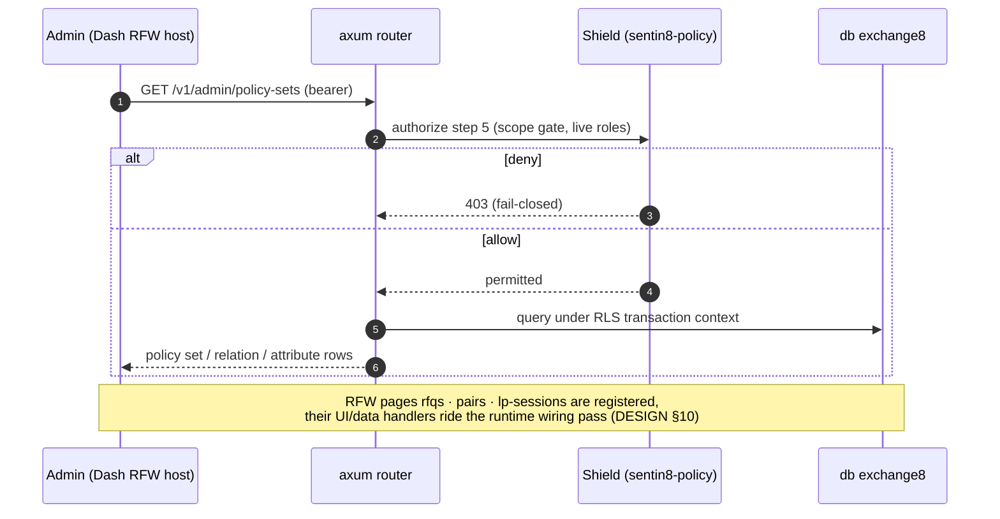

## 3. Data Model

Schema-per-service: database `exchange8`, schema `rfq`, role
`exchange8_rfq_service`, DSN env `EXCHANGE8_RFQ_DATABASE_URL`. RLS
(`ENABLE` + `FORCE`) on every tenant table; policies require
`sentin8_context_initialized()` and `env_id = sentin8_current_env_id()`
(set via `SELECT sentin8_set_tenant_context($1)` on the same
connection/transaction as the queries). The role's `search_path` is
`rfq, public`; cross-schema access is exactly the declared SELECT grants on
`refdata.security` and `refdata.currency` (the FK targets are
intra-database and need no grants).

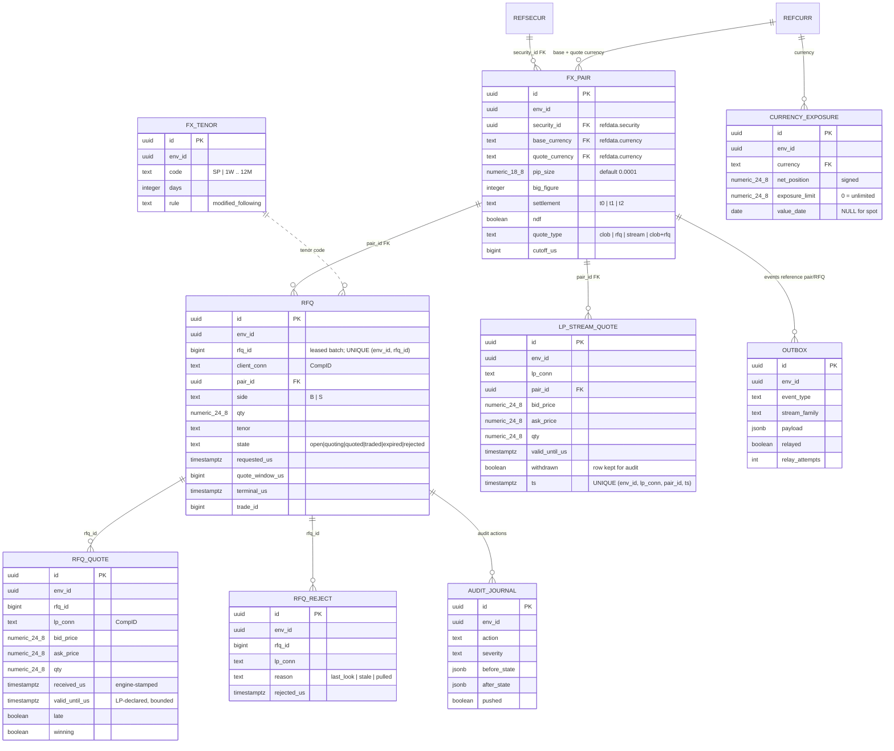

Per-table notes:

| Table | Visibility | Notes |
|---|---|---|
| `rfq.fx_pair` | env-scoped, RLS FORCE | pair master over `refdata.security` (`security_type 'Fx'`); UNIQUE `(env_id, base_currency, quote_currency)`; `quote_type` selects the serving engine; indexes on `env_id` |
| `rfq.fx_tenor` | env-scoped, RLS FORCE | tenor catalog (SP = spot; forwards by calendar-days + modified-following rule); UNIQUE `(env_id, code)` |
| `rfq.rfq` | env-scoped, RLS FORCE | lifecycle row; UNIQUE `(env_id, rfq_id)`; `state ∈ {open, quoting, quoted, traded, expired, rejected}`; `trade_id` set on traded; index `(env_id, state)` for the sweep |
| `rfq.rfq_quote` | env-scoped, RLS FORCE | LP responses; `received_us` engine-authoritative; `late` kills visibility; `winning` marks the chosen quote; index `(env_id, rfq_id)` |
| `rfq.rfq_reject` | env-scoped, RLS FORCE | last-look/asymmetric counters by `(env_id, lp_conn)`; audit + scorecard input |
| `rfq.lp_stream_quote` | env-scoped, RLS FORCE | streaming pushes; UNIQUE `(env_id, lp_conn, pair_id, ts)`; withdrawal keeps the row, stops binding; index `(env_id, pair_id, lp_conn)` |
| `rfq.currency_exposure` | env-scoped, RLS FORCE | per-currency net position + limit, optional value-date bucket for forwards; UNIQUE `(env_id, currency, value_date)` |
| `rfq.outbox` | env-scoped, RLS FORCE | DBX §6.7 producer table; partial index on `relayed = false`; `pg_notify('rfq_outbox_changed')` trigger on INSERT |
| `rfq.audit_journal` | env-scoped, RLS FORCE | DBX §6.8 journal for `POST /v1/audit`; partial index on `pushed = false` |

### Lifecycle

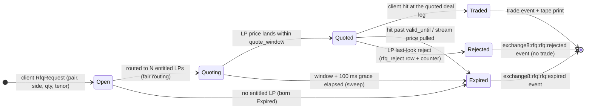

Streaming quotes have no RFQ lifecycle: a stream hit emits a trade bound to
`rfq_id = 0`. A pending last-look hit inside `Quoted` is parked (visible only
as the engine's `pending_hits` set) until accept, reject or deadline sweep.

## 4. API Surface

Grouped by audience. The authorization gate for every handler surface is the
8-step platform pipeline - bearer verify → tenant resolve → feature gate →
**Shield (`scope-mirror`, enforced, action `exchange8:rfq:quote`)** → RLS
context → execute → audit. The HTTP router mounts `GET /v1/health`,
`/openapi.json` and the Shield policy-admin API only; the RFQ flow arrives
via FIX 4.4 QuoteReq / WS session protocols, and the registered error codes
are `exchange8_rfq_not_found` (404), `exchange8_rfq_quote_late` (422) and
`exchange8_rfq_hit_expired` (422).

| Audience | Surface | Gate | Emits |
|---|---|---|---|
| Client session (FIX 4.4 QuoteReq / WS) | RFQ request, quote responses, hit, streaming quote view | `exchange8:rfq:quote` (scope-mirror) + pair entitlement | `exchange8:rfq:rfq:*` lifecycle events |
| LP session | Quote responses, last look, streaming pushes/withdraws | `exchange8:rfq:quote` + LP entitlement | `exchange8:rfq:quote:*`, `exchange8:rfq:stream:*` |
| Market data (entitled feeds) | Anonymized tape (MemBus family `rfq.event`, newest-wins) | session entitlement; `exchange8:rfq:stream:read` | tape entries (no identities) |
| LP scorecard (admin) | Last-look analytics snapshot | `exchange8:rfq:rfq:read` | - |
| Admin (RFW) | Pages `rfqs`, `pairs`, `lp-sessions` (`/v1/admin/ui/{page}` + `POST /v1/admin/{resource}`) | `exchange8:rfq:rfq:read` / `:write` / `exchange8:fx:pairs:admin` | - |
| Admin | Shield policy-admin API (`exchange8:rfq:policy:read` / `:write`, role `exchange8:rfq:admin`) | scope-mirror + admin scopes | `sentin8:sys:policy` family |
| Ops | `GET /v1/health`, `/openapi.json` | unauthenticated (health) | - |

Declared admin scopes (runtime-registered via `vertical enroll`): role
`exchange8:admin` → `exchange8:rfq:rfq:read`, `exchange8:rfq:rfq:write`,
`exchange8:rfq:quote:write`, `exchange8:rfq:stream:read`,
`exchange8:fx:pairs:admin`; role `exchange8:rfq:admin` →
`exchange8:rfq:policy:read`, `exchange8:rfq:policy:write`.

Event families (Sentin8:Bus, `exchange8:rfq:{resource}:{operation}`):
`rfq:requested`, `rfq:quoted`, `rfq:traded`, `rfq:expired`,
`rfq:rejected` (LP last-look), `stream:quote`, `stream:withdrawn`; MemBus
families `rfq.quote` (streaming LP quotes, session-private) and `rfq.event`
(anonymized tape).

**Multi-party event chain (outbox → Bus → trigger):**

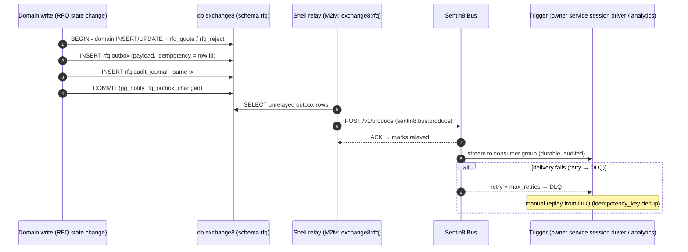

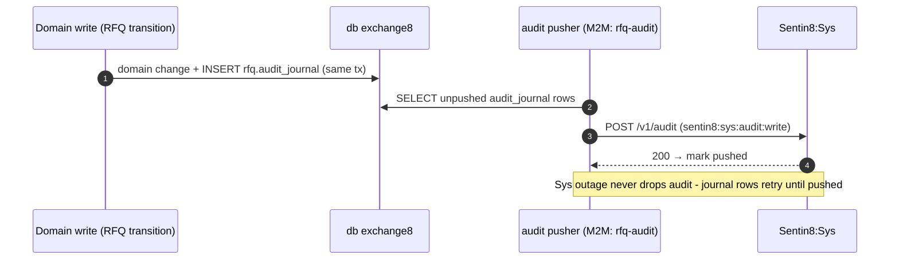

## 5. Cross-Cutting Concerns

- **Authentication** - Sentin8:Auth is the only issuer. Session participants
  (clients, LPs) authenticate to Exchange8:Gateway and act through connections;
  service workloads use cert-bound M2M `client_credentials` tokens
  (DCR-registered per workload: `exchange8:rfq` and `rfq` (the service's own
  client), `exchange8:rfq-policy` / `rfq-policy` (Shield hot-reload +
  stat), `rfq-audit` (journal pusher), `exchange8-rfq-tls` (DB-free host
  resolve)). DCR is fail-closed: only workloads in
  `sentin8_service_workloads` (seeded by `sentin8-cli vertical enroll`) can
  register.
- **Authorization** - the `scope-mirror` policy set (`origin='platform'`,
  `mode='enforced'`) permits each declared action (handler step-5 target:
  `exchange8:rfq:quote`) for callers holding the matching scope or the
  platform-admin scopes (`sentin8:sys:admin`, `sentin8:sys:org:admin`,
  `sentin8:sys:env:admin`). No-set → deny (fail-closed); shadow is the
  emergency one-UPDATE rollback lever only; M2M `token_tp` never bypasses
  policy; a tenant forbid beats the mirror permit.
- **Tenant resolution + RLS** - every table has `ENABLE` + `FORCE ROW LEVEL
  SECURITY` with policies `sentin8_context_initialized() AND env_id =
  sentin8_current_env_id()`; context is set with
  `SELECT sentin8_set_tenant_context(...)` (`set_config(..., true)`,
  transaction-local) on the **same connection** as the data statements -
  the async helper must be awaited. Explicit `env_id = $N` predicates are
  defense-in-depth; RLS is the backstop; role `exchange8_rfq_service`
  carries no `BYPASSRLS`.
- **Idempotency** - bus produce: `idempotency_key` = outbox row id at
  `POST /v1/produce`; RFQ identity: UNIQUE `(env_id, rfq_id)` plus the
  in-process engine state (a duplicate quote for a terminal RFQ is dropped,
  a duplicate hit cannot re-trade a `Traded` RFQ); stream quotes are
  newest-wins so replays self-supersede; hit/last-look answers are engine
  transitions, not additive writes.
- **Rate limiting / bot protection** - ingress tier is the platform edge
  (Sentin8:Proxy); session-level rate policies ride the Shield policy
  surface (per-tenant sets), not bespoke code.
- **Audit journaling** - every state transition writes `rfq.audit_journal`
  (same transaction where possible); the pusher drains to Sys
  `POST /v1/audit` (`sentin8:sys:audit:write`); a Sys outage retries without
  loss.
- **Drain** - `sentin8::shell` graceful drain on upgrade: HTTP stops
  accepting, in-flight sessions finish, the relay/journal pusher checkpoint
  unrelayed/unpushed rows, and Sentin8:Captain's `upgrade-instance` swaps
  the binary (rolling, zero-downtime). In-flight RFQs are short-lived by
  nature - an engine restart expires `Open`/`Quoting` RFQs (their lifecycle
  is measured in milliseconds) and streaming books re-sync from LP pushes.
- **TLS** - terminated in-process by `sentin8-tls` behind Sentin8:Proxy
  (single ingress, SNI `exchange8-rfq.sys.ops…`); the
  `exchange8-rfq-tls` workload resolves host context DB-free via
  `GET /v1/resolve/hostname` (`sentin8:sys:instances:read`). Post-quantum
  only; no classical fallback.
  relay, journal pusher and the sweep timer alike.

## 6. Failure Modes & Recovery

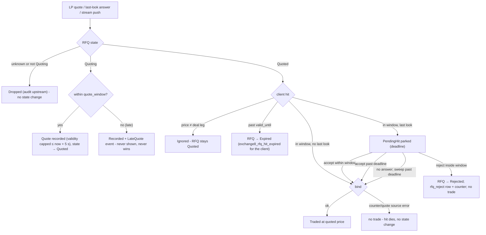

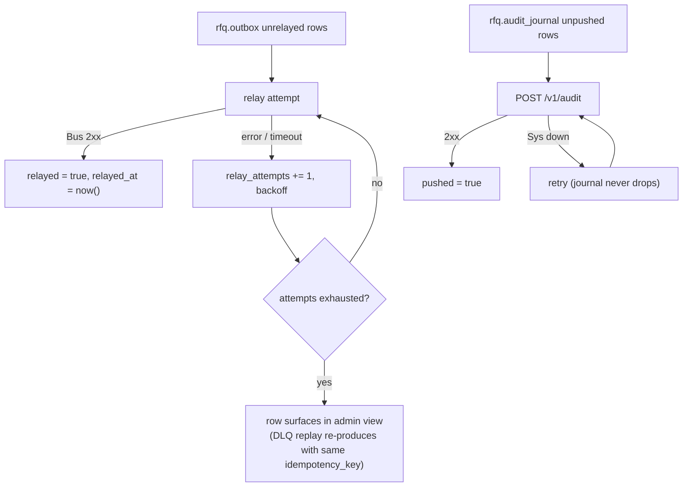

Recovery sequence (crash between domain write and relay):

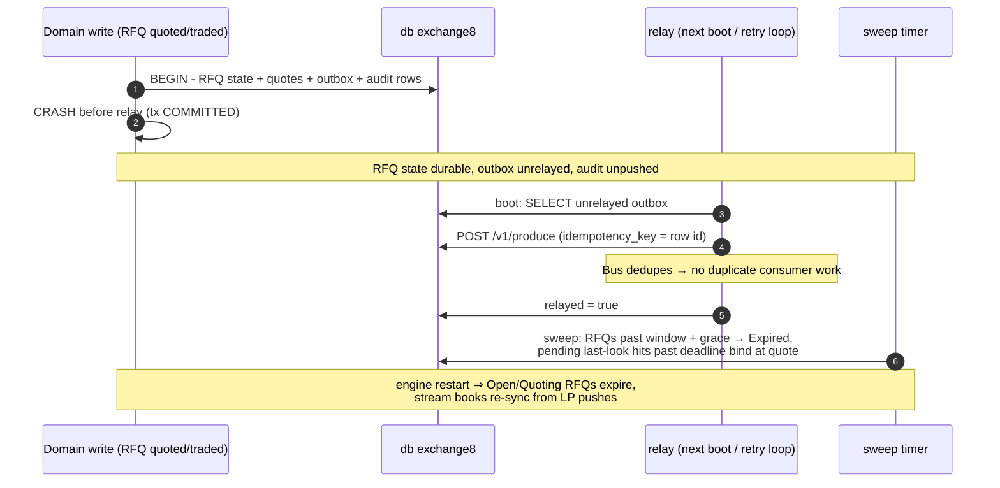

| Failure | Behavior |
|---|---|
| LP session down | RFQ routes to the remaining entitled LPs; `expired` if none respond |
| LP late (past quote window) | quote flagged `late` + `rfq_quote.late=true`, `exchange8_rfq_quote_late` semantics; never shown |
| Hit during last-look reject | client receives `rfq:rejected` with reason; `rfq_reject` row persisted; no trade |
| LP never answers last look | sweep binds the trade at the quoted price past the deadline (asymmetric) and counts `late_last_look` |
| Engine restart | `Open`/`Quoting` RFQs expire (short-lived by nature); streaming quote books re-sync from LP pushes |
| Relay outage | outbox rows retry with backoff; `idempotency_key` makes replay safe |
| Sys outage | audit journal retries, never drops |

## 7. Concurrency & Performance Model

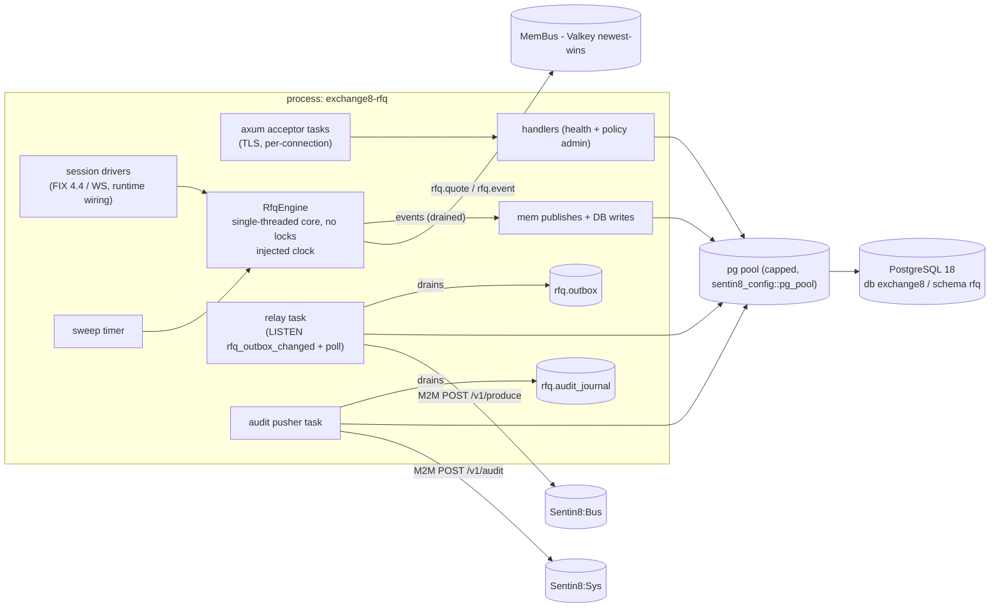

- **Task layout** - one HTTP acceptor; session drivers (one per client/LP
  connection) feed the engine; one sweep timer (windows + last-look
  deadlines + pending-hit binding); one relay task (LISTEN
  `rfq_outbox_changed` + periodic unrelayed poll); one audit pusher. The
  engine is single-threaded in-process state - all RFQ decisions serialize
  through it, so no shared-mutex contention exists on the hot path.
- **Pool sizing** - the shared `sentin8_config::pg_pool::connect` caps
  connections (default 3, overridable via `SENTIN8_PG_POOL_MAX`) so ~15
  vertical services cannot exhaust PostgreSQL. Relay and journal use the
  same pool; context is set transaction-locally per statement set.
- **Hot paths** - quote ingest and hit binding are pure in-memory engine
  calls (sub-millisecond, no DB); persistence lands per transition. Caches:
  nothing hot-cached beyond the Shield policy engine set (hot-reload
  consumer keeps loaded sets fresh).
- **Streaming model** - MemBus is newest-wins: a superseded quote ceases to
  exist, so backpressure cannot propagate stale prices; slow consumers see
  the newest state, never a stale queue replay.
- **Backpressure** - the outbox partial index bounds the relay scan;
  unrelayed rows retry with backoff so a Bus outage does not spin; the
  drain path checkpoints before shutdown.

## 8. Invariants, Insecure-Defaults Rejected, Unsafe Rationale

Invariants (always true):

1. A late quote is recorded, never shown to the client, and never wins or
   binds - visibility and binding are both keyed on `late = false`.
2. Engine receive timestamps are authoritative; LP-supplied times are
   advisory and never decide window membership.
3. LP-declared validity is capped at receipt time plus
   `MAX_VALID_WINDOW_US` (5 s) - no LP quote carries unbounded validity.
4. A hit binds **only** at the quoted deal leg - the price is exact-equality
   matched; no price invention, averaging or tolerance band.
5. A hit past the quoted `valid_until` expires the RFQ and cannot trade.
6. A last-look rejection always produces `rfq:rejected`, no trade, and a
   persisted `rfq_reject` row; an accept (within or past the deadline)
   always trades at the quoted price - asymmetry is deliberate.
7. Quote fairness: one request, one simultaneous fan-out to every entitled
   LP; LP entitlement is per pair and evaluated at request time.
8. Every streaming trade draws its id from the engine's single trade-id
   counter with `rfq_id = 0`; RFQ trades consume the same counter.
9. Rejected and LateQuote events are never tapeable; the tape never carries
   LP or client identity, and one-sided quotes never appear on it.
10. A domain state change and its `rfq.outbox` (and wherever possible
    `rfq.audit_journal`) row are committed in the **same** transaction;
    tenant context is set on the same connection and awaited.
11. No role carries `BYPASSRLS`; cross-schema access is exactly the declared
    SELECT grants on `refdata.security` and `refdata.currency`.

Insecure defaults rejected:

- **`danger_accept_invalid_certs` / hand-rolled CA loading** - TLS is
  in-process via `sentin8-tls` (post-quantum, root CA in the OS trust
  store).
- **LP-supplied timing as truth** - a client-configurable clock is a
  fairness attack; engine stamps decide windows.
- **Raw RFQ events on a public feed** - rejects LP/client identity leaks
  (front-running, quote sniping); the anonymous projection replaces them.
- **Unbounded LP-declared validity** - rejected; the engine caps it at
  ingest.
- **Direct cross-schema writes / blanket schema grants** - declared
  SELECT-only grants are the exact cross-service surface; everything else
  is membus/bus/owner-API.
- **Static superuser service DSN** - the service role is unprivileged,
  non-bypass, database-`exchange8`-only.

No `unsafe` blocks exist in this service; the unsafe-rationale section is
vacuously satisfied. Soundness-relevant safety rests on the invariants
above (exact hit matching, late non-binding, engine-time authority,
same-connection context).

## 9. Testing Strategy

```mermaid
graph TD
    PYRAMID["Test pyramid - exchange8-rfq"] --> UT["Unit (pure engine)"]
    PYRAMID --> CONF["Conformance scenarios (conformance.rs)"]
    PYRAMID --> PWT["Policy wiring (tests/policy.rs)"]
    PYRAMID --> SQL["SQL matrix (tests/sql_matrix.rs, live DB)"]
    PYRAMID --> E2E["Vertical E2E (e2e-ts/, UI + BFF only)"]
    UT --> UT1["routing entitlements · no-LP expiry"]
    UT --> UT2["quote windows · late non-binding · validity cap"]
    UT --> UT3["hit leg matching · stale-price rejection"]
    UT --> UT4["last-look accept/reject/deadline-bind · counters"]
    UT --> UT5["stream: newest-binds · withdraw · one-sided legs"]
    CONF --> C1["quote_window_expiry"]
    CONF --> C2["late_quote_never_wins"]
    CONF --> C3["last_look_binding (incl. asymmetric late accept)"]
    CONF --> C4["last_look_reject"]
    CONF --> C5["stream_binding"]
    PWT --> P1["no-set deny · enforced no-match · shadow never blocks"]
    PWT --> P2["M2M parity · platform-admin scopes · forbid wins · role rules"]
    PWT --> P3["cross-env isolation · mirror covers every handler action · enroll dry-run"]
    SQL --> S1["RLS matrix: no context / own env / cross env"]
    SQL --> S2["FORCE RLS + policy coverage from the shipped DDL"]
    E2E --> E1["human-parity flows; no direct SQL/backend"]
```

- **Unit layer** - the engine's pure core owns the domain matrix: routing
  and entitlement expansion, quote window + lateness, validity capping, hit
  leg/price matching, last-look parking/accept/reject/deadline binding and
  per(LP, reason) counters, streaming newest-binds + withdraw + one-sided
  legs, and tape anonymization (identity leak assertions, one-sided and
  identity-bearing events never tapeable) with analytics scoring.
- **Conformance layer** - `conformance.rs` replays the five deterministic
  design scenarios on a scripted clock through the real engine; these are
  the deployment-portable checks every environment honors.
- **Policy layer** - proves the real seeded `scope-mirror` text evaluates
  fail-closed, respects `mode`/`origin`, isolates sets per `env_id`, keeps
  M2M parity, lets platform-admin scopes pass, lets a tenant forbid or
  role-grant decide, covers every handler action, and dry-runs clean at
  enroll.
- **SQL matrix** - live PostgreSQL via the non-bypass `exchange8_probe`
  role: RLS enforcement (no context → 0 rows, insert without context →
  rejected, own env → own rows only, cross env → 0 rows) and FORCE RLS +
  policy coverage for every table the shipped `init.sql` declares. Skips
  silently when the DB is unreachable so test runs stay hermetic.
- **Deliberately not tested here** - platform TLS/RLS plumbing itself,
  Sentin8:Bus delivery guarantees, Shield engine internals: covered by the
  platform's own test strategy docs.
- **E2E** - the vertical's `e2e-ts` suite drives the real UI through the
  BFF only (no direct SQL or backend calls), so admin surfaces are
  exercised as a human would.

## 10. Open Questions

- The FIX 4.4 QuoteReq/WS session transports, bus consumers, the sweep
  timer and the MemBus publish path are declared by the design but not
  wired in this binary - the HTTP router carries health + Shield
  policy-admin only, and no domain endpoint/handler mounts exist. Wiring
  lands with the runtime-wiring pass mirroring the sibling services.
- RFW pages (`rfqs`, `pairs`, `lp-sessions`) are registered but their
  UI/data handlers (`/v1/admin/ui/{page}`, `/v1/admin/{resource}`) are not
  mounted in this binary.
- `rfq.outbox` emission (event types per lifecycle transition, stream
  families, `event_triggers` registrations in `vertical-registry.json`) is
  designed by the DBX pattern but not yet written by a handler path.
- `rfq_id`/trade-id batch leases from the platform sequence facility: the
  engine consumes injected counters today; lease-at-startup wiring is the
  vertical id-substrate pattern (data-model design §2a) and is outstanding.
- The tape SSE publisher surface and session-entitlement model for
  streaming quotes (`exchange8:rfq:stream:read` consumers) - the endpoint
  contract for RFQ is not fixed yet.
- The `rfq.currency_exposure` update path and the interplay with Exchange8:Risk's
  per-currency limit decisions (who shifts net positions, when) is a
  risk-design decision; only the table and limit columns exist today.
- Pair `quote_type` routing between Exchange8:ME (CLOB) and this engine per
  `fx_pair.quote_type` is designed at the vertical level but not resolved
  in a runtime router here.
- Forward tenor pricing (value-date derivation from `fx_tenor.days` +
  `rule`) affects quote semantics on tenor code beyond `SP`; the forward
  pricing curve (deposit rates / forward points source) is not designed on
  this service's surface yet.

---

**Design attribution:** exchange8:rfq and its underlying concepts were designed by Hamid Jahanzad <Hamid@Jahanzad.com>.

