# DESIGN.md: Exchange8:Risk - Detailed Design Document

## 1. Scope & Context

Exchange8:Risk owns synchronous pre-trade authorization for one environment: the
21-check authorization matrix, the notional/open-order/message-rate limit
ledgers and their reservation trail, the per-connection rate guards, and
the per-env exposure snapshot publication. It explicitly does **not** own:

- client protocols and session admission - Exchange8:Gateway terminates FIX/
  OUCH/REST, validates shape, and calls the pre-check;
- matching - Exchange8:ME consumes only authorized orders and is not a risk gate;
- position, mark-to-market, margining, liquidation, funding - Exchange8:Margin
  (the asynchronous derivatives risk service; this service may consult its
  margin requirements but never computes them);
- limit-definitions ownership for other services; the `risk` schema's
  tables are this service's alone;
- reference data (instruments, calendars, tick regimes) - Exchange8:RefData;
  Risk consumes its snapshots;
- trade persistence and clearing - Exchange8:Clearing (Risk reads day-so-far
  consumption to seed buckets at start-of-day);
- event durability, audit archival, identity, TLS - platform planes
  (Sentin8:Bus, Sentin8:Sys, Sentin8:Auth, `sentin8-tls`, Shield).

### System context

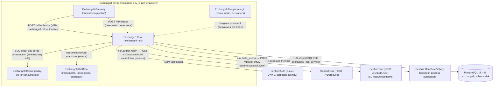

### Container view

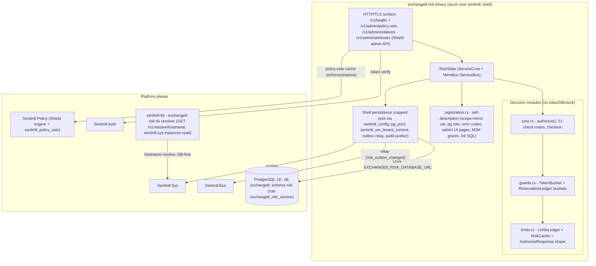

## 2. Runtime Architecture

The binary boots via `sentin8::shell::serve`:

1. `Sentin8Shell::new("exchange8:risk", "EXCHANGE8_RISK")` - registration,
   allocator, graceful drain under `make upgrade-instance`.
2. `with_state` builds `RiskState { core, membus }` - `ServiceBus::connect`
   attaches the MemBus publish handle (`risk.exposure`, pub/sub class,
   newest-wins); an empty `valkey_url` or unreachable Valkey disables
   publishing with a WARN (fail-soft; the gate still boots).
3. `with_router(extend_router)` mounts `/v1/health` (shell) and the shared
   Shield policy-admin API (`/v1/admin/policy-sets*`,
   `/v1/admin/relations*`, `/v1/admin/attributes*`) through
   `HasPolicyAdmin` - admin and request path share one policy cache.
4. `registration::print` serves `--print-registration`: the `scope-mirror`
   Shield set (action `exchange8:risk:authorize` over the live effective
   scope set, plus `sentin8:sys:admin`/org-admin/env-admin permits), the
   `exchange8_risk_service` PostgreSQL role (database `exchange8`, no
   BYPASSRLS, no cross-schema grants), error codes, the RFW admin pages
   (`limits`, `reservations`), M2M grant workloads, and the `init` SQL for
   the `risk` schema.

### Component diagram

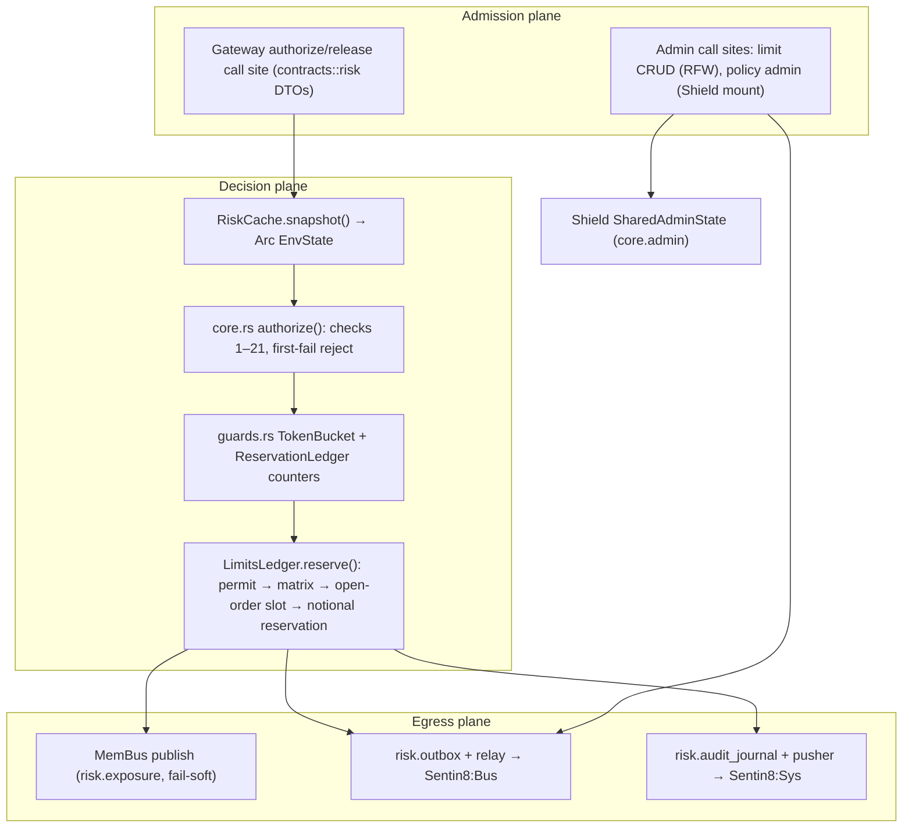

### Request lifecycle - synchronous pre-trade authorize

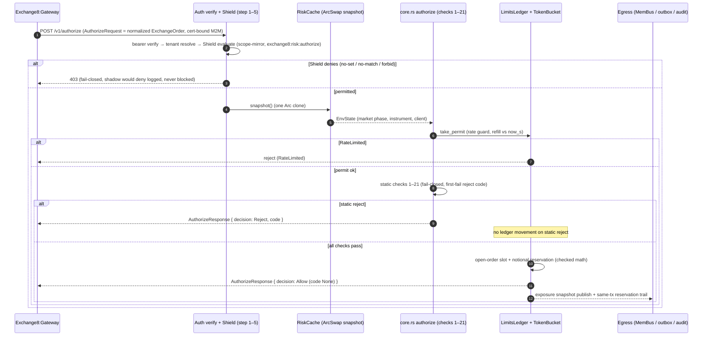

### Request lifecycle - limit update via admin

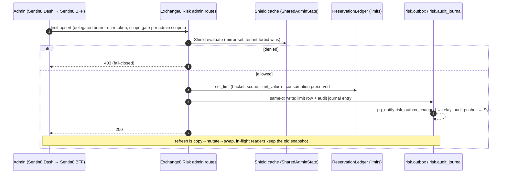

### Request lifecycle - reject path (first failure wins)

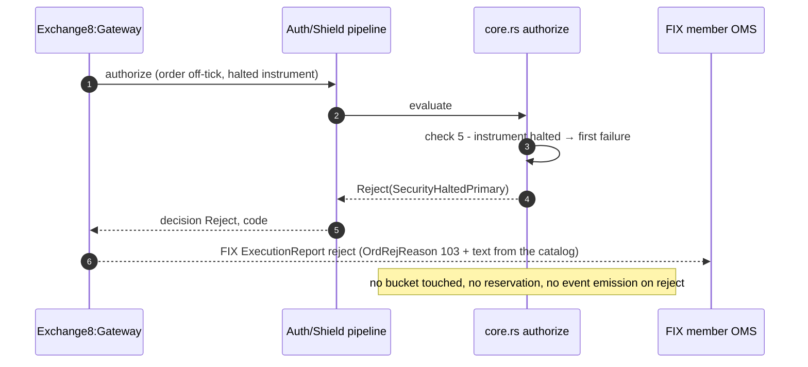

## 3. Data Model

Schema `risk` in database `exchange8` (database-per-vertical,
schema-per-service); role `exchange8_risk_service` holds exactly the grants
in `init.sql` (no BYPASSRLS, no cross-schema grants). RLS is FORCEd on
every table with `sentin8_context_initialized() AND env_id =
sentin8_current_env_id()` policies; context is set per connection via
`SELECT sentin8_set_tenant_context($1)` - always awaited, transaction-local
(`set_config(..., true)`) on the same connection as the query.

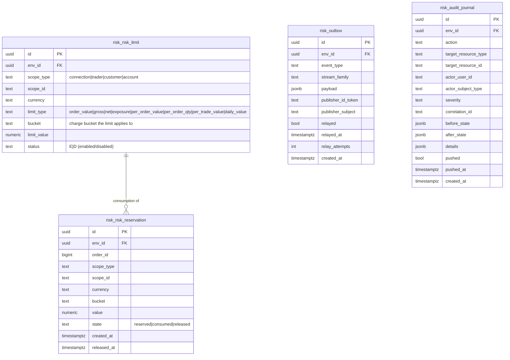

Per-table notes:

- `risk.risk_limit` - pre-trade limit definitions. `scope_type` is
  CHECK-enforced to `connection|trader|customer|account`, `limit_type` to
  the order_value / gross / net / exposure / per-order / per-trade / daily
  vocabulary; `status` is `E`/`D`. Indexed on `env_id` and
  `(env_id, scope_type, scope_id)`. Env-scoped (RLS on `env_id`); no org
  column; no secret-bearing columns.
- `risk.risk_reservation` - the persistent audit/rebuild trail of bucket
  consumption: one row per reservation (`order_id`, bucket, `value`), state
  CHECK-enforced to `reserved | consumed | released` with transitions
  stamped (`created_at`, `released_at`). Indexed per env+order and per
  env+scope+state. The in-memory ledger is authoritative per request; this
  table is the day-so-far reconstruction source and the audit trail.
- `risk.outbox` - the local outbox (platform `sentin8_outbox` shape): rows
  inserted in the same transaction as the domain change (`event_type`,
  `stream_family`, `payload`), `relayed`/`relayed_at`/`relay_attempts`
  maintained by the shell relay, partial index on unrelayed rows, and the
  `outbox_notify_trigger` firing `pg_notify('risk_outbox_changed')` for
  relay wake-up.
- `risk.audit_journal` - the local audit journal (platform `sentin8_audit`
  shape): admin/domain actions with before/after states, actor/subject/
  severity/correlation; `pushed`/`pushed_at` track delivery to Sys; partial
  index on unpushed rows.
- In-memory only: the `EnvState` snapshot (instruments, clients, market
  phase), the `LimitsLedger` per-connection counters, and the token
  buckets. Reference data (instruments, tick regimes) belongs to
  Exchange8:RefData's tables - this schema holds no copy of it.

### Reservation lifecycle

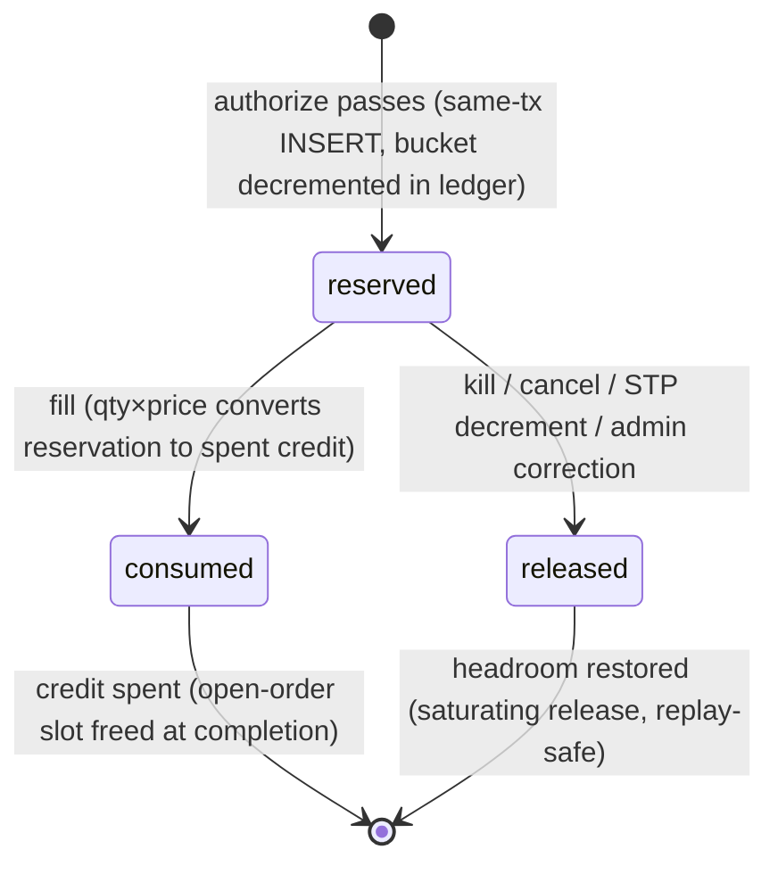

## 4. API Surface

| Audience | Surface | Gate | Notes |
|---|---|---|---|
| Upstream services (M2M) | `POST /v1/authorize` | bearer verify → tenant resolve → Shield (`exchange8:risk:authorize`; also `exchange8:risk:read`,`exchange8:risk:write` grants, `sentin8:sys:admin`, sys org/env admins via the mirror) | request `AuthorizeRequest` (normalized order), response `AuthorizeResponse { decision, code }` |
| Upstream services (M2M) | `POST /v1/release` | same Shield action (`exchange8:risk:authorize`) | internal (Gateway/ME event consumers release automatically; endpoint reserved for admin corrections) |
| Admin / Shield | `GET/PUT/DELETE /v1/admin/policy-sets{,/{name},/{name}/test}`, `POST /v1/admin/policy-sets/{enforce,shadow,disable}`, `GET/PUT/DELETE /v1/admin/relations{,/check}`, `GET/PUT/DELETE /v1/admin/attributes` | `exchange8:risk:policy:read` / `exchange8:risk:policy:write` (scope mirror also covers `sentin8:sys:admin`, sys org/env admins) | shared Shield admin API mount |
| Admin (declared) | `GET /v1/admin/ui/limits` + `/v1/admin/limits`; `GET /v1/admin/ui/reservations` + `/v1/admin/reservations` | role `exchange8:risk:admin` (admin scopes: `exchange8:risk:read`, `exchange8:risk:write`, `exchange8:risk:policy:{read,write}`) | RFW pages `limits` (icon `0xe06d`), `reservations` (icon `0xe88f`) |
| Health | `GET /v1/health` | unauthenticated (shell) | liveness for Sentin8:Captain |
| Out | Bus `POST /v1/produce` | M2M `sentin8:bus:produce` | workloads `exchange8:risk`/`risk`, plus `sentin8:stat:measure` |
| Out | Sys `POST /v1/audit` | M2M `sentin8:sys:audit:write` | workload `risk-audit` |
| MemBus | `risk.exposure` publication | in-process (workload identity, Valkey) | pub/sub class, newest-wins per env |
| TLS | `GET /v1/resolve/hostname` (Sys owner API) | M2M `sentin8:sys:instances:read` | workload `exchange8-risk-tls` (database-free resolve) |

Emitted events ride the `exchange8:{service}:{resource}:{operation}`
vocabulary (per-change `event_type` mapping into `risk.outbox` is the open
writer surface): limit-definition and reservation changes
(`exchange8:risk:limit:*` / `exchange8:risk:reservation:*`), and the
MemBus `risk.exposure` exposure snapshots. Inbound events this service
consumes (cache refresh projection): instrument state and reference-data
updates (`sentin8:refdata:security:updated` family), customer/connection
state, market status (`sentin8`/exchange market families), limit
definitions, and Shield policy-set updates via the shared policy consumer.
Events use colons only - never dots.

### Multi-party: gateway → risk → me

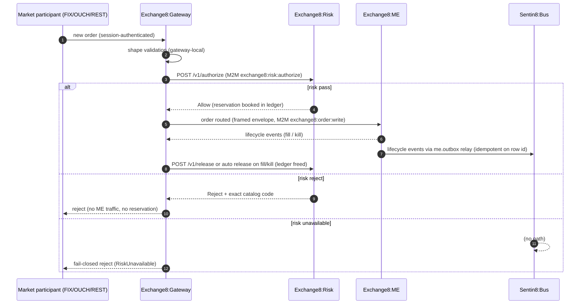

### Event flow: outbox → Bus → trigger

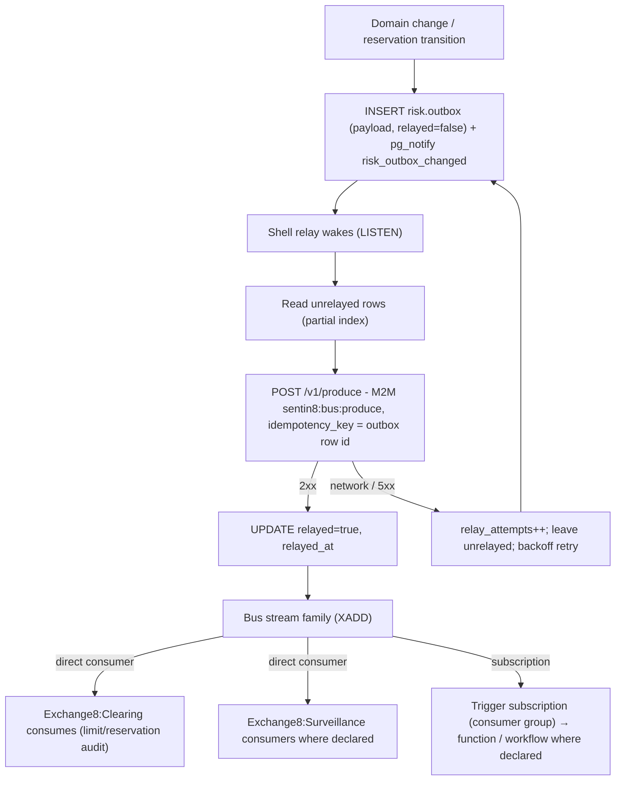

## 5. Cross-Cutting Concerns

- **Authentication.** Sentin8:Auth is the only issuer. The Gateway and the
  admin surface present cert-bound tokens; the 8-step pipeline applies
  (bearer verify → tenant resolve → feature gate → Shield authorize →
  RLS context → execute → audit); requests that cannot resolve a tenant
  context are rejected, never defaulted.
- **RLS context.** Every tenant-table access sets context on the *same*
  connection: `SELECT sentin8_set_tenant_context($1)` awaited,
  transaction-local; explicit `env_id` WHERE clauses remain
  defense-in-depth on top of FORCE RLS. The integration matrix (§9)
  proves silent zero-row reads without context, insert rejection via
  WITH CHECK, own-env visibility, and cross-env invisibility.
- **Shield authorization.** Step 5 is the only gate. The seeded
  `scope-mirror` set (declared in `registration.rs` as
  `SCOPE_MIRROR_POLICIES`, asserted by tests) is action-granular over the
  live effective scope set for `exchange8:risk:authorize`; enforce mode
  decides, shadow logs would-deny without blocking; tenant-authored forbid
  beats the platform mirror; M2M parity holds (`token_tp` never bypasses);
  no-set / no-match deny (fail-closed).
- **Idempotency & exactly-once.** Bus delivery is at-least-once by stream
  semantics; the outbox relay's `idempotency_key = risk.outbox.id` makes
  produce effectively-once per domain event. Ledger releases are
  saturating, so replayed lifecycle events (double release of the same
  order) cannot under-consume or over-grow headroom.
- **Rate limiting / bot protection.** The service *is* the rate-limiting
  tier for order flow: per-connection token buckets (burst + sustained)
  fail closed (`RateLimited`); the exchange-core's own surfaces rely on
  platform-level protections (Shield + BFF posture).
- **Audit journaling.** Domain/admin changes ride `risk.audit_journal`
  (same transaction where applicable) with actor/subject/severity/
  correlation; the shell pusher forwards unpushed rows to
  Sys `POST /v1/audit` (workload `risk-audit`, scope
  `sentin8:sys:audit:write`); a Sys outage only delays delivery, never
  loses records.
- **Drain.** `sentin8::shell` graceful drain integrates with
  `make upgrade-instance`: the replacement instance reaches `Active`
  before the old drains in-flight authorize calls and flushes outstanding
  outbox/journal rows - a synchronous gate must never truncate decisions
  mid-flight.
- **TLS posture.** In-process TLS via `sentin8-tls` (post-quantum
  X25519MLKEM768 / ML-DSA-65); the DB-free resolver workload
  `exchange8-risk-tls` resolves hostnames through the Sys owner API
  (`GET /v1/resolve/hostname`, scope `sentin8:sys:instances:read`) - no
  platform-database DSN for resolution, no BYPASSRLS anywhere in the grant
  set.

## 6. Failure Modes & Recovery

**Fail-closed posture.** The authorization gate fails closed on every
condition that could hide lost state: unknown connection, unknown
instrument, unconfigured or exhausted bucket, refused context, stale
cache beyond the acceptable lag, and service unavailability itself - the
Gateway's behavior when this service is unreachable is a reject
(`RiskUnavailable`), never a bypass. A per-connection risk bypass flag
exists in the gateway contract as an explicit platform-admin lever, default
off, exercised only by an explicit operations decision.

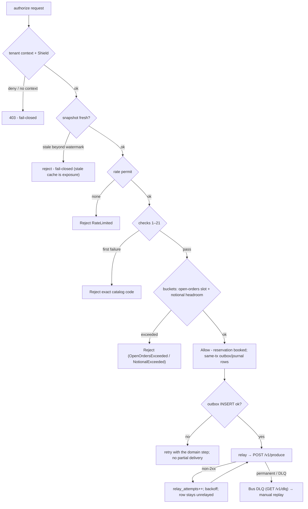

- **Risk instance down.** The gate is synchronous: no instance, no
  authorization, no order. Callers reject with `RiskUnavailable` - the
  multi-instance deployment means any replica can serve (state rides the
  snapshot + events; start-of-day load is authoritative), so a single
  replica loss is absorbed by the fleet, not by callers.
- **Cache / event lag.** The snapshot is generation-aware; beyond the
  max-lag watermark the service refuses (fail-closed) rather than authorize
  against stale instrument or limit state. MemBus publish is fail-soft
  (exposure publication degrades with a WARN; the gate itself does not).
- **DB unavailable at SOD load.** The service refuses to become `Active`
  (Captain health gate): authorizing against an empty snapshot would be a
  silent fail-open.
- **Outbox relay outage.** `risk.outbox` rows accumulate unrelayed
  (`relay_attempts` grows); the partial index replays them in `created_at`
  order when the Bus recovers; `idempotency_key = row id` makes replay
  safe; failed deliveries land in the DLQ for manual replay - never
  silently dropped.
- **Sys audit outage.** `risk.audit_journal` rows stay unpushed; the
  pusher retries - audit is delayed, never lost.

Recovery sequence:

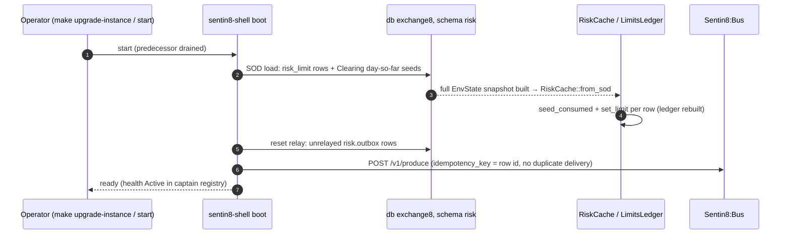

## 7. Concurrency & Performance Model

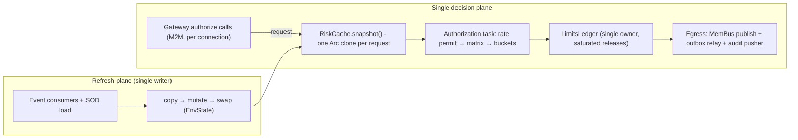

- **Task layout.** The decision plane is a single-owner task over the
  ledger plus the shell's standard workers (outbox relay, audit pusher,
  MemBus handle); refresh is the sole mutation path for the snapshot.
- **Hot path budget.** Target P99 < 5 ms for `POST /v1/authorize`; the
  in-process work is one `Arc` clone, one token-bucket refill
  (arithmetic vs injected clock), and a fixed sequence of integer/fixed-
  point comparisons - no I/O, no allocation in the check pipeline.
- **Locking strategy.** The snapshot is immutable-after-swap (readers clone
  the `Arc`); the ledger is single-owner; no reader-writer or spin locks on
  the authorize path.
- **Notional math.** Fixed-point price/qty with checked multiplication and
  saturating ledger arithmetic (`u128` notional); overflow rejects
  `Internal` instead of wrapping.
- **Backpressure.** Egress (MemBus/outbox/audit) is asynchronous and
  retried; the synchronous gate never queues behind egress - a decision is
  returned before the exposure publication and journal pushes complete.

## 8. Invariants, Insecure-Defaults Rejected, Unsafe Rationale

Always-true conditions:

1. The same order evaluated against the same snapshot yields the same
   decision and the same reject code (pure function, catalog-exact codes).
2. No order is authorized without (a) a Shield permit for
   `exchange8:risk:authorize` and (b) a rate permit, an open-order slot,
   and notional headroom - every bucket fails closed.
3. Unknown instrument, unknown connection, unconfigured bucket, stale
   cache → reject, never default-allow; the fail-open "unchecked flow when
   no limit configured" posture is rejected by construction.
4. Released or spent notional never exceeds consumed headroom
   (saturating arithmetic); reservation state transitions are
   `reserved → consumed | released` only, never re-entering `reserved`.
5. Outbox rows are inserted in the same transaction as the domain change;
   delivery is idempotent per row id; audit rows are delivered at least
   once to Sys.
6. No tenant-table access without tenant context on the same connection;
   RLS FORCEd on all four tables; role `exchange8_risk_service` carries no
   BYPASSRLS, no cross-database grants, no cross-schema grants.
7. Shield's step-5 decision is the only authorization gate: the seeded
   scope mirror covers `exchange8:risk:authorize`; shadow never blocks;
   forbid beats permit; M2M tokens never bypass policy.
8. Reject codes are exactly the catalog codes
   (FIX 103/58-text-compat); no handler invents a code.

Insecure-defaults rejected: no plaintext provider/credential material in
`risk.*` tables (verification material lives in the identity plane; the
outbox carries publisher references only); no `danger_accept_invalid_certs`-style
TLS shortcuts (Sentin8:Acme root via OS trust store); no BYPASSRLS or
superuser runtime role; no fail-open defaults for unknown risk scopes; no
unbounded egress buffers without retry semantics.

Unsafe rationale: the decision modules contain no `unsafe`; all arithmetic
is checked/saturating fixed-point and the snapshot swap is expressed with
safe `Arc` semantics, so memory safety and determinism are enforced by the
type system.

## 9. Testing Strategy

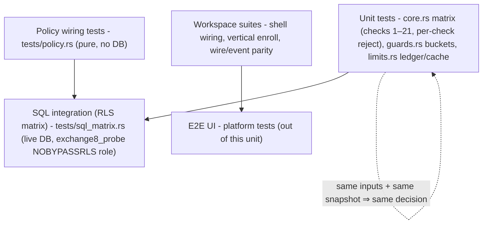

- **Pure matrix unit tests** (in-module, `core.rs`, `guards.rs`,
  `limits.rs`): one test per check (suspended, unresolved/mismatched
  instrument, disabled customer, book token, multi-book strategy, halted,
  holiday, market phases, currency, ord type/TIF, tick, odd/mixed lot,
  iceberg floor, max size/price, LIS, shortable cells, FOK×STP, peg
  variants, post-only, cross/bypass, capacity, entitlement, price
  protection, notional exceed/exact, rate); token-bucket burst/rate
  properties (capacity clamp, deterministic clock); reserve/release
  round-trips, exact-limit fits, slot counts, fill conversion, at-limit
  arithmetic, saturation (double release), unknown-scope fail-closed,
  seed-rebuild, limit refresh preserving consumption; snapshot swap
  atomicity and reader isolation.
- **Policy wiring tests** (`tests/policy.rs`, no DB): the *actual* seeded
  `SCOPE_MIRROR_POLICIES` text loads the engine - no-set deny, enforced
  no-match deny, shadow never blocks (would-deny reported), mirror permits
  its own grants, M2M parity, platform-admin scopes pass, forbid-beats-
  permit, role-keyed tenant sets decide, and the enroll-time dry-run gate
  accepts the declared set.
- **SQL integration matrix** (`tests/sql_matrix.rs`, live PostgreSQL 18 as
  the `exchange8_probe` NOBYPASSRLS role): every table declared in this
  service's `init.sql` exists with FORCE RLS + policies; zero rows without
  context; insert without context rejected (savepoint-guarded); own-env
  probe row visible exactly once; cross-env zero rows - one rolled-back
  transaction (zero residue; skips silently offline).
- **Deliberately not tested here:** platform token-verification internals,
  MemBus/Bus/Sys wire formats, RFW rendering, and Flutter surfaces -
  platform-owned suites (the platform testing strategy doc); E2E UI lives
  at platform level.

## 10. Open Questions

- Router mounting of the decision and admin surfaces: `POST /v1/authorize`,
  `POST /v1/release`, and the declared RFW data endpoints
  (`/v1/admin/limits`, `/v1/admin/reservations`) are defined at enrollment
  with shapes implemented; the handler wiring into the axum router is the
  open integration point.
- The SOD projection and event-consumer wiring (row → `EnvState`
  projection, customer/limit/instrument refresh families, the Clearing
  day-so-far seed query) - the snapshot contract is complete; the loaders
  are the remaining work.
- The concrete per-change `event_type` strings written into `risk.outbox`
  and the durable write path mirroring the in-memory ledger journal into
  `risk.risk_reservation` rows (schema is in place; the writer is open).
- Rate-guard configuration defaults per connection class (capacity and
  sustained rate are the mechanism's inputs; venue-wide defaults are a
  business configuration decision).
- The replace-validation mount (cancel/replace inheriting checks 1–4 plus
  re-price/re-notional) at the same authorize surface.
- Synchronous pre-trade options checks consulting the Exchange8:Margin margin
  requirement (derivatives extension: the cross-service hook and caching
  of the consulted requirement are future design).

---

**Design attribution:** exchange8:risk and its underlying concepts were designed by Hamid Jahanzad <Hamid@Jahanzad.com>.

