# DESIGN.md: Exchange8:Settlement - Detailed Design Document

## 1. Scope & Context

**Owns**

- Novation records (`settlement.novation`) - per-trade CCP substitution,
  idempotent per `(env_id, trade_id)`, with a dense `novation_seq`.
- CCP facility routing (`settlement.ccp_facility`, `settlement.ccp_facility_file`,
  `settlement.security_to_ccp`, `settlement.clearing`) - endpoint configuration,
  per-file-family credential refs and schedules, security→CCP mapping,
  participant clearing assignment.
- Custody (`settlement.asset`, `settlement.custody_account`,
  `settlement.custody_transaction`) - crypto asset master, per-env custody
  addresses, on-chain transaction ledger with the
  `pending → signed → broadcast → confirmed / failed` state machine.
- Collateral (`settlement.collateral`) - balances, haircuts, concentration
  buckets, rehypothecation flag.
- Give-up allocations (`settlement.giveup`) and block/EFP/EFR trade reports
  (`settlement.block_trade`).
- The FX conversion core and options exercise/assignment/expiry pure cores
  (their persistent position/contract tables belong to Exchange8:RefData
  (`exchange8.fx_pair`, `exchange8.fx_tenor`) and the contract master).
- CCP EOD file exports (CDS, SIS, Fortis) and the settlement-netting CSV
  (reconciliation backstop), scheduled by Sentin8:Cron.
- Audit journaling and the outbox producer for all of the above.

**Does NOT own (delegates)**

- The event-sourced trade/position ledger, statements, novation of internal
  records - Exchange8:Clearing.
- Matching and margin calculation - Exchange8:ME / Exchange8:Margin.
- Regulatory reporting - Exchange8:Regulatory.
- Fiat currency movement - Bank8:Ledger postings (this service computes the
  leg shapes; Ledger executes them).
- Contract/position master tables - Exchange8:RefData / contract-ledger owners.
- Cron triggers for expiry and EOD jobs - Sentin8:Cron.

### System context

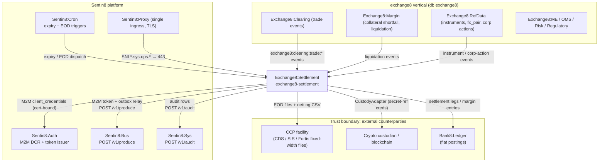

### Container view

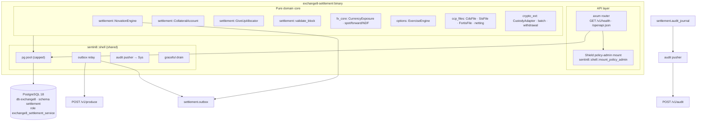

## 2. Runtime Architecture

The binary (`src/main.rs`) is a Sentin8 Shell assembly: `Sentin8Shell::new(
"exchange8:settlement", "EXCHANGE8_SETTLEMENT")` with registration printing,
`with_simple_state()`, and `with_router(extend_router)` that mounts the
covering all in-process tokio workers. Boot, DB pool, drain, relay and audit
pusher are shell-provided.

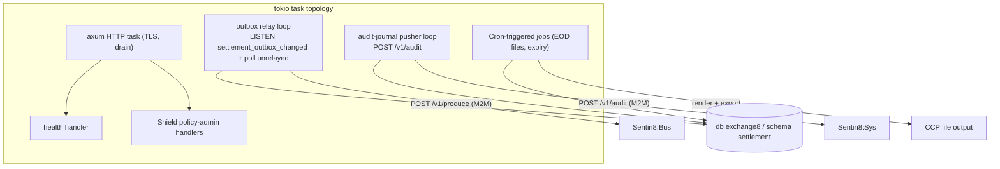

### Request family: novation

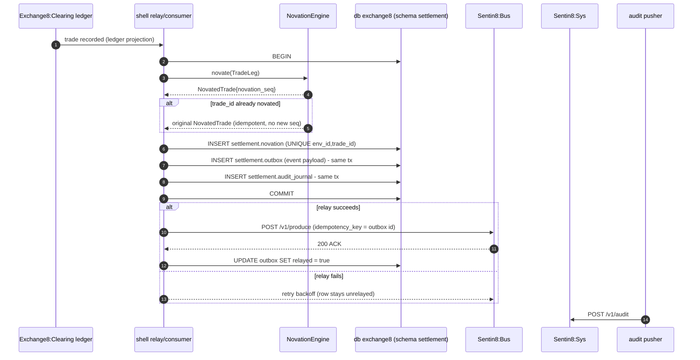

### Request family: custody movement

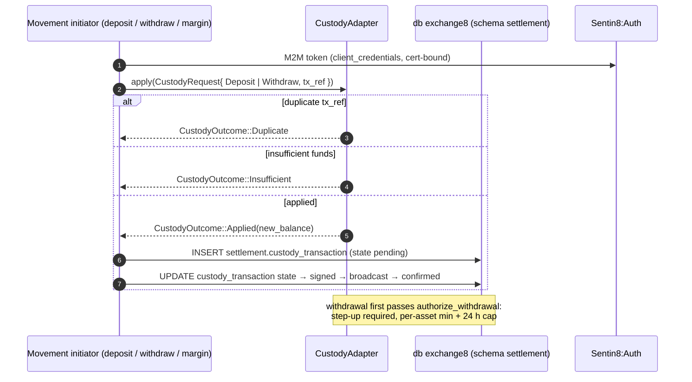

### Request family: give-up allocation

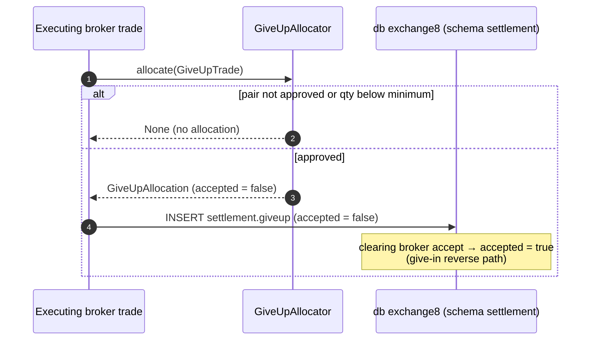

### Request family: block trade report

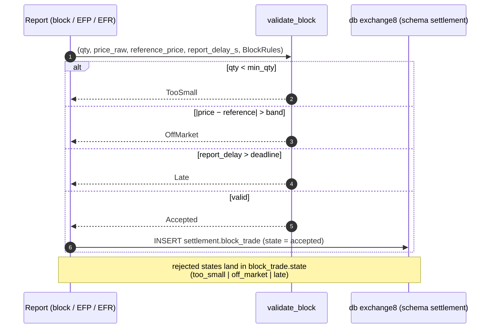

### Request family: FX conversion (spot / forward / NDF)

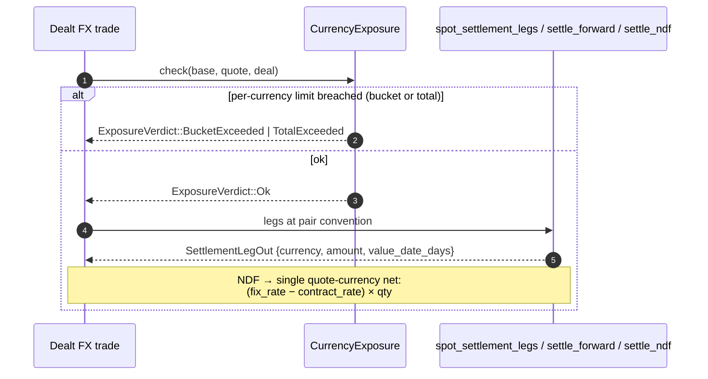

### Request family: options exercise / expiry

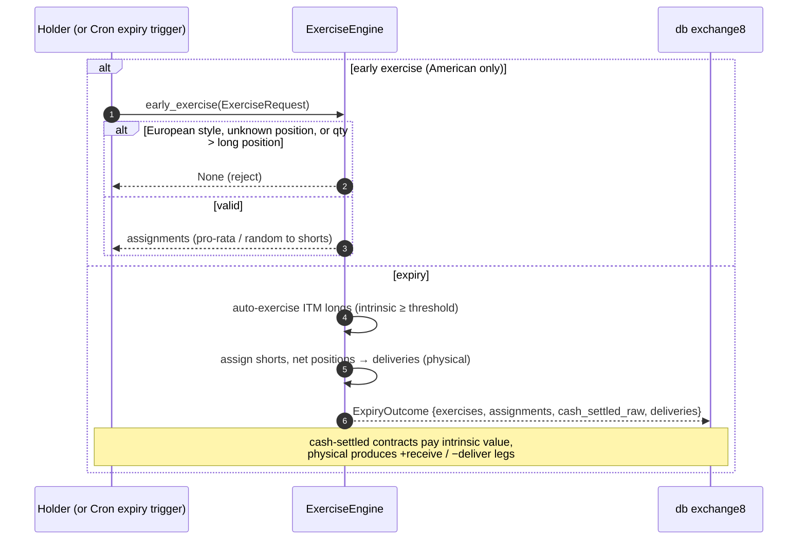

### Request family: CCP file ingest/export

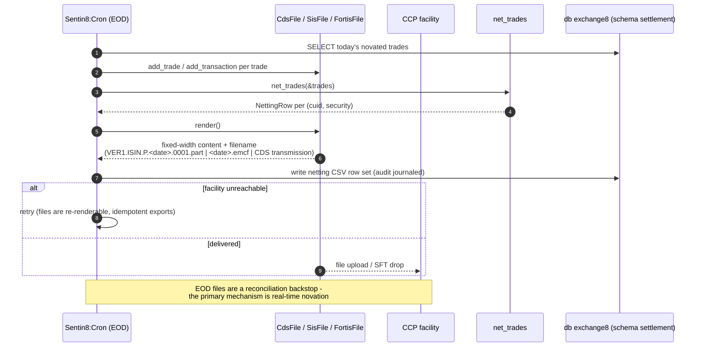

## 3. Data Model

Schema-per-service: database `exchange8`, schema `settlement`, role
`exchange8_settlement_service`, DSN env `EXCHANGE8_SETTLEMENT_DATABASE_URL`.
RLS (`ENABLE` + `FORCE`) on every table; policies require
`sentin8_context_initialized()` and `env_id = sentin8_current_env_id()`
(set via `SELECT sentin8_set_tenant_context(...)` on the same connection).

```mermaid
erDiagram
    CLEARING ||--o{ CCP_FACILITY : "ccp_facility_id"
    CCP_FACILITY ||--o{ CCP_FACILITY_FILE : "export credentials"
    CCP_FACILITY ||--o{ SECURITY_TO_CCP : "routes securities"
    ASSET ||--o{ CUSTODY_ACCOUNT : "asset_id"
    CUSTODY_ACCOUNT ||--o{ CUSTODY_TRANSACTION : "on-chain ledger"

    CLEARING {
        uuid id PK
        uuid env_id
        text market_code
        text connection_id
        text clearing_id
        uuid ccp_facility_id
        text status "E | D"
    }
    CCP_FACILITY {
        uuid id PK
        uuid env_id
        text name
        text api_url
    }
    CCP_FACILITY_FILE {
        uuid id PK
        uuid env_id
        uuid ccp_facility_id FK
        text file_type "CDS | SIS | Fortis family"
        text creds_secret_ref "secret ref only"
        text schedule
    }
    SECURITY_TO_CCP {
        uuid id PK
        uuid env_id
        uuid security_id
        uuid ccp_facility_id FK
    }
    NOVATION {
        uuid id PK
        uuid env_id
        bigint trade_id "UNIQUE (env_id, trade_id)"
        bigint novation_seq "dense per session"
        timestamptz novated_at
    }
    ASSET {
        uuid id PK
        uuid env_id
        text symbol
        text chain "bitcoin/ethereum/solana/…"
        text contract_address "NULL for native"
        integer decimals
    }
    CUSTODY_ACCOUNT {
        uuid id PK
        uuid env_id
        uuid asset_id FK
        text address
        numeric_24_8 balance
        text creds_secret_ref "never private keys"
    }
    CUSTODY_TRANSACTION {
        uuid id PK
        uuid env_id
        uuid custody_account_id FK
        text txid
        text direction "deposit | withdraw"
        numeric_24_8 amount
        text state "pending|signed|broadcast|confirmed|failed"
    }
    COLLATERAL {
        uuid id PK
        uuid env_id
        text account_id
        text asset_kind "cash | security | crypto"
        text asset_ref
        numeric_20_8 market_value
        integer haircut_bps
        text bucket
        integer concentration_bps
        boolean rehypothecatable
    }
    GIVEUP {
        uuid id PK
        uuid env_id
        bigint trade_id
        text executing_broker
        text clearing_broker
        uuid instrument_id
        numeric_18_8 qty
        numeric_18_8 price
        boolean accepted
    }
    BLOCK_TRADE {
        uuid id PK
        uuid env_id
        text block_type "block | efp | efr"
        uuid instrument_id
        numeric_18_8 qty
        numeric_18_8 price
        text buyer
        text seller
        text reported_by
        integer report_delay_s
        text state "accepted|rejected|too_small|off_market|late"
    }
    OUTBOX {
        uuid id PK
        uuid env_id
        text event_type
        text stream_family
        jsonb payload
        boolean relayed
        int relay_attempts
    }
    AUDIT_JOURNAL {
        uuid id PK
        uuid env_id
        text action
        jsonb after_state
        boolean pushed
    }
```

Per-table notes:

| Table | Visibility | Notes |
|---|---|---|
| `settlement.clearing` | env-scoped, RLS FORCE | participant clearing assignment, `status ∈ {E, D}`; UNIQUE `(env_id, market_code, connection_id, clearing_id)` |
| `settlement.ccp_facility` | env-scoped | CCP endpoint config; credentials live on the child `*_file` rows as secret refs |
| `settlement.ccp_facility_file` | env-scoped | `file_type` = CDS / SIS / Fortis family; `schedule` feeds Sentin8:Cron |
| `settlement.security_to_ccp` | env-scoped | which CCP clears which security |
| `settlement.novation` | env-scoped | idempotency contract: UNIQUE `(env_id, trade_id)` |
| `settlement.asset` | env-scoped | crypto asset master (chain, contract address, decimals) |
| `settlement.custody_account` | env-scoped | address + balance; `creds_secret_ref` only |
| `settlement.custody_transaction` | env-scoped | on-chain ledger; index `(env_id, state)` for stuck-tx sweep |
| `settlement.collateral` | env-scoped | index `(env_id, account_id)` |
| `settlement.giveup` | env-scoped | allocation awaiting clearing-broker acceptance |
| `settlement.block_trade` | env-scoped | reported negotiated trades with validation state |
| `settlement.outbox` | env-scoped | DBX §6.7 producer table; partial index on `relayed = false` |
| `settlement.audit_journal` | env-scoped | DBX §6.8 journal; partial index on `pushed = false` |

### Lifecycles

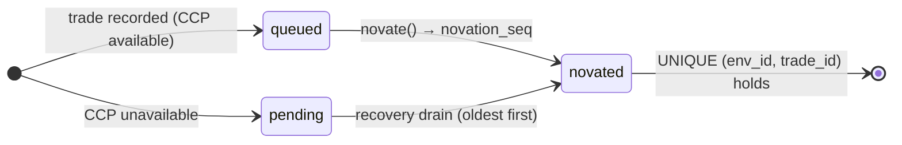

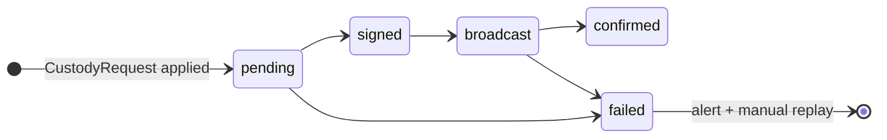

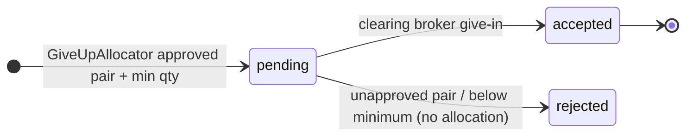

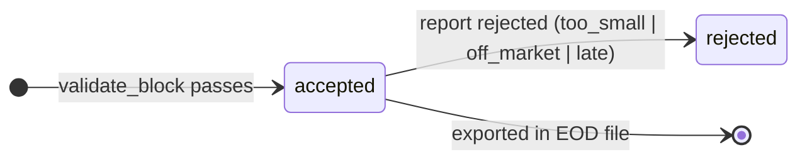

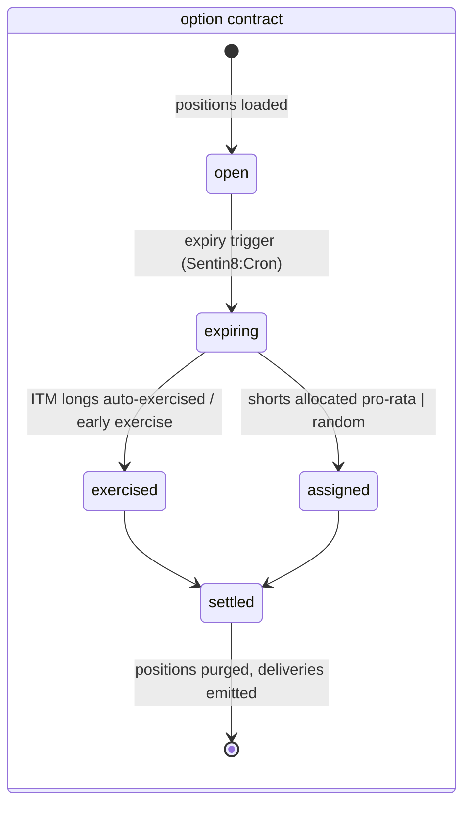

## 4. API Surface

Grouped by audience; the authorization gate for all handler surfaces is the
8-step platform pipeline - bearer verify → tenant resolve → feature gate →
**Shield (`exchange8:settlement-policy` scope-mirror, enforced)** → RLS
context → execute → audit. The HTTP router mounts health, `/openapi.json`
and the Shield policy-admin API only; domain triggers arrive via events and
Cron.

| Audience | Surface | Gate | Emits |
|---|---|---|---|
| System (M2M) | Novation of trade events (`exchange8:settlement:run` action) | scope-mirror permit / `sentin8:sys` admin scopes | `exchange8:clearing:trade:novated` (vertical design §4.1) |
| System (M2M) | Custody movements (`exchange8:custody:write`) | step-up gate for withdrawals + scope-mirror | outbox event (see §10) |
| System (M2M) | Give-up allocation / block validation (`exchange8:giveup:write`, `exchange8:blocktrade:write`) | scope-mirror permit | outbox event (see §10) |
| System (M2M) | FX legs + exposure verdicts (`exchange8:settlement:write`) | scope-mirror permit | outbox event (see §10) |
| System (M2M) | Exercise / assignment / expiry (`exchange8:novation:write`) | scope-mirror permit | `exchange8:clearing:exercise:requested`, `exchange8:clearing:assignment:allocated`, `exchange8:clearing:expiry:settled` |
| Admin (RFW) | `/v1/admin/ui/novation` + `POST /v1/admin/novation` (page `Novation`) | `exchange8:novation:read` / `:write` | - |
| Admin (RFW) | `/v1/admin/ui/custody` + `POST /v1/admin/custody` (page `Custody`) | `exchange8:custody:read` / `:write` | - |
| Admin (RFW) | `/v1/admin/ui/collateral` + `POST /v1/admin/collateral` | `exchange8:collateral:read` / `:write` | - |
| Admin (RFW) | `/v1/admin/ui/blocks` + `POST /v1/admin/blocks` (page `Block Trades`) | `exchange8:blocktrade:read` / `:write` | - |
| Admin | Shield policy-admin API (`exchange8:settlement:policy:read` / `:write`) | role `exchange8:settlement:admin` | `sentin8:sys:policy` family |
| Ops | `GET /v1/health`, `/openapi.json` | unauthenticated (health), none | - |

Declared error codes: `exchange8_novation_failed` (500),
`exchange8_block_trade_rejected` (422).

**Multi-party settlement chain (outbox → Bus → trigger):**

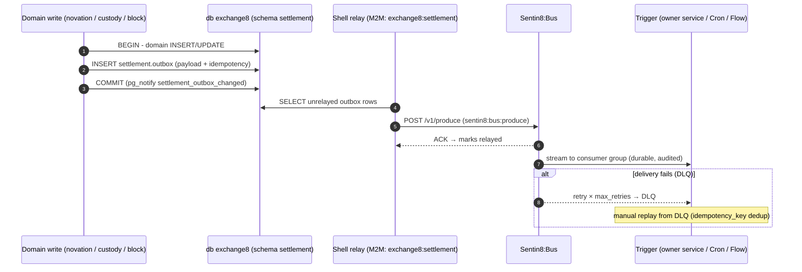

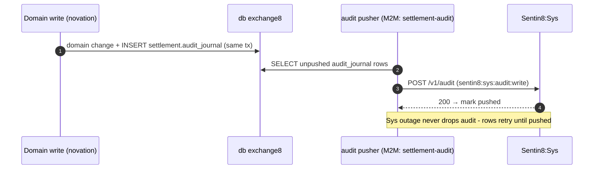

## 5. Cross-Cutting Concerns

- **Authentication** - Sentin8:Auth is the only issuer. User access uses
  user tokens; system-driven novation/collateral/expiry use cert-bound M2M
  `client_credentials` tokens (DCR-registered per workload: `exchange8:settlement`,
  `exchange8:settlement-policy`, `settlement-audit`,
  `exchange8-settlement-tls`). DCR is fail-closed: only workloads present in
  `sentin8_service_workloads` (seeded by `sentin8-cli vertical enroll`) can
  register.
- **Authorization** - the scope-mirror policy set (`origin='platform'`,
  `mode='enforced'`) permits each declared action for callers holding the
  matching scope or the platform-admin scopes (`sentin8:sys:admin`,
  `sentin8:sys:org:admin`, `sentin8:sys:env:admin`). No-set → deny
  (fail-closed); shadow is an emergency rollback lever only; `token_tp`
  never bypasses policy.
- **Tenant resolution + RLS** - every table has `ENABLE` + `FORCE ROW LEVEL
  SECURITY` with policies `sentin8_context_initialized() AND env_id =
  sentin8_current_env_id()`; the context is set with
  `SELECT sentin8_set_tenant_context(...)` (`set_config(..., true)`,
  transaction-local) on the **same connection** as the data statements - the
  async helper must be awaited or RLS silently sees no context. Explicit
  `env_id = $N` predicates remain the primary defense; RLS is the backstop.
  Role `exchange8_settlement_service` carries no `BYPASSRLS`.
- **Idempotency** - novation: UNIQUE `(env_id, trade_id)` + engine re-entry;
  custody: `tx_ref` dedup → `CustodyOutcome::Duplicate`; batch relay:
  `idempotency_key` = outbox row id at Bus `POST /v1/produce`; settlement
  batches: net-then-check atomically.
- **Rate limiting / bot protection** - ingress tier is the platform edge
  (Sentin8:Proxy); service-local rate policies ride the Shield policy
  surface (per-tenant sets), not bespoke code.
- **Audit journaling** - every state transition writes
  `settlement.audit_journal` (same transaction where possible); the pusher
  drains to `POST /v1/audit`; Sys outage retries without loss.
- **Drain** - `sentin8::shell` graceful drain on upgrade: HTTP stops
  accepting, in-flight requests finish, the relay/journal pusher checkpoint
  unrelayed/unpushed rows, and Sentin8:Captain's `upgrade-instance` swaps
  the binary (rolling, zero-downtime).
- **TLS** - terminated in-process by `sentin8-tls` behind Sentin8:Proxy
  (single ingress, SNI `exchange8-settlement.sys.ops…`); the
  `exchange8-settlement-tls` workload resolves host context DB-free via
  `GET /v1/resolve/hostname` (`sentin8:sys:instances:read`). Post-quantum
  only; no classical fallback.
  pusher and Cron-triggered workers alike.

## 6. Failure Modes & Recovery

### Instruction retry after a settlement-outcome failure

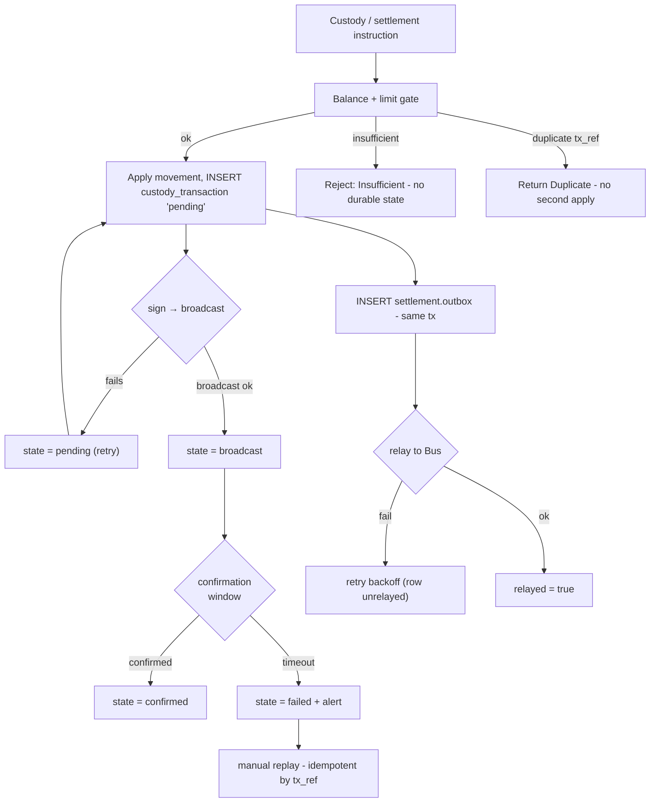

### Relay / journal retry and DLQ

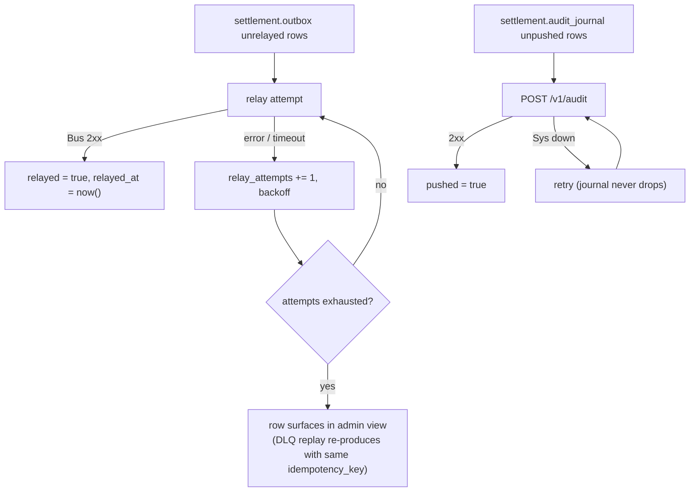

Recovery sequence (crash between write and relay):

```mermaid
sequenceDiagram
    autonumber
    participant W as Domain write
    participant DB as db exchange8
    participant R as Relay (next boot / retry loop)

    W->>DB: BEGIN - novation + outbox + audit rows
    W->>W: CRASH before relay (tx COMMITTED)
    Note over W,R: novation UNIQUE holds, outbox unrelayed, audit unpushed
    R->>DB: boot: SELECT unrelayed outbox
    R->>DB: POST /v1/produce (idempotency_key = row id)
    Note over R: Bus dedupes → no duplicate consumer work
    R->>DB: relayed = true
    R->>DB: audit pusher drains unpushed journal rows
```

| Failure | Behavior |
|---|---|
| CCP unreachable | novation rows persist; trades queue pending in the engine; EOD files re-render as the reconciliation backstop |
| Custody tx stuck | state machine sweep on `(env_id, state)` index → `failed` + alert |
| Collateral shortfall | valuation shortfall surfaced to Exchange8:Margin via events |
| Give-up rejected | no allocation; trade stays with the executing broker |
| Block report invalid | `state ∈ {too_small, off_market, late}` persisted, error `exchange8_block_trade_rejected` |
| Relay outage | outbox rows retry; `idempotency_key` makes replay safe |
| Sys outage | audit journal retries, never drops |

## 7. Concurrency & Performance Model

```mermaid
graph LR
    subgraph proc["process: exchange8-settlement"]
        AX["axum acceptor tasks<br/>(TLS, per-connection)"] --> HC["handlers"]
        RL["relay task<br/>(LISTEN + poll)"] -->|"drains"| OX[("settlement.outbox")]
        AL["audit pusher task"] -->|"drains"| AJ[("settlement.audit_journal")]
        CRJ["cron-triggered jobs<br/>(EOD render, expiry)"] -->|"spawn per trigger"| JOBS["bounded job set"]
        ENG["pure cores (no locks)<br/>NovationEngine · ExerciseEngine"]
    end
    POOL[("pg pool (capped, sentin8_config::pg_pool)")] --> PG[("PostgreSQL 18")]
    HC --> POOL
    RL --> POOL
    AL --> POOL
    JOBS --> POOL
    ENG --- POOL
    RL -->|"M2M POST /v1/produce"| BUS[("Sentin8:Bus")]
    AL -->|"M2M POST /v1/audit"| SYS[("Sentin8:Sys")]
```

- **Task layout** - one HTTP acceptor; one relay task (LISTEN
  `settlement_outbox_changed` + periodic unrelayed poll); one audit pusher;
  Cron-triggered jobs (EOD file render, options expiry) spawn as short-lived
  tasks. No cross-task shared mutable state in the cores: engines are
  per-trigger instances fed by projections, so no mutex contention on the
  hot path.
- **Pool sizing** - the shared `sentin8_config::pg_pool::connect` caps
  connections (default 3, overridable) so ~20 services cannot exhaust
  PostgreSQL. Relay and journal use the same pool; context is set
  transaction-locally per statement set.
- **Hot paths** - novation insert (single UNIQUE-guarded row + outbox row);
  exposure check (pure in-memory bucket math); file render (pure string
  building). Cache: nothing is hot-cached beyond the policy engine set
  (Shield hot-reload consumer keeps the loaded sets fresh).
- **Backpressure** - outbox partial index bounds the relay scan; unrelayed
  rows retry with backoff so a Bus outage does not spin; the drain path
  checkpoints before shutdown.

## 8. Invariants, Insecure-Defaults Rejected, Unsafe Rationale

Invariants (always true):

1. Novation is idempotent per `(env_id, trade_id)` - a re-delivery never
   creates a second row or advances `novation_seq`.
2. A domain write and its `settlement.outbox` (and wherever possible
   `settlement.audit_journal`) row are committed in the **same**
   transaction.
3. Tenant context and data statements always run on the same connection;
   `sentin8_set_tenant_context` is awaited.
4. Custody movements dedupe on `tx_ref` before funds move; a failed
   first application still blocks a duplicate retry's second apply.
5. Settlement batches are all-or-nothing: one under-covered deliver leg
   rejects the batch; intra-batch netting never touches external funds.
6. Crypto prices/quantities are scale-pinned `(8, 8)` and equity `(4, 0)`;
   mixed-scale notionals are rejected, never approximated.
7. NDF settlement produces exactly one quote-currency amount; deliverable
   forwards produce exactly two legs at the contract rate.
8. Options physical delivery derives from the **pre-exercise** net
   position; assignments conserve the exercised quantity exactly.
9. CCP export records match the pinned per-record byte lengths (CDS r1 = 80,
   r2 = r3 = 81; EOD records end `#` + LF); netting CSV always includes a
   header row.
10. No plaintext private keys, custodian credentials or file credentials -
    only `*_secret_ref` values; no role carries `BYPASSRLS`.

Insecure defaults rejected:

- **`danger_accept_invalid_certs` / hand-rolled CA loading** - TLS is
  in-process via `sentin8-tls` (post-quantum, root CA in the OS trust
  store).
- **Direct cross-schema/table joins into other services** - cross-service
  data flows are membus/bus/owner-API per the access-order rule (this
  service declares zero cross-schema grants today).
- **Static superuser service DSN** - the service role is unprivileged,
  non-bypass, database-`exchange8`-only.
- **Plaintext wallet keys in process** - design rejects the pattern;
  adapters reference secrets.
- **Per-leg settlement fallback for crypto batches** - an atomicity
  compromise rejected in favor of all-or-nothing batches.

No `unsafe` blocks exist in this service; the unsafe-rationale section is
vacuously satisfied. Soundness-relevant safety instead rests on the
invariants above (scale pins, tx_ref dedup, same-connection context).

## 9. Testing Strategy

```mermaid
graph TD
    PYRAMID["Test pyramid - exchange8-settlement"] --> UT["Unit (pure cores)"]
    PYRAMID --> PWT["Policy wiring (tests/policy.rs)"]
    PYRAMID --> SQL["SQL matrix (tests/sql_matrix.rs, live DB)"]
    PYRAMID --> E2E["Vertical E2E (e2e-ts/, UI + BFF only)"]
    UT --> UT1["novation idempotency + pending drain"]
    UT --> UT2["collateral haircut + concentration caps"]
    UT --> UT3["give-up approved pairs / min qty"]
    UT --> UT4["block validation verdict table"]
    UT --> UT5["FX legs, exposure buckets/limits, forward/NDF"]
    UT --> UT6["custody dedup, batch atomicity, withdrawal gates"]
    UT --> UT7["options pro-rata/random assignment, ITM thresholds, physical deliveries"]
    UT --> UT8["CCP file field positions + record lengths + netting CSV"]
    PWT --> P1["no-set deny · shadow never blocks · forbid wins"]
    PWT --> P2["M2M parity · platform-admin scopes · cross-env isolation"]
    PWT --> P3["mirror covers every handler action · enroll dry-run"]
    SQL --> S1["RLS matrix: no context / own env / cross env"]
    SQL --> S2["role existence, non-bypass (DCR check)"]
    E2E --> E1["human-parity flows; no direct SQL/backend"]
```

- **Unit/property layer** - pure cores own all domain math: novation
  idempotency, pending-queue recovery order, collateral caps, give-up
  gates, block verdicts, exposure bucket/total limit precedence (strict
  `>` - at-limit is compliant), scale-pair guards, custody dedup, batch
  atomicity, withdrawal step-up/min/cap, assignment conservation, expiry
  threshold behavior, and CCP record byte-length assertions (the wire
  contract).
- **Policy layer** - proves the *real* seeded scope-mirror text evaluates
  fail-closed, respects mode and origin, isolates sets per `env_id`, keeps
  M2M parity, and dry-runs clean at enroll.
- **SQL matrix** - live PostgreSQL via the non-bypass `exchange8_probe`
  role: RLS enforcement (no context → 0 rows, own env → own rows, cross
  env → 0 rows) and the service-role catalog check. Skips silently when
  the DB is unreachable so test runs stay hermetic.
- **Deliberately not tested here** - platform TLS/RLS plumbing itself,
  Sentin8:Bus delivery guarantees, Shield engine internals: covered by the
  platform's own test strategy docs.
- **E2E** - the vertical's `e2e-ts` suite drives the real UI through BFF
  only (no direct SQL), so settlement surfaces are exercised as a human
  would.

## 10. Open Questions

- RFW admin pages (`novation`, `custody`, `collateral`, `blocks`) are
  registered but their data/UI handlers are not mounted in this binary -
  wiring the `RFC 4.15` admin surface for these resources is outstanding.
- `settlement.outbox` event emission from handlers (event types, stream
  families, trigger registrations in `vertical-registry.json`) is designed
  by the DBX pattern but not yet wired.
- The `exchange8:clearing:exercise:requested`,
  `exchange8:clearing:assignment:allocated` and
  `exchange8:clearing:expiry:settled` event flow crosses Exchange8:Clearing's
  ledger and this engine - the final producer/consumer split between the
  two services is pending the clearing integration.
- CCP transport (SFTP/HTTPS drop, per-facility schedules in
  `ccp_facility_file.schedule`) and acknowledgement/ingest handling are not
  yet implemented (the builders + netting CSV are).
- Real `CustodyAdapter` implementations (custodian API credential flows,
  chain signers) - only the in-memory reference exists.
- Corporate-action settlement flow (cash/stock delivery on corp-action
  events from Exchange8:RefData) is in scope per the vertical design but has no
  implementation here yet.
- Greeks-based margin interplay (Exchange8:Margin SPAN vs portfolio margin for
  option positions) - the collateral rows here are haircut-based; the
  margin-model handshake is a margin-design decision.

---

**Design attribution:** exchange8:settlement and its underlying concepts were designed by Hamid Jahanzad <Hamid@Jahanzad.com>.

